# mcp-notes

A personal notes system for people who live in Claude Code. One local daemon, `notesd`, holds
your notes and photos and serves them three ways: to every Claude Code session as an MCP server,
to `/n <anything>` typed from any repo, and to a dark web wall at `http://localhost:7317` with
its own chat bar.


## Contents

- [What it is](#what-it-is)
- [Why it is different](#why-it-is-different)
- [A tour of the wall](#a-tour-of-the-wall)
  - [Three views: notes, photos, everything](#three-views-notes-photos-everything)
  - [Tags](#tags)
  - [Writing a note](#writing-a-note)
  - [Adding photos](#adding-photos)
  - [The photo modal and the full-screen tab](#the-photo-modal-and-the-full-screen-tab)
- [Using it from Claude Code](#using-it-from-claude-code)
  - [Summaries and comparisons](#summaries-and-comparisons)
  - [Looking at pictures](#looking-at-pictures)
  - [Editing a note, live on the wall](#editing-a-note-live-on-the-wall)
  - [More things to ask](#more-things-to-ask)
- [The chat bar](#the-chat-bar)
- [Install and run](#install-and-run)
  - [Requirements](#requirements)
  - [Install on WSL](#install-on-wsl)
  - [Keep WSL running from Windows](#keep-wsl-running-from-windows)
  - [Run it by hand](#run-it-by-hand)
  - [Tests](#tests)
  - [Configuration](#configuration)
- [How it works](#how-it-works)
  - [MCP tools](#mcp-tools)
  - [HTTP API](#http-api)
  - [Where things are stored](#where-things-are-stored)
- [Limitations](#limitations)
- [Roadmap](#roadmap)
- [Repository layout](#repository-layout)
- [About the screenshots](#about-the-screenshots)

## What it is

mcp-notes keeps short notes and photos. A note is one text field: no title, no folders, no
schema. Tags are `#hashtags` written inside the text, and every note gets a short id like
`A-B32` that you can say out loud to Claude.

You mostly don't open it to find things. You ask:

```
/n check notes that has #v250 tags. i wonder what my last note about it was
/n summarize our notes on #seer this week. compare it to last week
/n show me some pictures that i saved on 30 oct . give your comments on them
```

The wall is for browsing, writing quickly, and dropping in photos.

## Why it is different

- **Claude is the search engine.** There is no search bar. Claude Code reaches your notes through
  MCP with filters for tags, dates, full text and images, and does the reading, comparing and
  summarizing itself. The same tools work from any repo through `/n`.
- **Ids you can say.** `A-B32`: one character, a dash, three characters. Lookup ignores case and
  a missing dash (`ab32` finds `A-B32`). Every card has a copy-id button, and Claude quotes ids
  in its answers.
- **Photos stay byte for byte.** Originals are never re-encoded or resized. The wall shows a
  thumbnail and the modal a display copy, but the full-screen tab shows the original pixels at
  1:1, and the file on disk is exactly the file you dropped. HEIC photos from a phone are kept as
  HEIC, with a full-resolution JPEG made only for viewing.
- **Claude can see your photos.** A tool returns a preview sized for Claude's image input, so
  "what's in the pictures I saved on Sunday?" gets a real answer about the pictures.
- **Nothing is lost by editing.** Every update, append, revert and delete keeps the previous body
  in `note_revisions`. Deletes are soft. Claude can list revisions and revert.
- **The wall follows Claude.** When Claude edits a note over MCP, the wall updates within a
  second over server-sent events. No reload.
- **Notes remember where they came from.** A note saved from a repo records the working directory,
  the repo and the Claude session it came from.
- **Local first, two machines.** Text lives in a Postgres database (Neon) that more than one machine can
  share. Photos live on the disk of the machine that took them in. Another machine sees the note
  and a "not on this machine" placeholder.
- **It is yours alone.** One user, bound to `127.0.0.1`, no accounts, no telemetry.

## A tour of the wall

### Three views: notes, photos, everything

The wall opens on text notes only, with photo notes hidden. The rail button cycles through the
three views: text only ("Notes."), photos only ("Photos.", a contact-sheet gallery), and
everything mixed ("Everything."). The giant heading always tells you which one you're in.

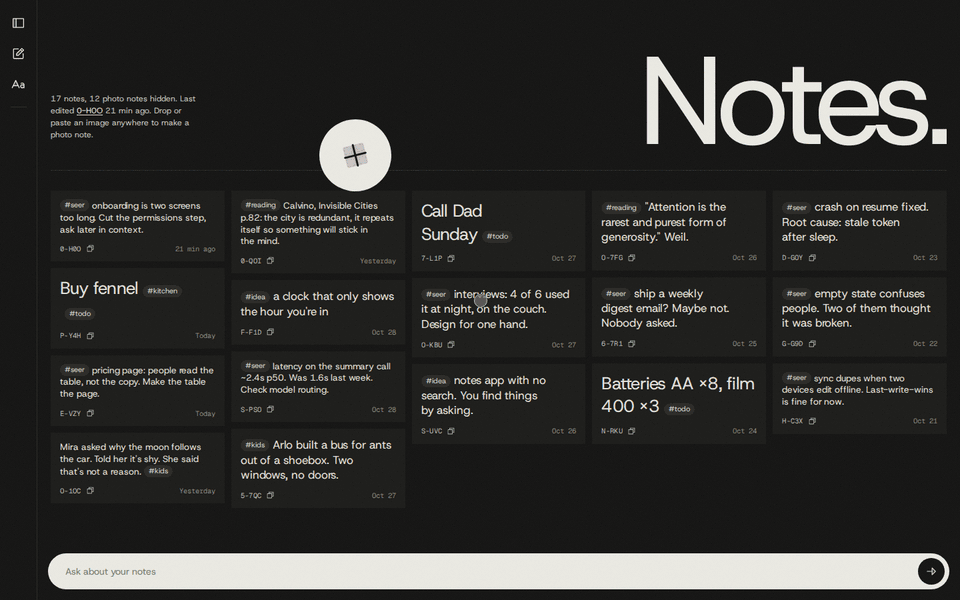

| Photos only | Everything |
|---|---|
|  | 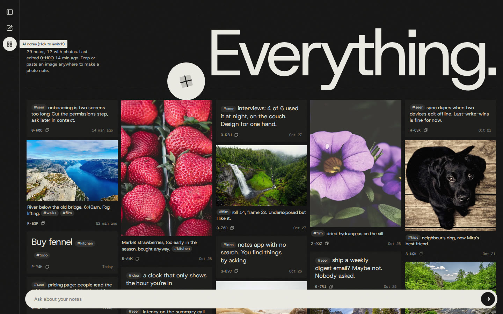 |

### Tags

Tags are parsed from the text on every save: `#seer`, `#v250`, `#from_phone`. The sidebar lists
every tag with its count. Clicking tags filters the wall (several tags combine with AND), the
heading becomes the filter, and the active tags stay on the collapsed rail as vertical chips.
Clicking a tag chip inside a note filters by it too. Filters apply in all three views.

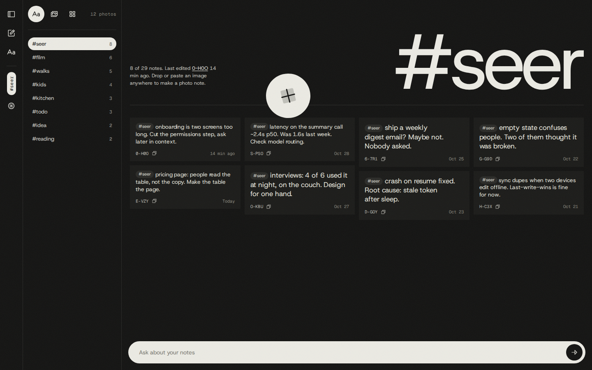

### Writing a note

The round "+" sticker (or the pencil on the rail) creates a note with a server-made id and opens
it for typing. Text is saved when the field loses focus. Clear a text note's text and it is
deleted (softly, with its last body kept as a revision). Text size follows length, so a
three-word note reads like a sticky and a paragraph reads like a paragraph.

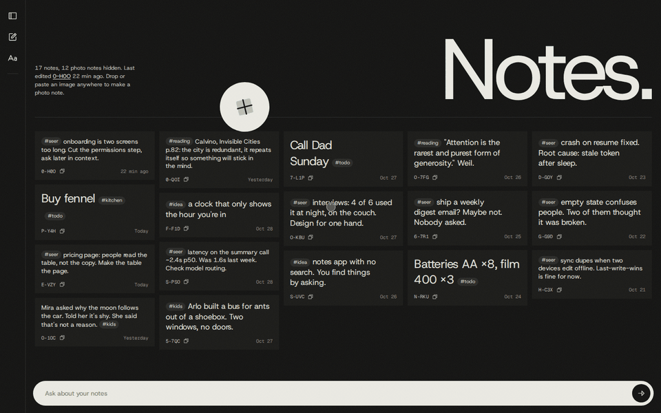

### Adding photos

Drop image files anywhere on the page, or paste a screenshot. Each one becomes a photo note. If
you are in the text-only view, the wall switches to everything so you can see the new note.
Dropping the same file twice returns the existing note instead of a duplicate (dedupe by
sha256).

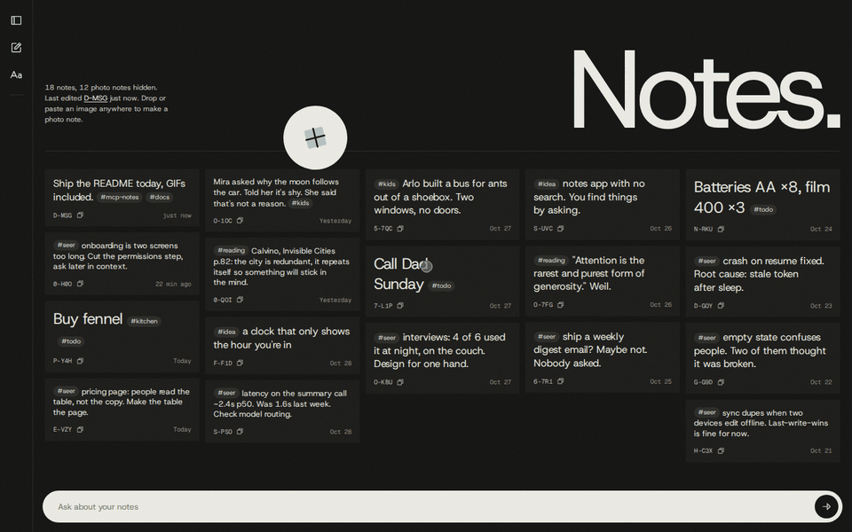

Two other ways in, both handy from Claude Code:

- **The inbox folder.** Anything dropped into `~/mcp-notes-data/inbox` becomes a photo note, and
  the file is moved into the store.
- **The `create_image` tool.** Claude Code often has a screenshot path at hand: "save this
  screenshot as a note about the login bug".

### The photo modal and the full-screen tab

Click a photo for the modal: the display copy, the note's text, its tags and id. Previous/next
buttons and the arrow keys step through the photos in the current filter. Esc closes it.

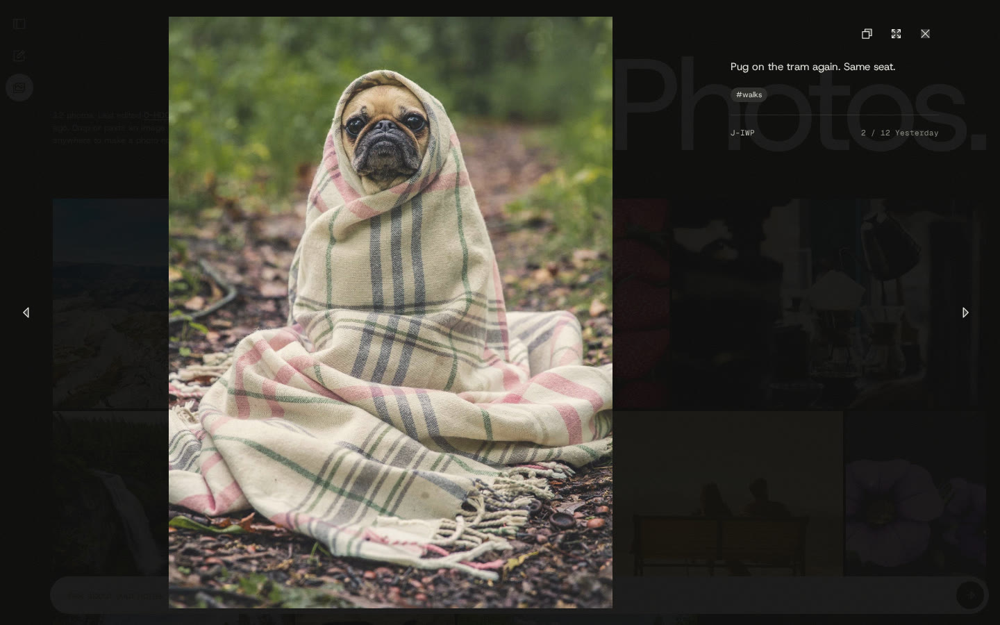

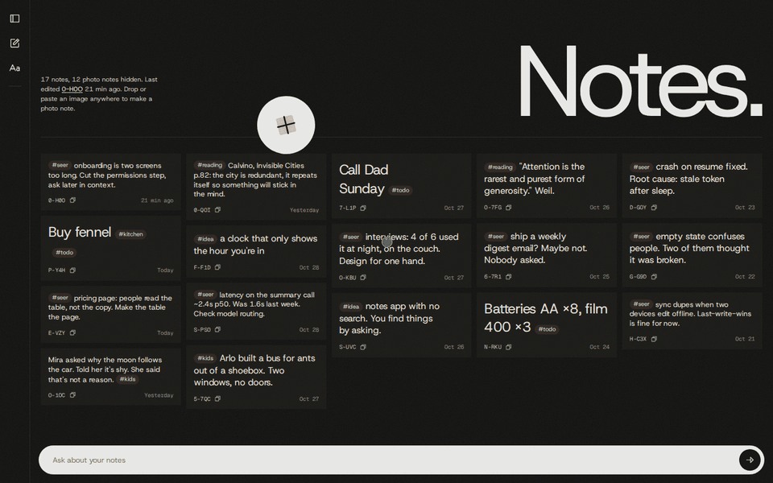

"Show full screen" opens the photo alone in a new tab, titled with the note id. It fits the
window by default. Click to toggle 1:1 device pixels and drag to pan. This tab shows the
original with no film-tone filter. It's the place to check focus and grain.

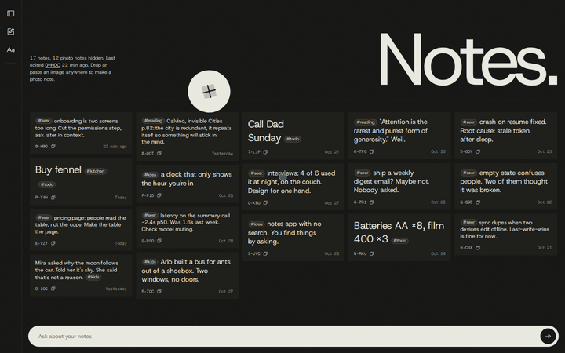

## Using it from Claude Code

`install.sh` registers the daemon as the user-scope MCP server `notes` and links the `/n` skill
into `~/.claude/skills/n`, so in any repo:

```
/n <what you want, in plain words>
```

The recordings below are real Claude Code sessions (Opus 5.5) against a demo instance. The only
edit is a blanked line where Claude Code printed account usage.

### Summaries and comparisons

Claude calls `list` twice, once per week, and does the comparison itself. Note ids are quoted, so
you can jump to any of them.

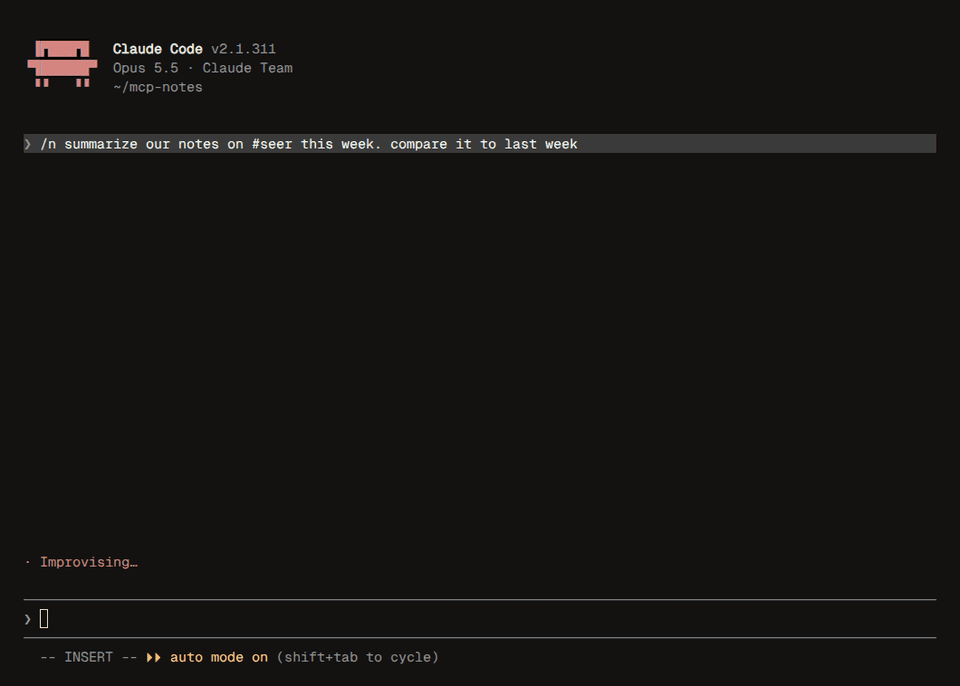

### Looking at pictures

`list` filtered by `has_image` and the saved date, then `view_images`, which hands Claude the
previews. In this demo the sample captions came from a design mock-up and don't match the stock
photos. Claude noticed.

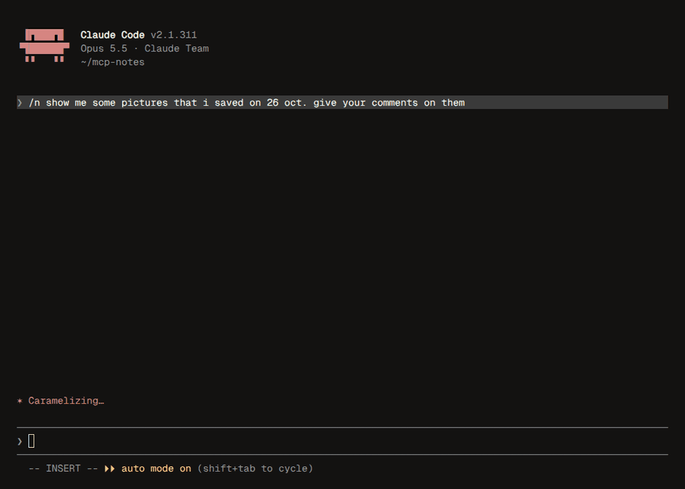

### Editing a note, live on the wall

Claude rewrites the note through `update` and the old text becomes a revision. The wall below
picks up the change and "Last edited" moves to `E-VZY`, with no reload.

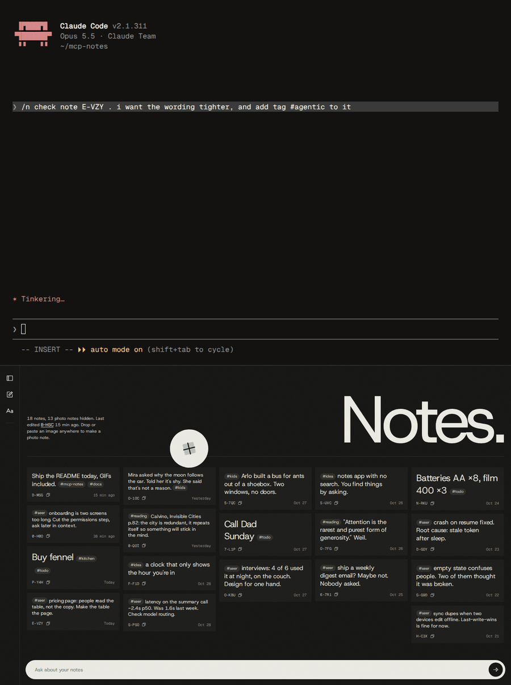

### More things to ask

```
/n let's get this session insights up until now and save it as a new note
/n check note A-B32 . i just copy paste it in a markdown format. please remove the markdown formatting in it. also add tag #agentic to it
/n summarize our notes on #seer this week. compare it to #v250
/n what did A-B32 say before i edited it yesterday? put it back
/n save ~/Pictures/Screenshots/login-bug.png as a note, tag it #seer #bug
```

## The chat bar

The pill at the bottom of the wall is a natural-language command line. Its answer streams into a
panel that rises above it, which you can pin or dismiss. A terse status line ("searching
notes", "looking at 2 photos", "searching the web") shows what the agent is doing. Notes the
answer mentions are outlined on the wall and the rest dim. Chips under the answer jump to each
note, switching the view if that note is hidden.

Behind it is the Claude Agent SDK: headless Claude Code on your existing login, one run per
message, with the same `notes` tools `/n` uses plus web search. A follow-up continues the same
thread. Dismissing the panel starts a new one. Answers are not saved as notes.

The recordings below are real runs against the demo instance. The time spent waiting for the
answer is sped up 1.8×.

**Reading and comparing.** It pulls both weeks, writes the comparison, and the eight notes it
used stay lit on the wall.

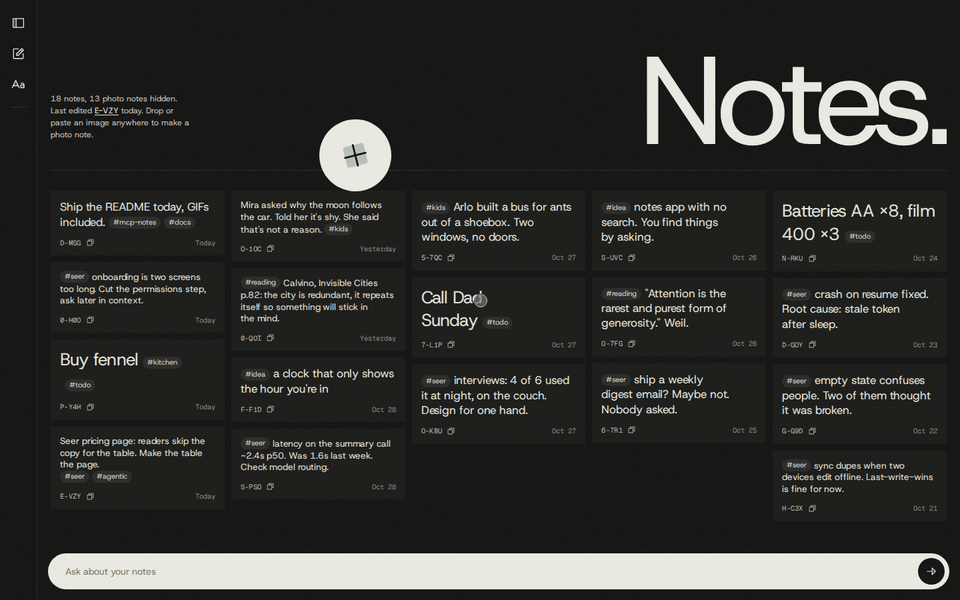

**Looking at photos.** In the everything view it finds the photos saved on 26 Oct, looks at them,
and highlights the photo note it used. It also catches the caption that doesn't match its photo.

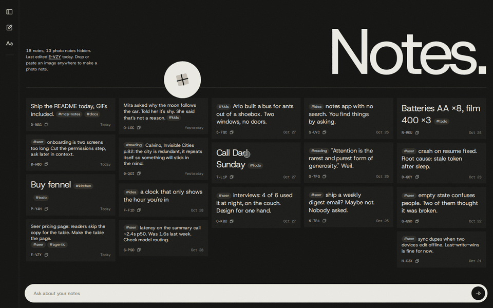

**The web plus your notes.** It searches the web, then ties the result back to the Calvino quote
in your `#reading` note.

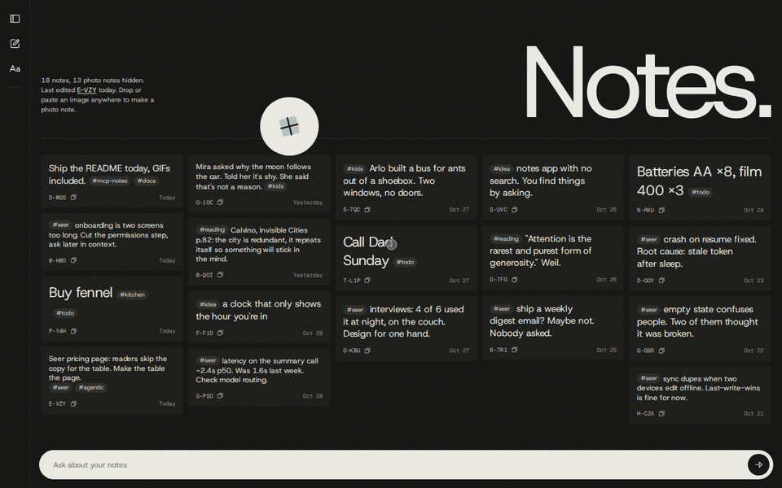

If Claude fails on a usage limit or a login problem, the same message is retried once on GLM
(z.ai, configured through `.env.local`'s `LLM_*` keys), and the panel's header says which brain
answered. `CHAT_BRAIN=glm` makes GLM the only brain.

## Install and run

### Requirements

- WSL 2 with systemd enabled (`/etc/wsl.conf`: `[boot]` `systemd=true`). Other Linux setups work
  too. Skip the Windows part and the systemd unit if you'd rather run it by hand.
- Node 22.
- The `claude` CLI, logged in.
- A Postgres database. The project uses Neon (`@neondatabase/serverless`). Any Postgres URL that
  is not a Neon host goes through `node-postgres` instead.
- Docker, only for the integration tests.

### Install on WSL

```sh
git clone git@github.com:miftahulmahfuzh/mcp-notes.git ~/mcp-notes
cd ~/mcp-notes
cp /path/to/your/.env.local .env.local    # DATABASE_URL, DATABASE_URL_UNPOOLED
npm ci
npm run db:migrate                         # once, against the direct (unpooled) host
scripts/install.sh
```

`install.sh` is idempotent. Run it again after every pull. Each run it:

1. builds the server and the web UI,
2. creates `~/mcp-notes-data`,
3. installs and restarts the systemd user unit `notesd` (absolute node path, this checkout),
4. runs `loginctl enable-linger` so the unit starts when the distro boots,
5. waits for `GET /health`,
6. registers `notes` with `claude mcp add --scope user --transport http notes http://localhost:7317/mcp`,
7. symlinks the `/n` skill into `~/.claude/skills/n`,
8. exits non-zero unless the unit is active, `/health` answers and `claude mcp list` shows
   `notes` connected.

Then open `http://localhost:7317` in the Windows browser. Logs: `journalctl --user -u notesd -f`.
Undo with `scripts/uninstall.sh` (it keeps your data).

### Keep WSL running from Windows

WSL shuts an idle distro down about 15 seconds after its last terminal closes, and `notesd`
stops with it. A logon task holding one hidden `wsl.exe` open fixes that:

```powershell
powershell -NoProfile -ExecutionPolicy Bypass -File \\wsl.localhost\Ubuntu\home\<you>\mcp-notes\scripts\windows\install-wsl-keepalive.ps1
```

If it says "Access is denied", run it from an elevated PowerShell. The details, the evidence and
an alternative (`instanceIdleTimeout=-1` in `.wslconfig`) are in [docs/INSTALL.md](docs/INSTALL.md).

### Run it by hand

```sh
npm run build && npm start                 # notesd on 127.0.0.1:7317
npm run dev                                # server with reload (tsx watch)
npm run dev:web                            # Vite dev server for the UI, proxied to the daemon
```

To try it without touching your real notes, point it at another database and data dir:

```sh
DATABASE_URL=postgres://… NOTESD_PORT=7400 NOTES_DATA_DIR=/tmp/notes-demo npm start
claude --mcp-config demo-mcp.json --strict-mcp-config    # {"mcpServers":{"notes":{"type":"http","url":"http://127.0.0.1:7400/mcp"}}}
```

### Tests

```sh
npm run typecheck
npm test                 # unit tests, server and web (jsdom)
npm run test:int         # integration tests against a real Postgres 16 in Docker (container mcp-notes-pg-test, port 55433)
```

The integration suite starts or reuses its own container and never touches the Neon database.

### Configuration

`.env.local` at the repo root, plus a few optional environment variables:

| Variable | Default | Meaning |
|---|---|---|
| `DATABASE_URL`, `DATABASE_URL_UNPOOLED` | — | Postgres URLs. The daemon uses the pooled Neon host, migrations the direct one, chosen by host name. |
| `NOTESD_PORT` | `7317` | HTTP port. The host is always `127.0.0.1`. |
| `NOTES_DATA_DIR` | `~/mcp-notes-data` | Photos, derived images, inbox. |
| `CHAT_BRAIN` | `claude` | `glm` runs the chat bar on GLM only. |
| `LLM_BASE_URL`, `LLM_API_KEY`, `LLM_MODEL` | — | The GLM fallback endpoint (z.ai). |
| `TEST_DATABASE_URL` | set by `test:int` | Integration test database. |

## How it works

```
 Claude Code (/n, any repo) ──MCP──┐
                                   │     ┌─────────────────────────────┐     ┌────────────────┐
 Browser http://localhost:7317 ────┼────▶│ notesd  (Hono, 127.0.0.1)   │────▶│ Postgres       │
   wall · gallery · modal · chat   │     │  /mcp  streamable HTTP      │     │ notes          │
                                   │     │  /api  JSON, SSE, upload    │     │ note_revisions │
 ~/mcp-notes-data/inbox ──watch────┘     │  /     the web app          │     └────────────────┘
                                         │  one notes service + events │────▶ ~/mcp-notes-data
                                         └─────────────────────────────┘      images · cache
```

Every write goes through one notes service, which writes the revision in the same transaction
and emits an event. The web app listens on `/api/events` and re-fetches. It also re-fetches
every 60 seconds, which picks up edits made by a daemon on another machine.

### MCP tools

| Tool | What it does |
|---|---|
| `create` | New note from text, with optional origin `{cwd, repo, claude_session}` |
| `get` | One or several notes by id |
| `update` | Replace a note's body |
| `append` | Add text to the end of a note |
| `delete`, `restore` | Soft delete and undo it |
| `list` | Filter by tags (any or all), created/updated date range, `has_image`, EXIF taken-date range. Newest first, paged |
| `search` | Full text (Postgres `simple` config, so code tokens survive) plus the same filters, ranked |
| `tags` | Every tag with its count and last use |
| `revisions`, `revert` | A note's earlier bodies, and putting one back |
| `create_image` | Photo note from a local file path, with optional text |
| `view_images` | Previews of up to 8 photo notes as image content, with their metadata |

The server also sends Claude short instructions: what mcp-notes is, how ids look, and that
comparisons are Claude's job.

### HTTP API

| Route | |
|---|---|
| `GET /health` | `{"ok":true}` |
| `GET /api/notes?has_image=&tag=&limit=&cursor=` | Notes, newest first |
| `GET/PATCH/DELETE /api/notes/:id`, `POST /api/notes` | One note |
| `GET /api/tags` | Tags with counts |
| `GET /api/events` | Server-sent events, `event: note` on every change |
| `POST /api/images` | Multipart upload (`file`, optional `body`), returns `{note, created}` |
| `GET /api/notes/:id/original` · `/display` · `/thumb` · `/preview` | The photo in each form; 404 `not_on_this_machine` when the file lives elsewhere |
| `POST /api/chat` | Streams `status` and `delta` events, then `done` with the `thread_id` and the brain that answered |
| `/full/:id` | The full-screen photo page |

### Where things are stored

```
Postgres   notes(id, body, tags[], image_path, image_meta, origin, created_at, updated_at, deleted_at)
           note_revisions(note_id, body, saved_at)
~/mcp-notes-data/
  images/YYYY/MM/<id>.<ext>        originals, byte for byte
  cache/<id>/thumb.webp            480 px wide, for the wall and gallery
  cache/<id>/preview.jpg           long edge 1568 px, what Claude sees
  cache/<id>/display.jpg           full resolution, only for HEIC/HEIF/TIFF
  inbox/                           drop files here; failures go to inbox/failed/
```

`cache/` can be deleted at any time. Everything in it is rebuilt on demand.

## Limitations

- **Photos are local only, by design.** An original lives on the one machine that took it in and
  is never synced. Another machine sharing the database shows the text with a "not on this
  machine" placeholder. Back up `~/mcp-notes-data/images` yourself.
- **Full size costs disk.** Originals are kept exactly as they arrive, so a phone's 4 MB HEIC
  stays 4 MB, plus a full-resolution JPEG for viewing.
- **Text needs the network.** Notes live in Neon. With no connection, nothing loads.
- **No semantic search yet.** Search is full text plus tags and dates. "Notes about ArangoDB
  credentials" works only when those words appear. Embeddings come in iteration 6.
- **No connectors yet.** Spending, runs and Seer experiments (iteration 5) are not reachable.
- **Single user, no auth.** It binds to `127.0.0.1` only. Anyone with a shell on the machine can
  read it.
- **Built for WSL.** The installer assumes a systemd user session. The Windows keepalive task
  may need an elevated PowerShell once.
- **Desktop first.** No phone layout. Ingest phone photos through the inbox folder or an upload.
- **HEIC colour.** The HEIC display copy has no Display-P3 conversion, so wide-gamut photos can
  look a little flat in the browser. The original is untouched.
- **Tag syntax is loose.** Any `#word`, including `#123`, becomes a tag.
- **Edits from another machine** reach the wall within 60 seconds, not instantly.

## Roadmap

| # | Iteration | State |
|---|---|---|
| 1 | Spine: `notesd`, schema, MCP tools, revisions, `/n`, autostart | done |
| 2 | Images: local store, derivatives, inbox, image tools, EXIF dates | done |
| 3 | Web UI: wall, three views, gallery, modal, full-screen tab, upload | done |
| 4 | Chat bar brain: Claude Agent SDK, streaming, threads, GLM fallback | done |
| 5 | Read-only connectors: expense-tracking, run-insights, Seer | planned |
| 6 | Semantic search: pgvector embeddings, hybrid ranking | planned |

Fixed decisions and the full acceptance set are in [docs/ROADMAP.md](docs/ROADMAP.md).

## Repository layout

```
src/            notesd: config, db (Drizzle), notes service, MCP server, HTTP routes, images, chat agent
web/            the Vite + React app (wall, gallery, modal, full-screen page)
drizzle/        SQL migrations
claude/skills/n the /n skill, symlinked into ~/.claude/skills/n
deploy/         systemd user unit template
scripts/        install, uninstall, integration test runner, Windows keepalive
tests/          unit and integration tests
docs/           roadmap, iteration briefs, design, plans, these screenshots
```

## About the screenshots

The screenshots and recordings come from a throwaway instance (its own Postgres container and
data folder) seeded with the sample notes from the Claude Design mock-up in `docs/design/`. The
photos are from [Lorem Picsum](https://picsum.photos) (Unsplash), so they don't always match
the captions. Everything shown is the real app, and the Claude Code sessions are real.
