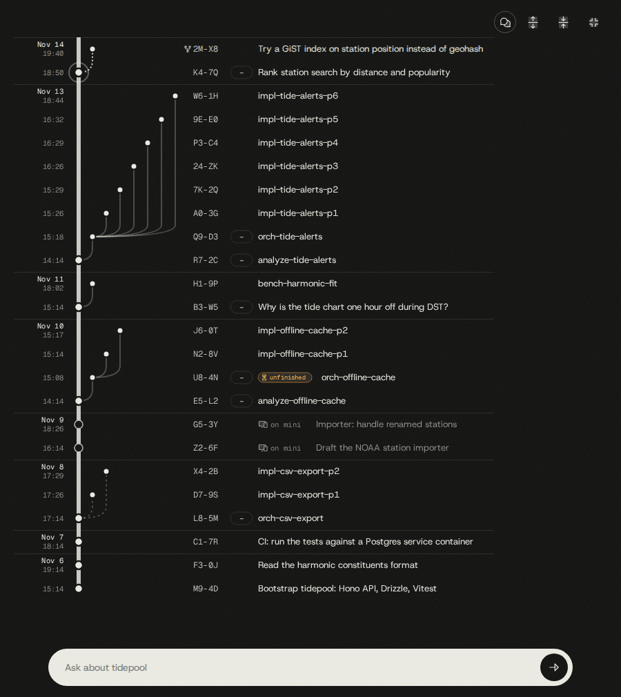

# mcp-notes

A personal notes system for someone who has Claude Code open all day. One local daemon, `notesd`,
keeps notes, photos and files in Postgres and serves them three ways: to every Claude Code session
as an MCP server (`/n <anything>` from any repo), to a JSON API, and to a dark web wall at
`http://localhost:7317` with its own chat bar. The same daemon maps your Claude Code sessions,
reads your other apps, reviews Seer's stock picks and keeps your film library.


You mostly do not open it to find things. You ask:

```
/n what was my last note about #v250?
/n summarize our notes on #seer this week and compare with last week
/n show me the pictures I saved on 30 Oct and tell me what you see
/n which session added the recycle bin, and what did it cost?
/n how is my spending this week?
/n what did I watch last month? then play something
```

## What sets it apart

- **Claude is the search engine.** No search bar. Search blends full text, meaning, tags and
  recency, and Claude does the reading, comparing and summarizing.
- **Ids you can say.** Notes are `A-B32`, sessions `A0-3G`, films `M-23T4`. Type one in any
  prompt; in answers they are links.
- **Nothing is lost.** Every edit keeps a revision, every delete is soft, and only the wall's
  recycle bin can delete for good. No tool Claude has can.
- **Originals stay byte for byte.** Photos and files are never re-encoded. Claude gets a preview
  it can look at.
- **Two machines, one database.** Text is shared; photos, files, transcripts and videos stay on
  the machine that holds them and say so (`not_on_this_machine`).
- **Yours alone.** One user, bound to `127.0.0.1`, no accounts, no telemetry.

## What is in it

| Part | What it does | Guide |
| --- | --- | --- |
| The wall | Notes as cards, tags, a big editor, photos, files, recycle bin, live updates when Claude edits | [wall](docs/guide/wall.md) |
| Claude Code | The `notes` MCP server, `/n`, six hooks, clickable ids, pasted pictures saved as notes | [claude-code](docs/guide/claude-code.md) |
| Search | Hybrid search, related notes, similar photos, background embeddings | [search](docs/guide/search.md) |
| Chat | The wall's chat bar (a Claude agent with the same tools) and one history page for every chat and `/n` exchange | [chat](docs/guide/chat.md) |
| Sessions | Every Claude Code session as a graph per repo: who started whom, summaries, search, cost, context rot, resume | [sessions](docs/guide/sessions.md) |
| Connectors | Read-only answers from expense-tracking, run-insights and Seer; `/v` and `/j` write to daily-words | [connectors](docs/guide/connectors.md) |
| Seer Adversarial | Claude reviews each Seer pick before the open; twin books show whether its objections paid | [adversary](docs/guide/adversary.md) |
| Movies | Your video folders as a TMDB poster library, watch history, Play and Resume in VLC, [every question you can ask](docs/guide/movies.md#what-you-can-ask) | [movies](docs/guide/movies.md) |

<table>
<tr>
<td></td>
<td></td>
</tr>
</table>

## Install

```sh
git clone git@github.com:miftahulmahfuzh/mcp-notes.git ~/mcp-notes && cd ~/mcp-notes
cp /path/to/your/.env.local .env.local    # DATABASE_URL, DATABASE_URL_UNPOOLED, OPENROUTER_API_KEY
npm ci && npm run db:migrate
scripts/install.sh                        # build, systemd user unit, MCP registration, skills, hooks
```

Then open `http://localhost:7317`. Run `scripts/install.sh` again after every pull. Requirements,
the Windows keepalive, a second machine and troubleshooting are in
[install](docs/guide/install.md).

## Reference

| | |
| --- | --- |
| [Architecture](docs/guide/architecture.md) | How it is built, the data model, what is on disk, limitations |
| [MCP tools](docs/guide/reference/mcp-tools.md) | Every tool with its description and arguments, generated from the server |
| [HTTP API](docs/guide/reference/http-api.md) | Every route, generated from the daemon's route table |
| [Configuration](docs/guide/reference/configuration.md) | Every environment variable |
| [Roadmap](docs/ROADMAP.md) | Fixed decisions and iterations |

## Working on it

```sh
npm run dev          # daemon with reload
npm run typecheck && npm test
npm run test:int     # integration tests against Postgres in Docker
npm run docs:gen     # regenerate the MCP and HTTP reference after adding a tool or route
npm run docs:shots -- wall movies   # retake a guide's pictures from a throwaway daemon
```

The docs are checked against the code: `npm test` fails when the generated reference is stale, a
route or environment variable is undocumented, a link is broken or a picture is unused. Prove a
change on a throwaway daemon with the `verify-notesd` skill (`.claude/skills/verify-notesd`).
