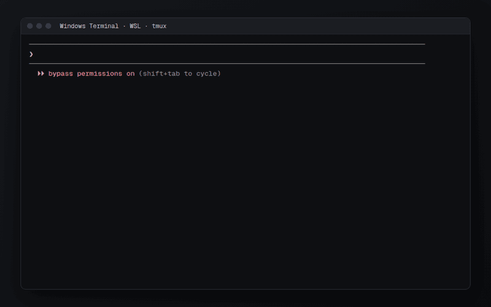

# mcp-notes

A personal notes system for people who live in Claude Code. One local daemon, `notesd`, holds
your notes and photos and serves them three ways: to every Claude Code session as an MCP server,
to `/n <anything>` typed from any repo, and to a dark web wall at `http://localhost:7317` with
its own chat bar.


## Contents

- [What it is](#what-it-is)
- [Why it is different](#why-it-is-different)
- [A tour of the wall](#a-tour-of-the-wall)
  - [Three views: notes, photos, everything](#three-views-notes-photos-everything)
  - [Tags](#tags)
  - [Writing a note](#writing-a-note)
  - [The big editor](#the-big-editor)
  - [Adding photos](#adding-photos)
  - [The photo modal and the full-screen tab](#the-photo-modal-and-the-full-screen-tab)
  - [Deleting and the recycle bin](#deleting-and-the-recycle-bin)
  - [Open file location](#open-file-location)
  - [Links to a note](#links-to-a-note)
- [Using it from Claude Code](#using-it-from-claude-code)
  - [Summaries and comparisons](#summaries-and-comparisons)
  - [Looking at pictures](#looking-at-pictures)
  - [Editing a note, live on the wall](#editing-a-note-live-on-the-wall)
  - [Clickable note ids](#clickable-note-ids)
  - [Spending, runs and Seer](#spending-runs-and-seer)
  - [More things to ask](#more-things-to-ask)
- [The chat bar](#the-chat-bar)
- [Connectors: spending, runs, Seer](#connectors-spending-runs-seer)
- [Install and run](#install-and-run)
  - [Requirements](#requirements)
  - [Install on WSL](#install-on-wsl)
  - [Keep WSL running from Windows](#keep-wsl-running-from-windows)
  - [A second machine](#a-second-machine)
  - [Run it by hand](#run-it-by-hand)
  - [Tests](#tests)
  - [Configuration](#configuration)
- [How it works](#how-it-works)
  - [MCP tools](#mcp-tools)
  - [HTTP API](#http-api)
  - [Where things are stored](#where-things-are-stored)
- [Limitations](#limitations)
- [Roadmap](#roadmap)
- [Repository layout](#repository-layout)
- [About the screenshots](#about-the-screenshots)

## What it is

mcp-notes keeps short notes and photos. A note is one text field: no title, no folders, no
schema. Tags are `#hashtags` written inside the text, and every note gets a short id like
`A-B32` that you can say out loud to Claude.

You mostly don't open it to find things. You ask:

```
/n check notes that has #v250 tags. i wonder what my last note about it was
/n summarize our notes on #seer this week. compare it to last week
/n show me some pictures that i saved on 30 oct . give your comments on them
```

The wall is for browsing, writing quickly, and dropping in photos.

## Why it is different

- **Claude is the search engine.** There is no search bar. Claude Code reaches your notes through
  MCP with filters for tags, dates, full text and images, and search understands meaning, not
  only words: "ArangoDB credentials" finds "arango root password is in the vault". Claude does
  the reading, comparing and summarizing itself. The same tools work from any repo through `/n`.
- **Ids you can say.** `A-B32`: one character, a dash, three characters. Lookup ignores case and
  a missing dash (`ab32` finds `A-B32`). Every card has a copy-id button, and Claude quotes ids
  in its answers.
- **Photos stay byte for byte.** Originals are never re-encoded or resized. The wall shows a
  thumbnail and the modal a display copy, but the full-screen tab shows the original pixels at
  1:1, and the file on disk is exactly the file you dropped. HEIC photos from a phone are kept as
  HEIC, with a full-resolution JPEG made only for viewing. A note can hold several photos, kept
  in the order you added them.
- **Claude can see your photos.** A tool returns a preview sized for Claude's image input, so
  "what's in the pictures I saved on Sunday?" gets a real answer about the pictures, and "show me
  the pictures in note A-B32" shows Claude every picture in that note.
- **Nothing is lost by editing.** Every update, append, revert and delete keeps the previous body
  in `note_revisions`. Claude can list revisions and revert. Deleted notes and removed photos go
  to a recycle bin on the wall. Only "delete forever" in that bin removes anything for good, and
  no tool Claude has can do that.
- **The wall follows Claude.** When Claude edits a note over MCP, the wall updates within a
  second over server-sent events. No reload.
- **Notes remember where they came from.** A note saved from a repo records the working directory,
  the repo and the Claude session it came from.
- **Local first, two machines.** Text lives in a Postgres database (Neon) that more than one machine can
  share. Photos live on the disk of the machine that took them in. Another machine sees the note
  and a "not on this machine" placeholder.
- **Your other apps answer too.** The same tools read expense-tracking, run-insights and Seer,
  read-only, so "how is my spending this week?" or "how did yesterday's run go?" gets an answer
  from the real data, with Claude's opinion on it.
- **It is yours alone.** One user, bound to `127.0.0.1`, no accounts, no telemetry.

## A tour of the wall

### Three views: notes, photos, everything

The wall opens on text notes only, with photo notes hidden. The rail button cycles through the
three views: text only ("Notes."), photos only ("Photos.", a contact-sheet gallery with one tile
per photo, so a note with three photos gives three tiles), and everything mixed ("Everything.").
The giant heading always tells you which one you're in. On the wall a photo note shows its first
photo as the cover, with a small count in the corner when it holds more than one.


| Photos only | Everything |
|---|---|
|  |  |

The recording and both stills were made before iteration 7. Every photo note in them holds one
photo, so no card shows a count, and the cards lack the expand, delete and folder icons
described below.

### Tags

Tags are parsed from the text on every save: `#seer`, `#v250`, `#from_phone`. The sidebar lists
every tag with its count. Clicking tags filters the wall (several tags combine with AND), the
heading becomes the filter, and the active tags stay on the collapsed rail as vertical chips.
Clicking a tag chip inside a note filters by it too. Filters apply in all three views.


### Writing a note

The round "+" sticker (or the pencil on the rail) creates a note with a server-made id and opens
it for typing. Text is saved when the field loses focus. Clear the text of a note that has no
photos and it is deleted when you leave it (softly: it goes to the recycle bin, with its last
body kept as a revision). Text size follows length, so a three-word note reads like a sticky and
a paragraph reads like a paragraph.


The recording shows the inline flow, which is unchanged. It was made before cards had the expand
and delete icons.

### The big editor

Every card has an expand icon at the right end of its id line, beside the trash icon. It opens
the same note in a large editor:

- a wide, tall text area in the wall's type
- the note id with its copy button
- the tag chips
- the note's photos as a strip, each with a remove icon and the folder icon (see
  [Open file location](#open-file-location)). Click a photo to see it large; the left and right
  arrows (buttons or keys) move to the note's other photos without closing it and stop at the first
  and last one. Esc, a click beside the photo or the X closes the photo and leaves the editor open.

For a long note, press "+", type the first line, then expand it and keep writing.

- Text saves the way cards do: when the text area loses focus and when the editor closes, and
  only if it changed. The card on the wall shows the change at once.
- Esc closes it (when a photo is open large, the first Esc closes only the photo).
- While the editor is open, a dropped or pasted image is attached to this note instead of
  becoming a new one. The drop overlay shows a paperclip instead of the usual image icon to say
  so. A file that already lives in a note is not attached twice. The editor quietly says which
  note holds it.
- If you attach a photo to a text note while the wall is on "Notes.", the wall switches to
  "Everything." when you close the editor, so the note stays in sight.
- Emptying the text does not delete the note while the editor is open. On close, a note with no
  text and no photos goes to the recycle bin, the same rule as on the wall.
- Removing a photo from the strip is soft. The photo goes to the recycle bin's photo grid, and
  restoring it puts it back at the same place in the note.

The editor has no recording yet.

### Adding photos

Drop image files anywhere on the page, or paste a screenshot. Each file becomes a new photo
note. If you are in the text-only view, the wall switches to everything so you can see the new
note. To add a photo to a note that already exists, open it in [the big editor](#the-big-editor)
and drop it there. Each photo is stored once (dedupe by sha256, per photo). Dropping a file that
is already in a note returns that note instead of a copy, and brings the note back from the
recycle bin if it was deleted.


Three other ways in, all handy from Claude Code:

- **The inbox folder.** Anything dropped into `~/mcp-notes-data/inbox` becomes a photo note, and
  the file is moved into the store.
- **The `create_image` tool.** Claude Code often has a screenshot path at hand: "save this
  screenshot as a note about the login bug".
- **The `attach_image` tool.** It adds a local file to a note that already exists: "attach
  ~/Pictures/Screenshots/login-bug-2.png to note A-B32".

### The photo modal and the full-screen tab

Click a photo for the modal: the display copy, the note's text, its tags and id. The
previous/next buttons and the arrow keys step one photo at a time, through every photo of a note
and then on to the next note, within the current filter. The meta line shows where you are
overall (`4 / 12`) and, for a note with several photos, which of that note's photos this is
(`2/3`). Esc closes it. The modal also has the delete icon, which sends the note to the recycle
bin, and the folder icon.


Both were captured before iteration 7, when a note held one photo. They show neither the `2/3`
position nor the delete and folder icons.

"Show full screen" opens the photo alone in a new tab, titled with its id. A note's first photo
shares the note's id, so old `/full/<note id>` links still open it. The tab fits the window by
default. Click to toggle 1:1 device pixels and drag to pan. This tab shows the original with no
film-tone filter. It's the place to check focus and grain.


### Deleting and the recycle bin

Every card, the big editor and the photo modal have a trash icon. Deleting needs no confirmation
and is soft. For six seconds a quiet line above the right end of the chat bar says
`deleted A-B32`, with an undo icon beside it. Click the icon and the note is back. Removing one
photo in the editor works the same way (`removed image`).

The trash icon on the rail (and in the open sidebar) switches to the recycle bin, headed
"Deleted.". It holds every deleted note, text and photo alike:

- at the top, a grid of deleted photos: the photos of deleted notes, and single photos removed
  from a note that is still on the wall;
- below, the deleted notes in the wall's style, most recently deleted first.

Tag filters work in the bin too. The sidebar's tags and counts keep counting live notes only.

Each entry has two icons, restore and delete forever:

- Restore puts a note back on the wall, or puts a removed photo back into its note at its old
  position. Restoring a photo of a deleted note brings the note back with it.
- If the same file has since been added to another note, restoring the photo is refused, and
  the message says which note holds it.
- In the grid, the tile of a deleted note acts on the whole note.

Delete forever is the only destructive action in mcp-notes. It asks first, inline: the two icons
turn into a check (delete forever) and a cross (cancel). Once confirmed, it removes the database
rows: either the note with its photos, revisions and embedding, or the one photo. It also removes
the original files and their derived copies in `cache/`, and nothing else. Delete forever exists
only on the wall. No MCP tool can delete anything for good, so Claude can never destroy data.

The bin has no recording yet.

### Open file location

Photo cards on the wall, the photo modal and the editor's photo strip have a folder icon ("Show
in Explorer"). Gallery tiles don't; open the photo and use the modal's. Clicking it opens Windows
Explorer on the folder that holds the original, with the file selected. `notesd` turns the stored
path into a Windows path with `wslpath -w` and starts `explorer.exe /select,<path>`. It does not
wait for Explorer, whose exit code means nothing.

The icon appears only when this can work: the original must be on this machine, and `notesd`
must run under WSL with Windows interop available (`GET /api/capabilities` answers
`{"reveal":true}`). The endpoint takes a photo id, never a path. It refuses any request whose
`Origin` is not the wall's own page, so another site open in the browser cannot trigger it.

### Links to a note

`http://localhost:7317/?note=F-ZH5` (the port is `NOTESD_PORT`) opens the wall with that note
scrolled into view and briefly outlined; `#F-ZH5` works too, and the id may be lower-case or lack
its dash (`?note=fzh5`). The wall first makes the note visible: it leaves the bin, switches
"Notes." or "Photos." to "Everything." when the view hides it, and drops only the active tags the
note does not carry. A big editor open on another note closes the usual way, saving its text; one
open on the linked note stays open. A note older than the 2000 the wall loads is fetched on its
own. A deleted note opens the bin on its card, with a line saying it can be restored there, and an
unknown id says `no note F-ZH5` in the top right corner. The address is left as it is, so a reload
selects the note again; changing the hash or moving back and forward selects the new target.

## Using it from Claude Code

`install.sh` registers the daemon as the user-scope MCP server `notes` and links the `/n` and
`/migrate` skills into `~/.claude/skills`, so in any repo:

```
/n <what you want, in plain words>
```

To move a folder of pictures into the notes and free the disk, `/migrate` puts every image in the
folder into one new image note, tags it, checks the note holds them all, then deletes the folder:

```
/migrate C:\Users\GPD\Downloads\Telegram Desktop\sun27 #ai_image
```

The recordings below are real Claude Code sessions (Opus 5.5) against a demo instance. The only
edit is a blanked line where Claude Code printed account usage.

### Summaries and comparisons

Claude calls `list` twice, once per week, and does the comparison itself. Note ids are quoted, so
you can jump to any of them.


### Looking at pictures

`list` filtered by `has_image` and the saved date, then `view_images`, which hands Claude the
previews. In this demo the sample captions came from a design mock-up and don't match the stock
photos. Claude noticed.


`view_images` takes note ids or photo ids. A note id stands for every photo of that note, in
order, so "/n show me the pictures in note A-B32" lets Claude see all of them. A call returns at
most eight. Past eight, it names the photo ids still to view, and Claude can ask for those next.
The recording was made before notes could hold several photos, but the calls it shows work the
same way today.

### Editing a note, live on the wall

Claude rewrites the note through `update` and the old text becomes a revision. The wall below
picks up the change and "Last edited" moves to `E-VZY`, with no reload.


### Clickable note ids



Claude Code's terminal output is plain text: an id like `F-ZH5` normally cannot be clicked. Here
it can, and nothing in Claude Code had to be patched. Four small pieces make it work:

1. **The wall has an address for every note.** `?note=<id>` scrolls to the note and outlines it
   (see [Links to a note](#links-to-a-note)).
2. **Claude is told the address.** The daemon puts the wall URL, built from `NOTESD_PORT`, into
   the MCP server's instructions, and the `/n` skill says to write every id as
   `[F-ZH5](http://localhost:<port>/?note=F-ZH5)`.
3. **Claude Code turns a markdown link into a terminal hyperlink** (OSC 8), which Windows
   Terminal, iTerm2, kitty and most modern terminals open on Ctrl/Cmd+click. tmux needs one config
   line to pass it through (see below).
4. **Optional: the `note-links` mod** ([claude/mods/note-links](claude/mods/note-links/README.md))
   redraws replies so ids Claude wrote *without* a link also become links, and adds `/open <id>`,
   which opens the wall from WSL even when your terminal cannot click.

The GIF is a demo instance with made-up notes (the wall on port 7400). The terminal frames are
captured from a real Claude Code session and the browser frames are real screenshots of the wall
loading the link; the click itself is drawn in, since a screen recorder cannot press a key in
Windows Terminal from here.

`/n`, and any session that loads the `notes` server, writes every note id as a markdown link to
the wall, for example `[F-ZH5](http://localhost:7317/?note=F-ZH5)`. Claude Code draws a markdown
link as a terminal hyperlink (OSC 8), so Ctrl+click on the id (Cmd+click on macOS) opens the
wall in your browser on that note. The wall URL is not written into the skill: the daemon puts
`http://localhost:<NOTESD_PORT>` into the MCP server's instructions, so a different port needs no
edit. Ids inside note bodies and tool calls stay plain.

Inside tmux the link reaches the terminal only when tmux knows the terminal supports hyperlinks.
One line in your tmux config does it; see
[Clickable ids under WSL2 + tmux](docs/INSTALL.md#8-clickable-ids-under-wsl2--tmux).

### Spending, runs and Seer

The same server reads three of your own apps, read-only: expense-tracking (spending in rupiah),
run-insights (Apple Watch runs, the app's analyses and reviews, coach Nina) and Seer (the trading lab's
leaderboard and positions, and the best Sera methods). `/n` sends questions about them to their
curated tools, falls back to a system's `_sql` tool only when those don't answer, and replies
with what the data shows plus Claude's own read and a suggestion, not a tally. The tools are
listed under [Connectors](#connectors-spending-runs-seer).

```
/n how are my spending this week? don't just tally the numbers and give me your inputs
/n i did a run yesterday. show me how it went. what are your thoughts on this run?
/n compare my running this month with last month
/n what are the best sera method that we have found up until now?
```

### More things to ask

```
/n let's get this session insights up until now and save it as a new note
/n check note A-B32 . i just copy paste it in a markdown format. please remove the markdown formatting in it. also add tag #agentic to it
/n summarize our notes on #seer this week. compare it to #v250
/n what did A-B32 say before i edited it yesterday? put it back
/n save ~/Pictures/Screenshots/login-bug.png as a note, tag it #seer #bug
/n attach ~/Pictures/Screenshots/login-bug-2.png to note A-B32
/n show me the pictures in note A-B32
/n remove the second picture from note A-B32
```

## The chat bar

The pill at the bottom of the wall is a natural-language command line. Its answer streams into a
panel that rises above it, which you can pin or dismiss. A terse status line ("searching
notes", "looking at 2 photos", "reading expenses", "reading runs", "reading seer", "searching
the web") shows what the agent is doing. Notes the answer mentions are outlined on the wall and
the rest dim. Chips under the answer jump to each note, switching the view if that note is
hidden.

The bar takes several lines. Shift+Enter starts a new line and Enter sends, but not while an
input method is still composing. The bar grows upward one line at a time up to about six lines,
then scrolls inside, and drops back to one line after sending. Newlines reach the agent as you
typed them. The panel always sits above the bar, whatever its height.

The caret icon next to pin and dismiss collapses the panel to its header line. That line shows
the question on one line (newlines become spaces, a long question is cut with an ellipsis, and
the full text is in the tooltip). After the question comes the status while it is still
answering, or the brain that answered. A collapsed answer keeps streaming. Click the line to open
it again. Every new answer opens expanded, and the notes it used stay outlined on the wall while
it is collapsed. Dismiss still closes the panel for good and starts a new thread next time.

Behind it is the Claude Agent SDK: headless Claude Code on your existing login, one run per
message, with the same tools `/n` uses: the `notes` tools, the read-only tools for
expense-tracking, run-insights and Seer, and web search. Ask it "how much did i spend on meals
in october, and which week was the worst?" and it answers with the numbers and an opinion. A
follow-up continues the same thread. Dismissing the panel starts a new one. Answers are not
saved as notes.

The recordings below are real runs against the demo instance. The time spent waiting for the
answer is sped up 1.8×. They were made before the bar took several lines and before the panel
could collapse.

**Reading and comparing.** It pulls both weeks, writes the comparison, and the eight notes it
used stay lit on the wall.


**Looking at photos.** In the everything view it finds the photos saved on 26 Oct, looks at them,
and highlights the photo note it used. It also catches the caption that doesn't match its photo.


**The web plus your notes.** It searches the web, ties the result back to the Calvino quote in
your `#reading` note, and lists its sources as links.


If Claude fails on a usage limit or a login problem, the same message is retried once on GLM
(z.ai, configured through `.env.local`'s `LLM_*` keys), and the panel's header says which brain
answered. `CHAT_BRAIN=glm` makes GLM the only brain.

## Connectors: spending, runs, Seer

The same `notes` MCP server also reads three of your own apps, read-only, so `/n` and the chat bar
can answer "how much did I spend on meals in October?" or "how did yesterday's run go?" straight
from their data:

| System | Repo | What it holds |
|---|---|---|
| `expenses` | [miftahulmahfuzh/expense-tracking](https://github.com/miftahulmahfuzh/expense-tracking) | Expenses parsed from pasted text, in whole rupiah, with categories and receipt photos |
| `runs` | [miftahulmahfuzh/run-insights](https://github.com/miftahulmahfuzh/run-insights) | Apple Watch runs (pace, distance, heart rate, splits), weekly and monthly reviews, the coach Nina |
| `seer` | [miftahulmahfuzh/seer](https://github.com/miftahulmahfuzh/seer) | The trading lab: strategies, positions, trades, the leaderboard, and Sera's experiments in `lab/lab.sqlite` |

| Tool | What it does |
|---|---|
| `expenses_schema` | Tables, columns, types and what they mean, from the live database |
| `expenses_sql` | One read-only SELECT, row-capped |
| `expenses_spending` | `from`–`to` (WIB days, up to 366): total, by category with its Indonesian label, by day, by ISO week (Monday–Sunday, partial weeks flagged), and the largest items. Optional `categories` (e.g. `["meals"]`) and `top` |
| `expenses_get` | One expense group by `id`: its items in the app's order, photos, note and the original pasted text |
| `expenses_months` | Monthly totals for the last `months` (default 6) ending at `to_month`, zero-filled, each marked complete or in progress. Optional `categories` |
| `runs_schema` | Tables, columns, types and what they mean |
| `runs_sql` | One read-only SELECT, row-capped |
| `runs_list` | Reviewed runs from `from` to `to` (default today) with key metrics and the app's headline per run, plus period totals (distance-weighted pace) |
| `runs_get` | One run by `id`, or every run on a `date`: metrics, per-km splits, heart-rate zones, note, and the app's own latest analysis |
| `runs_review` | The app's latest `week` or `month` review (`key` like `2026-W44`, `2026-10` or any day in it; default the current one) with that period's totals and runs |
| `seer_schema` | Tables and columns of the Seer database and of `lab.sqlite` |
| `seer_sql` | One read-only SELECT against `source` `db` or `lab` |
| `seer_leaderboard` | The leaderboard ranked as the app ranks it, over the common window; the benchmark, retired and too-new strategies listed apart |
| `seer_positions` | Open bracket orders and book positions with marks and unrealised P&L, in USD. Optional `strategy` and `include_pending` |
| `seer_sera_best` | The best dev variant of each Sera method by MAR, with the lab's metrics, hurdles and test trials; eligibility is as of the run date. Optional `status`, `only_eligible`, `limit` |

How it stays safe:

- **Read-only twice.** Every Postgres connection starts with `default_transaction_read_only=on`
  and every query runs inside `BEGIN READ ONLY`, so a write fails at the database even if a tool
  were wrong. `lab.sqlite` is opened read-only in a short-lived reader process (no write lock,
  safe while Seer's own jobs use it). `_sql` also refuses anything but one SELECT before it
  reaches the database.
- **Credentials stay where they are.** Each call reads that repo's `.env.local` (the direct,
  non-pooler `DATABASE_URL*`), so rotated credentials work without a restart. Nothing is copied
  into this repo, a log, a note or a tool result; errors are scrubbed.
- **Limits.** 10 s statement timeout, 200 rows by default, 1000 at most.
- **Fail-soft.** A missing repo, a missing `.env.local` or an unreachable database is a short
  error for that one call ("expense-tracking is not reachable: …"); notes and the other systems
  keep working.
- Dates are calendar days in Asia/Jakarta (WIB), money is whole rupiah (Seer: US dollars), and
  run units are the app's own (metres, seconds, sec/km, bpm). Nothing is cached in the notes
  database.

There are no recordings of the connectors on purpose: the only data they can show is real
spending, real runs and real positions.

## Install and run

### Requirements

- WSL 2 with systemd enabled (`/etc/wsl.conf`: `[boot]` `systemd=true`). Other Linux setups work
  too. Skip the Windows part and the systemd unit if you'd rather run it by hand.
- Node 22.
- The `claude` CLI, logged in.
- A Postgres database. The project uses Neon (`@neondatabase/serverless`). Any Postgres URL that
  is not a Neon host goes through `node-postgres` instead.
- Docker, only for the integration tests.

### Install on WSL

```sh
git clone git@github.com:miftahulmahfuzh/mcp-notes.git ~/mcp-notes
cd ~/mcp-notes
cp /path/to/your/.env.local .env.local    # DATABASE_URL, DATABASE_URL_UNPOOLED, OPENROUTER_API_KEY
npm ci
npm run db:migrate                         # against the direct (unpooled) host; again after a pull that adds drizzle/*.sql
npm run embed:backfill                     # optional: embed existing notes now (notesd also does it in the background)
scripts/install.sh
```

`install.sh` is idempotent. Run it again after every pull. Each run it:

1. builds the server and the web UI,
2. creates `~/mcp-notes-data`,
3. installs and restarts the systemd user unit `notesd` (absolute node path, this checkout),
4. runs `loginctl enable-linger` so the unit starts when the distro boots,
5. waits for `GET /health`,
6. registers `notes` with `claude mcp add --scope user --transport http notes http://localhost:7317/mcp`,
7. symlinks the `/n` and `/migrate` skills into `~/.claude/skills`,
8. exits non-zero unless the unit is active, `/health` answers and `claude mcp list` shows
   `notes` connected.

Then open `http://localhost:7317` in the Windows browser. Logs: `journalctl --user -u notesd -f`.
Undo with `scripts/uninstall.sh` (it keeps your data).

### Keep WSL running from Windows

WSL shuts an idle distro down about 15 seconds after its last terminal closes, and `notesd`
stops with it. A logon task holding one hidden `wsl.exe` open fixes that:

```powershell
powershell -NoProfile -ExecutionPolicy Bypass -File \\wsl.localhost\Ubuntu\home\<you>\mcp-notes\scripts\windows\install-wsl-keepalive.ps1
```

If it says "Access is denied", run it from an elevated PowerShell. The details, the evidence and
an alternative (`instanceIdleTimeout=-1` in `.wslconfig`) are in [docs/INSTALL.md](docs/INSTALL.md).

### A second machine

The text database is shared, so a second laptop can run its own `notesd` against it. Clone the
repo there, copy the same `.env.local`, and run `scripts/install.sh` (no `db:migrate` and no
`embed:backfill`: the schema and the embeddings are already there). Notes, tags, revisions, the
recycle bin, search by meaning and the chat bar work the same. Photos do not move: a photo made
on one machine shows "not on this machine" on the other, by design, and its folder icon is
hidden there. The connectors need the three sibling repos (or `*_DIR` pointing at them) on that
machine too.

### Run it by hand

```sh
npm run build && npm start                 # notesd on 127.0.0.1:7317
npm run dev                                # server with reload (tsx watch)
npm run dev:web                            # Vite dev server for the UI, proxied to the daemon
```

To try it without touching your real notes, point it at another database and data dir:

```sh
DATABASE_URL=postgres://… NOTESD_PORT=7400 NOTES_DATA_DIR=/tmp/notes-demo npm start
claude --mcp-config demo-mcp.json --strict-mcp-config    # {"mcpServers":{"notes":{"type":"http","url":"http://127.0.0.1:7400/mcp"}}}
```

### Tests

```sh
npm run typecheck
npm test                       # unit tests, server and web (jsdom)
npm run test:int               # integration tests against real Postgres in Docker
npm run test:live:connectors   # opt-in: each *_schema tool against the real databases, read-only
npm run test:live:embeddings   # opt-in: one real OpenRouter embeddings call over the labelled search set
```

`test:int` starts or reuses two containers, both on `pgvector/pgvector:pg16` (one that runs another
image is recreated): `mcp-notes-pg-test` (port 55433) for the notes, and
`mcp-notes-pg-connectors` (port 55435), where it rebuilds one
database per connector from that repo's own migration files (read, never imported; a repo that is
not there is skipped with a message). Neither suite touches a Neon database.
Embeddings in `npm test` and `test:int` come from a deterministic fake, so neither makes a network
call. `test:live` (chat), `test:live:connectors` and `test:live:embeddings` are opt-in and never
part of `npm test` or `test:int`.

### Configuration

`.env.local` at the repo root, plus a few optional environment variables:

| Variable | Default | Meaning |
|---|---|---|
| `DATABASE_URL`, `DATABASE_URL_UNPOOLED` | — | Postgres URLs. The daemon uses the pooled Neon host, migrations the direct one, chosen by host name. |
| `NOTESD_PORT` | `7317` | HTTP port. The host is always `127.0.0.1`. The MCP instructions give Claude `http://localhost:<port>` as the wall URL for clickable note ids. `scripts/install.sh` registers the MCP server and checks health on 7317. |
| `NOTES_DATA_DIR` | `~/mcp-notes-data` | Photos, derived images, inbox. |
| `NOTESD_EXPLORER_BIN` | `explorer.exe` on `PATH`, else `/mnt/c/Windows/explorer.exe` | The Windows Explorer binary "open file location" starts. The systemd unit's `PATH` has no `/mnt/c`, so the fallback is what normally runs. |
| `CHAT_BRAIN` | `claude` | `glm` runs the chat bar on GLM only. |
| `LLM_BASE_URL`, `LLM_API_KEY`, `LLM_MODEL` | — | The GLM fallback endpoint (z.ai). |
| `OPENROUTER_API_KEY` | — | OpenRouter key for note embeddings (`openai/text-embedding-3-small`). Unset: notes save as usual, `search` is full text only and says so, `related` answers only for notes that already have a vector. |
| `TEST_DATABASE_URL` | set by `test:int` | Integration test database. |
| `EXPENSE_TRACKING_DIR`, `RUN_INSIGHTS_DIR`, `SEER_DIR` | `~/expense-tracking`, `~/run-insights`, `~/seer` | Where the connectors find each repo and its `.env.local`. Read on every call. |
| `CONNECTOR_TIMEOUT_MS` | `10000` | Statement timeout per connector query. |
| `TEST_CONNECTORS_URL` | set by `test:int` | Connector test container (admin URL). |

## How it works

```
 Claude Code (/n, any repo) ──MCP──┐
                                   │     ┌─────────────────────────────┐     ┌────────────────┐
 Browser http://localhost:7317 ────┼────▶│ notesd  (Hono, 127.0.0.1)   │────▶│ Postgres       │
   wall · gallery · modal · chat   │     │  /mcp  streamable HTTP      │     │ notes          │
   editor · recycle bin            │     │  /api  JSON, SSE, upload    │     │ note_images    │
                                   │     │  /     the web app          │     │ note_revisions │
 ~/mcp-notes-data/inbox ──watch────┘     │  one notes service + events │     └────────────────┘
                                         │  explorer.exe /select (WSL) │────▶ ~/mcp-notes-data
                                         └─────────────────────────────┘      images · cache
```

Every write goes through one notes service, which writes the revision in the same transaction
and emits an event. The web app listens on `/api/events` and re-fetches. It also re-fetches
every 60 seconds, which picks up edits made by a daemon on another machine.

### MCP tools

| Tool | What it does |
|---|---|
| `create` | New note from text, with optional origin `{cwd, repo, claude_session}` |
| `get` | One or several notes by id |
| `update` | Replace a note's body |
| `append` | Add text to the end of a note |
| `delete`, `restore` | Soft delete (to the recycle bin) and undo it |
| `list` | Filter by tags (any or all), created/updated date range, `has_image` (at least one photo), EXIF taken-date range (matches when any photo of the note matches). Newest first, paged |
| `search` | By meaning and by words: full text (Postgres `simple` config, so ids and code tokens still rank first) blended with vector similarity, tag match and recency, after the same filters. `mode: "text"` for exact words only |
| `related` | The notes nearest in meaning to a note `id`, each with a similarity score, never the note itself |
| `tags` | Every tag with its count and last use |
| `revisions`, `revert` | A note's earlier bodies, and putting one back |
| `create_image` | New photo note from a local file path, with optional text. The same file again returns the note that already holds it |
| `attach_image` | Add a local file to an existing note `id` as its next photo. Returns `{note, attached}`; `attached: false` when the file is already in a note, which is returned instead |
| `remove_image`, `restore_image` | Take one photo out of its note by photo id (soft, it goes to the recycle bin), and put it back at its old position |
| `view_images` | Previews of up to 8 photos as image content, each after a text block with its ids, "image k of n" and metadata. Takes note ids (every photo of the note, in order) or photo ids; past 8 it lists the photo ids still to view |

Every note in a result carries `images`: its photos in order, each with its own id, metadata,
URLs and `available` (false when the file lives on another machine). No tool deletes anything
for good: `delete` and `remove_image` are soft, and `restore` / `restore_image` undo them.
Delete forever exists only in the wall's recycle bin.

The 15 connector tools are listed under [Connectors](#connectors-spending-runs-seer).

The server also sends Claude short instructions: what mcp-notes is, how ids look, that
comparisons are Claude's job, and that the connectors are read-only and the curated tools come first.

### Search by meaning

Every note body is embedded with OpenRouter (`openai/text-embedding-3-small`, 1536 dimensions)
into `note_embeddings` (pgvector, HNSW cosine index), next to the sha256 of the body it was made
from, so a vector that no longer matches its note is never used. Embedding happens in the
background after a write commits: a slow or failing OpenRouter never blocks or fails a save, the
note is retried with backoff, and a periodic sweep picks up notes written on the other machine.
Textless photo notes have no vector; deleted notes keep theirs, so a restore needs no new call.

`search` takes full-text matches and the nearest vectors under the same filters and blends four
signals: text rank, similarity, tag match and recency. The weights live in `src/search/blend.ts`,
each with a comment. If the query cannot be embedded, it returns today's full-text ranking and
says so in `fallback`. `npm run embed:backfill` embeds everything pending in one go and prints
progress (first run, or after a model change).

### HTTP API

| Route | |
|---|---|
| `GET /health` | `{"ok":true}` |
| `GET /api/notes?has_image=&tag=&limit=&cursor=` | Live notes, newest first, each with its `images` |
| `GET/PATCH/DELETE /api/notes/:id`, `POST /api/notes` | One note. `DELETE` is soft (to the recycle bin) |
| `POST /api/notes/:id/restore` | Bring a deleted note back |
| `GET /api/tags` | Tags with counts, live notes only |
| `GET /api/events` | Server-sent events, `event: note` on every change |
| `POST /api/images` | Multipart upload (`file`, optional `body`), returns `{note, created}` |
| `POST /api/notes/:id/images` | Multipart `file`, attached to that live note: 201 `{note, attached: true}`, or 200 with the note that already holds the file |
| `GET /api/images/:imageId` | One photo's metadata and URLs, whatever its state |
| `GET /api/images/:imageId/original` · `/display` · `/thumb` · `/preview` | The photo in each form, photos in the bin included; 404 `not_on_this_machine` when the file lives elsewhere |
| `GET /api/notes/:id/original` · `/display` · `/thumb` · `/preview` | The same for a live note's first photo, kept for older links |
| `DELETE /api/images/:imageId` | Remove one photo from its note (soft), returns the note |
| `POST /api/images/:imageId/restore` | Put a removed photo back; 409 `duplicate_image` with the holder's `note_id` when the file is in another note now |
| `GET /api/bin?tag=` | The recycle bin, `{notes, images}`, newest deleted first |
| `DELETE /api/bin/notes/:id` · `DELETE /api/bin/images/:imageId` | Delete forever: rows and files. 409 `not_deleted` for anything not in the bin; 403 `forbidden_origin` unless the request comes from the wall's own page |
| `GET /api/capabilities` | `{"reveal": true}` when "open file location" can work on this machine |
| `POST /api/images/:imageId/reveal` | Open Explorer with the original selected; 202 as soon as `explorer.exe` has started. Same-origin requests only |
| `POST /api/chat` | Streams `status` and `delta` events, then `done` with the `thread_id` and the brain that answered |
| `/full/:imageId` | The full-screen photo page |

### Where things are stored

```
Postgres   notes(id, body, tags[], origin, created_at, updated_at, deleted_at,
                 image_path, image_meta)        legacy: read only at start-up, dropped later
           note_images(id, note_id, path, sha256, mime, width, height, bytes, taken_at,
                       original_name, host, position, created_at, deleted_at)
           note_revisions(note_id, body, saved_at)
           note_embeddings(note_id, embedding vector(1536), body_sha256, model, attempts, next_attempt_at, …)
~/mcp-notes-data/
  images/YYYY/MM/<imageId>.<ext>   originals, byte for byte
  cache/<imageId>/thumb.webp       480 px wide, for the wall and gallery
  cache/<imageId>/preview.jpg      long edge 1568 px, what Claude sees
  cache/<imageId>/display.jpg      full resolution, only for HEIC/HEIF/TIFF
  inbox/                           drop files here; failures go to inbox/failed/
```

Each photo is one `note_images` row with its own id, in the same `A-B32` form as note ids. A
note's first photo takes the note's own id. That is how photos saved before iteration 7 kept
their file names, their `cache/` folders and their links when migration 0002 copied them in.
Photos added later get a fresh id. `position` is the order photos were added in. Removing a
photo sets its `deleted_at` and keeps its position. Dedupe is by `sha256` among photos that have
not been removed. The two `notes` image columns are the iteration 6 layout. New code never
writes them. At start-up `notesd` copies any photo an older daemon stored there into
`note_images` (it does nothing when there is nothing new), and a later migration drops them.

`cache/` can be deleted at any time. Everything in it is rebuilt on demand. Delete forever
removes a photo's original and its `cache/<imageId>/` folder, and nothing else.

## Limitations

- **Photos are local only, by design.** An original lives on the one machine that took it in and
  is never synced. Another machine sharing the database shows the text with a "not on this
  machine" placeholder. Back up `~/mcp-notes-data/images` yourself.
- **Full size costs disk.** Originals are kept exactly as they arrive, so a phone's 4 MB HEIC
  stays 4 MB, plus a full-resolution JPEG for viewing.
- **Text needs the network.** Notes live in Neon. With no connection, nothing loads.
- **Meaning needs OpenRouter.** A note becomes findable by meaning shortly after it is saved,
  not in the same instant. Without `OPENROUTER_API_KEY`, or while OpenRouter is down, `search`
  falls back to full text and says so, and `related` answers only for notes embedded earlier.
  Pictures are found by their text and dates, not by what is in them.
- **Connectors are read-only.** Nothing in expense-tracking, run-insights or Seer can be changed from here, by design.
- **Delete forever is final.** It removes the rows and the files, with no undo. Everything else
  (deleting a note, removing a photo) waits in the recycle bin until you restore it or delete it
  forever. Nothing is purged on a timer.
- **Open file location is for Windows.** It needs `notesd` under WSL with interop, and the
  original on this machine. Anywhere else the folder icon is not shown.
- **Photo order is the order you added them.** There is no drag to reorder, no cropping and no
  image editing, and notes stay plain text with no markdown rendering.
- **Single user, no auth.** It binds to `127.0.0.1` only. Anyone with a shell on the machine can
  read it.
- **Built for WSL.** The installer assumes a systemd user session. The Windows keepalive task
  may need an elevated PowerShell once.
- **Desktop first.** No phone layout. Ingest phone photos through the inbox folder or an upload.
- **HEIC colour.** The HEIC display copy has no Display-P3 conversion, so wide-gamut photos can
  look a little flat in the browser. The original is untouched.
- **Tag syntax is loose.** Any `#word`, including `#123`, becomes a tag.
- **Edits from another machine** reach the wall within 60 seconds, not instantly.

## Roadmap

| # | Iteration | State |
|---|---|---|
| 1 | Spine: `notesd`, schema, MCP tools, revisions, `/n`, autostart | done |
| 2 | Images: local store, derivatives, inbox, image tools, EXIF dates | done |
| 3 | Web UI: wall, three views, gallery, modal, full-screen tab, upload | done |
| 4 | Chat bar brain: Claude Agent SDK, streaming, threads, GLM fallback | done |
| 5 | Read-only connectors: expense-tracking, run-insights, Seer | done |
| 6 | Semantic search: pgvector embeddings, hybrid ranking, `related` | done |
| 7 | Wall editing: big editor, several photos per note, recycle bin, open file location, collapsible answer, multi-line chat bar | done |
| 8 | A second machine (the GPD), weekly digest, … | later |

Fixed decisions and the full acceptance set are in [docs/ROADMAP.md](docs/ROADMAP.md).

## Repository layout

```
src/            notesd: config, db (Drizzle), notes service, MCP server, HTTP routes, images, chat agent, connectors
web/            the Vite + React app (wall, gallery, modal, full-screen page)
drizzle/        SQL migrations
claude/skills/n the /n skill, symlinked into ~/.claude/skills/n
claude/skills/migrate  the /migrate skill (a folder of images into one note, then the folder is deleted)
claude/mods/note-links  the note-links Claude Code mod (links note ids in replies, /open <id>); see its README
deploy/         systemd user unit template
scripts/        install, uninstall, integration test runner, Windows keepalive
tests/          unit and integration tests
docs/           roadmap, iteration briefs, design, plans, these screenshots
```

## About the screenshots

The screenshots and recordings come from a throwaway instance (its own Postgres container and
data folder) seeded with the sample notes from the Claude Design mock-up in `docs/design/`. The
photos are from [Lorem Picsum](https://picsum.photos) (Unsplash), so they don't always match
the captions. Everything shown is the real app, and the Claude Code sessions are real.

All of them were captured before iteration 7. The wall, gallery and modal in them show one photo
per note, with no photo count and no expand, delete or folder icons. The chat bar is one line and
the answer panel has no collapse icon. The text above describes the current behaviour, and the
captions say where a picture shows the older look. The big editor, the recycle bin and open file
location have no screenshots yet.
