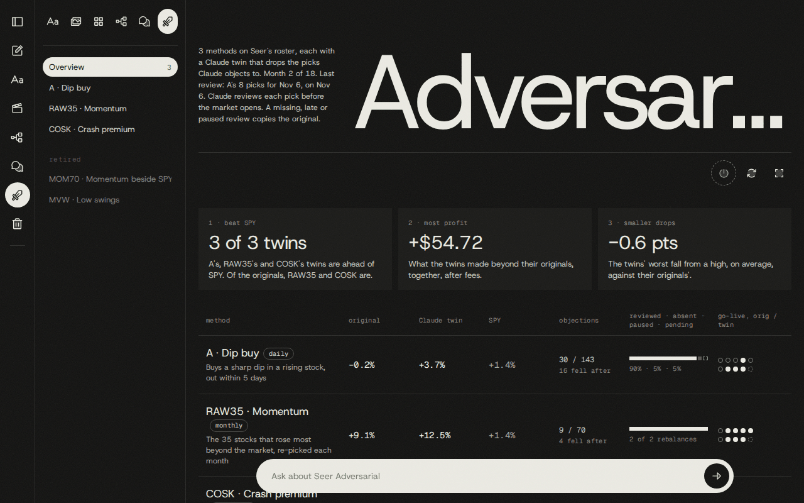
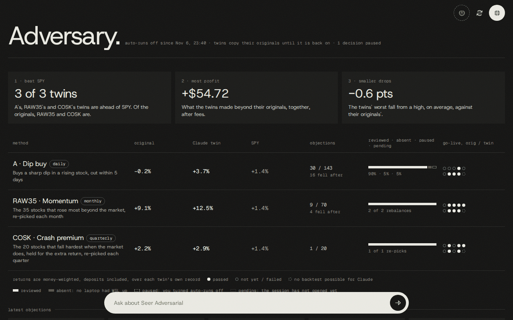
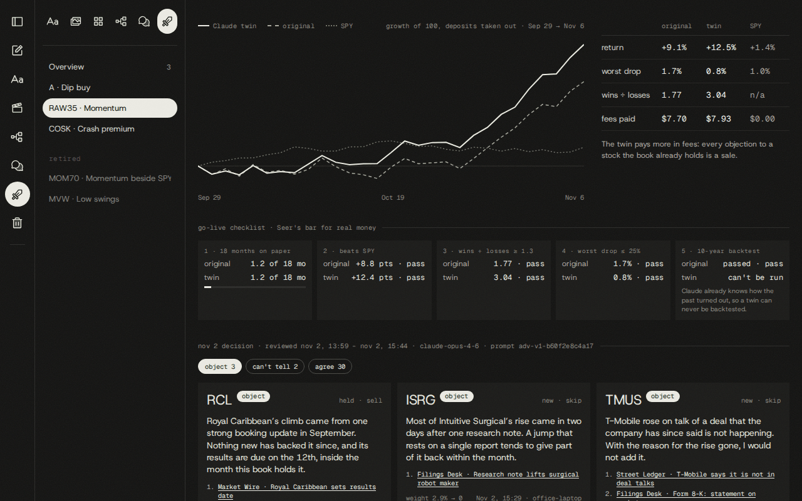
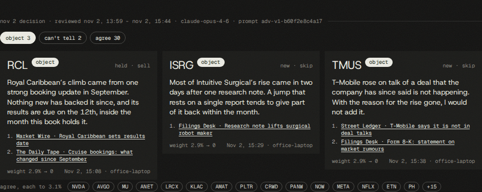
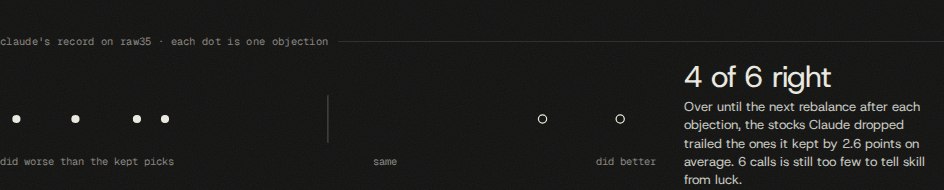
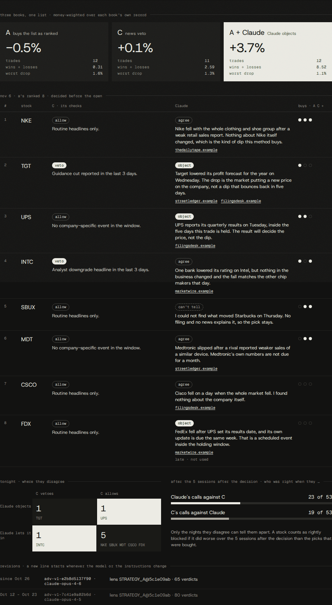

# Seer Adversarial

Seer Adversarial makes Claude the adversary of every trading method on Seer's roster. Before a
method's pick is bought, a background reviewer in notesd researches the stock and says **agree**,
**object** or **can't tell**, in plain words, with a link for every claim. Each method has a
**Claude twin** in Seer: a paper book that runs the same method but drops what Claude objected to.
The wall's `/adversary` page shows the twins next to their originals and SPY, every verdict with
its sources, and whether the objections turned out right.

Two repositories are involved. Seer (found through `SEER_DIR`, see
[connectors.md](connectors.md)) owns the roster, the twins, the prices and the simulator. mcp-notes
owns the reviewer, the read model, the page and the MCP tools. mcp-notes writes three narrow tables
in Seer's database and nothing else.

Every picture in this guide comes from a throwaway instance with an invented roster, invented
verdicts and invented prices. The tickers are real symbols; nothing else is.



## The idea

| Term | Meaning |
|---|---|
| Original | A method on Seer's roster, for example `A-GT` (daily dip buy) or `RAW35-FR-GT` (monthly momentum book). |
| Twin | The roster row whose `twin_of` names the original, for example `A-GT-CX`. Same rule, same capital, same deposits and fees. It skips what Claude objected to. |
| Decision | One method's picks for one US session: the ranked candidates of a daily (bracket) method, or the target weights of a book at a rebalance. Stored in Seer's `strategy_candidates`. |
| Verdict | Claude's call on one pick of one decision: `agree`, `object` or `unsure` (shown as "can't tell"). Stored in Seer's `adversary_verdicts`. |
| C | Seer's own news-veto method (`C-GT`), an LLM critic of A. It is never reviewed and has no twin. It appears only beside A in the three-way. |

What a verdict does to the twin is decided in Seer's engine, not here:

- **object** drops the pick. In a book the remaining targets share its weight pro rata. In a daily
  method the next-ranked candidate takes the slot.
- **agree** and **can't tell** keep the pick. "Can't tell" means "follow the method".
- **No verdict in time** (nobody reviewed, the review failed, or it landed late) means the twin
  copies the original for that decision.

A twin can never be backtested, because Claude already knows how the past turned out. Its record
is forward only.

## Opening the page

The Sword icon ("Seer Adversarial") in the rail and the sidebar opens `/adversary`. A second press
returns to the wall. `/adversary/<strategy_id>` opens one method; a click on a method row or a
sidebar entry goes there. A twin's id in the URL or in a tool argument means its original.

The sidebar lists Seer's roster the way Projects lists repositories: "Overview" first with the
number of active methods, then the active methods, then the retired ones greyed.

The toolbar has three icon buttons:

| Button | What it does |
|---|---|
| Power | The shared ON/OFF switch for automatic reviews. On: "Auto-runs on (click to pause)". Off: a dashed ring, "Auto-runs off (click to turn on)". Disabled when this machine's reviewer is not running. |
| Review now | Starts one review pass at once, even while auto-runs are off. On a method page it reads "Review this method now" and reviews only that method. The page says "review started" straight away; verdicts arrive later. |
| Focus (Alt+Z) | Hides the rail, sidebar and header (`?focus=1`). Alt+Z toggles it and Esc leaves it, exactly as on Projects. |

The page re-fetches on every `adversary` server-sent event and every two minutes while the tab is
visible, which picks up verdicts written by the daemon on the other machine.

The pill at the bottom, "Ask about Seer Adversarial", is the wall's chat bar. It sends the question
with `[Seer Adversarial · <strategy id or overview>]` on the first line, and the answer opens in
the answer panel over the page. See [chat.md](chat.md).

## The overview

- **Header line.** How many methods have a twin, "Month N of 18" (Seer wants 18 months on paper
  before real money), and the last review.
- **Cause tiles.** Seer's cause in order: 1 · beat SPY (how many twins are ahead of SPY, and which
  originals are), 2 · most profit (what the twins made beyond their originals, together, after
  fees), 3 · smaller drops (the twins' worst fall from a high against their originals', in
  points).
- **One row per method.** Original, twin and SPY returns; objections as `objected / reviewed` with
  "N fell after" once objections have run their course; a coverage bar; both go-live checklists as
  five dots each.
- **Latest objections.** The eight newest `object` and `can't tell` verdicts that counted, as
  cards with their sources.

Returns are money-weighted with deposits included, and every comparison runs over the twin's own
record, because a twin starts later than its original and runs one session behind it.

The coverage bar counts decisions, not stocks:

| State | Meaning |
|---|---|
| reviewed | At least one verdict was decided before the session opened. |
| absent | The session opened with no verdict in time. The twin copied the original. |
| paused | Same, but a `paused` mark exists: the owner had auto-runs off. |
| pending | The session has not opened yet. |



## A method page

A book method (monthly, quarterly) and a daily method without a C sibling get this page.



- **Curves.** Twin, original and SPY as growth of 100 with deposits taken out, on the twin's dates.
- **Stats.** Return, worst drop, wins ÷ losses and fees paid for each. A note appears when the twin
  paid more in fees: objecting to a stock the book already holds is a sale.
- **Go-live checklist.** Seer's five rules for real money, original and twin side by side: 18
  months on paper, beats SPY, wins ÷ losses ≥ 1.3, worst drop ≤ 25 %, 10-year backtest. The
  twin's fifth rule always reads "can't be run".
- **The decision.** The newest decision that is pending or reviewed. Its line shows when it was
  reviewed, the model and the prompt version. Three filter pills (`object`, `can't tell`, `agree`)
  switch the cards; the agreed names also show as chips under the other two.
- **Claude's record.** One dot per objection that has run its course.
- **Revisions.** One line per (prompt version, model, lens), newest first.

### Verdict cards



A card shows the stock, the verdict, the reason, numbered sources (`publisher · title`, with the
fetch time as a tooltip), and a footer with the time and the host that made the review.

For a book, the card also shows:

- `held · sell` when Claude objected to a stock the book already holds, `new · skip` when the
  stock would have been a new purchase.
- `weight a% → b%`: the original's target weight and the twin's. The twin's weight comes from the
  twin's own book once the twin has decided that session; before that it is the expected weight
  (0 for an objection, the pro rata share for the rest).

A verdict decided after the open is drawn dimmed with "late · not used".

### The record



For each objection, the page compares the stock's return over the method's own horizon with the
average return of the picks Claude kept on the same decision:

| Method kind | Horizon |
|---|---|
| Daily (bracket) | The stock's fifth session from the decision session (A's 5-session time stop). |
| Book | The last bar before the method's next decision. Pending until that decision exists. |

Returns run from the close on the decision's data date. A dot left of the middle line is a stock
that did worse than the kept picks, so Claude was right. "Same" is within half a point. With
fewer than 30 calls the page says the sample is too small to tell skill from luck.

## The daily three-way

A daily method that has a C sibling (same rule set, Seer's news veto) gets a different page:
A, C and A + Claude compared.



- **Three books.** The original (buys the list as ranked), C (its news model vetoes), and the twin
  (Claude objects), each with its return over its own record, trades, wins ÷ losses and worst drop.
- **The ranked list.** One row per candidate: C's verdict and sentence, Claude's verdict, reason
  and sources, and three dots for which of the three books bought it. A hollow dashed dot means
  that book has not decided the session yet. The twin decides one session late, so on the decision
  night its dots are still undecided.
- **Where they disagree.** A two by two grid for this session: both block, only Claude objects,
  only C vetoes, both let it in.
- **Who was right.** Over the nights the two critics disagreed, a blocked stock counts as rightly
  blocked if it did worse over five sessions than the names neither critic blocked.
- **Revisions**, as on a method page.

`GET /api/adversary/daily/:id?session=` returns the same three-way for any past session; the page
shows the latest.

## The reviewer

The reviewer is a background job in the daemon (`src/adversary/service.ts`). It starts 30 seconds
after the daemon, then runs a pass every `ADVERSARY_POLL_MS` (10 minutes). Nothing from Seer or
GitHub triggers it: it polls Seer's database.

### What a pass does

1. Starts Seer's nightly if it is due (see [The nightly dispatch](#the-nightly-dispatch)).
2. Checks that Seer's adversary tables exist. If not, it logs "Seer's database has no adversary
   tables yet" and idles.
3. Reads the roster and keeps the **reviewable originals**: active, not a benchmark, a bracket or a
   book, and with an active twin. No strategy id is hard-coded, so a method admitted to the roster
   is reviewed as soon as its twin exists.
4. Reads their decisions from `strategy_candidates` and drops every decision whose session has
   opened.
5. If the shared toggle is off and this is an automatic pass: writes one `paused` mark per due
   decision that has neither a verdict nor a mark, and stops.
6. Otherwise plans the work under the daily cap, claims a lease per decision and reviews stock by
   stock. A review is never started once its session has opened.

### Two stages per stock

Each stock is two Claude Agent SDK runs on the owner's Claude login, in `<dataDir>/adversary`,
with no settings files, no session persistence and `permissionMode: dontAsk`.

| Stage | Model | Tools | Output |
|---|---|---|---|
| Gather | `ADVERSARY_GATHER_MODEL` (`sonnet`) | `WebSearch` and the reviewer's own in-process tools; the built-in `WebFetch` is disallowed | A dossier in plain sentences, each fact with the URL it came from |
| Verdict | `ADVERSARY_VERDICT_MODEL` (`opus`) | None | Structured JSON: `verdict`, `reason` (at most 600 characters), `source_urls` |

The gathering tools:

| Tool | What it reads |
|---|---|
| `seer_price_context` | Seer's own daily prices up to the decision night, no network: recent changes, distance from the 200-session average, daily trading value, the same for SPY. |
| `fetch_url` | Opens a public web page and returns its text. The only way a page becomes citable. |
| `finnhub_company_news`, `finnhub_earnings_calendar`, `finnhub_recommendation_trends`, `finnhub_basic_financials`, `finnhub_insider_transactions` | Finnhub. Offered only when `FINNHUB_API_KEY` is in Seer's `.env.local`. |
| `massive_news` | Massive (Polygon) news. Needs `MASSIVE_API_KEY`. |
| `sec_filings` | Recent SEC filings (8-K, 10-Q, 10-K, Form 4, takeover and delisting forms). Needs `SEC_CONTACT_EMAIL`. |

The rule that keeps verdicts honest: **only pages opened with `fetch_url` can be cited.** Each
review keeps a ledger of the pages it opened. The verdict stage receives the dossier and that
numbered list, and any URL it cites outside the list is dropped. An `agree` or `object` left with
no citation is stored as `unsure` with "No page that was actually read backs this call, so the
pick stays." A search snippet alone never counts.

The verdict is written for an owner who is not a trader: plain words, the company's name instead of
its ticker, no trading jargon.

### The lens

Claude judges each pick through the method's own lens, built in `src/adversary/lens.ts` from data:
the roster row (name, description, how it trades, rule set, gate note), the lab method's hypothesis
when the row was promoted from Seer's lab, and an optional hand-written brief in
`claude/adversary/briefs/<object_name>.md`. A method new to the roster gets a usable lens with no
code change.

The brief decides what counts as a reason to object. A dip-buy method asks whether a drop is noise
or news. A book that holds crash-prone stocks on purpose must never be told a stock is risky.

### Prompt versions and revisions

`prompt_version` is `adv-v1-<12 hex>`: a hash of both system prompts, both model names and the lens
text. It is stored on every verdict together with the exact verdict model id and the lens id. When
any of them changes, new verdicts carry a new version and the page's revisions list starts a new
line. Past verdicts are never rewritten.

### When a verdict counts

A verdict counts only if it was decided **before its session opens**: 09:30 in New York on the
session date, which is 20:30 WIB in US summer and 21:30 WIB in US winter.

- `src/adversary/sessions.ts` `sessionOpenUtc` mirrors Seer's `session_open_utc`, and the read
  model's SQL spells the same rule. Both sides pin the same two examples.
- `decided_at` is Seer's database clock at insert, not the laptop's clock.
- A verdict that lands after the open is kept for the record, logged `late` in `adversary_reviews`
  and shown as "late · not used". The twin ignores it.
- When a pick has several verdicts, the one that counts is the latest decided before the open.
  `superseded_by` is history only.

### The daily cap and the order of work

`ADVERSARY_DAILY_CAP` (15) limits **deep reviews per WIB day across both machines**. One deep
review is one stock: an attempt that finished `ok`, `failed` or `late`. Reused drafts and skipped
picks cost nothing.

Work is ordered so the cap is spent where it matters first:

1. Daily (bracket) candidates.
2. Book decisions, earliest open first.
3. Early looks at a book's next rebalance, only with budget left over.

A pick over the cap gets one `skipped_budget` row a day and no verdict, so the twin copies the
original for it. A pick whose review failed twice within a week is not retried automatically.

**Early looks.** Seer's `book_previews` says what a book would buy if it rebalanced today. When the
next rebalance is within 7 days and its real targets do not exist yet, the reviewer drafts verdicts
for the preview. A draft is stored only in `adversary_reviews`, never in Seer. When the real
targets appear, a draft for the same stock, session and prompt version is written to Seer as the
final verdict at no cost.

### Two switches

| Switch | Scope | While off |
|---|---|---|
| `NOTESD_ADVERSARY=off` | This machine. Read at start. | No reviewer at all: no reviews, no `paused` marks, no leases, no nightly dispatch. The page still reads Seer, the toggle routes answer 503 `reviewer_off` and the Power button is disabled. |
| The Power toggle | Both machines. `app_settings` key `adversary.auto` in the shared notes database; absent means on. | Automatic passes review nothing and write `paused` marks instead. "Review now" still reviews. The nightly dispatch stops too. |

Turning the toggle back on starts a pass at once. The toggle records which host changed it and
when; the page shows that in focus mode.

The difference shows in the coverage bar. A decision missed while the toggle was off is `paused`.
A decision missed because no machine with a running reviewer was up is `absent`.

### Review now

`POST /api/adversary/review-now` (the toolbar button) queues one manual pass and answers 202
before it finishes, with `reason` set when it is queued behind a pass already running. A manual
pass ignores the toggle and skips the nightly dispatch. It still obeys the daily cap, the leases
and the open: it reviews only picks that have no verdict yet and whose session has not opened.

### The nightly dispatch

Claude can only review picks that exist. Seer's GitHub workflow `nightly.yml` writes them, and
GitHub's cron fires that workflow hours late, often after the US open, when a verdict can no longer
count. So each automatic pass looks at whether to start the nightly itself
(`src/adversary/dispatch.ts`):

- Only on New York Tuesday to Saturday, and only from New York midnight plus 5 minutes (12:05 WIB
  in US winter, 11:05 in summer). The data provider refuses the day's bars before that.
- Only when no successful nightly has finished since that moment.
- It runs `gh workflow run nightly.yml --repo <owner/name> --ref main`, with the repository read
  from the `origin` remote of the Seer checkout.
- After a dispatch it waits 90 minutes before asking again, 15 minutes after a failed attempt, and
  stops after 3 dispatches per New York date. The state is `app_settings` key
  `adversary.nightly_dispatch`, shared so two laptops do not both keep asking.
- A duplicate is harmless: the workflow queues runs, and a run for a session that already
  succeeded does nothing.

It runs before the schema check on purpose, because the first nightly after a Seer deploy is what
creates the adversary tables. It needs `gh` installed and logged in on this machine; the daemon
looks on `PATH`, then in `~/.local/bin`, `/usr/local/bin` and `/usr/bin`, or uses `NOTESD_GH_BIN`.
`NOTESD_SEER_DISPATCH=off` leaves the nightly to GitHub's cron.

### Leases between two machines

Both laptops may run a daemon against the same databases. Before reviewing a decision, a daemon
claims a row in Seer's `adversary_leases` keyed by (strategy, session). The claim succeeds when
there is no lease, when the lease has expired, or when this host already holds it. Expiry is
judged by Seer's database clock, so the laptops' clocks do not matter.

A lease lasts twice the per-stock timeout plus a minute (15 minutes with the defaults), is renewed
after every stock and released when the decision is done. A daemon that finds a decision leased
skips it for this pass. A daemon that crashes leaves a lease that expires on its own.

## Claude Code and the chat

The five MCP tools are listed with their arguments in
[reference/mcp-tools.md](reference/mcp-tools.md#seer-adversarial).

| Tool | Use |
|---|---|
| [`adversary_overview`](reference/mcp-tools.md#adversary_overview) | Everything on the overview: roster, returns, objections, coverage, checklists, cause, latest objections, this machine's reviewer status. |
| [`adversary_verdicts`](reference/mcp-tools.md#adversary_verdicts) | Verdicts with reasons and sources, filtered by method, session and verdict. Without a session it answers each method's latest decision. |
| [`adversary_scorecard`](reference/mcp-tools.md#adversary_scorecard) | One method's record, and Claude against C for a daily method. |
| [`adversary_redo_context`](reference/mcp-tools.md#adversary_redo_context), [`adversary_redo_submit`](reference/mcp-tools.md#adversary_redo_submit) | Only for the `/redo` skill. |

The first three are read-only and work with the reviewer off. The wall's chat can call those three
and not the redo pair.

From any Claude Code session, through `/n` (see [claude-code.md](claude-code.md)):

```
/n what did Claude object to today?
/n how are the Claude twins doing against their originals and SPY?
/n show Claude's verdicts on RAW35 for the last rebalance, with sources
/n were Claude's objections on A right so far? and who is ahead, Claude or C?
/n is the adversarial reviewer on, and how many reviews has it used today?
```

In the pill on `/adversary`:

```
Which objections cost the twin the most in fees?
Why did Claude object to TGT?
Which decisions were absent this month, and why does that matter?
```

### /redo

`/redo <method> <TICKER>` (skill in `claude/skills/redo`) redoes one pick's review inside a Claude
Code session, which has working web search and web fetch when the headless reviewer could not open
a page.

```
/redo A SLB
/redo RAW35-FR-GT NVDA 2026-11-02
```

1. `adversary_redo_context` finds the pick and reads the clock. The method may be a full id, a
   twin's id or a short form such as `A`. Without a session it means the next session that has not
   opened.
2. If the answer says `can_redo: false`, the skill stops and says why. `closed` means the session
   has opened. `closing` means the open is less than 10 minutes away, too tight for a web review.
3. Otherwise the session researches under the returned facts, lens and rules, then calls
   `adversary_redo_submit`.
4. The daemon checks the clock again with its own time, claims the lease, writes the verdict and
   points the verdict it replaces at the new one.

The same honesty rule applies: an `agree` or `object` submitted without a source is stored as
`unsure`. A redo costs no reviewer budget and is logged in `adversary_reviews` with zero tokens.

### /check-seer-adversarial-nightly

`/check-seer-adversarial-nightly` (skill in `claude/skills/check-seer-adversarial-nightly`) answers
"will there be verdicts today, and when?". It reads the real run times of Seer's nightly with `gh`,
looks for red runs and failed steps, checks the reviewer's own preconditions (daemon up, toggle on,
twins exist, adversary tables exist, candidates written), saves one note per distinct problem, and
states in WIB when today's verdicts should land or the one cause that blocks them. It never starts
a review, a toggle change or a workflow run.

## How it writes

**Seer's database.** The connector guard that the `seer_*` tools use stays read-only. The reviewer
writes through `src/adversary/seerWriter.ts` only, which refuses any statement outside this list
before it reaches the database:

| Table | Allowed |
|---|---|
| `adversary_verdicts` | `INSERT`, and `UPDATE ... SET superseded_by` only. Verdicts are append-only. |
| `adversary_marks` | `INSERT` only. A mark is never changed or removed. |
| `adversary_leases` | `INSERT`, `UPDATE`, `DELETE`. |

One statement per call, one connection per call, on the direct URL from `SEER_DIR/.env.local`.
A replaced verdict and its replacement are written in one transaction.

**The notes database.** `adversary_reviews` (`drizzle/0011_adversary_reviews.sql`) is the
reviewer's attempt log, usage log and draft store, written only by `src/adversary/reviewsRepo.ts`.
One row per attempt:

| Column | Holds |
|---|---|
| `strategy_id`, `session_date`, `symbol` | The pick. |
| `stage` | `draft` (an early look at a preview) or `final`. |
| `status` | `ok`, `failed`, `skipped_budget` or `late`. |
| `verdict` | The verdict as stored, with `seer_verdict_id` once written to Seer and `downgraded` when a missing citation turned it into `unsure`. |
| `prompt_version`, `gather_model`, `verdict_model` | What produced it; the exact model ids the SDK reported. |
| `input_tokens`, `output_tokens`, `cost_usd`, `turns` | Usage of both stages together. |
| `error`, `host`, `reused_from`, `started_at`, `finished_at` | Why it failed, who ran it, the draft a final verdict was copied from. |

**Events.** After each committed write the service emits a change that `/api/events` sends as
`event: adversary` with `{op, strategy_id, session_date}`. `op` is `verdict`, `mark`, `toggle` or
`run` (a pass started or finished).

Routes are listed in [reference/http-api.md](reference/http-api.md#seer-adversarial). Reads need no
reviewer. The toggle `PUT` and `review-now` are same-origin only.

## Costs

- A review is a gathering run (up to `ADVERSARY_GATHER_MAX_TURNS`, 20 turns) plus a verdict run,
  bounded together by `ADVERSARY_STOCK_TIMEOUT_MS` (7 minutes). A stock that times out gets no
  verdict.
- The ceiling is `ADVERSARY_DAILY_CAP` stocks per WIB day, counted across both machines from
  `adversary_reviews`.
- Runs use the owner's Claude login, so the cost is subscription usage. `cost_usd` is the SDK's
  own figure for each attempt.
- No page shows usage. `adversary_overview` returns `reviewer.used_today` and `daily_cap`; the
  rest is a query on `adversary_reviews`:

```sql
select started_at::date as day, count(*) as attempts, sum(cost_usd) as usd,
       sum(input_tokens) as input, sum(output_tokens) as output
from adversary_reviews
where status in ('ok', 'failed', 'late') and reused_from is null
group by 1 order by 1 desc;
```

- To spend nothing: turn the Power toggle off (decisions are recorded as paused), or start the
  daemon with `NOTESD_ADVERSARY=off`.

Settings are listed in [reference/configuration.md](reference/configuration.md#seer-adversarial).

## Quirks and limits

- **A machine has to be awake.** Picks land after Seer's nightly, and a verdict must be decided
  before the US open the same evening (WIB). If no daemon with a reviewer is up in that window,
  the decision is `absent`.
- **The twin runs one session behind.** It decides session S in the next nightly, from verdicts
  decided before S opened. On the decision night its buys read as undecided and its weights are
  the expected ones.
- **Two numbers called "return".** The go-live checklist is Seer's own and is not money-weighted
  (raw equity, deposits included, as Seer's site shows it). The return columns and stats are
  money-weighted. They can differ for the same book.
- **Coverage is per decision.** A decision with one counted verdict out of 35 is `reviewed`. The
  picks without a verdict were kept.
- **`late` in coverage** counts absent decisions that have a verdict decided after the open.
- **"Review now" does not re-review.** It fills in picks without a verdict. To replace a verdict,
  use `/redo`.
- **A redo starts a revision line.** `/redo` stores the Claude Code session's model as both
  models, so its `prompt_version` differs from the reviewer's.
- **A lens that cannot be built skips the method for that pass.** When Seer's lab database cannot
  be read, the method is left out instead of being reviewed under a different lens, which would
  show as a false revision.
- **No reviewer without the `claude` binary.** The daemon logs "adversary off: claude binary ...
  not found" and behaves as with `NOTESD_ADVERSARY=off`.
- **The dispatch needs `gh`.** With `gh` missing or logged out, each attempt is logged as failed
  and counted, three a day at most.
- **Sample size.** A monthly book gives about 18 decisions in 18 months. The per-objection record
  and the daily method's candidates are where signal shows first, and the page says so when the
  sample is small.
- **Nothing here is per-machine storage.** There are no local files, so `not_on_this_machine` never
  applies. Each verdict records the host that made it.

Failure answers:

| Answer | Where | Meaning |
|---|---|---|
| 503 `seer_unavailable` | Every read route | Seer cannot be read. `detail` is `not_reachable` (no checkout, no `.env.local`, database down), `not_migrated` (Seer has no adversary tables) or `query_failed`. The page shows "Seer's database can't be reached from this machine". |
| 503 `reviewer_off` | `GET`/`PUT /api/adversary/toggle`, `POST /api/adversary/review-now` | This daemon has no reviewer. |
| `reviewer_off` (`ok: false`) | `adversary_redo_context`, `adversary_redo_submit` | Same, from the MCP tools. |
| 404 `not_found` | Method, decision, daily, scorecard, review-now | No such method, or the method has no decision for that session. |
| 400 `invalid_id`, `invalid_session`, `not_bracket` | Read routes | A malformed id or date, or the three-way asked for a book method. |
| 403 `forbidden_origin` | Toggle `PUT`, review-now | The request did not come from the wall's own origin. |
| `not_a_pick`, `unknown_method`, `ambiguous_method` | Redo tools | The stock is not in a recent decision of that method, or the method name does not resolve to one method. |
| `too_late`, `leased`, `write_failed`, `no_lens`, `seer_not_ready`, `seer_unreachable`, `invalid` | Redo tools | The session opened while researching; the other machine holds the lease; Seer refused the write; the lens could not be built; Seer is not migrated or not reachable; the reason is empty or too long, or a source is not an http(s) URL. Nothing was written. |

## Where the code is

| Path | What it holds |
|---|---|
| `src/adversary/service.ts` | `AdversaryService`: the poll loop, a pass, leases, paused marks, redo, toggle, status; `createAdversaryService` wires production. |
| `src/adversary/plan.ts` | Reviewable originals, decisions from candidates and previews, the order of work, the cap. Pure. |
| `src/adversary/agent.ts`, `prompt.ts`, `lens.ts` | The two-stage Agent SDK reviewer, both system prompts and `prompt_version`, the lens. |
| `src/adversary/tools.ts` | The gathering tools, rate limits, the source ledger, `fetch_url`. |
| `src/adversary/sessions.ts` | `sessionOpenUtc` (mirror of Seer's `session_open_utc`) and WIB days for the cap. |
| `src/adversary/seerReader.ts`, `seerWriter.ts` | Every read the reviewer makes of Seer; the table allow-list and the only writes. |
| `src/adversary/reviewsRepo.ts` | The only writer of `adversary_reviews`. |
| `src/adversary/toggle.ts`, `dispatch.ts`, `events.ts`, `redo.ts` | The shared switch, the nightly dispatch, the event bus, the pure part of `/redo`. |
| `src/adversary/read.ts`, `readSql.ts`, `readTypes.ts` | The read model behind the page and the tools. |
| `src/adversary/golive.ts`, `scorecard.ts` | Seer's checklist and money-weighted measures (ported, with a parity test); the record and the duel with C. |
| `src/http/adversaryApi.ts`, `src/mcp/adversaryTools.ts` | Routes and MCP tools. |
| `web/src/pages/AdversaryPage.tsx`, `web/src/components/adversary/*`, `web/src/hooks/useAdversary.ts`, `web/src/lib/adversary.ts`, `web/src/adversaryApi.ts` | The page. |
| `claude/adversary/briefs/*.md` | Hand-written lens briefs, one per Seer `object_name`. |
| `claude/skills/redo`, `claude/skills/check-seer-adversarial-nightly` | The two skills. |
| `drizzle/0011_adversary_reviews.sql` | The attempt and usage log. |
| `docs/plans/2026-11-05-seer-adversarial-design.md` | The design brief: the owner's decisions and the honesty rules. |

## Proving a change

The feature map is
[`.claude/skills/verify-notesd/features/adversary.md`](../../.claude/skills/verify-notesd/features/adversary.md).

- `verify.sh up --adversary` builds a throwaway Seer database from
  `${SEER_DIR:-~/seer}/db/migrations` and turns the reviewer on against it. A plain `verify.sh up`
  pins `NOTESD_ADVERSARY=off`.
- **A review on that run is real and billed.** For a free journey, write the toggle off before
  seeding (`verify.sh exec RUN "insert into app_settings ..."`, spelled out in the feature map),
  seed Seer with `verify.sh exec RUN --seer "..."`, and never click "Review now" without stubbing
  `/api/adversary/review-now`. Never drive the pill: it is the chat bar.
- Sessions in the past are never reviewed, so a seed whose sessions have all opened costs nothing
  even with the toggle on.
- Unit tests: `tests/unit/adversary/` (`golive.parity.test.ts` reads Seer's files and fails when
  the ported constants drift). Integration tests: `tests/integration/adversary/` and
  `tests/integration/connectors/adversary.int.test.ts`; they need `SEER_DIR` at a Seer checkout
  with the adversary migration and skip without it.
- The pictures in this guide are retaken with `npm run docs:shots -- adversary`
  (`scripts/docs/shots/adversary.mjs`), which seeds its own invented Seer data and starts no
  review.
