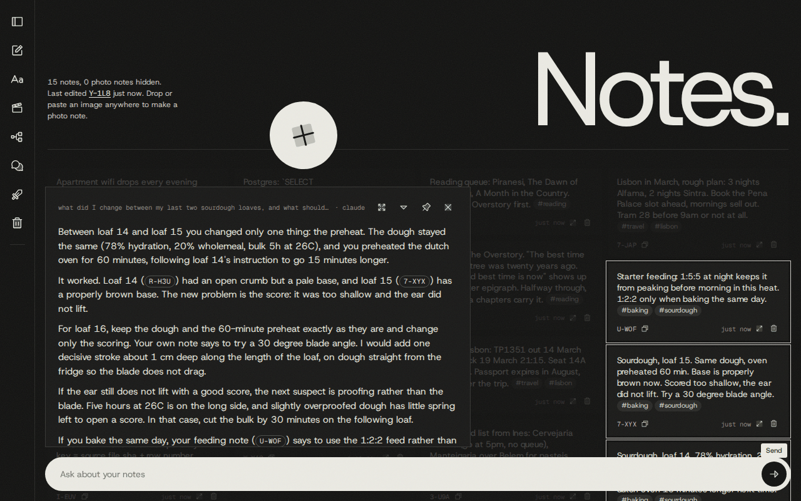
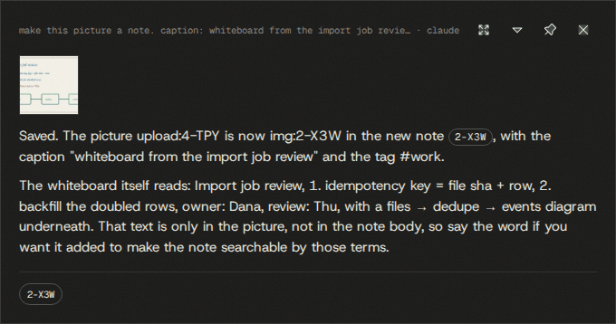
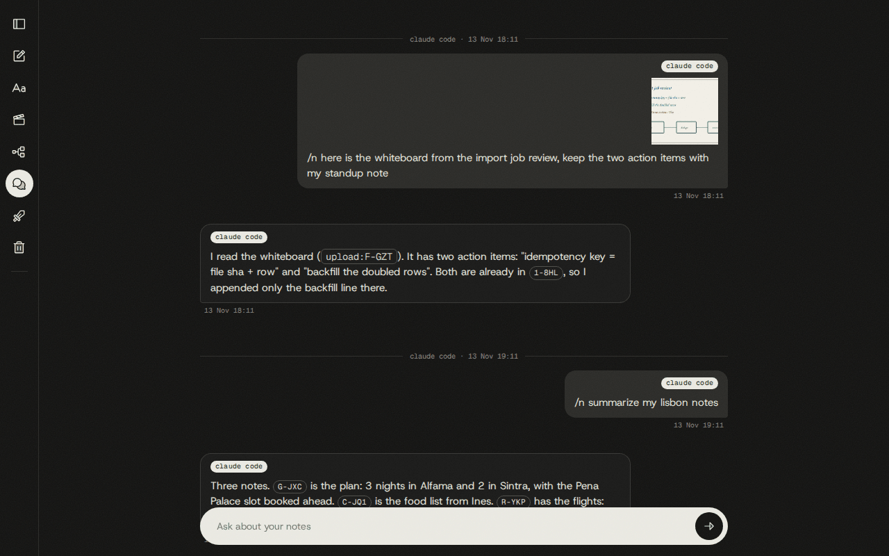
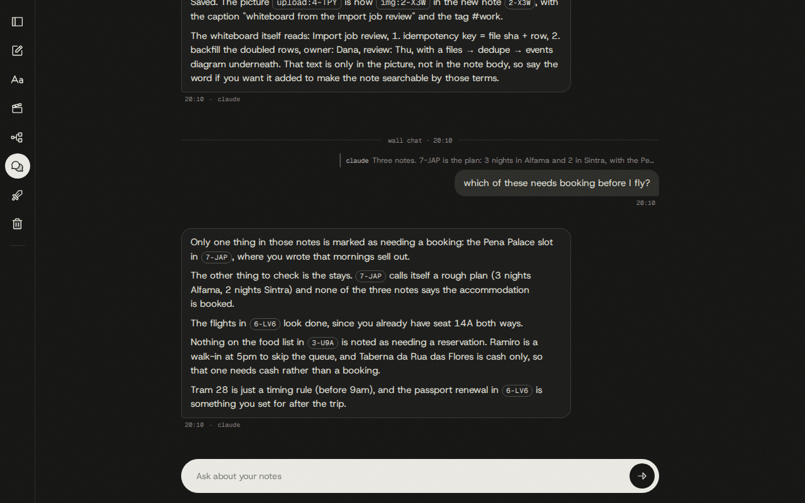
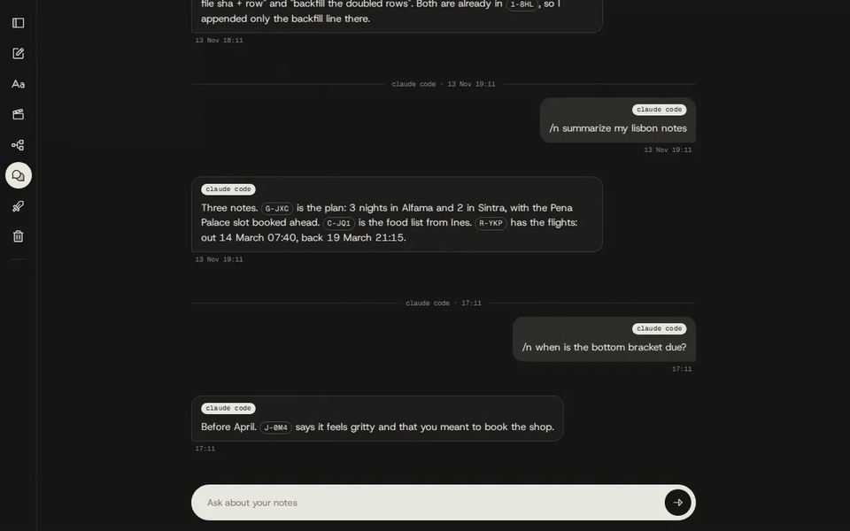

# The chat bar and the chat history page

The pill at the bottom of the wall is a plain-language command line for the note store. Each
message starts one run of a Claude agent that has the same `notes` MCP tools `/n` has, plus web
search. The answer streams into a panel above the pill, the notes it used light up on the wall, and
every question and answer is kept in notesd's own database. The history page at `/history` shows all
of them on one timeline, together with every `/n` exchange captured from Claude Code.



## Asking

Type in the pill ("Ask about your notes") and press Enter.

- **Several lines.** Shift+Enter starts a new line. Enter sends, except while an input method is
  still composing. The pill grows upward one line at a time to six lines, then scrolls inside, and
  drops back to one line after sending. Newlines reach the agent as typed.
- **Follow-ups.** The next message continues the same thread: the agent sees the earlier questions
  and answers. Dismissing the panel ends the thread, and the next message starts a new one.
- **One run at a time.** A new message stops the answer that is still streaming. That holds across
  pages too: there is one chat brain per daemon.

## The answer panel

The panel sits above the pill, whatever the pill's height. Its header shows the question on one
line (newlines become spaces, a long question is cut, the tooltip has the full text; a question
that was only pictures reads "1 image" or "2 images"). Next to it is the status line while the
agent works and, once it is done, the brain that answered (`claude` or `glm`).

| Header icon | What it does |
| --- | --- |
| Chat in full screen | Opens `/history?thread=<id>` scrolled to this conversation, outlined for a moment. |
| Collapse / Expand | Folds the panel to its header line. A collapsed answer keeps streaming; click the line to open it. Every new answer opens expanded. |
| Pin / Unpin | A pinned panel ignores Esc. |
| Dismiss | Closes the panel, stops a running answer and ends the thread. Esc does the same when the panel is not pinned. |

While an answer is open, the notes it mentions are outlined on the wall and the rest are dimmed.
They stay outlined while the panel is collapsed. Under a finished answer there is one chip per note
used ("Show on wall"): it jumps to the card and switches the view if the card is hidden. The agent
is told to quote every note it relied on by id, and the page finds the notes by those ids.

### Status lines

The status is a short caption for the tool call in progress. It clears when text starts to arrive.


| Caption | The agent is |
| --- | --- |
| searching notes | calling `search`, `list` or `tags` |
| reading a note, reading 3 notes | calling `get` |
| finding related notes | calling `related` |
| looking at a photo, looking at 2 photos | calling `view_images` |
| finding similar photos | calling `similar_images` |
| reading history | calling `revisions` |
| saving a note, editing a note, deleting a note, restoring a note | writing a note |
| saving the pasted photo as a note, attaching the pasted photo | using a picture pasted into the chat |
| attaching a photo, removing a photo, restoring a photo, moving a photo to its own note | changing a note's pictures |
| reading expenses, reading runs, reading seer, reading daily-words | reading a connector |
| looking up a word, saving a word, checking for a similar saying, saving a saying | using daily-words |
| searching sessions, reading a session, reading a session transcript, counting session tokens, opening a session in tmux | using the session tools |
| reading Seer Adversarial, reading Claude's verdicts, reading Claude's record | reading the adversary tools |
| searching movies, reading a title, reading watch history, reading a filmography, marking a title, opening VLC | using the movie tools |
| searching the web, reading a web page | calling WebSearch or WebFetch |

### Ids in an answer are links

The same rules apply in the answer panel and in every bubble on the history page
(`web/src/lib/chatSegments.ts`).

| Written in the text | Becomes | A click |
| --- | --- | --- |
| A note id, `A-B32` | a note link | Opens the note in the big editor right where you are; the wall, the bin or the history page is unchanged when you close it. Ctrl/cmd-click or middle-click opens the wall on that note in a new tab. |
| A wall link, `[A-B32](http://localhost:7317/?note=A-B32)` (how Claude Code writes ids) | a note link | Same as above. |
| A session node id, `A0-3G`, or a link to `/projects?...node=A0-3G` | a node link | Opens the session's pop-up. See [sessions.md](sessions.md). |
| A movie id, `M-23T4`, or a link to `/movies/M-23T4` | a movie link | Opens the movie pop-up with Play. See [movies.md](movies.md). |
| `img:9-TD6`, `upload:G-0NC` | a picture link, on the history page | Opens that note picture or pasted picture large. |
| An `http(s)` URL or a markdown link | a link | Opens in a new tab. |

The rules that keep this from misfiring:

- An id is never linked inside a code span, inside a URL, in a path or file name, or as part of a
  longer word.
- A note id is linked when it is written in canonical upper case, or in any case when the page
  already holds that note. A note the wall has not loaded is fetched on click. A deleted one says
  "A-B32 is deleted. Restore it from the bin." and an unknown one says "no note A-B32".
- A node id is linked only when the server knows that session. `CI-CD` and `UI-UX` have the same
  shape and stay text.
- A movie id is linked by shape alone. The pop-up says so when the id names nothing. A movie id
  that the model wrote as a note link (`/?note=M-23T4`) still opens the movie.
- In the big editor, the crosshair icon ("Show on wall") closes it, goes to `/?note=<id>` and
  outlines the card.

## Pictures

Paste a screenshot or photo while the pill has focus and it goes with the next question instead of
becoming a note.


- The thumbnail shows a spinner while it uploads and a warning mark if the upload failed. The ×
  takes it out. Send is disabled until every picture is uploaded or removed.
- Up to four pictures go with one message, and a message may be pictures alone.
- The answer panel shows the pictures above the answer. Click one to view it large.
- The agent sees the pictures of the current message, each named by an upload id
  (`upload:A-B32`). It is told to state that id once in its answer, so a later message can point
  at "that image".
- Pasted pictures are stored once per sha256 under `<NOTES_DATA_DIR>/chat-images/` and are never
  notes. They do not appear on the wall. The model receives a JPEG preview (long edge at most
  1568 px), never the original.
- Pasting anywhere else on the wall still makes a photo note, and pasting into the open big editor
  still attaches to that note. Dropping a file on the page always makes a note.

Ask the agent to keep a pasted picture and it calls
[`create_image`](reference/mcp-tools.md#create_image) with the upload id, or
[`attach_image`](reference/mcp-tools.md#attach_image) to add it to an existing note. If the same
picture already lives in a note, it tells you which note instead of making a second one.



A picture that already lives in a note can be sent too. The "Chat about this image" icon in the
photo viewer opens the history page with that picture attached to the composer. It is sent by
reference (nothing is copied or uploaded), and the agent reads it as a note image, with its note
id.

## What the agent is

`src/chat/agent.ts` runs the Claude Agent SDK: headless Claude Code on the owner's existing login,
one run per message.

- **Stateless runs.** No SDK session is resumed or written (`persistSession: false`). Each turn
  rebuilds the conversation from notesd's own rows (`src/chat/turn.ts`, `context.ts`), so Claude
  and the GLM fallback see the same history and nothing depends on `~/.claude/projects`.
- **Closed tool surface.** The run loads no user or project settings, no plugins and no other MCP
  server (`settingSources: []`, `strictMcpConfig`). It gets the daemon's own `/mcp` endpoint and
  the two web tools, and only the tools on the allow list in `src/chat/status.ts`
  (`allowedChatTools`). Anything else is refused without a prompt (`permissionMode: 'dontAsk'`).
- **Its own system prompt.** `src/chat/prompt.ts` replaces Claude Code's default prompt. It is
  built per run, so "today" is current: relative dates ("last week", "30 oct") are resolved in the
  daemon's time zone, weeks start on Monday. The notes MCP server's own instructions come on top.
- **The login, never a key.** `src/chat/env.ts` strips `ANTHROPIC_API_KEY`, base-URL and model
  overrides and every `CLAUDE_CODE_*` variable from the child's environment, so a daemon started
  from inside a Claude Code terminal does not hand its session markers to the run.
- **Limits.** `CHAT_MAX_TURNS` (default 24) caps the agent's turns per message and
  `CHAT_TIMEOUT_MS` (default 180000) caps the wall-clock time. `NOTESD_CLAUDE_BIN` names the
  `claude` binary. See [configuration](reference/configuration.md).

### Tools it can use

The allow list, by group. Arguments are in the [MCP tool reference](reference/mcp-tools.md).

| Group | Tools | Writes? |
| --- | --- | --- |
| Notes | `create`, `get`, `update`, `append`, `delete`, `restore`, `list`, `search`, `tags`, `related`, `revisions`, `revert` | Yes, when asked |
| Pictures | `create_image`, `view_images`, `attach_image`, `remove_image`, `restore_image`, `move_image`, `similar_images` | Yes, when asked |
| Sessions | `sessions_search`, `session_get`, `session_transcript`, `sessions_usage`, `session_resume` | `session_resume` opens tmux |
| Connectors | every `expenses_*`, `runs_*`, `seer_*` tool | No, read-only |
| daily-words | every `dword_*` tool | Yes: words and sayings |
| Seer Adversarial | `adversary_overview`, `adversary_verdicts`, `adversary_scorecard` | No |
| Movies | `movies_list`, `movies_get`, `movies_history`, `movies_person`, `movies_mark`, `movies_continue` | `movies_mark` stores a mark; `movies_continue` starts VLC |
| Web | `WebSearch`, `WebFetch` | No |

Not on the list: `link_note` and `unlink_note` (linking a note to a session is `/n` only) and the
adversary redo tools.

### How it is told to behave

These rules come from the system prompt, so they shape every answer:

- Plain prose for a small panel: short paragraphs, no headings, tables or bold, a list only when
  asked. The answer comes first, then the detail.
- Every note it used is quoted by id. It never invents an id.
- It changes notes only when asked, reads a note before updating it, never creates a note unless
  asked, and never saves its own answer as a note.
- It sees a note's files by name, type and size but cannot open them and cannot attach files.
- From spending, runs or Seer it gives the figures in the app's units, says which dates it looked
  at, compares with the previous period and ends with one suggestion. If an app cannot be read it
  says which one and does not guess.
- For connectors it uses the curated tools first, and a `*_sql` tool only after calling the
  `*_schema` tool.
- A vocabulary question ("what does X mean", "add the word X") or a saying to keep is handled
  with the daily-words tools, as `/v` and `/j` do. There is no slash-command parser in the chat
  bar: it reads plain language, and a message that starts with `/v` or `/j` means the same.
- It calls `movies_continue` only when asked to play, resume or continue something.

### Claude first, GLM as fallback

If the Claude run fails on a usage limit, a billing problem or a login problem before any text has
streamed, the same message is retried once on GLM (z.ai, an Anthropic-compatible endpoint
configured by `LLM_BASE_URL`, `LLM_API_KEY` and `LLM_MODEL`). The panel's header and the history
bubble say which brain answered. Without the three `LLM_*` keys there is no fallback.
`CHAT_BRAIN=glm` makes GLM the only brain, and the daemon refuses to start with that setting when
an `LLM_*` key is missing.

## Threads and replies

A thread is one conversation. Each turn the agent receives, in order: the earlier messages of the
thread (`<chat_history>`), the message being replied to if there is one (`<reply_to>`), and the
current message (`<message>`). Every message has a four-character id (`K7F2`), written to the model
as `[msg:K7F2]` with its time in WIB.

- **What the agent remembers.** Only the text of earlier answers, not the tool results behind
  them, so it calls the tools again when it needs the data. Deleted messages are left out, and an
  edited message is seen with its new text.
- **How much.** The newest 24,000 characters of history are kept and each earlier message is cut
  at 4,000 characters; older messages are replaced by one line saying they were omitted. The
  current message is never cut.
- **Pictures.** The agent sees the pictures of the current message and of the message being
  replied to. Earlier pictures appear only as their `[image upload:ID]` label.
- **Replies from the agent.** The agent may start an answer with `[msg:K7F2]` to reply to one
  earlier message. The server strips the label while streaming (`src/chat/citation.ts`) and
  stores the link; the history page shows the answer with a quote of that message.
- **Replies from you.** On the history page, Reply on any bubble quotes it in your next message.
  The agent sees the quoted message even when it belongs to another thread.

## Page-aware pills

The wall's pill is hidden on the other pages, which have their own.

| Page | Pill | What it does |
| --- | --- | --- |
| `/movies` | "Ask about your movies", or "Ask about \<title\>" on a title's page | The wall chat, with the page (and the open title's movie id) named on the first line of the message, so "this film" and "this director" mean that title. The answer opens in the same panel over the page. See [movies.md](movies.md). |
| `/adversary` | "Ask about Seer Adversarial" | The wall chat, with the page and the selected strategy named on the first line. See [adversary.md](adversary.md). |
| `/projects` | "Ask about \<repo\>" | A chat scoped to one repository. Its threads carry that repo, the agent's turn starts with a `<project>` block that points it at that repo's sessions, and sending switches the page to the project's chat history. The toggle in the project header (Alt+C) switches between the graph and that history. See [sessions.md](sessions.md). |
| `/history` | "Ask about your notes" | The same chat, answered in place as bubbles. See below. |

A thread never changes project: a project thread stays with its repo and a wall thread stays
unscoped. Project threads also appear on `/history`, which lists every thread.

## The history page

The chat-history icon in the sidebar (or "Chat in full screen" on the answer panel) opens
`/history`. A second press of the icon returns to the wall, and back and forward move between the
wall and this page.



- **One timeline.** Every wall chat and every `/n` exchange, oldest at the top. A divider marks
  where a thread starts and says "wall chat" or "claude code". Bubbles captured from the terminal
  carry a "claude code" badge.
- **Times** are shown in Jakarta time (UTC+7) on every machine. Hover a time for the full
  timestamp. Answers also show the brain that wrote them.
- **Pictures** show as thumbnails. Click one to view it large; the arrow keys move between that
  message's pictures.
- **Paging.** The page loads the newest 50 messages and fetches older ones as you scroll up (or
  with "Earlier messages").
- **Live.** New messages appear without a reload, including a `/n` you ran in another window, and
  an edit or delete made in another tab.
- **The composer** at the bottom works like the wall's pill and takes pasted pictures. The answer
  streams into a bubble (it shows "thinking" and then the status line). A message continues the
  newest conversation when that one is a wall chat, and starts a new thread when the newest
  exchange came from Claude Code. Its draft and pasted pictures are separate from the wall pill's.

### Reply, edit, delete

Hover or Tab onto a bubble for its actions.

| Action | On | What happens |
| --- | --- | --- |
| Reply | any bubble | A chip above the composer names the bubble; × cancels. The sent message shows a quote of the original, and a click on the quote jumps to it (loading older pages if needed). Replying to a wall bubble continues that thread. Replying to a "claude code" bubble starts a new wall thread. |
| Edit | your own messages | Edits in place: Enter saves, Esc cancels, Shift+Enter is a new line. The bubble is marked "edited" (hover for when) and the old text is kept as a revision. The answer is not regenerated: only later turns see the new text. |
| Delete | any bubble | Soft delete. On a question that has an answer it asks "Delete the answer too?" (Question only / Question and answer). A line above the pill offers Undo for 6 seconds. |
| Restore | a deleted bubble | "Show deleted" lists deleted bubbles dimmed, each with Restore. The toggle is remembered for the tab. |



Edit a question, delete it together with its answer, then undo:



### `/n` exchanges from Claude Code

The `notes-capture` Stop hook (see [claude-code.md](claude-code.md)) posts every finished `/n`
turn to `POST /api/capture/claude-code`: the prompt as typed, Claude's final answer, both
timestamps and any pasted pictures. notesd stores it as a single-turn thread with source
`claude_code`.

- The route needs the header `X-Notes-Capture: 1`, a JSON body, a loopback request URL and no
  foreign `Origin`. A browser page elsewhere cannot post to it.
- It is idempotent on `<claude_session>:<user_uuid>`: the first call answers 201, a replay answers
  200 with `duplicate: true` and writes nothing.
- An exchange with an empty answer stores the question alone.
- Limits: 8 pictures of at most 20 MB each (PNG, JPEG, GIF or WebP), a 64 MB body, a 200,000
  character prompt and a 1,000,000 character answer.
- The hook spools each payload to an outbox first and retries later when the daemon is down, so a
  capture can arrive late. It keeps the time of the prompt, so it lands in the right place on the
  timeline.

Captured exchanges are read-only history as far as Claude Code is concerned: replying to one on
the history page starts a wall thread, answered by the chat agent, not by the terminal session.

## Example questions

Each group lists the tools the question needs. All of them are on the allow list above.

Finding and reading notes (`search`, `list`, `get`, `tags`, `related`):

```text
what did I change between my last two sourdough loaves, and what should I try next?
summarize my #seer notes this week, compare to last week
what did I save on 30 oct?
which tags have I not used since september?
what else do I have that is related to A-B32?
```

Changing notes (`create`, `update`, `append`, `delete`, `restore`, `revisions`, `revert`):

```text
save a note: renew the passport after the Lisbon trip #travel
add #bike to the note about the derailleur
append "booked for 3 April" to A-B32
delete the two oldest #scratch notes
bring back the note I deleted about the router
what did A-B32 say before I edited it? put the old text back
```

Pictures (`list` with `has_image`, `view_images`, `similar_images`, `create_image`,
`attach_image`, `move_image`, `remove_image`):

```text
what's in the photos I saved on 26 oct?
(paste a picture) make this picture a note. caption: whiteboard from the import job review #work
(paste a picture) add this to A-B32
(paste a picture) do I have photos like this one?
find my photos of a red top in a car
move the second picture of A-B32 to its own note
```

Follow-ups and replies (the thread, `<reply_to>`):

```text
and the week before?
(Reply on a bubble) which of these needs booking before I fly?
```

The web (`WebSearch`, `WebFetch`):

```text
what is Invisible Cities about? search the web, and do I have a note on it?
```

The owner's other apps (`expenses_*`, `runs_*`, `seer_*`, `adversary_*`; see
[connectors.md](connectors.md) and [adversary.md](adversary.md)):

```text
how much did I spend on meals in october, and which week was the worst?
how did my long runs go this month compared with last month?
what is on top of the Seer leaderboard, and what positions are open?
which picks did Claude object to today, and how has its record been?
```

daily-words (`dword_vocab_lookup`, `dword_vocab_add`, `dword_journal_find_similar`,
`dword_journal_add`):

```text
add the word perch, as in "the bird's perch"
have I saved something like "a stitch in time saves nine"?
```

Claude Code sessions (`sessions_search`, `session_get`, `session_transcript`, `sessions_usage`;
best asked from the pill on `/projects`, see [sessions.md](sessions.md)):

```text
which session fixed the import job retry bug?
how many tokens did I use in mcp-notes this week?
```

Movies (`movies_*`; see [movies.md](movies.md)):

```text
what did I watch last weekend?
what else did this director make, and which have I seen?   (from a title's page)
continue MobLand
play something
```

## Quirks and limits

- **Chat is billed and it is the real login.** Every message runs a real agent on the owner's
  Claude login. There is no dry-run mode in the daemon; tests inject a stub or a scripted backend.
- **The question is saved first.** The user's message is written before the agent starts, so it
  survives any failure. The answer is written only when the run ends cleanly. A stopped or failed
  run leaves a question without an answer on the history page.
- **Failures show in the panel** as "Chat failed: ..." after whatever text had streamed:

  | Message | Cause |
  | --- | --- |
  | Chat stopped: no answer within 180 s. | `CHAT_TIMEOUT_MS` passed. |
  | Chat stopped: the agent hit its 24-turn cap before finishing. Try a narrower question. | `CHAT_MAX_TURNS` reached. Not retried on GLM. |
  | Chat stopped: a newer message replaced this one. | Another message was sent, from any page or tab. |
  | Chat stopped: notesd is shutting down. | The daemon stopped during the run. |
  | Could not read pasted image ... | The picture's preview file is gone. Not retried on GLM. |

- **The fallback is one retry, before any text.** Once Claude has streamed text, a failure is
  final, so an answer is never duplicated. Errors that are not about limits, billing or login do
  not fall back.
- **Refused before the stream starts** (plain JSON, not SSE): 400 `invalid_reply_to` or
  `unknown_image`, 404 `reply_not_found` (the bubble replied to is deleted or gone), 409
  `not_on_this_machine` (a pasted picture whose file is on the other machine), 422
  `unreadable_image`. More than four pictures is a 400.
- **Pictures are per machine.** A pasted picture's file lives on the machine that received it. On
  the other machine its thumbnail is missing (`404 not_on_this_machine`) and it cannot be sent to
  the agent, until the same bytes are pasted there: the store then writes the file back under the
  same id. Pasted pictures are never deleted; there is no bin for them.
- **Messages are soft-deleted only.** There is no hard delete for chat messages and no page that
  lists a message's old texts; revisions are kept in `chat_message_revisions`.
- **Only your own messages can be edited** (`not_editable` for an answer), and a blank edit is
  refused (`empty_text`).
- **Two machines.** Chat rows are in the shared database, so both machines show the same history.
  `event: chat` on `/api/events` carries only this daemon's writes; the history page reloads its
  newest page when it is opened, so the other machine's chats appear then.
- **A thread id the server does not know starts a new thread**, as does one that belongs to
  another project or to a captured exchange. Captured `claude_code` threads are never continued.
- **Tools reach outside the note store.** From the chat bar `movies_continue` opens VLC on the
  owner's screen and `session_resume` opens a tmux window. The connector tools read the owner's
  real apps. A throwaway verify instance does not sandbox those.
- **Embeddings are optional.** Without `OPENROUTER_API_KEY` the agent's `search` calls run as
  full text and report a fallback, and `related` and `similar_images` depend on vectors that are
  not being made. See [search.md](search.md).
- **A message cannot forge the prompt layout.** `<message>`, `<chat_history>`, `<reply_to>` and
  `<project>` tags typed into a message are neutralised before the turn is composed.

## How it is stored

`drizzle/0006_chat_history.sql` creates the four tables; `drizzle/0003_chat_images.sql` holds
pasted pictures and `drizzle/0007_cc_sessions.sql` adds `chat_threads.project`.

| Table | Holds |
| --- | --- |
| `chat_threads` | One row per conversation: a uuid, `source` (`wall` or `claude_code`), the brain that answered last, `external_key` (the capture's `<claude_session>:<user_uuid>`), `project` (a repo, for project chat). |
| `chat_messages` | One row per bubble: the four-character id, role, text, source, brain, `reply_to`, `edited_at`, `deleted_at`. |
| `chat_message_revisions` | The old text of every edit. |
| `chat_message_attachments` | What a message carries, by reference: a pasted picture (`chat_image`), a note picture (`note_image`) or a note file. |
| `chat_images` | Pasted pictures: sha256, size, host, path under `chat-images/YYYY/MM/`. |

`ChatService` (`src/chat/service.ts`) is the only writer of the chat tables. Every write is one
transaction, and after it commits the service emits a change that `/api/events` sends to the
browser as `event: chat {op, thread_id, id}` with `op` one of `created`, `updated`, `deleted`,
`restored`. The history page listens and re-fetches.

`POST /api/chat` itself answers as server-sent events: `accepted` (the thread and the saved
question), then `status` and `delta` events, then `done` (with the answer's id, the brain and any
`reply_to`) or `error`. Routes and payloads are in the
[HTTP reference](reference/http-api.md#chat).

## Where the code is

| Path | What it holds |
| --- | --- |
| `src/chat/agent.ts` | The Agent SDK backend: one run per message, SDK options, timeout, stop reasons, the GLM retry. |
| `src/chat/prompt.ts` | The whole system prompt, built per run. |
| `src/chat/status.ts` | The tool allow list (`allowedChatTools`) and the status captions (`captionForToolUse`). |
| `src/chat/context.ts`, `turn.ts`, `compose.ts` | Rebuilding the turn from stored rows: blocks, budgets, image blocks. |
| `src/chat/citation.ts` | Stripping a leading `[msg:ID]` from the stream into `reply_to`. |
| `src/chat/env.ts` | The child environment for Claude and for GLM. |
| `src/chat/service.ts`, `repo.ts`, `events.ts`, `ids.ts`, `types.ts` | Threads, messages, edits, deletes, the timeline, the change bus. |
| `src/chat/images.ts`, `noteImages.ts` | The pasted-picture store and note pictures sent by reference. |
| `src/chat/capture.ts`, `src/http/capture.ts` | Storing a `/n` exchange; the capture route and its guard. |
| `src/chat/project.ts` | The repo key of a project thread. |
| `src/chat/stub.ts` | The backend tests use when no agent should run. |
| `src/http/api.ts` | `POST /api/chat` and `GET /api/events`. |
| `src/http/chatApi.ts`, `chatImages.ts` | History routes; pasted-picture routes. |
| `web/src/components/ChatBar.tsx`, `AnswerPanel.tsx`, `ChatText.tsx` | The pill, the panel, linked text. |
| `web/src/hooks/useChat.ts`, `useChatImages.ts` | The wall chat's state and its pasted pictures. |
| `web/src/lib/chatSegments.ts`, `usedIds.ts` | Which ids become links; which notes an answer used. |
| `web/src/pages/HistoryPage.tsx`, `components/Bubble.tsx`, `MessageItem.tsx`, `ReplyChip.tsx`, `HistoryTools.tsx` | The history page. |
| `web/src/hooks/useHistory.ts`, `useHistoryActions.ts`, `useMessageActions.ts`, `useJumpToMessage.ts` | The timeline store, reply, edit, delete, undo, jump to a quoted bubble. |
| `web/src/components/projectChat/`, `movies/MoviesPill.tsx`, `adversary/AdversaryPill.tsx` | The page-aware pills. |
| `claude/hooks/notes-capture.mjs` | The Stop hook that posts `/n` exchanges. |
| `tests/unit/chat-*.test.ts`, `tests/integration/chat.*.int.test.ts`, `capture*.int.test.ts` | Tests. `npm run test:live` is the opt-in, billed run against the real agent. |

## Proving a change

The feature map entry is `.claude/skills/verify-notesd/features/chat.md`.

- History, edits, deletes and captures need no agent. Launch with `verify.sh up` (add `--web` when
  `web/` changed), seed exchanges through `POST /api/capture/claude-code`, then drive
  `GET /api/chat/messages`, `PATCH`, `DELETE` and restore with `verify.sh api`, and the page with
  `verify.sh ui`.
- A real chat turn is billed. Drive one only when the change is in the chat path, once, with a
  one-line question about seeded notes, and say in the report that it was billed. Do not ask a
  throwaway instance about spending, runs, Seer or movies: those tools read the real apps.
- The pictures in this guide come from `scripts/docs/shots/chat.mjs`. `npm run docs:shots -- chat`
  retakes the free ones (`paste.png`, `history.png`, `history-actions.gif`).
  `DOCS_CHAT_BILLED=1 npm run docs:shots -- chat` also sends three billed messages for
  `answer.png`, `working.png`, `image-note.png` and `history-reply.png`;
  `DOCS_CHAT_STEPS=answer,image,reply` picks which.
