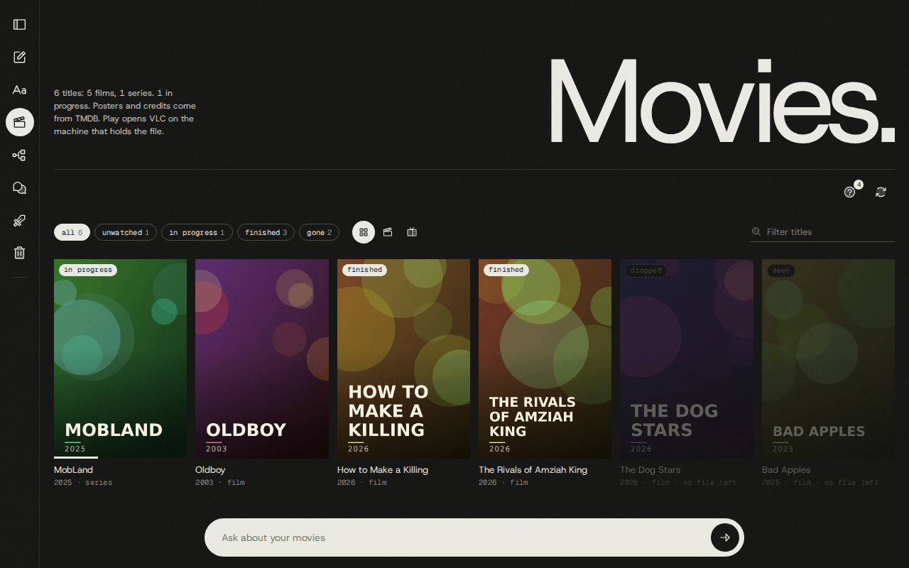
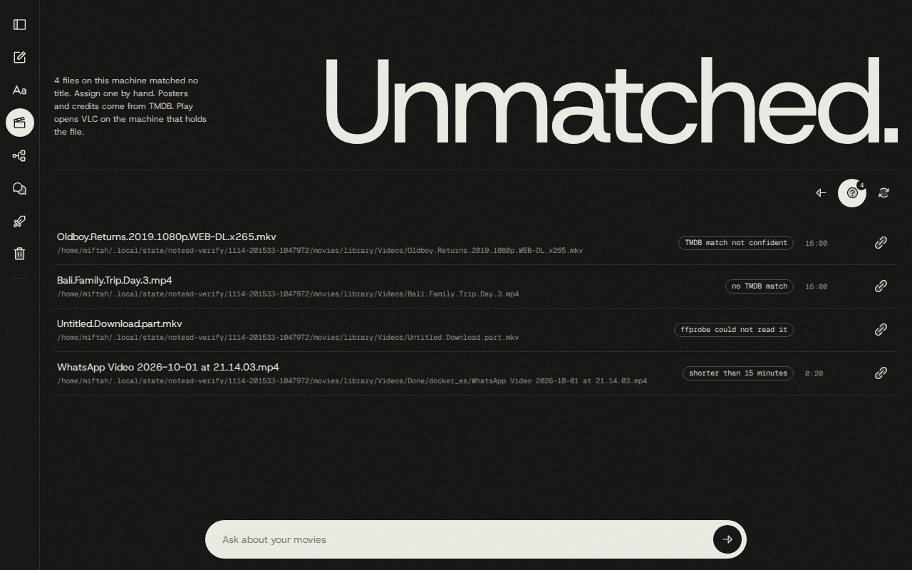
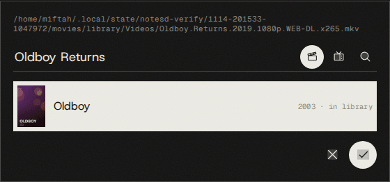
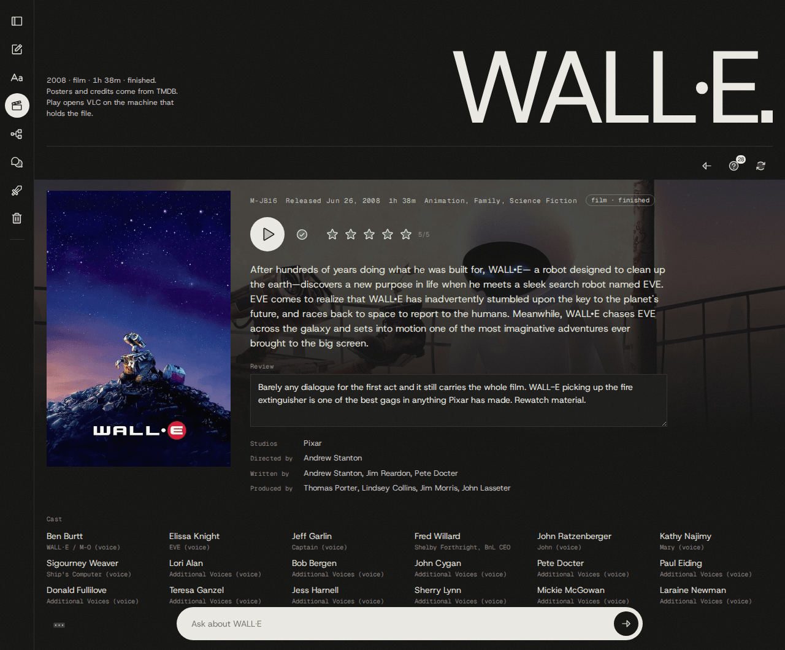
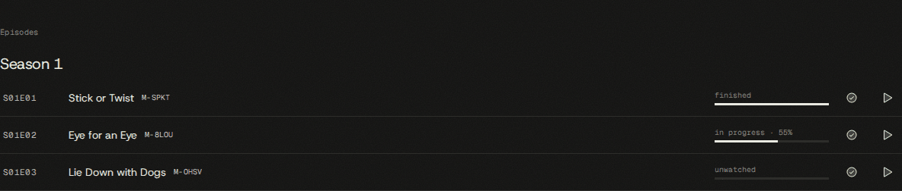
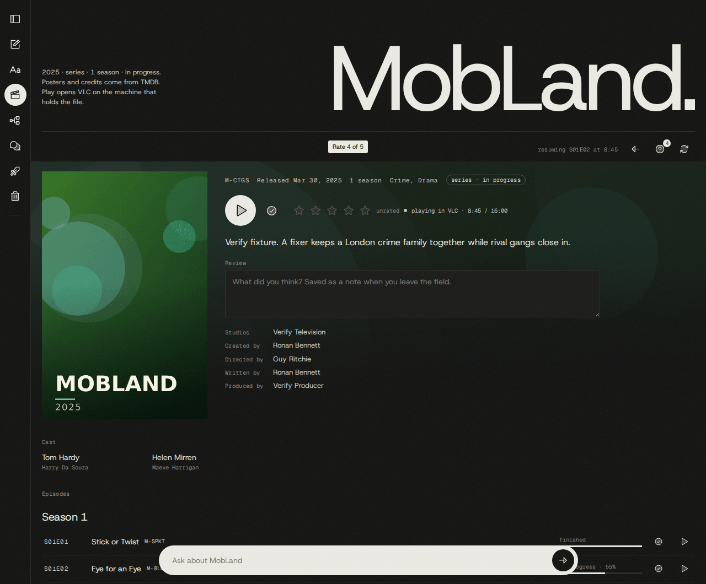
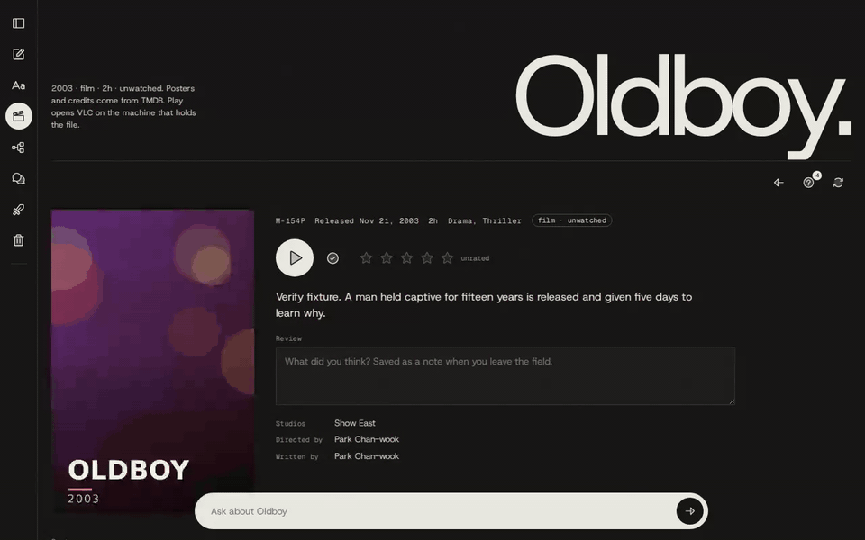
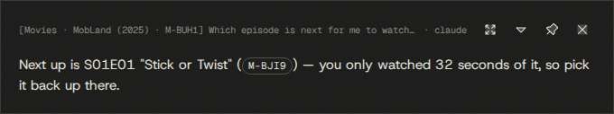
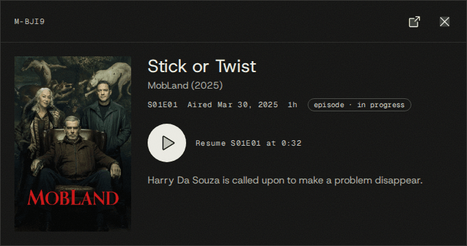

# Movies

The Movies library is notesd's record of the video files on your machines: which films and series
you have, what you watched, when, and how far you got. It scans the folders you name, looks every
video up on TMDB, shows the result as a poster grid at `/movies`, plays files in the Windows VLC and
follows the position while they play. Six `movies_*` MCP tools answer questions about it from
Claude Code (`/n ...`) and from the wall's chat.



Every picture and example on this page comes from the generated library of `verify.sh up --movies`
(six titles, a fake TMDB that draws its own posters, a fake VLC). The titles, ids and paths are that
fixture's, not anyone's real library.

Contents: [Setup](#setup) · [What is stored](#what-is-stored) · [The scan](#the-scan) ·
[Movie ids](#movie-ids) · [Watch state](#watch-state) · [The Movies page](#the-movies-page) ·
[Playback](#playback) · [Continue and "play something"](#continue-and-play-something) ·
[The VLC health log](#the-vlc-health-log) · [Two machines](#two-machines) ·
[What you can ask](#what-you-can-ask) · [Off switches and failure answers](#off-switches-and-failure-answers) ·
[Quirks and limits](#quirks-and-limits) · [Where the code is](#where-the-code-is) ·
[Proving a change](#proving-a-change)

## Setup

Put the folders, the TMDB token and VLC's settings file in `.env.local`, then run
`npm run db:migrate` once and `scripts/install.sh` (see [install.md](install.md)):

```
NOTESD_MOVIES_ROOTS=/mnt/c/Users/<you>/Videos:/mnt/c/Users/<you>/Downloads/Telegram Desktop
NOTESD_MOVIES_DONE_DIRS=Done
NOTESD_VLC_INI=/mnt/c/Users/<you>/AppData/Roaming/vlc/vlc-qt-interface.ini
TMDB_API_READ_ACCESS_TOKEN=<your TMDB v4 read access token>
```

Every setting is listed in [reference/configuration.md](reference/configuration.md). The ones that
change behaviour:

| Setting | What it changes |
| --- | --- |
| `NOTESD_MOVIES` | `off` builds nothing: no scan, no TMDB call, no VLC, and every route and tool answers `movies_off`. Default on. |
| `NOTESD_MOVIES_ROOTS` | The folders to scan, absolute, separated by `:`, searched recursively (24 levels deep). Empty: nothing is scanned on this machine, but the page, the tools and titles from the other machine still work. |
| `NOTESD_MOVIES_DONE_DIRS` | Folder names (not paths, any case, default `Done`) that mean "watched". See [Done folders](#moved-deleted-and-done-folders). |
| `NOTESD_MOVIES_SCAN_MS` | Pause between passes, default two minutes. |
| `NOTESD_MOVIES_MIN_SECONDS` | Videos shorter than this (default 900, 15 minutes) never reach TMDB. |
| `NOTESD_MOVIES_FALLBACK_MODEL` | The Claude model asked to name a file TMDB could not match (default `haiku`); `off` disables it. |
| `TMDB_API_READ_ACCESS_TOKEN` / `TMDB_API_KEY` | The token is preferred; the key is used only without one. With neither, files are still registered, all unmatched as `no_tmdb_credentials`. |
| `NOTESD_VLC_INI` | VLC's `vlc-qt-interface.ini`. Unset: films opened from Explorer are not seen, only plays started by notesd. |
| `NOTESD_VLC_BIN`, `NOTESD_CURL_EXE` | The Windows `vlc.exe` and `curl.exe`. Play needs both, WSL interop and `wslpath`. |
| `NOTESD_VLC_HTTP_PORT`, `NOTESD_VLC_POLL_MS` | First port tried for VLC's HTTP interface (default 47318, then the next nine) and how often a playing VLC is read (default 5 s). |
| `NOTESD_VLC_EXTRA_ARGS` | Extra `vlc.exe` arguments for every launch. See [Playback](#playback). |
| `NOTESD_VLC_HEALTH_MS` | How often every `vlc.exe` is sampled (default 30 s); `0` turns the health log, incidents and hang detection off. 1 to 4999 is rejected at start. |

## What is stored

| Thing | Table | Scope | Lifetime |
| --- | --- | --- | --- |
| Title | `movie_titles` | Shared by both machines | One per TMDB film (`movie-<tmdb id>`) or series (`tv-<tmdb id>`). Never deleted, even when every file is gone. Holds the poster path, release date, synopsis, runtime, genres, and your watched flag, rating and review link. |
| Studios, people, credits | `movie_companies`, `movie_title_companies`, `movie_people`, `movie_credits` | Shared | Stored with the title on its first match: up to 40 cast with character names, and up to 20 each of directors, writers, producers and creators. |
| Episode | `movie_episodes` | Shared | Every episode TMDB lists for a series, with name, air date, runtime and synopsis, whether or not you have its file. |
| File | `movie_files` | Per host | One row per video path on one machine: size, mtime, duration, season and episode, status (`matched`, `unmatched`, `pending`) and reason. Soft-deleted: a file that leaves the disk keeps its row with `deleted_at`. |
| Play | `movie_plays` | Per host | One row per play: start, end, position reached, duration, and source (`live` for a VLC notesd started, `vlc_recents` for one read from VLC's recent list). Never deleted, and it outlives its file. |
| Movie id | `movie_ids` | Shared | The `M-23T4` id of every title and every episode. See [Movie ids](#movie-ids). |

`MoviesRepo` (`src/movies/repo.ts`) is the only writer of these tables. Watch state is not in any of
them: it is derived when read. Posters and backdrops are not stored either: the page hotlinks them
from `TMDB_IMAGE_BASE`, so both machines show them.

## The scan

`MoviesService` (`src/movies/service.ts`) runs one pass five seconds after the daemon starts, then
one every `NOTESD_MOVIES_SCAN_MS`. It polls and never watches: the roots are normally under
`/mnt/c`, which is drvfs, and drvfs sends WSL no inotify events for changes made on the Windows
side. The rescan button on the page (and `POST /api/movies/sync`) starts a pass at once; while one
runs, further requests share a single follow-up pass.

One pass (`src/movies/sync.ts`), in order:

1. Walk the roots for `mkv`, `mp4`, `avi`, `m4v` and `webm` files. Symlinks are never followed. A
   folder that cannot be read is skipped, and the files already known under it are left alone.
2. Pair each known file that is missing with a newly appeared file of the same name and size: that
   is a move. What is still missing is marked deleted.
3. Record a done signal for every file that sits in a Done folder.
4. Register new files, but only once two passes in a row saw the same size and modification time.
   A download in progress waits (`waiting` in the pass report).
5. `ffprobe` each new file for its duration, two at a time. Shorter than the minimum: unmatched,
   `too_short`. Unreadable: unmatched, `probe_failed`. No `ffprobe` binary: new files wait.
6. Parse the path, ask TMDB, store the title's metadata the first time a title is matched.
7. Read VLC's recent list (see [Films opened from Explorer](#films-opened-from-explorer)).

A pass that wrote anything emits `changed` on `/api/movies/events`, and the page reloads.

### The six filename shapes

`src/movies/parse.ts` reads only the file name and its parent folder. A folder above them (a Done
folder, a collection folder) is never part of the title. The parent folder lends only what the file
name lacks: its title when the file has none, its year when it names the same film, its season.

| Shape | Example | Read as |
| --- | --- | --- |
| Release name with dots | `How.to.Make.a.Killing.2026.1080p.WEB-DL.x265.6CH-Pahe.in.mkv` | film "How to Make a Killing", 2026 |
| Release name with underscores or spaces | `The_Rivals_of_Amziah_King_2026_1080p_BluRay_x265_DD+5_1_Pahe_in.mkv` | film "The Rivals of Amziah King", 2026 |
| Year only in the folder | `Oldboy (2003)/Oldboy.mkv` | film "Oldboy", 2003 |
| `SxxEyy` in a season folder | `Mobland S01 WEB-DL 1080p x265 6CH [Pahe.in]/MobLand.S01E02.Eye.for.an.Eye.1080p.WEB-DL.x265.6CH-Pahe.in.mkv` (or a bare `S01E02.mkv` in that folder) | series "MobLand", season 1, episode 2 |
| Absolute numbering | `One Piece - 405 720p WEB-DL x264 2CH [Pahe.in].mkv` | series "One Piece", episode 405 counted from the first; mapped to a season and episode through TMDB's episode list |
| Two films in one folder | `Nezha (2019)/Ne.Zha.2.2025.1080p.WEB-DL.x265.6CH-Pahe.in.mkv` | film "Ne Zha 2", 2025: the file carries its own year, so the folder lends nothing |

The title ends at the first release tag (resolution, source, codec, audio) or season marker.
Bracketed parts (`[Pahe.in]`) and the `Pahe.in` suffix are dropped. The year is the last year-like
token before that point and never the first token, so `1917.2019.1080p...` is "1917" from 2019. The
spec is the table in `tests/fixtures/movies/filenames.ts`.

### TMDB matching

`src/movies/match.ts` turns the parsed name into one TMDB title or a reason:

- An episode searches series only, a name with a year and no episode searches films only, a name
  with neither searches films and then series. A search with a year that finds nothing is repeated
  without it.
- Each of the first ten candidates gets a confidence from 0 to 1: title similarity (1 when equal
  after removing case, accents and punctuation; 0.95 when equal without spaces, so "Nezha" is "Ne
  Zha"; otherwise the share of common words) plus a year adjustment (0 for the same year, -0.1 one
  year off or when the candidate has no date, -0.5 further off; a later season's year costs a series
  nothing).
- 0.85 or more is a match. The best candidate wins; on a tie the earlier one in TMDB's order.

`src/movies/tmdb.ts` is the only module that talks to TMDB. When TMDB cannot be reached at all
(network error, timeout, 401, 403, 429 or 5xx) the pass stops calling it, the remaining files stay
`pending` with `tmdb_error`, and the next pass retries them. A title's metadata is fetched once,
when it is first matched; it is not refreshed afterwards.

### The Haiku fallback

When no candidate is confident, `src/movies/fallback.ts` asks a Claude model (Haiku by default, on
your `claude` login, no tools, one turn) for the title, year and kind from the raw file and folder
names. Its answer goes through the same TMDB search and the same 0.85 rule; an answer of `null`
(a phone clip, a screen recording) leaves the file unmatched. It is one call per file and never
repeated: a file that ends up `no_match` or `low_confidence` is not looked at again until you assign
it by hand. Files shorter than the minimum never get there.

### The unmatched list

A file that is not in the library sits in the unmatched list of the machine that holds it:

| Reason | Shown as | Meaning | Retried? |
| --- | --- | --- | --- |
| `too_short` | shorter than 15 minutes | Under `NOTESD_MOVIES_MIN_SECONDS`. No TMDB lookup. | No |
| `no_match` | no TMDB match | TMDB returned no candidate, with or without the fallback. | No |
| `low_confidence` | TMDB match not confident | Candidates, none at 0.85. | No |
| `probe_failed` | ffprobe could not read it | No duration could be read. | When the file's size or mtime changes |
| `no_tmdb_credentials` | no TMDB credentials | Neither TMDB setting is present. | On the first pass after a credential is set |
| `tmdb_error` (status `pending`) | TMDB could not be reached | TMDB was down during the pass. | Every pass |



The link icon on a row opens the assign dialog: it searches TMDB with the parser's guess, you pick
film or series, choose a result, and for a series set season and episode (prefilled from the name).
Assigning stores the title if it is new and moves the file into the library. A result already in
the library says so.



### Moved, deleted and Done folders

- A known file that is gone from disk while a new file with the same name and size appears under
  the roots was moved. It keeps its row, its plays and its id; only the path changes.
- A known file that is gone and has no such twin is deleted: `deleted_at` is set, the row, the
  title and the plays stay. Deleting is not watching; see [Watch state](#watch-state).
- A file found in, or moved into, a folder whose name is in `NOTESD_MOVIES_DONE_DIRS`, at any depth
  below a root, gets a done signal (`done_at`) and counts as finished. The signal is recorded once
  and stays when the file later leaves the folder.

### Films opened from Explorer

VLC writes its recent list when it exits. With `NOTESD_VLC_INI` set, every pass reads
`[RecentsMRL]` from that file (`src/movies/vlc/recents.ts`) and turns each `file:///C:/...` entry
into a play observation with source `vlc_recents`:

- An entry for a known file is recorded only when it says something the file's last play does not
  (a position more than 10 seconds away), so a play notesd followed live is not counted twice.
- An entry with time 0 or -1 means "opened, position unknown". It is recorded once and gives the
  state `seen`.
- An entry whose file is no longer on disk is matched to a title by its name and stored as an
  already deleted file, so films watched and deleted before notesd knew them still have history.

## Movie ids

Every title has an id like `M-23T4`, and so has every episode of a series, with or without a file.

- Shape: `M-` and four characters from `0-9A-Z`. A note id (`A-B32`) has three characters after the
  dash, a session node id (`A0-3G`) two on each side.
- The database writes them, never application code. `movie_next_id()` scrambles a sequence over the
  1,679,616 possible ids, so they look random, never repeat and are the same from either machine.
  Triggers on `movie_titles`, `movie_episodes` and `movie_files` register an id for every new title,
  every episode row and every season and episode a file names (`drizzle/0018_movie_ids.sql`). An
  episode keeps its id when the title's metadata is rewritten. Never invent one.
- Lookup is case-insensitive, but the dash is required (`m-23t4` works, `M23T4` does not), because
  a film can be called "M3GAN". Note ids tolerate a missing dash; movie ids do not.
- `movie-<tmdb id>` and `tv-<tmdb id>` stay the keys of rows and routes and still work everywhere.

Where an id is accepted and shown:

| Place | Behaviour |
| --- | --- |
| The title's page | The title's id is the first fact under the heading; each episode row carries its own. |
| `/movies/<id>` | Opens the title. An episode's id opens its series scrolled to that episode, with the row marked, even when the season has no file. |
| `GET /api/movies/<id>` | Answers the title; an episode's id answers its series. |
| Every `movies_*` tool | `title` takes a movie id. In `movies_get` an episode's id answers that episode first; in `movies_continue` it plays exactly that episode; in `movies_mark` it takes `watched` only. |
| Wall chat | An id in an answer is a chip. Clicking it opens the movie pop-up (`MovieModal`) with Play and a button to the page (`web/src/lib/chatSegments.ts`). |
| Claude Code | The MCP instructions tell Claude to write `[M-23T4](http://localhost:7317/movies/M-23T4)`, and the `note-links` mod links a bare id the same way. See [claude-code.md](claude-code.md). |

A movie id written as a note link (`/?note=M-23T4`) still opens the movie, on the wall and in the
terminal.

## Watch state

State is derived at read time by `src/movies/state.ts` and nowhere else. It is never stored.

A file's state comes from the file row and its last play. "Last play" is the newest play whose
position is known; when no play has a position, the newest play.

| State | Decided by |
| --- | --- |
| `finished` | The file's watched flag, or a done signal, or the last play reached 90 % of the duration (VLC's own length reading, else ffprobe's). |
| `in_progress` | The file is on disk and was played: a position above 0, or opened with the position unknown. |
| `unwatched` | The file is on disk and was never played (or left at 0). |
| `dropped` | The file is deleted and was played partway. |
| `seen` | The file is deleted and every play of it is "opened, position unknown". |
| `removed_unwatched` | The file is deleted and was never played. |

A title's state comes from its files:

- The title's own watched flag makes it `finished`, whatever the files say.
- A film takes the most-watched state any of its files has, in the order `finished`, `in_progress`,
  `dropped`, `seen`, `unwatched`, `removed_unwatched`.
- A series is `finished` when every file is. It is `in_progress` when something was watched and a
  file on disk is still unfinished. With nothing watched it is `unwatched`, or `removed_unwatched`
  when no file is left. Otherwise (something watched, nothing left on disk to watch) it is `dropped`
  when a file was dropped or deleted unwatched, else `seen`.
- An episode with several copies is finished when any copy is.

Play resumes at the last known position, or from the start when there is none or the file is
finished.

## The Movies page

The film-slate icon in the rail or sidebar opens `/movies`. The header counts titles, films, series
and what is in progress.

**The grid.** One poster per title; a series is one poster. In progress comes first, then
unwatched, then finished, then titles with no file left, each by newest play. A chip names the
state (an unwatched poster has none), a bar under the poster shows how far into a film you are or
the share of episodes finished, and a title with no file left on any machine is dimmed and says
"no file left". It is never hidden.

**Filters.** The state pills (`all`, `unwatched`, `in progress`, `finished`, `gone`) carry counts.
`finished` includes `seen`; `gone` is about files, not state, so it overlaps the others. Three icons
choose all kinds, films or series, and the text box filters on title and year. The filter survives
opening a title and coming back.


**A title's page** (`/movies/<id>`): the poster, the movie id, release date, runtime or season
count, genres, kind and state; then Play, the watched flag, the stars, the synopsis, the review,
the credits (studios, created by, directed by, written by, produced by) and the cast with their
characters (the first 18, with an icon for the rest).



- **Play.** On a film the button reads "Play" or "Resume at 5:06". On a series it is Continue:
  resume the open episode or play the next one (see
  [Continue](#continue-and-play-something)). It is disabled with the reason as its label when the
  file is on the other machine, when no file is left, or when VLC cannot be started here.
- **Watched flag.** The check icon sets or clears the title's watched flag, for the films whose
  credits you skip.
- **Stars.** 0 to 5, whole stars.
- **Review.** One text field, saved when it loses focus and only when the text changed. The review
  is an ordinary note written through `NotesService`: its body is `Review of <title> (<year>)`, your
  text and `#movie`, and the title links it by `review_note_id`. So `/n` and search find it, its
  revisions are kept, and it shows on the wall under `#movie`. Editing that note elsewhere changes
  what the field shows. Clearing the field keeps the note with its header.
- **Files or episodes.** A film lists its files; a series lists the seasons that have a file on any
  machine, one row per episode with its code, name, movie id, a progress meter, a watched icon and a
  play icon. A deleted file is flagged "deleted" with its date in the tooltip; a file on the other
  machine is flagged "on <host>". Seasons with no file anywhere are counted, not listed.



**The pill.** The bar at the bottom asks the wall's chat about the page. On the grid it reads "Ask
about your movies"; on a title's page it reads "Ask about <title>", and "this film", "this
director" or "the main character" mean that title. The page rides on the message's first line
(`[Movies · MobLand (2025) · M-CTGS]`). See [What you can ask](#what-you-can-ask) and
[chat.md](chat.md).

**Toolbar.** Back to the library, the unmatched list with a count of this machine's unmatched and
pending files (`/movies/unmatched`), and Rescan the library, which starts a pass at once.

**Live updates.** The page listens on `/api/movies/events` and reloads on every change, polls once
a minute for changes made by the other machine, and while a play is followed re-reads the player
and the open title every five seconds.

## Playback



Play, Continue and `movies_continue` all end in `MoviePlayer` (`src/movies/player.ts`):

1. The file must belong to this host and be on disk. Otherwise the answer is `not_on_this_machine`
   or `file_missing`.
2. The Linux path becomes a Windows path through `wslpath -w`.
3. A free port is picked, starting at `NOTESD_VLC_HTTP_PORT` and trying ten, and a fresh 32
   character password is made for this launch.
4. The Windows `vlc.exe` starts as a separate instance with its HTTP interface on `127.0.0.1` only,
   that port and password, `--start-time` at the resume second, `--fullscreen`, and VLC's own
   "continue playback?" prompt turned off. `NOTESD_VLC_EXTRA_ARGS` goes before the file. Under
   systemd VLC is started in its own scope, so restarting notesd does not close it.
5. notesd waits up to 20 seconds for the interface to answer, makes sure VLC is playing, and seeks
   when VLC is more than 5 seconds from the resume point.
6. `src/movies/vlc/foreground.ts` runs one `powershell.exe` script that finds the `vlc.exe` whose
   command line carries this launch's password and puts its window in front. The play never waits
   for it, and a film that opens behind another window is not a failed play.
7. Every `NOTESD_VLC_POLL_MS` the position is read into the play's one row. When VLC exits, the
   play closes at the last position read.



Rules worth knowing:

- **Status is read with the Windows `curl.exe`.** VLC listens on Windows loopback, which WSL's NAT
  networking cannot reach from Linux, so each read is one `curl.exe` run through interop.
- **One play is followed at a time.** Starting another ends the tracking of the previous one at its
  last position and leaves that VLC open.
- **notesd never reuses, stops or kills a VLC.** Not the one you opened yourself, and not one it
  started. There is no stop, pause or seek command for you to send.
- **A stopped VLC keeps the last real position.** When VLC reports `stopped` (you pressed stop, or
  the film ended) the position is not overwritten with 0.
- **A VLC that never answers** within 20 seconds leaves the play recorded at its start position
  without tracking (`tracking: false`, `note: "http_timeout"`).
- **`NOTESD_VLC_EXTRA_ARGS`** is split on whitespace with no quoting, for example
  `--avcodec-hw=none`. `--http-*`, `--extraintf`, `--intf` and `-I` are rejected at start, because
  notesd owns VLC's HTTP interface.
- **A daemon restart** closes the plays the previous process left open and does not pick them up
  again. The film keeps playing; with `NOTESD_VLC_INI` set, its position is next seen through
  VLC's recent list.

`GET /api/movies/player` says whether playback works here (`available`, and a `reason` such as
`no_interop`, `no_vlc`, `no_curl`) and which play is followed. The same check feeds
`movies_playback` in `GET /api/capabilities`.

## Continue and "play something"

"Continue" (`src/movies/continue.ts`) is the series Play button, `POST /api/movies/continue` and
the `movies_continue` tool. For one title it decides, in this order:

1. Resume the most recently played file that is on this machine and in progress.
2. A film: finished answers `nothing`; a file here starts; no file here answers `missing`.
3. A series: take the first unfinished episode after the newest play (else after the highest
   finished episode, else the first). Its file is here: start it. It is not: answer `missing` with
   that episode and the later episodes that do have a file here. None left: `nothing`, caught up.

Without a title it continues the title of this machine's newest play. An episode's movie id skips
the rule: that episode plays, resumed when it was left partway, and `missing` when it has no file
here.

| `action` | Meaning |
| --- | --- |
| `resumed` | VLC opened at `position`. |
| `started` | VLC opened from the start: the next episode, or a film not started yet. |
| `missing` | Nothing played. `missing` is the episode with no file here; `present` lists later episodes that have one. For a film, both are empty. |
| `nothing` | Nothing played. `reason` is `finished`, `caught_up` or `no_episodes`. |
| `ambiguous` | The words fit several titles; `candidates` lists them. |
| `no_match` | No title fits, or (without a title) nothing was ever played here. |

"Play something" is `movies_continue` with `random: true` (`playSomething`): the server picks one
title at random among those continue would play on this machine (a file here that is not deleted,
a film not finished or a series with a next episode here) and plays it. A half-watched title is as
likely as an unwatched one and resumes. A title you marked watched is never picked. `picked_from`
says how many it chose among; calling again picks again. It exists only as the tool: the page and
the HTTP route have no random play.

## The VLC health log

`src/movies/vlc/health.ts` keeps a record of every `vlc.exe` on the machine, to explain crashes and
freezes after the fact.

- **What is sampled.** Every `NOTESD_VLC_HEALTH_MS`, `tasklist.exe` lists the `vlc.exe` processes
  (pid and working set). While one exists, `powershell.exe` adds private bytes, handle count, start
  time and command line. A VLC that notesd started is marked `ours` and carries its play: file,
  state, position, seconds paused, seconds without an HTTP answer, and whether it is hung. The
  per-launch password is redacted from logged command lines.
- **Where.** `<NOTES_DATA_DIR>/movies/vlc-health-<host>.jsonl`, one JSON object per line: `start`,
  `sample`, `idle` (the last VLC went away), `hang`, `clean_stop`, `incident`. It is a file, fsync'd
  line by line, and not a database table, so the lines before a WSL or Windows crash are on disk
  even though the daemon died with it. The file is capped at 5 MB with one previous file kept.
- **Incidents.** At start the tail of the log is read. If the previous run ended without a
  `clean_stop` while a VLC was being sampled, one `incident` line is written with the last 40
  samples, the hang lines, the open play, and the Windows Application Error (1000) and Application
  Hang (1002) events from 10 minutes before the last sample to 15 minutes after the last line.
- **Hangs.** When a VLC notesd started stops answering for two polls while its process is alive,
  one `hang` start line is written and the play stays open at its last position, however long the
  silence lasts. An end line follows when it answers again, exits, or tracking ends. When the
  process is gone the play closes at once.
- **Reading it.** `GET /api/movies/player/health?limit=` returns the newest samples (default 200,
  at most 2000), a summary per VLC run (including memory growth per minute, and per paused minute,
  which is the leak signal), the hang lines and the incidents. There is no page and no tool for it.

The monitor only reads on the Windows side. It needs `tasklist.exe`; without `powershell.exe`
samples keep pid and working set only, and there are no Windows events. It is off with
`NOTESD_VLC_HEALTH_MS=0`, with no roots, and outside WSL.

## Two machines

Both machines use the same database and different disks.

| Shared | Per host |
| --- | --- |
| Titles, metadata, credits, episodes | Files (each row names its host) |
| Movie ids | Plays (history lists both machines' plays) |
| Watched flag, rating, review | The unmatched list (this machine's files only) |
| Posters (hotlinked TMDB URLs) | The scan, VLC, the player, the health log |

- A file on the other machine has `available: false`. On the page its row says "on <host>" and its
  play icon is disabled; the big Play button reads "On <host>: play it on that machine".
- Playing it answers `not_on_this_machine` (HTTP 404) with the host.
- `player_unavailable` (HTTP 409) means this machine cannot start VLC, with the reason.
- "Continue" and "play something" only consider files on the machine that runs the daemon. Without
  a title, continue follows this machine's newest play, not the other's.
- A title that exists only on the other machine still shows in the grid with its state.

## What you can ask

The six tools are the same in both places. Claude Code reaches them through the `notes` MCP server
(the `/n` skill maps the phrasings below), and the wall's chat agent has all six in its tool list
(`allowedChatTools` in `src/chat/status.ts`) plus web search. Argument details are in
[reference/mcp-tools.md](reference/mcp-tools.md#movies_list).

Every call in these tables was run with `verify.sh mcp RUN <tool> '<json>'` against the fixture
library and answered as described. "Both" means Claude Code (`/n ...`) and the wall chat. A title
can always be given as a movie id, a `movie-`/`tv-` key or words.

Differences between the two places:

- In Claude Code, movie ids in answers are links to the page. In wall chat they are chips that open
  the pop-up with Play.
- Only the pill on a title's page knows which title is open, so "this film" works there and nowhere
  else.
- `movies_continue` opens VLC on the machine that runs the daemon, whichever place asked.





### Browse and filter

| Ask | Tool call | Where |
| --- | --- | --- |
| `/n what's in my movie library?` | `movies_list {}` | Both |
| `/n what haven't I watched yet?` | `movies_list {"state":"unwatched"}` | Both |
| `/n which series am I in the middle of?` | `movies_list {"state":"in_progress","kind":"tv"}` | Both |
| `/n films I finished` | `movies_list {"kind":"movie","state":"finished"}` | Both |
| `/n what did I delete halfway?` | `movies_list {"state":"dropped"}` | Both |
| `/n what did I delete without watching?` | `movies_list {"state":"removed_unwatched"}` | Both |
| `/n films I only opened once` | `movies_list {"state":"seen"}` | Both |
| `/n Blumhouse films I have` | `movies_list {"company":"Blumhouse"}` | Both |
| `/n what do I have with Margaret Qualley?` | `movies_list {"person":"Margaret Qualley"}` | Both |
| `/n the one about the beekeeper` | `movies_list {"q":"beekeeper"}` | Both |
| `/n what did I finish this year?` | `movies_list {"finished_from":"2026-01-01","finished_to":"2026-11-14"}` | Both |
| `/n A24 films I finished this year` | `movies_list {"company":"A24","finished_from":"2026-01-01"}` | Both |
| `/n the last two things I touched` | `movies_list {"limit":2}` | Both |

- `q` matches words in the title, original title and synopsis. It does not search genres, cast or
  studios; those are `person` and `company`, which match part of a name in any credit role.
- The list is ordered by newest play, then by when the title was added. The tool has no sort
  argument.
- `finished_from` and `finished_to` take `YYYY-MM-DD` (a whole day in the daemon's timezone) or an
  ISO datetime. Either one drops titles with nothing finished.
- Each title carries `movie_id`, `state`, `rating`, `progress`, `last_played_at`, `finished_at`,
  `present_here` and `url`.

### One title

| Ask | Tool call | Where |
| --- | --- | --- |
| `/n which MobLand episode did I watch last, and when?` | `movies_get {"title":"mobland"}`, read `last_play` | Both |
| `/n who directed M-WXCR and who is in it?` | `movies_get {"title":"M-WXCR"}`, read `directors`, `cast` | Both |
| `/n what did I write about How to Make a Killing?` | `movies_get {"title":"How to Make a Killing"}`, read `review` | Both |
| `/n what is M-8LOU about?` | `movies_get {"title":"M-8LOU"}`, read `asked.episode` | Both |
| `/n list MobLand season 1 with ids` | `movies_get {"title":"tv-247718","season":1}` | Both |
| `/n do I have episode 3 of MobLand?` | `movies_get {"title":"mobland","episode":3}`, read `has_file`, `present_here` | Both |
| `/n how far am I into MobLand S01E02?` | `movies_get {"title":"mobland","season":1,"episode":2}` | Both |
| `/n when did I delete The Dog Stars?` | `movies_get {"title":"The Dog Stars"}`, read `files[].deleted_at` | Both |
| `Who is the main character?` (pill on a title's page) | `movies_get` with the id on the message's first line, first `cast` entry | Wall chat |
| `Any trivia about this film?` (pill on a title's page) | `movies_get` for the year, then web search | Wall chat |
| `/n what is Citizen of a Kind about? who is the woman at the front in the thumbnail?` | `movies_get {"title":"Citizen of a Kind"}`, read `overview`, `cast`; the poster image itself answers who is in front | Both |

- The answer has the title's facts and credits, `seasons[].episodes[]` (each with `movie_id`,
  `state`, `has_file`, `present_here`, `deleted`, `progress`), `files` (every file ever seen, deleted
  ones too), `plays` newest first and `last_play`.
- An episode's movie id answers with `asked` first, only that episode's files and plays, and the
  series as one summary line per season.
- A series with more than 60 episodes answers with a summary per season (`files_here` gives the
  episode numbers with a file here as ranges, so a gap is a missing file) until you pass `season` or
  `episode`. `episode` alone matches that number in any season.
- Words that fit several titles answer `ambiguous` with the candidates and their ids; words that
  fit nothing answer `not_found`; a movie id that names nothing answers `not_found`.
- **A question about who is pictured is answered from the poster itself, not just the credit
  list.** The poster is a hotlinked TMDB image (`poster_url`), and Claude can look at it: asked who
  is at the front of a poster, it reads the image and matches the face to the cast TMDB names, not
  just reports the cast in credit order.

### Watch history

| Ask | Tool call | Where |
| --- | --- | --- |
| `/n what did I watch lately?` | `movies_history {}` (30 newest plays) | Both |
| `/n what did I watch today?` | `movies_history {"from":"2026-11-14"}` | Both |
| `/n what did I watch last night?` | `movies_history {"from":"2026-11-13","to":"2026-11-13"}` | Both |
| `/n when did I last watch MobLand?` | `movies_history {"title":"mobland","limit":1}` | Both |
| `/n every time I played M-5CWN` | `movies_history {"title":"M-5CWN"}` | Both |

- A play has `started_at`, `ended_at`, `position_s`, `duration_s`, `ratio`, `source`, `host`, the
  title, season, episode and episode name, `file_deleted` with `file_deleted_at`, and `movie_id` (the
  episode that was played, or the film).
- History covers both machines and survives the file's deletion. `position_s: null` means VLC was
  opened and the position is unknown.
- With `title`, an episode's movie id narrows to its series, not to that episode. Use `movies_get`
  with the episode's id for one episode's plays.

### People and filmographies

| Ask | Tool call | Where |
| --- | --- | --- |
| `/n recommend other Margaret Qualley films I haven't seen` | `movies_person {"name":"Margaret Qualley","unseen_only":true}` | Both |
| `/n everything Margaret Qualley was in, and which I've seen` | `movies_person {"name":"Margaret Qualley"}` | Both |
| `/n what has Tom Hardy acted in? just the newest` | `movies_person {"name":"Tom Hardy","role":"cast","limit":1}` | Both |
| `/n what did she direct or produce?` | `movies_person {"name":"Margaret Qualley","role":"crew"}` | Both |
| `/n not that one, the other person with that name` | `movies_person {"name":"Tom Hardy","person_id":990114}` with an id from `other_people` | Both |
| `What else did this director make?` (pill on a title's page) | `movies_get` for the director's name, then `movies_person` | Wall chat |

- This is the one tool that reads TMDB at question time. Each credit says `in_library`, `state`,
  `seen` (finished or seen) and `started` (in progress or dropped), newest release first, with the
  person's roles merged per title.
- `name` picks the most popular match; `other_people` lists up to four others.
- Without TMDB credentials it answers `tmdb_unavailable`; when TMDB is down, `tmdb_error`; a name
  TMDB does not know, `not_found`.
- On the fixture only the two people the fake TMDB knows can be looked up, so `role: "crew"` was
  proven as a filter (it returns an empty list for an actor), not against a director.

### Continue and play

| Ask | Tool call | Where |
| --- | --- | --- |
| `/n continue MobLand` | `movies_continue {"title":"mobland"}` | Both |
| `/n continue whatever I watched last night` | `movies_continue {}` | Both |
| `/n play M-SPKT` | `movies_continue {"title":"M-SPKT"}` (exactly that episode) | Both |
| `/n play Oldboy` | `movies_continue {"title":"Oldboy"}` | Both |
| `/n play something` / `/n I'm eating dinner, play a random movie` | `movies_continue {"random":true}` | Both |
| `Play this` (pill on a title's page) | `movies_continue` with the id on the message's first line | Wall chat |

- Answers are the actions in [Continue and "play something"](#continue-and-play-something), with a
  `message`, the `movie_id` of the episode or film it is about, and its `url`.
- `title` and `random` together answer `invalid_input`.
- Words that fit several titles do not always answer `ambiguous` here: an exact title wins, then
  the candidate played most recently. `ambiguous` comes back only when none of the candidates was
  ever played. On the fixture, `movies_get {"title":"the"}` is ambiguous while
  `movies_continue {"title":"the"}` picks The Dog Stars. The `ambiguous` action itself could not be
  produced on the fixture library.
- Errors: `not_on_this_machine`, `player_unavailable`, `file_missing`.

### Mark watched, rate, review

| Ask | Tool call | Where |
| --- | --- | --- |
| `/n mark Oldboy watched` | `movies_mark {"title":"Oldboy","watched":true}` | Both |
| `/n I haven't actually finished Oldboy` | `movies_mark {"title":"Oldboy","watched":false}` | Both |
| `/n rate Oldboy 5 stars` | `movies_mark {"title":"Oldboy","rating":5}` | Both |
| `/n remove my rating of Oldboy` | `movies_mark {"title":"Oldboy","rating":null}` | Both |
| `/n my review of M-154P: still the best corridor fight ever filmed` | `movies_mark {"title":"M-154P","review":"..."}` | Both |
| `/n I watched Oldboy, four stars, the middle drags` | `movies_mark {"title":"Oldboy","watched":true,"rating":4,"review":"..."}` | Both |
| `/n mark M-OHSV watched` | `movies_mark {"title":"M-OHSV","watched":true}` (that episode's files) | Both |
| `/n mark that file watched` | `movies_mark {"file_id":9,"watched":true}` with an id from `movies_get` `files[].id` | Both |
| `/n find my review that mentions Glen Powell` | `search {"query":"Glen Powell"}` (the review is a note) | Both |

- Pass exactly one of `title` or `file_id`, and at least one change.
- Rating and review belong to a title. An episode's movie id and a `file_id` take `watched` only;
  anything else answers `invalid_input`.
- A new review replaces the earlier one in the same note; the earlier text is kept as a revision
  of that note.
- `watched: false` clears the flag and nothing else: a film whose last play reached 90 %, or whose
  file has a done signal, stays finished. Clearing the flag on a file (by `file_id` or an episode's
  id) also clears that file's done signal.
- A `file_id` that is not in the library answers `unmatched_file`; an unknown one, `not_found`.

### Ids

| Ask | Tool call | Where |
| --- | --- | --- |
| `/n what is the id of MobLand?` | `movies_list {"q":"mobland"}` or `movies_get`, read `movie_id` | Both |
| `/n the ids of MobLand's episodes` | `movies_get {"title":"mobland","season":1}`, read `seasons[].episodes[].movie_id` | Both |
| `/n what is M-OHSV?` | `movies_get {"title":"M-OHSV"}`, read `asked.what` | Both |
| `/n we are missing M-OHSV, can we skip it?` | `movies_get {"title":"M-OHSV"}`, read `asked.episode.has_file` | Both |

### What cannot be asked

No tool does these. The first group can be done on the page or over HTTP; the rest cannot be done
at all.

- **Page or HTTP only:** list the unmatched files, assign a title to a file, start a rescan, read
  the VLC health log, see whether playback works on this machine.
- **VLC control:** pause, stop, seek, volume, "restart from the beginning" (Play resumes unless the
  file is finished), play a chosen file by `file_id`, play on the other machine.
- **Filters the tool does not have:** genre, year, rating, runtime, sort order. `movies_list`
  returns year and rating, so Claude can filter a list itself; genres are only in `movies_get`.
- **History filters:** by machine, or by one file.
- **Edits:** delete a title, a file row or a play; change a title's metadata or refresh it from
  TMDB; rate or review one episode.
- **Titles you do not have:** there is no TMDB title search and no wish list. `movies_person` is
  the only way to see films outside the library, and "films like this" is a web search checked
  against `movies_list`.

## Off switches and failure answers

| Situation | What answers |
| --- | --- |
| `NOTESD_MOVIES=off` | Every `/api/movies*` route: 503 `movies_off` (`GET /api/movies/player` answers `{available: false, reason: "movies_off"}`). Every tool: `movies_off: the movie library is not running on this server ...`. The page says how to turn it on. |
| No `NOTESD_MOVIES_ROOTS` | Nothing is scanned and the health log is off. The page, tools and playback of known files still work. An empty library says which setting to add. |
| No TMDB credentials | Files are registered, all unmatched `no_tmdb_credentials`. Assign answers 503 `tmdb_off` for a title not stored yet. `movies_person` answers `tmdb_unavailable`. |
| TMDB down | Files stay `pending` and retry every pass. Assign and TMDB search answer 502 `tmdb_error`; `movies_person` answers `tmdb_error`. |
| No `ffprobe` | New files wait until it is installed (one log line). |
| File on the other machine | `available: false`; play answers 404 `not_on_this_machine` with the host. |
| File gone from disk before the next scan | Play answers 410 `file_missing`. |
| No WSL interop, `wslpath`, `vlc.exe` or `curl.exe`; no free port; VLC would not start | Play answers 409 `player_unavailable` with `reason` (`not_linux`, `no_interop`, `no_wslpath`, `no_vlc`, `no_curl`, `no_free_port`, `launch_failed`). The Play buttons are disabled and say so. |
| Request from another origin | Writes, play, continue and sync are same-origin only. |

Routes and status codes are listed in [reference/http-api.md](reference/http-api.md#movies).

## Quirks and limits

- **"Finished by position" looks at the last play only.** Replaying a finished film and stopping
  early makes it `in_progress` again, unless its watched flag or a done signal is set. The watched
  flag is the durable way to say "finished".
- **A series in progress can appear in a "finished this year" list.** A title's `finished_at` is
  the newest moment the title or any of its files became finished, so `finished_from` /
  `finished_to` also return a series with one finished episode in the range. Check `state`.
- **Deleting is not watching.** A file deleted partway is `dropped`; deleted unplayed it is
  `removed_unwatched`. Only the watched flag, a Done folder or 90 % make it finished.
- **Move detection needs the same name and size.** A file renamed while it is moved is a delete
  and a new file, with a new row and no play history.
- **A new file takes two passes to appear**, because its size and mtime must hold still. With the
  default interval that is two to four minutes; the rescan button shortens it.
- **Unmatched files are not retried.** `no_match`, `low_confidence` and `too_short` stay until you
  assign a title by hand. Renaming the file makes it a new file, which is matched again.
- **Metadata is fetched once.** New episodes of a running series, or corrections on TMDB, do not
  arrive on their own. A file whose episode TMDB did not list still gets a row and an id from its
  file name.
- **The Haiku fallback is billed** to your `claude` login, one short call per unclear file. The
  throwaway instance of `verify.sh` pins it off.
- **Films opened from Explorer are seen late.** VLC writes its recent list when it exits, and the
  list is read on the next pass. VLC keeps only its most recent entries.
- **A recent-list entry with no position** tells nothing about how far you got. It counts as
  `in_progress` while the file exists and `seen` once it is deleted.
- **Polling, never watching.** A file change shows up after the next pass, not at once.
- **Per-machine history without a title.** "Continue" with no title follows this machine's newest
  play only.
- **Ids need their dash.** `M23T4` is not a movie id.
- **`movies_list` describes fields it does not return.** The tool description names
  `release_date`, `companies` and `available` per title; the items carry `year`, `present_here` and
  no studios. Use `movies_get` for studios and the release date.
- **Never point Play at the live daemon when testing.** It starts the real VLC. Use
  `verify.sh up --movies`.

## Where the code is

| Path | What it holds |
| --- | --- |
| `src/movies/service.ts` | `MoviesService`: the poll loop, `syncNow`, status, manual assign, the change events |
| `src/movies/sync.ts` | One pass: moves, deletes, done signals, the settle rule, probing, resolving |
| `src/movies/scan.ts` | The directory walk and `ffprobe` |
| `src/movies/parse.ts` | File and folder names to title, year, season, episode |
| `src/movies/match.ts`, `tmdb.ts`, `fallback.ts` | The confidence rule, the TMDB client, the Haiku fallback |
| `src/movies/repo.ts` | `MoviesRepo`, the only writer of the `movie_*` tables |
| `src/movies/read.ts` | The read model behind the page and the tools: list, one title, history, unmatched |
| `src/movies/state.ts` | Watch state and the resume position |
| `src/movies/ids.ts` | Movie id shape and lookup (ids are written by the database) |
| `src/movies/reviewNote.ts` | The review as a note through `NotesService` |
| `src/movies/continue.ts` | The continue rule and `playSomething` |
| `src/movies/player.ts` | `MoviePlayer`: launch, resume, polling, the hang rule |
| `src/movies/vlc/launch.ts`, `http.ts`, `foreground.ts` | `vlc.exe` arguments and detection, status through `curl.exe`, bringing the window in front |
| `src/movies/vlc/recents.ts` | `[RecentsMRL]` to play observations |
| `src/movies/vlc/health.ts`, `incidents.ts` | The health log, hang lines, crash incidents |
| `src/http/moviesApi.ts`, `moviesPlayApi.ts` | Routes: library, unmatched, assign, user marks, sync, events; play, continue, player, health |
| `src/mcp/movieTools.ts` | The six `movies_*` tools |
| `src/mcp/instructions.ts`, `src/chat/prompt.ts`, `claude/skills/n/SKILL.md` | What Claude is told about the library in Claude Code, in wall chat and in `/n` |
| `web/src/pages/MoviesPage.tsx`, `web/src/components/movies/*` | The page, grid, title page, episode list, unmatched list, assign dialog, pill, `MovieModal` |
| `web/src/lib/movies.ts`, `web/src/hooks/useMovies.ts`, `web/src/moviesApi.ts` | Labels, filters and play plan; the store and its polling; the API client |
| `web/src/lib/chatSegments.ts`, `claude/mods/note-links` | Movie ids as links in wall chat and in the terminal |
| `drizzle/0017_movies.sql`, `drizzle/0018_movie_ids.sql` | The tables; the id sequence, function and triggers |
| `src/config.ts` (`parseMovies`) | Every setting, its default and its validation |

## Proving a change

The feature map is `.claude/skills/verify-notesd/features/movies.md`. `verify.sh up --movies` gives
a run its own generated library, a fake TMDB and a fake `vlc.exe` / `curl.exe`, with the fallback
and the health sampler pinned off, and the journey script drives the whole chain with no model
call:

```sh
V=.claude/skills/verify-notesd/scripts/verify.sh
$V up --web --movies                                         # RUN=..., MOVIES=...
.claude/skills/verify-notesd/scripts/movies/journey.sh RUN   # ends with: journey: PASS (12 stages)
$V mcp RUN movies_continue '{"title":"MobLand"}'             # one tool by hand
$V vlc RUN at 600                                            # jump the fake VLC; the next poll records it
$V vlc RUN quit                                              # VLC "exits"; the play closes
$V down RUN
```

- Unit tests: `tests/unit/movies/` (the VLC pieces) and `web/src/App.movies.test.tsx`.
- Integration tests: `tests/integration/movies.*.int.test.ts` (schema, repo, sync, API, play,
  continue, recents, MCP, health, health crash).
- The pictures on this page: `npm run docs:shots -- movies` (`scripts/docs/shots/movies.mjs`). The
  two chat pictures need one billed chat answer and are retaken only with `DOCS_SHOTS_CHAT=1`.
- Never drive Play or `movies_continue` on the live daemon, and never give a run a root under
  `/mnt/c`.
