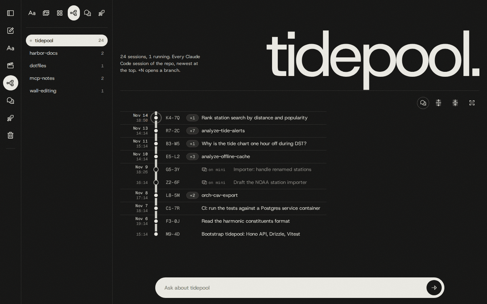
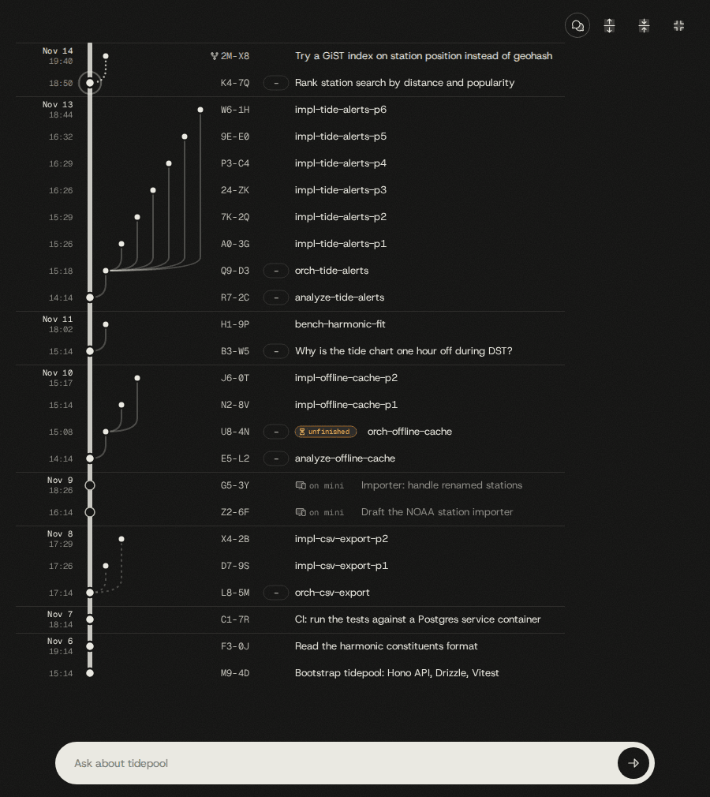
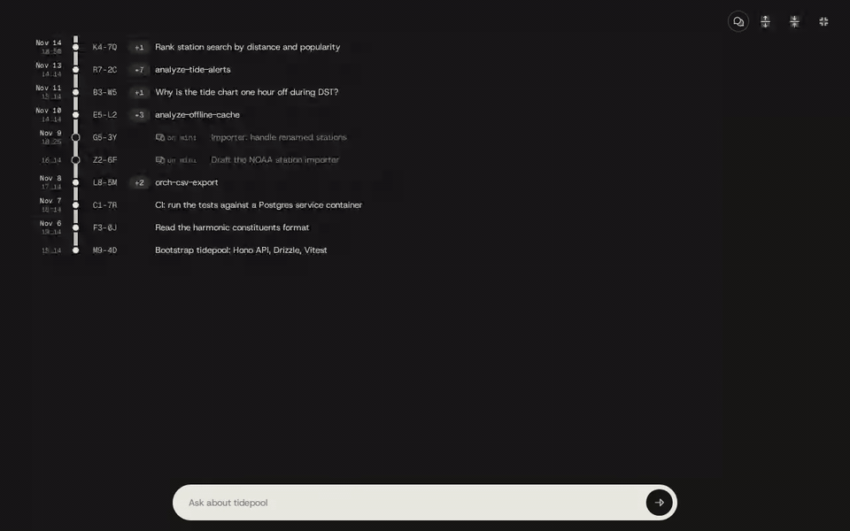
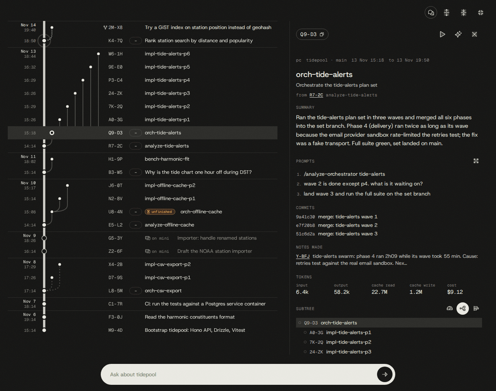
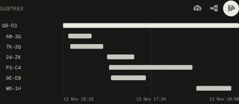
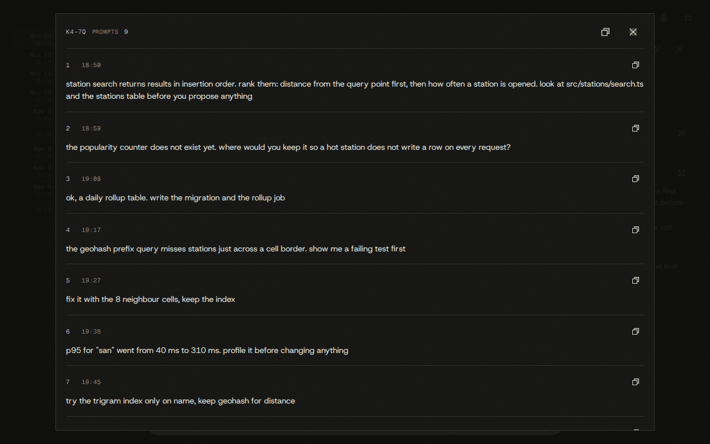
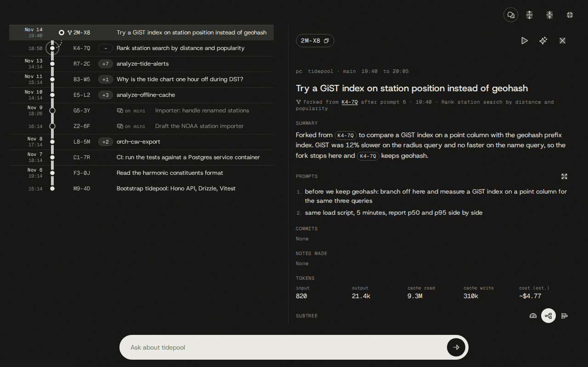
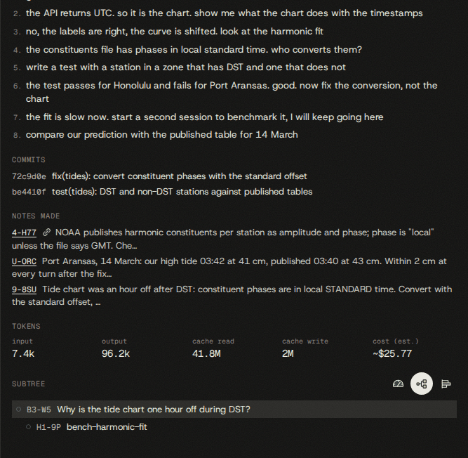
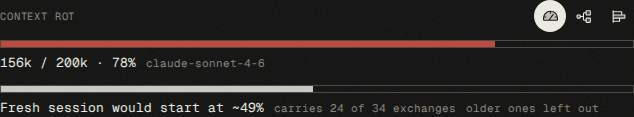
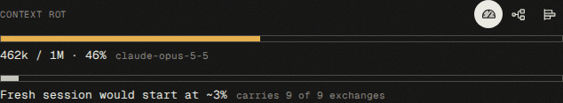

# The project session graph

Every Claude Code session run on your machines, grouped by repository, on one page of the wall
(`/projects`). The daemon reads Claude Code's own transcripts in the background, gives every
session a short id, works out which session started which, summarizes the idle ones, and makes all
of it searchable from Claude Code and from the chat. From a session's panel you can see what it
did, how full its context is, and get back into it.



Contents: [the page](#the-projects-page) · [the node panel](#the-node-panel) ·
[node ids](#node-ids) · [who started whom](#who-started-whom) · [summaries](#summaries) ·
[search](#searching-sessions) · [notes](#notes-of-a-session) · [context rot](#context-rot) ·
[resume and spawn fresh](#resume-and-spawn-fresh) · [usage](#tokens-and-cost) ·
[project chat](#chat-about-one-project) · [swarms](#running-swarms-with-the-graph) ·
[asking about sessions](#asking-about-sessions) · [ingest internals](#how-ingest-works) ·
[quirks](#quirks-and-limits)

## The Projects page

Open the Projects icon on the rail (the tree diagram) or go to `/projects`. The sidebar lists the
repositories that have sessions, newest activity first, each with its session count and a dot
while one of its sessions is running. Pick one and its sessions fill the page. The repository you
picked is stored in the database, so both machines open on the same one.

Each row is one Claude Code session, not one prompt. Time runs upward: the newest session is at the
top, with the day and start time in the left gutter.

- **The trunk.** Sessions you started yourself sit on the thick line on the left.
- **Branches.** Sessions that another session started (an `/analyze` that spawned an orchestrator,
  an orchestrator that spawned one session per phase, any `claude` launched in a new tmux window
  from inside a session, a fork) branch off to the right in lanes, like a git graph. Phases of one
  wave stand side by side.
- **`+N` chips.** A parent's descendants start folded into a `+N` chip. Click it to open that
  branch; **Expand all** and **Collapse all** in the toolbar do it for the whole graph.
- **Running.** A session that is running on this machine has a pulsing ring around its dot.
- **Other machine.** A session whose transcript is on the other machine has a hollow dot, a dimmed
  title and "on <host>" before it.
- **Edges.** A solid edge is an exact link. A dashed edge was guessed from transcripts. Round dots
  mark a fork, which also has a fork icon left of its id.
- **Unfinished.** An orchestrator whose swarm still has phases to do carries an "unfinished" badge
  (see [swarms](#running-swarms-with-the-graph)).



A row's title is the session's custom title, else its name (`claude -n`, which is how swarm
sessions get `analyze-…`, `orch-…` and `impl-…-pN`), else the title Claude Code generated, else
its first prompt.

The page draws only the rows on screen, so a repository with a thousand sessions scrolls like one
with ten. It re-reads the graph every 30 seconds (less often while nothing changes) and an
unchanged graph costs one `304`.

| Key | Does |
| --- | --- |
| `Alt+Z` | Focus mode: hides the rail, the sidebar and the header. `Esc` leaves it. |
| `Alt+C` | Switches between the session graph and the project's chat history. |
| `Alt+B` | Shows or hides the sidebar. |
| `Esc` | Closes the node panel. |

`/projects?repo=<repo>&node=<NODE>` opens a repository with one node selected and its branch
unfolded; `&focus=1` adds focus mode. The MCP tools return this link as `url` for every session.



## The node panel

Click a row to open its panel beside the graph.



| Part | What it shows |
| --- | --- |
| Header | The node id (click to copy), **Resume in tmux**, **Spawn fresh with this context**, close. |
| Meta line | "unfinished" and "running" marks, the host (or "on <host>" for the other machine), repo and branch, start and last activity. |
| Title | Name or title, the generated title under it when both exist, and the parent: `from <NODE>`, `(guessed)` for a heuristic link, or `forked from <NODE> after prompt N`. Click the parent to go to it, also when it is in another repository. |
| Summary | The Haiku summary. Note ids and node ids in it are links. Without one, a line says why and a **Summarize** button asks for one (see [summaries](#summaries)). |
| Prompts | Your prompts in order, the first 20, then "+N more". **Expand prompts** opens all of them. |
| Commits | Short sha and subject of each commit the session made, linked to the forge (GitHub, GitLab, Bitbucket) when a clone on this machine has an `origin` remote. |
| Notes made | Notes saved from the session and notes linked to it (link icon). A click opens the note in the big editor over the page; Ctrl or middle click opens the wall on it in a new tab. |
| Tokens | Input, output, cache read, cache write, and the cost: the total Claude Code recorded, or `~` an estimate from tokens and model prices. Subagents get their own line when the session ran any. |
| Subtree | Three views, chosen with the icons on the right: **Context Rot**, **Tree** and **Timeline**. The panel remembers the last one. |

**Tree** lists the session and everything it started, indented. **Timeline** draws the same
sessions as a Gantt chart: which phases overlapped and which one ran long. Click a row or a bar to
open that node.



**Expand prompts** opens a large pop-up with every stored prompt in full, numbered, with its time
and whitespace kept. Secrets show as `[redacted]`. Each prompt has a copy button and **Copy all
prompts** copies the lot. Pictures pasted into a prompt show as thumbnails that open in the
lightbox; a picture stored on the other machine is greyed out.



The plan documents a session touched and the files it edited are recorded too. The panel does not
list them; `session_get` returns them (`plan_docs`, `files_edited`), the prompt hook prints the plan
docs, and a handoff includes them.

## Node ids

A node id is two characters, a dash and two characters, like `A0-3G`: a different shape from a
note id (`A-B32`), so the two are never confused. The daemon generates them (`src/sessions/ids.ts`),
never all digits. Never invent one.

Type a node id into any Claude Code prompt, in any repository, and the `notes-prompt` hook adds
that session's title, parent and children, summary, plan docs, commits, transcript path and wall
link to what Claude sees before it answers:

```
what did A0-3G decide about the lane layout? keep going from there
compare 7K-2Q and A0-3G, which approach held up?
```

- Write the id the way the wall shows it: upper case, with the dash. `to-do`, a page range like
  `10-15`, a date, a file name such as `A0-3G.md` and a Jira key never match.
- At most five ids per prompt are looked up. An id that belongs to no session adds nothing.
- A prompt with no candidate costs one regular expression test: no file read, no network.
- A fork prints `Fork of <parent> (after prompt N, <time>)`. A session running as a background job
  prints `attach with: claude attach <job>` beside its transcript path.
- The MCP tools and the HTTP routes also accept lower case and a missing dash (`a03g`).

A session learns its own node id, and its parent's, from the `notes-session` hook when it starts.

## Who started whom

A session has at most one parent. The link has a source, and a better source is never overwritten
by a worse one:

| Source | Where it comes from | Edge |
| --- | --- | --- |
| `fork` | A session made with `claude --resume X --fork-session`, or a background job forked from X, starts with a copy of X's conversation. Ingest links it to X from Claude Code's job record (`~/.claude/jobs/<first 8 of the id>/state.json`) or, without one, from the first message id it shares with another transcript. A fork of a fork links to the fork it was copied from. | round dots, fork icon |
| `env` | `swarm.py` starts each child with `CC_PARENT_SESSION=<its own session id>`, and the `notes-session` hook reports it. A tmux child does not inherit its parent's environment, so it is passed by hand. | solid |
| `hook` | A session runs a Bash command that launches `claude` in tmux (`new-window`, `split-window`, `send-keys`…). The `notes-spawn` hook records a pending spawn, and the child claims it when it starts: within 30 seconds, same directory, on a fresh start only. A resumed or cleared session claims nothing. | solid |
| `heuristic` | For sessions from before the hooks: the parent's transcript is read for `swarm.py launch|spawn --name X` and `SendMessage {to: X}`, and a child is matched by name, time and directory. | dashed, "(guessed)" |

**Forks do not count their parent twice.** A fork's tokens, cost, commits, files, prompts, replies,
title and start time are only what it added after the fork point. The row stores where its own
records begin (`fork_cut_offset`), and everything that reads a transcript (ingest, the backfills,
the link worker, `session_transcript`) skips the copied records before it. A fork that so far
holds only the copy shows 0 tokens and no prompts.



Sessions run in a git worktree (`~/.worktrees/<repo>/<slug>`, `NOTES_WORKTREES_DIR`) are filed
under their repository from the path alone, also after the worktree is deleted.

## Summaries

When a session has been idle for 15 minutes and is not running, the daemon on the machine that ran
it writes a summary of two to four sentences with Claude Haiku, through the same `claude` login the
chat bar uses. Haiku sees the repository, the titles, your prompts, the commits, the files edited,
the plan docs touched and the final answer, with secrets (keys, tokens, passwords, connection
strings) blanked first. A summary is written once per state of the session: a session that has not
changed is never summarized again. A backlog is worked through a few at a time, at most one call
every five seconds, and three failures in a row (usage limit, logged out) pause it.

When a session has no summary, the panel says why:

| Line | Meaning |
| --- | --- |
| Summarizes once idle | It ran on this machine and has not been idle for 15 minutes, or is still running. |
| Summary requested | You pressed **Summarize**; the worker serves requests first, within about a minute, running sessions included. |
| Will be summarized on <host> | It ran on the other machine, whose daemon writes it. |
| Empty session | It used no tokens. There is nothing to summarize, and no button. |
| No summary yet | The row was written by an older daemon. |

**Summarize** only records the request (`summary_requested_at`). It never calls the model from the
page, and it survives a reload.

## Searching sessions

Sessions are searched the way notes are: words, meaning, and recency, blended with the weights in
`src/search/blend.ts` (see [search.md](search.md)). There is no search box on `/projects`. Ask in
the [project chat](#chat-about-one-project), in the wall chat, or from Claude Code with
[`sessions_search`](reference/mcp-tools.md#sessions_search).

A session is found through five sources:

| Source | What it matches |
| --- | --- |
| Session text | Node id, repo, name, titles, first and last prompt, stored prompts, summary and commit subjects (full text, `simple` config). |
| Session vector | Meaning of the title, summary, commit subjects and prompts, in that order, so a long session does not cut the commits off. |
| Node id | The exact id typed as the query. |
| Notes | The notes saved from the session or linked to it. |
| Replies | What Claude answered to each prompt: the text after the turn's last tool call, not the narration between tool calls and not subagent text. |

Notes and replies are related evidence. A session is ranked by the better of its own evidence and
`BLEND.related` (0.6) times its best note or reply, so a session whose own summary answers the
question stays above one that only repeats the words in a long reply. Each hit says what it
matched through:

```json
{ "node_id": "B3-W5", "title": "Why is the tide chart one hour off during DST?",
  "via_notes": [{ "id": "Q-C2M", "excerpt": "NOAA publishes harmonic constituents per station as amplitude and phase; ..." }],
  "via_replies": [{ "seq": 2, "excerpt": "Station 8770137 matches. Checked the next station against the published table ..." }] }
```

`via_notes` and `via_replies` list at most three items each, best first, and are empty when the
session matched on its own text. `seq` is the number of the prompt the reply answered.

Without `OPENROUTER_API_KEY`, session search is words only: every word must appear, and the result
carries `mode: "text"` and a `fallback` sentence saying so. Replies and notes are still searched by
their words. Reply vectors are made one by one in the background on the machine that ran the
session; both machines can search them.

## Notes of a session

A session's notes are the ones saved from it (`kind: "made"`) plus the ones linked to it
(`kind: "linked"`), newest first, at most 50. A note that is both is listed once, as made.

- Every note a Claude Code session writes through the notes tools (`create`, `create_image`,
  `update`, `append`, `attach_image`) is linked to that session by the `notes-link` hook. When the
  link fails the hook tells the model, so it can retry with `link_note`.
- `link_note` links any existing note to any session without changing the note; `unlink_note`
  removes a link. Both are in the MCP server only, not in the chat.
- A deleted note cannot be linked: restore it first. Purging a note from the recycle bin drops its
  links; a soft delete keeps them.

```
/n link 5-BW7 into A0-3G
/n save what we just measured as a note
```



## Context rot

A long session gets worse at its job as its context fills: older instructions blur, earlier
decisions are missed, and every turn costs more. The **Context Rot** view (the gauge icon left of
**Tree**) shows how far along a session is.





**The first bar** is the latest context over the session's context window. The latest context is
what the next turn starts from: the input, cache read, cache write and output tokens of the latest
main-chain reply. It is not the cumulative token count in the Tokens section, and subagents are
left out. The bar reads `<tokens> / <window> · <percent>` with the model.

| Band | Fill |
| --- | --- |
| green | below 40 % |
| amber | 40 % to below 70 % |
| red | 70 % and above |

**The window is inferred, never stored** (`src/sessions/contextWindow.ts`), from evidence ingest
keeps on the session. The first rule that matches wins:

1. The model's table entry is 1M (the 5.x models, Opus 4.7 and 4.8, Haiku 5.5).
2. The session's context ever passed 200,000 tokens: it must be running on 1M.
3. A main-thread request listed a `context-1m-*` beta, or the model id ends in `[1m]`.
4. The model's table entry (200k).
5. An unknown or missing model: 200k, and the bar says "window assumed".

A session with no reply yet reads "Unknown". On a session running on this machine the bar moves
with each reply, over a server-sent stream. A session of the other machine refreshes every 60
seconds.

**The second bar** estimates where "Spawn fresh with this context" would start and how many
prompt and reply exchanges it would carry ("older ones left out" when not all fit). It is the
handoff dry run, `GET /api/sessions/:nodeId/handoff`, which writes no file, runs no git and works
for a session of either machine:

```json
{ "node_id": "B3-W5", "tokens": 68817, "window": 200000, "percent": 49.4,
  "exchanges_included": 24, "exchanges_total": 34, "truncated": true, "baseline": 30000 }
```

Read the two bars together. A red first bar with a short second one says spawn fresh. A session
still in the green says resume. When a fresh session would start no lighter than this one is (a
short session barely past its own start-up cost), the second bar keeps the true estimate, dims,
and says "no saving: resume is as cheap".

## Resume and spawn fresh

Both buttons are in the panel header and both open a tmux window on this machine.

**Resume in tmux** opens a new window, in the tmux session you attached to most recently, at the
session's directory, running `claude --resume <session id>`. The whole old context comes back,
rot included.

- If the session is still running, the button reads **Focus the running session** and switches to
  its window. It is never resumed twice.
- A session running as a Claude Code background job (`claude --bg`, a fork started from the agent
  view) has no terminal. The button reads **Attach to the background session** and opens a window
  running `claude attach <job>`; pressing it again focuses that window.
- A running session outside tmux that is not a background job answers `live_outside_tmux`: switch
  to its terminal.
- `claude --resume` finds a transcript by session id, not by directory, so a session whose worktree
  was deleted still resumes. The window opens in the session's own directory if it exists,
  otherwise in the repository's main checkout (the newest directory another session of that repo
  used on this machine outside `~/.worktrees`), then `~/<repo>`, then your home folder. The deleted
  directory is never recreated; the answer reports it as `original_cwd`.

**Spawn fresh with this context** starts a new session and hands it the old one's work instead of
its conversation. The daemon writes a handoff file,
`<NOTES_DATA_DIR>/handoffs/<NODE>-<yyyymmddThhmmss>.md`, and starts
`claude --append-system-prompt-file <handoff>` with a short first prompt whose first line is
`[notesd handoff]` and which names the node and the file. The prompt hook adds no node-id block to
that prompt, since the handoff is already loaded.

The handoff holds, in order: node id, title, directory and repo; the transcript path; the stored
summary and how old it is; plan docs; commits; the directory's `git status` and `git diff --stat`
(or a line saying git failed and why); then the stored exchanges, each prompt with Claude's reply.

- **Budget.** Exchanges may use 0.5 × the old session's inferred window, minus a fresh session's
  usual start. That start is the median first-reply context of the repository's latest 20 sessions
  on either machine, or 48,000 tokens when there is none. Forks are left out of the median (their
  first reply already holds the parent's history), and so are sessions that opened with a slash
  command or a handoff (a skill or a handoff loads far more than a short first prompt). Tokens are
  estimated as characters / 4.
- **When they do not fit.** The handoff keeps the first prompt and the newest exchanges that fit,
  and says how many were left out and where the transcript is. On a 1M window everything nearly
  always fits.
- **Cleanup.** Handoff files older than 14 days are deleted when the next one is written.

The panel buttons send no prompt. To send one, ask from Claude Code or the chat, which call
[`session_resume`](reference/mcp-tools.md#session_resume) with `prompt` (typed into a running
session, or sent as the first turn) and `fresh: true` for a fresh spawn:

```
/n resume A0-3G and ask it to rerun the integration tests
/n spawn a fresh session from A0-3G, its context is nearly full
```

A prompt for a background job with no attach window open cannot be delivered yet; the answer says
`prompt_delivered: false`, and a second call types it into the window that has opened.

Both actions work only on the machine that holds the transcript. For a session of the other
machine the panel asks first ("Try anyway"), and the usual answer is `not_on_this_machine`. The
HTTP route accepts only requests from the wall's own page.

## Tokens and cost

Each session's tokens are the sum of its own transcript and its subagents' transcripts. The cost
is the latest total Claude Code wrote into the transcript. When there is none, it is estimated
from the per-model token counts and the price table in `src/sessions/pricing.ts` (cache writes at
twice the input price) and marked `~` and "est." in the panel. A model without a known price is
left out of an estimate.

The wall has no usage page. Ask for totals:

```
/n how many tokens did I spend on tidepool sessions in November?
/n which sessions cost the most this month?
```

[`sessions_usage`](reference/mcp-tools.md#sessions_usage) answers per month (default) or per
session (`by: "node"`, the sessions that used the most tokens), optionally for one repository and
one month (`YYYY-MM`, in the daemon's time zone). `totals` covers every matching session.

## Chat about one project

The pill at the bottom of the graph page ("Ask about <repo>") is a chat bar for that repository
alone. The agent is told which repository you are looking at, searches its sessions with
`sessions_search`, reads the ones it relies on with `session_get`, and quotes each by node id. When
a reply excerpt is its evidence it names the session and the prompt number ("A0-3G, prompt 4").
Node ids in an answer are links that open the node; note ids open the note.

Its conversations are stored as threads of that project. The toggle at the left of the toolbar
(or `Alt+C`) switches the page between the session graph and the project's chat history. The
wall's own chat bar and `/history` are separate; see [chat.md](chat.md).

The chat has `sessions_search`, `session_get`, `session_transcript`, `sessions_usage` and
`session_resume`. It does not have `link_note` or `unlink_note`.

## Running swarms with the graph

A swarm (`/analyze`, then `swarm.py` spawning one session per phase) leaves a dozen or more
sessions in as many tmux windows. Once they close, the only record is the git log and the ledger.
The graph keeps the run as one branch: `analyze-<slug>` on the trunk, `orch-<slug>` under it, and
`impl-<slug>-pN` under that.

**While it runs.** Every phase session sits in its wave beside the others, and the ones still
working pulse. Only sessions on the machine you are looking from can pulse.

**When it stalls.** A session named `orch-<slug>` whose swarm still has a phase that is not done,
and that is not running itself, carries the "unfinished" badge. The daemon asks
`swarm.py verify --slug <slug>` (the script at `NOTESD_SWARM_SCRIPT`), run in the session's
directory or `~/<repo>`, and keeps each answer for 60 seconds. The badge is worked out only on the
machine that ran the orchestrator, and is absent when the script or the directory is missing.
Resume the orchestrator and tell it where it stopped:

```
/n resume U8-4N and tell it: resume the orchestration, wave 2 has not been spawned
```

It opens at the main checkout even when the phase worktrees are gone.

**When a phase fails.** Open the failed phase's node: its prompts, last answer and commits are in
the panel. Resume it to finish the job, or spawn fresh so a clean session starts with what the
failed one tried.

**Handing context across sessions.** Phase sessions do not share memory, but node ids carry
context. Put one in a prompt and the session reads that node's summary, plan docs and commits
before it answers:

```
phase 6 depends on 24-ZK's schema; read it before you change ingest.ts
the lane layout was settled in 9E-E0, follow that and do not redesign it
orch-recycle-bin (P3-C4) stopped after wave 1; pick up from its ledger
```

The hook reads only the prompt, not files. An id written into a phase plan ("see `24-ZK`") is
still useful: the phase session can look it up with `session_get`.

**Planning the next swarm.** The Timeline view is the run's critical path. A wave held up by one
long phase shows as one long bar beside short ones: split that phase, or move work that does not
depend on it into an earlier wave. Phases of one wave that ran one after another usually mean a
dependency the plan never wrote down. For the price of each part:

```
/n how much did the tide-alerts swarm cost, analyze vs orchestrator vs phases?
/n which phases of tide-alerts touched src/alerts/index.ts?
/n compare the summaries of the last two orchestrators: what went wrong in each?
```

**Keeping the links exact.** A phase started by `swarm.py` is linked through `CC_PARENT_SESSION`
and shows a solid edge. A swarm of mostly dashed edges was started some other way; start phases
through `swarm.py launch` so the tree, the cost roll-up and the unfinished badge hold up.

## Asking about sessions

The same questions work from Claude Code (through `/n`, see [claude-code.md](claude-code.md)), from
the wall chat and from the project chat. They work for any repository.

Find a session:

```
/n which session added the recycle bin, and what did it change?
/n when did I fix the DST bug in the tide chart?
/n which node is talking about the email sandbox?
/n find the session where Claude wrote: "the fit converted them with the zone's current offset"
/n which node posted on the TIDE-212 Jira page?
```

The last two find a session by what Claude wrote rather than by what you typed, which is what the
stored replies are for.

Read one:

```
/n what did A0-3G do, and which plan docs did it touch?
/n list the commits of Q9-D3 and its phases
/n show me the transcript of A0-3G around the migration error
/n summarize what we did about TIDE-198
```

Usage:

```
/n how many tokens did I spend on mcp-notes sessions in October?
/n the five most expensive sessions of tidepool
```

Act (these open tmux windows or write links):

```
/n resume A0-3G and ask it to rerun the integration tests
/n spawn a fresh session from A0-3G
/n link 5-BW7 into A0-3G
/n unlink 5-BW7 from A0-3G
```

Without `/n`, in any prompt:

```
continue from B3-W5: the fix is in, now add the regression test
```

| Tool | For |
| --- | --- |
| [`sessions_search`](reference/mcp-tools.md#sessions_search) | Find sessions by meaning and words; hits carry `via_notes`, `via_replies`, `fork_of`, `url`. |
| [`session_get`](reference/mcp-tools.md#session_get) | One session in full: summary, prompts, commits, files, plan docs, notes, parent, children, `resume_command`. |
| [`session_transcript`](reference/mcp-tools.md#session_transcript) | Search one session's transcript file (every word must appear; quoted phrases stay together), or read its last messages. |
| [`sessions_usage`](reference/mcp-tools.md#sessions_usage) | Token and cost totals per month or per session. |
| [`link_note`](reference/mcp-tools.md#link_note), [`unlink_note`](reference/mcp-tools.md#unlink_note) | Link a note to a session, or remove the link. |
| [`session_resume`](reference/mcp-tools.md#session_resume) | Resume, focus, attach, or spawn fresh in tmux. |

The HTTP routes behind the page are under
[Projects and sessions](reference/http-api.md#projects-and-sessions).

## How ingest works

One background ingester per daemon keeps a `cc_sessions` row per terminal session of its own
machine in step with `<CLAUDE_HOME>/projects/<dir>/<session id>.jsonl` (`src/sessions/ingest.ts`).
`SessionsRepo` (`src/sessions/repo.ts`) is the only writer of the session tables.

- **First pass.** On its first start the daemon reads every transcript on disk, newest first, four
  files at a time, so the page is full from the first visit.
- **Tail.** Every later read starts at the byte offset stored on the row, so an append or a restart
  costs only the new bytes. A last line without a newline is left for the next read. A file that
  shrank is re-read from 0. The write is a compare-and-set on the offset, so a replayed read
  changes nothing.
- **Change detection.** A file watcher on the project directories, plus a sweep every 60 seconds
  that catches what the watcher missed.
- **Subagents.** Transcripts of the Agent tool's subagents
  (`<session id>/subagents/agent-*.jsonl`) are tailed with their own offsets
  (`cc_subagent_transcripts`). Their tokens, models and commits count toward the parent session's
  node. Their text is never stored as a reply.
- **What is left out.** Sessions that are not terminal sessions: the wall's chat agent (project
  directories ending `-data-chat`) and `claude -p` helper runs such as the `/n` helper and the
  summarizer (entry points `sdk-ts` and `sdk-cli`).
- **Per session it keeps:** repo, directory, branch, name and titles, start and last activity,
  tokens per model, the recorded cost, prompts, Claude's reply to each prompt, commits, files
  edited, plan docs (paths under `docs/plans/`, `.workflows/plan/`, `docs/analyzer/`), the final
  message and the context evidence.
- **Prompts and replies.** Stored redacted in `cc_session_prompts` (up to 256 KB each) and
  `cc_session_replies` (up to `MAX_REPLY_STORE_CHARS`, 16 KB, full-text indexed), keyed to the
  prompt's number. A turn split across two reads or a restart stores what one read would.
- **Commits.** The `[branch sha] subject` lines `git commit` prints, plus the commits of every
  `git push` and fast-forward `git merge` range, so a quiet commit shows once it is pushed.
- **Live sessions.** Whether a session is running is read at request time from Claude Code's
  registry (`<CLAUDE_HOME>/sessions/<pid>.json`), cached for two seconds. An entry counts only
  while its process is alive. Nothing about it is stored.
- **Embeddings.** The summary worker embeds each session's embed text; `replyEmbeddings.ts` embeds
  each reply (current when the sha256 of the stored text and the model match). Both run in the
  background on the owning machine and never block ingest.

Rows written before a feature existed are brought up to date once, in the background, by the
machine that owns them. Each backfill has a version constant; bump it to make every machine run it
once more.

| Backfill | Constant | What it does |
| --- | --- | --- |
| Heuristic links | `LINKS_BACKFILL_VERSION` (`links.ts`) | Reads old transcripts for `swarm.py` launches and messages and links children as `heuristic`. |
| Forks | `FORK_BACKFILL_VERSION` (`ingest.ts`) | Finds forks ingested as ordinary sessions, re-reads each from byte 0, links it and cuts the copied records. Runs before the prompts backfill. |
| Prompts and replies | `PROMPTS_VERSION`, `REPLIES_VERSION` (`types.ts`) | Re-reads a row's transcript for full prompts, pasted pictures and replies. A row whose transcript is gone has its stored excerpts redacted in place and keeps no replies. |
| Context | `CONTEXT_BACKFILL_VERSION` (`ingest.ts`) | Fills the `context_*` evidence the Context Rot view reads. |
| Session vectors | `SESSION_EMBED_TEXT_VERSION` (`summarize.ts`) | Stored with each vector (`text_version`). Bump it when the embed-text layout changes and the summary worker re-embeds every session once. |

The fork, context and link backfills record that they ran in `app_settings`, one key per host
(`sessions.forks.backfill.<host>`, `sessions.context_backfill.<host>`,
`sessions.links.backfill.<host>`).

`NOTESD_SESSIONS=off` starts no ingester, no link worker, no summary worker and no reply embedder
on that daemon.
The page, the tools and search still serve what is already in the database. The other settings
(`CLAUDE_HOME`, `NOTES_WORKTREES_DIR`, `NOTESD_SWARM_SCRIPT`, `NOTESD_TMUX_BIN`,
`NOTESD_TMUX_SOCKET`, `NOTESD_CLAUDE_BIN`) are in
[configuration.md](reference/configuration.md#sessions).

## Quirks and limits

**Two machines.** Both share the database, not the disk. Each daemon ingests its own transcripts
and records its host.

| Works on either machine (from the database) | Only on the machine that ran the session |
| --- | --- |
| The graph, the panel, summaries once written, stored prompts, commits, notes, tokens and cost | Reading the transcript: `session_transcript` and `GET /api/sessions/:nodeId/transcript` answer `not_on_this_machine` |
| `sessions_search` (text, vectors, notes, replies), `session_get`, `sessions_usage` | Resume and spawn fresh (`not_on_this_machine`) |
| `link_note`, `unlink_note` | Writing the summary and the vectors ("Will be summarized on <host>") |
| The context gauge (refreshed every 60 seconds) and the handoff dry run | The pulse of a running session, the live context stream, the "unfinished" badge |
| The Prompts pop-up | Opening a picture pasted into a prompt ("Not on this machine") |

- `session_get` returns `resume_command: null` for a session of the other machine, and
  `available: false` with its `host`.
- **Pruned transcripts.** Claude Code deletes old transcripts. The row stays with everything
  already recorded; `session_transcript` answers `transcript_missing`. A row whose transcript was
  pruned before the prompts backfill keeps redacted excerpts only ("Older prompts were cut") and no
  replies.
- **A prompt in the panel is an excerpt.** The panel shows up to 2,000 characters of each of the
  first 20; the pop-up has the full text.
- **Costs are estimates unless Claude Code recorded one.** Subscription use has no bill; the
  number is what the tokens would cost at API prices.
- **The window can be wrong for a short session on a 4.6 model's 1M variant** until its context
  passes 200k or a request shows the beta. It then switches to 1M.
- **A link change sends no event.** After `link_note`, reopen the node to see the note.
- **`/api/projects/<repo>/sessions` is 404** until the repository has a session.
- **Text search needs every word.** `rate limit` does not find "rate-limited"; meaning search does.
- **A long host name overlaps the title** in the graph row: the "on <host>" column has a fixed
  width that fits a host name of about seven characters.
- **Never invent a node id**, and never write to the session tables outside `SessionsRepo`.
- Error answers from the tools start with a code: `invalid_node_id`, `not_found`,
  `not_on_this_machine`, `transcript_missing`, `no_tmux`, `live_outside_tmux`, `spawn_failed`,
  `deleted`.

## Where the code is

| Path | Holds |
| --- | --- |
| `src/sessions/ingest.ts`, `transcript.ts`, `merge.ts` | The ingester, the transcript parser and accumulator, the backfills. |
| `src/sessions/repo.ts` | `SessionsRepo`, the only writer of `cc_sessions` and its side tables. |
| `src/sessions/ids.ts` | Node id generation, normalization and the candidate pattern the prompt hook shares. |
| `src/sessions/fork.ts`, `forkDetect.ts` | Fork detection from job records and shared message ids. |
| `src/sessions/links.ts` | Heuristic parent links and their backfill. |
| `src/sessions/registry.ts` | Claude Code's live-session registry, background jobs. |
| `src/sessions/summarize.ts`, `summaryWorker.ts`, `redact.ts` | Haiku summaries, embed text, redaction. |
| `src/sessions/replyEmbeddings.ts` | Background vectors for replies. |
| `src/sessions/search.ts` | `searchSessions`, the candidate sources, `mergeCandidates`. To add search context, write one `CandidateSource`. |
| `src/sessions/contextWindow.ts` | Window inference, percent and bands. |
| `src/sessions/handoff.ts` | The handoff file, its budget and the dry-run estimate. |
| `src/sessions/resume.ts` | Resume, focus, attach and fresh spawn through tmux. |
| `src/sessions/unfinished.ts` | The "unfinished" check through `swarm.py verify`. |
| `src/sessions/pricing.ts`, `commitLinks.ts`, `repoResolve.ts`, `gitRange.ts` | Cost estimates, commit web links, repo keys, push and merge ranges. |
| `src/sessions/readModel.ts`, `view.ts` | What the routes and tools read, and the shapes they return. |
| `src/http/sessionsApi.ts`, `sessionHooks.ts`, `sessionResume.ts` | Read routes, the hook endpoints (loopback), resume and handoff (same-origin). |
| `src/mcp/sessionTools.ts` | The seven MCP tools. |
| `claude/hooks/notes-session.mjs`, `notes-spawn.mjs`, `notes-prompt.mjs`, `notes-link.mjs` | Session start and parent, pending spawns, node ids in prompts, auto-linking notes. |
| `web/src/pages/ProjectsPage.tsx`, `web/src/components/graph/`, `web/src/components/projectChat/` | The page, the graph, the node panel, Context Rot, the prompts pop-up, the project chat. |
| `web/src/lib/sessionGraph.ts`, `subtree.ts` | Graph layout (lanes, rows) and the subtree views. |
| `drizzle/0007` to `0010`, `0012` to `0016` | Session tables, subagent transcripts, note links, full prompts and summary requests, prompt images, commit search, replies, forks, context evidence. |

## Proving a change

The feature map is `.claude/skills/verify-notesd/features/projects.md`. It lists every
user-visible behaviour of this subsystem and how to drive it.

```sh
V=.claude/skills/verify-notesd/scripts/verify.sh
NOTESD_CLAUDE_BIN=/nonexistent/claude $V up --sessions --web   # fixture transcripts, summaries off
$V api RUN GET /api/projects/mcp-notes/sessions
$V mcp RUN sessions_search '{"query":"feat"}'
```

- `--sessions` seeds the run's own `CLAUDE_HOME` from `tests/fixtures/claude-home`. Without
  `NOTESD_CLAUDE_BIN` pointing nowhere the summary worker runs Haiku on the fixtures, which is
  billed.
- Richer graphs are seeded with `$V exec` (rows in `cc_sessions`, `cc_session_prompts`,
  `cc_session_replies`), a running session with a registry file under the run's
  `claude/sessions/`, a fork with the fixtures in `tests/fixtures/claude-home-forks`.
- Never drive resume or a fresh spawn against real tmux or a real `claude`. The feature map has
  the two fake-tmux journeys and the safety gate that must pass first. The handoff dry run is safe.
- Unit tests are in `tests/unit/sessions/` and `tests/unit/hooks/`, integration tests in
  `tests/integration/sessions.*.int.test.ts` and `sessionHooks.int.test.ts`.
- The pictures in this guide are retaken with `node scripts/docs/capture.mjs sessions`
  (`scripts/docs/shots/sessions.mjs` seeds a made-up project, `tidepool`).
