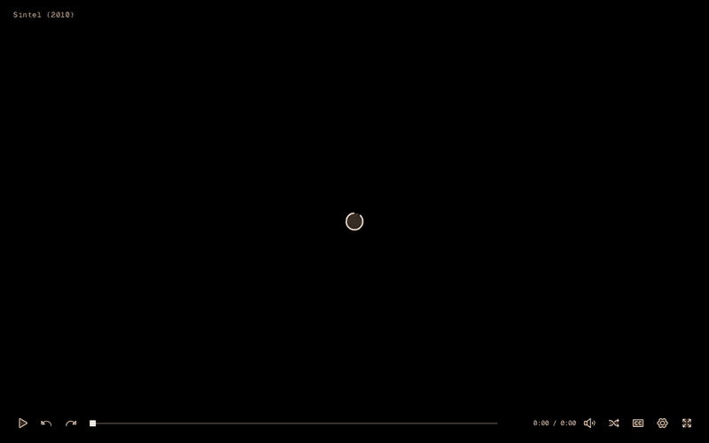
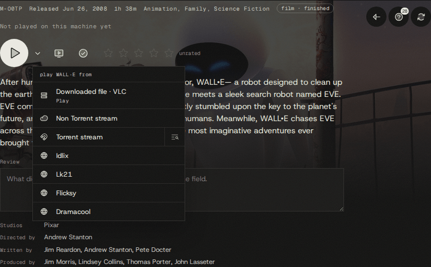
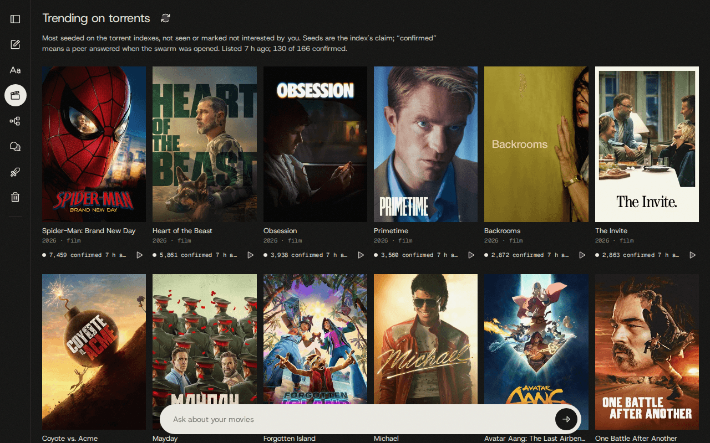

# Streaming and download sites

notesd plays what the library does not hold in two ways:

- **Streaming sites.** Four sites are searched and driven in a real Chrome on your screen, each by
  its own skill, and pahe.ink is searched for downloads.
- **Direct streaming.** A film or an episode plays in notesd's own player page, from a cloud
  provider, a torrent or this machine's cache, with no site, countdown or advert in between.

Every command:

| Site | Skill | What it does | Chat bar |
| --- | --- | --- | --- |
| pahe.ink (downloads) | `/pahe <title> [year]` | Finds the title's page and links each release, BluRay first | Yes, through `WebFetch` |
| idlix (streaming) | `/idlix <title> [year] [season N episode M]` | Finds the title, starts the film or one episode, shows it full screen | Yes, through `streaming_play` |
| lk21 (streaming) | `/lk21 <title> [year]` | The same | Yes, through `streaming_play` |
| flicksy (streaming) | `/flicksy <title> [year]` | The same | Yes, through `streaming_play` |
| dramacool (streaming, Asian dramas) | `/dramacool <title> [year] <episode>` | Finds the drama, starts the episode, shows it full screen | Yes, through `streaming_play` |
| A cloud source or a torrent, no site (streaming) | `/direct-stream <title> [year] [season N episode M]` | Finds the title, resolves a stream, plays it full screen in our own player | Yes, through `direct_stream_play` |
| An aggregator site's providers, or a magnet's index | `/update-cloud-source <site url or magnet>` | Reads the site's provider templates, adds the ones the registry lacks, probes each; for a magnet, names its index and keeps its trackers | No: it writes this machine's provider list and probes for minutes |
| A stream that went wrong | `/report-stream-bug [folder] [what you saw]` | Collects the stream's evidence, compares a reference download with the stream host, names the cause, saves a `#stream-bug` note | No: it reads this host's evidence and the daemon's log |
| A subtitle that does not fit | `/sync-subtitle [movie id, title or player address]` | Hears the film with Whisper, judges the subtitle's text and timing against it, re-times or replaces it | No: it runs Whisper on this laptop for up to a few minutes |
| A site not listed here | `/create-streaming-skill <name> <homepage>` | Adds a streaming site as a new skill of the same kind | No: it changes this repository |

The site skills only look a title up and drive a browser on your screen: no film file is fetched
from a site. A play that started is kept with its title, which then plays there again when no
source is named ([What played last time plays first](#what-played-last-time-plays-first)). Direct
streaming does download, to this machine only: the [stream cache](#caching-a-film-or-an-episode)
and [torrents](#torrents).

## What sets it apart


| | What it does | Where |
| --- | --- | --- |
| One player, nothing around it | A stream plays in a page notesd serves: no site, countdown, pop-up or advert. Every request goes through a pass-through that reaches only the stream's own hosts | [The player](#the-player), [Sessions and the pass-through](#sessions-and-the-pass-through) |
| Three sources, one command | A cloud provider, a torrent or this machine's cache, asked in the order that last worked for the title | [What played last time plays first](#what-played-last-time-plays-first) |
| The original language, never a dub | A stream's audio tags are read, then its first segment; for a cloud file with no tags Whisper listens to 30 seconds of it | [The resolver](#the-resolver), [The audio-language check](#the-audio-language-check) |
| A proper copy | Before a stream's first play a model looks at two frames and passes over a cinema recording or a burned-in betting logo | [The picture check](#the-picture-check) |
| A torrent picked by its swarm | The trackers are asked before a swarm is joined, the best three torrents are opened side by side, and the one that delivers plays while it downloads. Asking again tries the next ones | [Playing from a torrent](#playing-from-a-torrent) |
| An English subtitle, one way or another | The stream's own track, a file in the torrent, the track inside the video file, two subtitle services, another provider's file, and Whisper as the last resort. An outside file is re-timed to the audio, and `/sync-subtitle` checks one against what is said | [Subtitles for a torrent](#subtitles-for-a-torrent), [`/sync-subtitle`](#sync-subtitle-a-subtitle-checked-against-the-films-audio) |
| A stream that mends itself | An expired token is refreshed, a network error is ridden out, a host that stalls is left for another provider, and a pause downloads the film | [How a provider delivers](#how-a-provider-delivers), [A pause caches the film](#a-pause-caches-the-film) |
| The next episode is already here | While an episode plays, the one after it is fetched to this machine | [The next episode, fetched ahead](#the-next-episode-fetched-ahead) |
| Asked in your own words | "Play one of Nolan's films", "a Korean mafia film from this year TM", "resume One Piece from episode 730": people, studios, services, languages, genres and six codenames. A title chosen for you is never one you have seen | [Finding something to stream](#finding-something-to-stream), [Codenames](#codenames) |
| It knows what was said | An episode's whole dialogue is read from its subtitle, so "why did Jack leave Zou?" has an answer | [What a title says](#what-a-title-says-its-dialogue) |
| A broken stream explains itself | Every request of a play is logged. `/report-stream-bug` measures your connection against the stream host and names the cause | [Reporting a stream bug](#reporting-a-stream-bug-report-stream-bug) |
| No disguise | Every client says what it is. A bot check is never worked around: the owner clears it by hand, in the streaming Chrome | [The streaming Chrome](#the-streaming-chrome), [When the indexes have nothing](#when-the-indexes-have-nothing-1337x-extto-and-rutracker) |

The player pictures in this guide show the trailer of Sintel (© Blender Foundation, CC BY 3.0) in a
throwaway daemon (see [Proving a change](#proving-a-change)); the Movies page pictures are the
owner's real library, as in [movies.md](movies.md).

Contents: [What sets it apart](#what-sets-it-apart) · [pahe.ink](#paheink) ·
[The streaming sites](#the-streaming-sites) · [What you can ask](#what-you-can-ask) ·
[How a film is started](#how-a-film-is-started) · [The streaming Chrome](#the-streaming-chrome) ·
[In the chat bar](#in-the-chat-bar) · [Adding a site](#adding-a-site) ·
[Failure answers](#failure-answers) · [Direct streaming](#direct-streaming) ([Anime](#anime) ·
[The picture check](#the-picture-check) · [The audio-language check](#the-audio-language-check) ·
[The player](#the-player) · [Finding something to stream](#finding-something-to-stream) ·
[Codenames](#codenames) · [What played last time plays first](#what-played-last-time-plays-first) ·
[What a title says](#what-a-title-says-its-dialogue) ·
[`/update-cloud-source`](#update-cloud-source-providers-from-another-site) ·
[Caching](#caching-a-film-or-an-episode) · [The next episode](#the-next-episode-fetched-ahead) ·
[Reporting a stream bug](#reporting-a-stream-bug-report-stream-bug)) · [Torrents](#torrents)
([Playing from a torrent](#playing-from-a-torrent) · [Subtitles](#subtitles-for-a-torrent) ·
[`/sync-subtitle`](#sync-subtitle-a-subtitle-checked-against-the-films-audio) ·
[A pasted magnet](#a-magnet-the-owner-pasted)) · [Where the code is](#where-the-code-is) ·
[Proving a change](#proving-a-change)

## pahe.ink

```text
/pahe no other choice
/pahe ready or not 2019
```

- **In Claude Code** the `/pahe` skill (`claude/skills/pahe`) runs `search.mjs`, which fetches
  `https://pahe.ink/?s=<title>` and reads only the search results, not the page's menus and
  featured posts.
- **In the chat bar** the same request, or "find it on pahe" after a recommendation, reads that
  page with `WebFetch`.

The answer is a link per matching release, BluRay first, then WEB-DL. A result matches when its
name is the asked title, and its year is the asked year when one was given and the result has one; without a year, a
remake and its original are both shown. The search is fuzzy, so most results are unrelated: with
no exact match the answer shows up to three near misses, or says the site does not have the title
and gives the search link. A link is never built by hand, because the addresses are irregular,
and the lookup stops at the title's page: the download buttons behind it are not followed.

## The streaming sites

The streaming skills run one command, `claude/streaming/cli.mjs`, with a module per site in
`claude/streaming/sites/`:

| | idlix | lk21 | flicksy | dramacool |
| --- | --- | --- | --- | --- |
| Address | `https://z3.idlixku.com` (`IDLIX_ORIGIN`; the scripts follow it to its next numbered host) | `https://tv12.lk21official.cc` (`LK21_ORIGIN`) | `https://flicksy.pro` (`FLICKSY_ORIGIN`) | `https://dramacool9.com.ro` (`DRAMACOOL_ORIGIN`) |
| A plain request | Refused: Cloudflare answers 403 to `curl`, `WebFetch` and a headless browser | Answered | Answered | Answered |
| Search | The site's own `/api/search`, asked from inside the streaming Chrome | The search host named on the home page (`data-search_url`), asked directly | The site's own TMDB pass-through (`/api/tmdb/search/multi`), asked directly | The site's own search page (`/?s=`), its first 20 titles |
| A film's page | `/movie/<slug>` | `/<slug>` | `/watch/movie/<TMDB id>`, the player page | None of its own: a film is a title with one episode |
| A series | `/series/<slug>`: a link; one episode starts when asked for (`/series/<slug>/season/<n>/episode/<n>`) | Forwards to another site: a link, not started | `/series/<TMDB id>`: a link, not started | `/<slug>`: a link, and every title is one; one episode starts when asked for (`/<slug>-episode-<n>.html`, as the title's page links it) |
| Before the film | A 7-second countdown, then an advert with "Skip Ad" after about 10 seconds | Nothing | Nothing | Nothing; the player's host lays adverts over it, which are left alone |
| The player | In the page itself | In a frame from another host, inside a second one | In a frame from another host (FrameXTV, the first of the site's servers) | In a frame from another host (vidbasic, the site's "Fast Server"), inside a second one of that host |
| Time to a playing film | About 25 seconds | 6 to 20 seconds | About 6 seconds | About 9 seconds |

idlix and lk21 move between hosts (`z2`, `z3`; `tv11`, `tv12`). idlix's old host forwards to the
new one, and its scripts follow: a tab opened on the known host that lands on another numbered
host of the same name (`cdp.ps1` answers `moved` with where) makes that host the site. Set the
`*_ORIGIN` variable when a site has moved somewhere the scripts cannot follow: see
[configuration](reference/configuration.md#streaming-sites).

**A site this network does not reach.** Some sites are only reached through Cloudflare WARP, and
some refuse it: with WARP on, lk21's Cloudflare answers "you have been blocked" to the real
Chrome and to a plain request alike, and with it off both go through (2026-11-18; idlix answers
either way). So when a site does not answer (its page never loads, a request fails) and WARP is
installed on the Windows side, the command switches it the other way round (`warp-cli connect` or
`disconnect`), waits until it is there and asks the site once more. When that worked WARP stays
that way and `warp` in the answer says so; when it did not, WARP is put back and the first
failure is the answer. WARP carries the whole laptop's traffic, so it is touched only after a
site failed, and never for a torrent or a cloud stream. `NOTESD_STREAM_WARP=off` stops it. A tab left on Chrome's own error page by the failed try is closed and opened again, so the
second try really loads the site.

flicksy has no catalogue of its own: its search is TMDB's, so every title TMDB lists is found, and
whether a film plays is up to the server its page embeds. That server is one of the providers
`/direct-stream` asks too, and it serves the copy it has: a film not in English may be a dub,
which `/direct-stream` would pass over and flicksy plays as is. Only the site's first server is
played; its "Switch server" menu is left alone.

dramacool holds Asian dramas with English subtitles, and every title on it is a list of episodes:
a drama, a show, and a film too, which is a title with one episode. A later season is a title of
its own ("Love Wins All Season 2 (2026)"), found under the series' name or its full one. Only the
site's first server is played; its other server buttons are left alone. The player's host lays
small adverts over the picture, also in full screen. They are not closed for you: their "Close"
opens an advertising page, sometimes in the place of the episode. Close them with the mouse, or
ask for the episode again when one took the page.

A result matches when its English or original-language name is the asked title, and its year is
the asked year when one was given and the result has one. A link is never built by hand: it counts only when the site's
search returned it.

## What you can ask

Every line below works in Claude Code. The same words work in the wall's chat bar, except
`/create-streaming-skill` ([Adding a site](#adding-a-site)).

### `/pahe`: a download page

```text
/pahe no other choice
/pahe ready or not 2019
/pahe mobland
find no other choice on pahe
is ready or not on pahe? the 2019 one
get me the pahe link for that film
/pahe the second one
```

| You type | What comes back |
| --- | --- |
| `/pahe no other choice` | Both releases of No Other Choice (2025), BluRay first, then WEB-DL, each a link |
| `/pahe ready or not 2019` | Only the 2019 film, not the 2026 sequel |
| `/pahe that one`, after a recommendation | The film from the conversation, with its year |
| A title pahe does not have | "pahe.ink does not have it under that name", with the search link, or up to three near misses |

### `/idlix`, `/lk21`, `/flicksy`, `/dramacool`: find it, play it

```text
/idlix no other choice
/idlix love of your life
/lk21 love of your life
/lk21 ready or not 2019
/idlix la brea
play it on idlix
put that one on lk21
/lk21 the first one
```

| You type | What happens |
| --- | --- |
| `/idlix no other choice` | One film matches: it starts, full screen, in the streaming Chrome (about 25 seconds) |
| `/lk21 love of your life` | The same on lk21 (6 to 20 seconds) |
| `/flicksy impetigore` | The same on flicksy (about 6 seconds) |
| `/lk21 ready or not 2019` | The 2019 film starts. The year is what tells a remake from its original when both carry the same name |
| A title two films share, with no year | Several films match: the answer lists them with their years and asks which one |
| `the 2019 one`, after that | That film starts, played by the link from the list |
| `/idlix la brea` | A series: its link, with the number of seasons. Nothing starts |
| `/idlix OP 787` | One Piece episode 787 starts. The site says it is in season 18 |
| `/idlix la brea season 2 episode 3` | That episode starts |
| `/dramacool summer vacation 3` | Episode 3 of the drama starts (about 9 seconds) |
| `/dramacool summer vacation` | The drama's link. Nothing starts: every title on dramacool needs an episode, a film episode 1 |
| `play it on lk21`, after a recommendation | The film from the conversation |

Lookups, which start nothing:

```text
is la brea on idlix?
find no other choice on lk21
where can I stream no other choice?
is love of your life on idlix or lk21? which has the better quality?
which of the films you recommended are on lk21?
```

| You type | What comes back |
| --- | --- |
| `is la brea on idlix?` | The link, "series, 3 seasons" |
| `where can I stream no other choice?` (chat bar) | One line per site, each with its link and quality |
| A title no site has | It says so, per site, and offers near misses when there are any |

Together with the film library and the web:

```text
recommend comedies like How to Make a Killing, then put the first one I have not seen on idlix
which of those are on pahe?
what did this director make? find the newest one on lk21
```

The rules behind those answers:

- **`/idlix <title>`, `/lk21 <title>` or `/flicksy <title>` puts the film on** when exactly one film matches.
  `/dramacool <title> <episode>` puts that episode on when exactly one drama matches.
- **A question is a lookup.** "Is it on idlix?" answers with the link and starts nothing.
- **Several matches start nothing.** The answer lists them; say which one and it is played by
  its link.
- **A series without an episode is a link only**, and on lk21 it lives on another site. On
  flicksy a series is always a link.
- **An episode on dramacool** (`cli.mjs dramacool --play <title> --episode <n> [--season <n>]`).
  The title comes from the site's search; its page is read with a plain request, and the episode
  is the one that page links under "All Episodes". A title is one season, read from its address
  (`-season-2-`; 1 without), so two seasons of one name with no season asked answer
  `several_episodes`.
- **An episode on idlix** (`cli.mjs idlix --play <title> --episode <n> [--season <n>]`,
  `streaming_play` with `episode`). The series comes from the site's search, as always. Then the
  site's own episode API (`/api/series/<slug>/season/<s>/episode/<n>`, asked inside the streaming
  Chrome) says which season has the episode: the named season, or every season the series lists,
  because a long anime numbers its episodes through the seasons and only the site knows where
  (One Piece 787 is in season 18). The episode starts only when exactly one matching series has
  it. `skipped_play` says why not: `no_match` (no series of that name), `episode_lookup_failed`
  (the site could not be asked; `episode_error` says why), `no_episode`, `several_episodes` (two series of that name, or
  an episode number every season has: `episode_candidates` lists them and one is then played by
  its link), `no_video`, or `no_episodes` on a site that plays none. An episode's address is
  the series page the search returned plus the season and episode the site confirmed; it is
  never guessed.
- **A recommendation is not a request.** A film is never started because it was suggested.
- **A film in the library plays in VLC** (`movies_continue`), unless you name the site.
- **A play that started is kept with its title**, and the title then plays on that site again
  when no source is named ([What played last time plays first](#what-played-last-time-plays-first)).

### `/direct-stream`: straight from a cloud source or a torrent

```text
/direct-stream saltburn
/direct-stream dune 2021
this is a LOTR night. let's /direct-stream the first one
/direct-stream the bear season 2 episode 3
/direct-stream M-23T4
can I stream saltburn directly?
resume one piece from episode 730
stream a johnny depp movie. the more recent the better
let's watch some spanish series. pick one for me, one released this year
let's stream the most recent Shudder movie
what are Blumhouse's movies released this year? play one
```

| You type | What happens |
| --- | --- |
| `/direct-stream saltburn` | One film matches: it is resolved and plays full screen in the streaming Chrome, English subtitle on when a source has one |
| `/direct-stream dune 2021` | The 2021 film. Without the year, Dune matches three titles: the answer lists them and starts nothing |
| `this is a LOTR night. let's /direct-stream the first one` | Claude names the film first (The Lord of the Rings: The Fellowship of the Ring, 2001), then streams it |
| `/direct-stream the bear` | A series: its seasons, and a question about which episode. Nothing starts |
| `/direct-stream the bear season 2 episode 3` | That episode plays |
| A film no source can stream | `no_source`, with what each provider, index and torrent did. Nothing starts |
| `can I stream saltburn directly?` | A lookup: the match, and whether this laptop has a recently verified source |
| `resume one piece from episode 730` | The 730th episode, whatever season TMDB files it under; the answer names the season and episode |
| `stream a johnny depp movie. the more recent the better` | Claude lists his films newest first, picks one you have not seen, plays it and says which and why |
| `what are Blumhouse's movies released this year?` | A list, marked seen or not. Nothing starts until you add "play one" |

Requests that name no title are in [Finding something to stream](#finding-something-to-stream).

- **`/direct-stream` streams even a film you have.** Without it, a library film plays in VLC.
- **A question is a lookup**, and **a recommendation is not a request**.
- **"Pick one for me" and "play one" are requests.** Claude chooses from the list it found, plays
  that title and says which one and why. The list it chooses from never holds a title you have
  seen or marked not interested. "Rewatch one of Nolan's movies" does choose among the ones you
  have seen, and a title you name plays whether you have seen it or not.
- **It continues where the last stream stopped.**

### `/create-streaming-skill`: another site

```text
/create-streaming-skill "/lk21" the homepage is https://tv12.lk21official.cc/ .
note: we can search directly on the homepage without being redirected to a dedicated search page
search item url https://tv12.lk21official.cc/love-your-life-2026

/create-streaming-skill rebahin https://rebahin.example/ search is a pop-up, like idlix
add another streaming site, same as lk21: https://example.tv/
/lk21 stopped working, look at the site again
```

Give it the skill's name and the homepage. An example film page and a word on how the search
behaves save it a step. What it does is in [Adding a site](#adding-a-site).

## How a film is started

1. The streaming Chrome window comes to the front and opens the film's page.
2. The site's play button is pressed. On idlix the advertising tab that press opens is closed,
   the countdown is waited out and the site's own "Skip Ad" is pressed when the advert offers it.
   On lk21 the press goes to the player inside its frame, and the player's own play is pressed
   again when the first press only set it up. On flicksy the press goes to the player inside
   its frame, once the frame is the asked film's. On dramacool the frame's address is read from
   the episode's page first, and the press goes to the JW Player inside that frame; the player is
   given a size that follows its frame, since its host sizes it once, in pixels.
3. Once the film is running, the window goes full screen and the player is stretched over it.

Things that are not obvious:

- **The film plays in the streaming Chrome, not in your own browser.** A link opens a fresh page,
  and a page that is already playing cannot be handed over through one.
- **That Chrome runs an ad blocker you installed.** uBlock Origin Lite is in its profile
  (`%LOCALAPPDATA%\notesd-stream-chrome`), added by hand from the Chrome Web Store: Chrome 157
  loads no extension from a script, and needs no Google sign-in for the store. With it idlix's
  advert does not come and dramacool's overlays and advert tabs stay away. The scripts still work
  without it, and press nothing on an advert but idlix's own "Skip Ad" button.
- **Full screen is the F11 kind.** A page's own full-screen button is refused for a click that
  does not come from the keyboard or mouse, so the whole window goes full screen and a style
  stretches the player over it. F11 leaves it; Esc removes the style and shows the page.
- **The player stops two pixels short of the screen.** A video that covers the whole screen
  exactly is handed by Chrome to a full-screen overlay that draws nothing of the page over it:
  the player's subtitles and controls were in the page and not on the screen (idlix,
  2026-11-18). Two pixels less and they are drawn.
- **A hidden page stops a countdown.** Chrome is started with
  `--disable-features=CalculateNativeWinOcclusion`, so a window covered by another still counts
  as visible, and the window is brought to the front. Minimizing it during the wait stops the
  flow; the answer says at which stage, and asking again starts over.
- **One film at a time.** Starting a film on a site closes every other tab of the streaming
  Chrome: the other sites', the daemon's own player page, and a tab a resolver or a gate left
  open. Going the other way,
  the daemon's own player page (`/direct-stream`, a stream from the wall) closes the streaming
  sites' tabs when it starts a film with sound, and only those: a site's film would go on playing
  behind it, and a resolver's tab is left alone.

## The streaming Chrome

`claude/streaming/cdp.ps1` is the Windows half. WSL cannot reach Windows loopback, so the part
that talks to Chrome runs in Windows PowerShell, as with VLC.

- It uses a Chrome with its own profile folder, `%LOCALAPPDATA%\notesd-stream-chrome`, and
  DevTools port 9333. Chrome refuses a debugging port on the default profile, so your everyday
  Chrome, its tabs and its logins are never touched.
- When that Chrome is not running it is started minimized, and it stays open afterwards: about
  4 seconds cold, under a second warm.
- One call evaluates one JavaScript expression, in the site's tab or in an embedded frame whose
  address matches a pattern, and prints the reply. Options bring the window to the front, make
  it full screen, close every tab that is not on the site, or close only the tabs on named hosts.
- It never touches a Chrome it did not start, and never closes one.

## In the chat bar

The chat bar has no shell, so the daemon runs the same command for it through two MCP tools
(also available to Claude Code):

- `streaming_find` asks one site or all of them for a title and returns the links; with
  `episode` it also says which season of a series has it.
- `streaming_play` starts a film or one episode: by site and title, or by the link of a result.

"/idlix no other choice" or "put it on lk21" in the chat bar calls `streaming_play`; "where can
I watch it?" calls `streaming_find`. The bar never starts a film it was not asked to start. The
tools work on the machine with Windows Chrome; on the other one `streaming_play` answers with
the error and the bar gives the link. `NOTESD_STREAMING=off` turns both tools off.

## Adding a site

`/create-streaming-skill <name> <homepage> [what you know]` adds a streaming site end to end:
the skill, the site module, the chat bar's side, tests and this guide. Claude Code only, from any
repository; it works in `~/mcp-notes`. The sample commands are under
[What you can ask](#create-streaming-skill-another-site).

What the skill (`claude/skills/create-streaming-skill`) makes Claude do, in order:

1. **Ask the site with a plain request.** A real page back means lookups need no browser
   (lk21). A Cloudflare 403 means everything goes through the streaming Chrome (idlix).
2. **Find the search request** the site's search box makes, and read real answers: the fields
   for title, year, kind and slug, and how a page's address is built from the slug.
3. **Find the player:** in the page or in a frame from another host, what starts it, what the
   site shows before the film, and when the film is really running.
4. **Write the site module**, `claude/streaming/sites/<name>.mjs`: `search`, `titlePath`,
   `start` and `playerSelector`, plus `episodes` for a site that plays episodes and `details`
   for one whose pages describe a title. Add it to `sites/index.mjs`, to `STREAMING_SITES`
   (`src/streaming/service.ts`) and its `*_ORIGIN` to the configuration reference.
5. **Add the skill folder:** a `SKILL.md` copied from lk21's and a short `search.mjs` that calls `cli.mjs`.
6. **Name the site** in the chat prompt and the MCP instructions, so the chat bar knows it.
7. **Tests and docs**, then prove it live: a lookup, a series, no result, and two plays in a
   row, from the terminal and through the daemon.

It tells you before the first play test, because a Chrome window takes over the screen and plays
with sound. It also carries what went wrong on the first two sites: an advertising tab that
froze a countdown, a first press that only set a player up, a full-screen button that refuses
automated clicks, and a daemon that could not find PowerShell.

It will not disguise a client to get past a bot check, skip an advert the site does not let a
person skip, or dig out a video file. A site that needs any of those is not added.

## Failure answers

| Answer | Meaning |
| --- | --- |
| `streaming_off` | `NOTESD_STREAMING=off`, or the daemon was started without the tools |
| `no_chrome` | Chrome is not installed on the Windows side |
| `chrome_not_reachable`, `no_tab` | Chrome did not start, or the site's page did not load in time (with WARP installed, it is switched the other way round and the site asked once more) |
| `moved` | The tab opened on the site's address landed on another host that is not the same site by its name; idlix's own moves (`z2` to `z3`) are followed and never answer this |
| `the site answered HTTP 403` | Cloudflare is now refusing the real Chrome too |
| `playing: false` with `stage: no_player` | lk21's, flicksy's or dramacool's player frame did not appear after eight tries: the player changed (on flicksy, its first server is no longer FrameXTV), or the page is not a film |
| `skipped_play`: `no_match`, `several_matches`, `series` | Nothing was started: no film of that name, several (say which one and it is played by its link), or a series with no episode named |
| `cdp_failed` | Chrome answered on its port and the call into the tab failed; ask again |
| `not a title page on <origin>` | The link given to play is not a film or episode page of that site |
| `streaming script failed` | From the chat bar or a tool: the command did not answer within 3 minutes |
| `the page has no play button` | idlix's page changed, or it is a series page |
| `playing: false` with `stage` | Where the flow stopped: `countdown`, `advert`, `play_button`, `loading`, `film` (the player is there and did not start), `other_frame` (flicksy's or dramacool's frame still held another film) |
| A host that does not resolve | The site moved: set its `*_ORIGIN` |

A failure never falls back to a guessed link.

## Direct streaming

Direct streaming plays a film straight from the stream host a provider uses, in a page notesd
serves, with no site, countdown or advert in between. A provider is an embed address keyed by the
TMDB id, such as `https://vidfast.pro/movie/{id}`. Resolving opens that address out of sight in
the streaming Chrome, notes the manifest it asks for and the headers it sent, and closes the tab;
playing hands the manifest to notesd's player page through the daemon. It needs `NOTESD_MOVIES`
on, and `NOTESD_DIRECT_STREAM=off` turns it off: every `/api/stream/*` route then answers
`direct_stream_off` and no Chrome tab is opened for it.

### The resolver

`claude/streaming/direct/cli.mjs resolve <movie|tv> <tmdb id> [season episode]` opens each
provider's embed in a background tab of the streaming Chrome, muted, and keeps the first one that
loads a stream: the manifest, the `Referer`, `Origin` and `User-Agent` its request carried, and the
subtitle tracks seen (separate `.vtt`/`.srt` requests and tracks inside the manifest). Providers are
tried in the order described under **The order** below (`order.mjs`). A
provider whose page shows a bot check is recorded as `bot_check` and the next one is tried; nothing
is clicked or disguised to get past it.

**A dub is never a source.** The daemon passes the title's original language (TMDB's
`original_language`, kept on `movie_titles.original_language`) as `--audio-lang`, and the resolver
asks each stream what it speaks (`audio.mjs`) before keeping it:

| What the stream says | What happens |
| --- | --- |
| Its manifest names audio tracks and one is the original language | Kept; the player selects that track, whatever the manifest's default is |
| It names languages and none is the original (an English dub of a Korean series) | The provider is recorded as `dubbed` and the next one is tried |
| Nothing names a language | Kept: it cannot be told apart from the original |

A stream with one muxed audio has no track list, so its first media segment is read instead: the
programme table of an MPEG-TS segment, or the track header of an MP4 one (at most three small
requests, with the headers the manifest request carried). `dubbed` is about the title, not the
provider, so it leaves the provider's health alone. When every stream is a dub the answer is
`no_source`. A dub's separate English subtitle file is not wasted: when the stream that is kept
has no English subtitle of its own, the file is added to its tracks (`borrowed_from` names the
provider it came from). Providers are data, `providers.seed.json`, 24 templates read
from fmovies. `--deadline-s <n>` stops trying providers once `n` seconds have passed (the answer is
`deadline`, which says nothing about the title). `cli.mjs open <url> --fullscreen` puts a daemon page
full screen in the streaming Chrome and starts the player with sound, as a click would.

**A title that is not in English looks for a subtitle.** When the first stream that resolves has
no subtitle to show, it is held and up to four more providers are asked: the first with an
English track, or with a single unnamed subtitle file (the player shows such a file by default),
wins; otherwise the held stream plays. Its attempt reads `held: no English subtitle`. Once a
stream is held, a provider that was tried on this machine and never gave a stream is not asked. An English title, `--only` and a title whose language is not known take the first
stream. When the provider with the English track has the shorter picture (a 960p cinema
recording found after a 1080p stream), the taller stream plays and takes that provider's English
subtitle file (`borrowed_from`); only a separate file can be lent, not a track inside a manifest.

**The order** (`order.mjs`): first the provider `NOTESD_STREAM_FIRST_PROVIDER` names
(`cinemaos.live`: it reaches a stream in 7 to 11 s, where a list of embeds can take a minute),
while it earns the place: after three failures in a row, or a play whose delivery was bad, it is
ordered like the others until it gives a stream again. It comes after an anime's embeds, and
after the provider a title last played through, which is still asked alone first. Then a
provider that never gave a stream on this machine and failed five
times in a row goes last of all (it is still tried); then English subtitle (the seed's "has one"
stands even when the last title it resolved had none), delivery, health, quality, speed.

**A provider that is down rests.** A provider whose own page does not load (its name no longer resolves, the
connection fails, its origin answers 5xx: Cloudflare's 521, 522 and 523) has no stream to wait for: the sniffer
ends the watch 3 s after it sees that, and the attempt reads `no_stream`,
`unreachable: HTTP 523; 8 requests, ...`. Seven such providers cost a title nobody carries 39 s each. Once a
provider has never given a stream on this machine, has failed five times in a row, and its last failure was its
own (`unreachable`, or a bot check), it is not asked at all: its attempt is `skipped`,
`resting: it never gave a stream here and failed 5 times in a row (its page does not load); asked again after
2026-11-20 10:00 UTC`, and its health is left as it was. It is asked again a day after its last failure, then
after two days, four, up to a week, so a provider that came back is found by an ordinary resolve; `--only` (a
provider the owner names, `/update-cloud-source`'s probe, the campaign) asks it at any time. A provider that
loads and merely has no stream of the title never rests, and nothing deletes a provider (`order.mjs`
`restingUntil`).

**Side by side once the play goes badly.** The providers are asked one after another, and a provider that
loads but has no stream of the title takes its full 35 s to say so: thirteen of them cost A Story About Fire
(which nobody carries) 456 s; asked side by side it took 219 s. So once two providers have given nothing, the next ones in the order are asked
four at a time, each in its own background tab, muted like every sniff. They are still read in the order above,
so the answer is the one a resolve one after another would give, only sooner, and a provider that was begun
ahead and never needed is told to stop (a stop file its sniffer looks for; its tab closes) before the answer
goes out; its health is not touched. The first two providers are always asked alone, so a title the best
provider has costs no second tab. Not with `--only`, and not once a stream is held for want of a subtitle
(`LOOKAHEAD_AFTER`, `LOOKAHEAD_WIDTH` in `resolve.mjs`).

**What counts as a stream.** An HLS answer whose text is not a playlist (no `#EXTM3U`: a relay's
error page, a bare list of addresses) is not a stream, and the next provider is tried.

**What the sniffer does to a page, and what it calls a bot check.** A player that waits is pressed
once every five seconds from the eighth, up to four times, in the middle of the page as it is
laid out (a player that starts only from its own centred button, vidsrc.sh's, is missed by a
fixed point). `bot_check` is a page titled like a challenge, a `cf-mitigated: challenge` answer,
a request to Cloudflare's `/cdn-cgi/challenge-platform/`, hCaptcha or reCAPTCHA, or a player's own
puzzle: vidsrc.sh (behind VidSrc, VidMov and VidFyi) shows a slide or rotate puzzle before it
makes the stream, asked from `/vs_captcha/`. Once one is seen the presses stop and the sniff ends
five seconds later; nothing solves it. A host named `cap.<site>` is a Cap widget's own server
(hexa.su's "Verification Required") and counts the same.

**A playlist the page built for itself is not the stream.** A player may write its master
playlist into a `blob:` address (VidMario's for an episode). Only an http(s) address can be
played from outside the page, so such a playlist is skipped, and it is read for one thing: of the
real playlists the page went on to load, the tallest it names is kept, with that height.

**An episode from a whole-series player is not a stream.** A provider that lacks the episode asked
may fall back to a second player in a nested frame that is given the series alone and plays
whatever it starts with (NexaStream for Breaking Bad S01E99, which does not exist: a frame at
`.../play/tt0903747`). That is another episode, so the attempt reads `no_stream`,
`the stream came from <host>, a whole-series player whose address names no episode`, and the next
provider is tried. It is told by the frame the stream's request came from (its `Referer`): the
frame's address names the title (the TMDB id or an IMDb id) and not both the season and the
episode (`seriesPlayerFrame` in `resolve.mjs`). A frame whose address names no title says nothing
and is kept, and a film is never refused this way.

**Where subtitles are found.** Tracks inside the manifest; `.vtt` and `.srt` requests the page
made, also when the file's address is a relay's parameter (`fetch?url=...%2Fx.vtt&ref=...`) or the
request is a text track; and the list a page's subtitle service answered with (`sub.vdrk.site`,
`sub.wyzie.io`: a JSON list of files per language), since a page loads a file only when the viewer
picks its language. A player's seek-preview file is left out: it is WebVTT too, but its cues are
picture addresses (`thumbs/sprite-001.jpg#xywh=160,0,160,90`), told by its name (`thumbs`,
`thumbnails`, `sprite`, `storyboard`) or by its cues.

### Anime

A long anime does not fit the ordinary providers. TMDB files One Piece in seasons with episode
numbers that run on (episode 730 is season 17, episode 730), and each provider reads those two
numbers its own way: on VidFast season 17, episode 38 is episode 666, because its seasons are
another catalogue's. So an anime goes to **anime embeds** first: providers keyed by the AniList
id and the episode counted through the whole series, asked for the subtitled version (Japanese
audio, an English subtitle file).

- **The embeds** are `claude/streaming/direct/anime.seed.json` (`id_kind: "anilist"`; the episode
  template has `{id}` and `{episode}`, no season), loaded into the registry beside the provider
  seed. Today: vidnest.fun's `/anime/{id}/{episode}/sub` and `/animepahe/{id}/{episode}/sub`.
- **The mapping** (`src/directStream/anime.ts`): for a title whose original language is Japanese,
  the daemon asks `api.ani.zip` (`NOTESD_ANIME_MAP_URL`) for the AniList entry of the TMDB id
  (the answer is kept in memory for six hours, five minutes when the index did not answer), and takes the entry's episode that aired on the day TMDB gives for the episode
  asked. Exactly one episode must have aired that day; otherwise the title has no anime key. When
  none aired that day, the one episode that aired the day before or after is taken (TMDB files One
  Piece 787 on the Saturday, the index on the Sunday). The resolver gets it as
  `--anime <AniList id>:<episode>`.
- **The order.** With an anime key the anime embeds are tried first, then the ordinary providers
  with TMDB's season and episode. Without one (not Japanese, the index does not know the title,
  a later season that AniList keeps as its own entry) only the ordinary providers are tried.
- **The subtitle.** The embed's subtitle file names no language; the template asked for the
  subtitled version, so it is taken as English and shown by default.
- **A film.** A Japanese film the index lists as a movie goes to the same embeds, as episode 1
  of its AniList entry.

### Providers and their health

- The providers are data. `claude/streaming/direct/providers.seed.json` is checked in; the daemon
  loads it into this machine's `stream_providers` table at every start. Each machine has its own
  registry: a provider added with `/update-cloud-source` on one laptop is not on the other.
  An entry changed in the file updates its row. A provider added from a site keeps the site's
  address in `origin_site` and is never rewritten by the seed. Nothing deletes a provider.
- Health is per machine, in `stream_provider_health`: for each provider the last outcome
  (`resolved`, `no_stream`, `bot_check`, `error`), counts, failures in a row, the last success and
  failure, the last ten times to a stream, the manifest kind, the best quality and whether an
  English subtitle was seen. It is written after every resolve, and the resolver reads it to
  choose its order.
- A provider skipped because it only plays in its own page (`browser_only`), or because it has no
  episode address, is not a failure: its health is left alone.
- An episode address is kept in the seed only when it passed the campaign's control check
  (`claude/streaming/direct/campaign.mjs run --only <names>`): the provider resolves a real
  episode and does not resolve one the series does not have (Breaking Bad S01E99), so it cannot
  be an address that ignores the episode. Nine seed providers have one (2026-11-19): VidNest,
  VidUp, VidFast and VidLink without an English subtitle, HyperLink, Smashy, VidRock and
  NexaStream with one, and Movies111 without. A seed provider's host may only forward now
  (Smashy to `anyembed.xyz`, HyperLink and NexaStream from `vidsrc.wtf` to `viduki.net`); the
  template stays the address the aggregator site links, which still answers. A host that is
  gone is replaced by where the provider went: `111movies.com` is a parked domain, and
  Movies111 is `player.vidmario.net/embed/...` (where `111movies.net` forwards the old
  addresses).
- The ten providers the 2026-11-15 campaign called `unreachable` were looked at one by one on
  2026-11-19 (each entry's `notes` says which it is). None is blocked by this network: seven are
  dead (Videasy and VidKing shut down, their names no longer answer anywhere; Peachify, CloudBox,
  UltraBox, UpCloud and CloudPlay sit behind Cloudflare with an origin that is down, error 521 to
  523, and UpCloud's host now forwards to UltraBox's), and three moved: MovieVault to
  `www.rivestream.app` (it resolves a film, late), StreamVault to `hexa.su` and StreamBoxHD to
  `autoembed.me`, both of which put a puzzle before the film (`bot_check`). A dead provider stays
  in the registry, and after five failures in a row the order puts it last.

### How a provider delivers

A resolve says a provider names a stream. Only a play says whether its host then hands the
segments over: One Piece 787 resolved on HyperLink in 19 s, and its host then answered 97 of 130
segment requests with 503. So each provider also has a **delivery** verdict on this machine, read
from the [stream evidence log](#reporting-a-stream-bug-report-stream-bug) every time it is needed
and never stored (`src/directStream/delivery.ts`).

- **A run** is one session's time on one provider: its media requests through the pass-through,
  and the player's `stalled` and `recovering` lines. A request the player gave up (a seek) or
  notesd refused itself is left out.
- **Bad:** a quarter or more of at least 12 media requests failed (a 4xx or 5xx, or no answer),
  or the player stalled 3 times or more at 2 or more per ten minutes. **Good:** 12 requests or
  more and neither. A shorter run says nothing.
- The newest run of the last three days gives the verdict, so a host that got better is seen as
  soon as something plays from it again. A play from the cache makes no request and says nothing.
- **The order.** The daemon writes each verdict into the health file a resolve reads, and the
  resolver tries a provider with a bad delivery after the others of its subtitle tier
  (`order.mjs`: English subtitle, then delivery, then health, quality, speed). `--skip <name,name>`
  leaves providers out altogether.
- **While it plays.** The player counts a stall when the film waits for data for 1.5 s or more
  (a seek gets 5 s more; a pause is not a wait), again every 10 s while it stays frozen, and
  each network recovery. Three within two minutes, and
  it asks `POST /api/stream/sessions/<id>/source`: the daemon resolves the title again without
  the provider on screen, while the film plays on. When another provider answers, the session
  takes its source under the same id and the page loads it at the position it had reached; the
  log says `source: HyperLink -> VidNest Anime at 312 s`. The session never goes back to a
  provider it left, a token refresh included. With no other source the film stays as it is
  (`source kept: no_other_source`). At most two moves per session, one ask per two minutes;
  a play from the cache, a torrent (it buffers because it is still filling, not failing; its stalls
  are only logged) and a `?muted=1` check never move.
- **By hand.** The shuffle button, or S, asks for another source at once and as often as wanted
  (a poor picture, a cinema recording): the same route, without the page's own limits. The line
  over the picture says `Looking for another source…`, then `Source: <provider>` or `No other source`.
  On a torrent session the button is `Another torrent (S)` and moves to the next torrent: the line
  says `Looking for another torrent…`, then `Torrent: <release name>` or `No other torrent`.
- `direct_stream_sources` shows each provider's `delivery` (`verdict`, `requests`, `failed`,
  `stalls`, `median_kbps`, `at`), null when nothing played from it lately.

### The picture check

A resolve knows a stream's size, subtitles and sometimes its language, and nothing of what the
picture looks like. The Shadow's Edge resolved to a "960p" recording made in a cinema with a
betting site's logo burned in, and then to a Hindi dub with another. So before a provider's stream
of a title plays for the first time, the daemon looks at it (`src/directStream/picture.ts`):

1. `ffmpeg` reads two frames, 4 and 15 minutes in, from the manifest with the `Referer`, `Origin`
   and `User-Agent` the resolve captured (what the pass-through sends), scaled to 960 wide.
2. One model call (`NOTESD_STREAM_PICTURE_MODEL`, default haiku, the owner's login) answers
   `clean`, `watermark` (a logo, address or advert burned in by whoever copied it), `recording`
   (filmed off a cinema screen) or `unsure`. Black bars, subtitles, a studio's logo and anything
   that belongs to the scene are not faults.
3. `watermark` and `recording` reject the stream: its provider is skipped and the title is
   resolved again, up to three rejections in one play. When nothing passes, the first stream found
   plays: a poor picture is better than none. The provider's attempt reads
   `picture: watermark (1XBET logo top right)`.

- The verdict is kept per title (per episode) and provider in
  `<data dir>/movies/stream-pictures.json` on this machine, so a title is paid for once per
  provider. A rejected one is looked at again after 14 days (a proper copy may have replaced it),
  a clean one after 60. `unsure` is never kept, and nothing here fails a play: a model that does
  not answer, or cannot tell, is `unsure`, which plays.
- **A stream no frame can be read from** is asked for the first bytes of one segment (10 s at
  most). When its host hands them out, the stream is only one `ffmpeg` cannot decode here
  (fragmented MP4 in HEVC, an encrypted one): it is `unsure` and plays at once. When it does not,
  the stream is passed over like a rejected one while another
  provider answers, and is remembered for six hours in memory only: such a stream seldom plays either (HyperLink's segments sat
  on a host this network could not reach). `ffmpeg` reads the manifest first; for an HLS stream
  it cannot open, the daemon fetches the segment itself and hands ffmpeg the transport stream
  inside it (some hosts wrap every segment in a small picture file).
- It runs for a play, an episode change, a cache and a move to another source (the shuffle
  button lands on the next proper copy, not the next recording). A token refresh looks at nothing
  but keeps away from rejected providers. A provider the owner named (`provider`), a probe and a
  resolve that only reads a subtitle are not looked at.
- It adds 10 to 40 seconds to a provider's first play of a title, and the same again for each
  stream it rejects. `NOTESD_STREAM_PICTURE_MODEL=off` turns it off, and the audio-language check
  below with it.

### The audio-language check

The resolver's **"A dub is never a source"** check above reads a stream's audio-track tags. A cloud
`.mp4` often has none at all — `ffprobe` reports zero tracks — so a film dubbed into English passes it
undetected. Whisper hears the language actually spoken whatever the tags say, so before a cloud
provider's stream of a foreign-language title plays for the first time, the daemon listens to it
(`src/directStream/audioLang.ts`), in the same vet loop as the picture check (`vetted` in
`service.ts`):

1. `ffmpeg` cuts ~30 s of audio, 10 minutes in, from the manifest with the `Referer`, `Origin` and
   `User-Agent` the resolve captured, to a 16 kHz mono WAV — the format the Whisper worker reads.
   When ffmpeg cannot open the stream by itself, the segments are read instead, as the picture check reads a
   frame: eight segments of the smallest rendition from that minute are fetched three at a time with the same
   headers (asked once more after 1.5 s when the host refuses), each cut at its
   MPEG-TS sync, and their transport stream is handed to ffmpeg. Some hosts wrap every segment in a small picture
   file (HyperLink's are PNGs), so ffmpeg found "no stream" in the manifest and the check heard nothing: five of
   six foreign-language streams in the soak of 2026-11-19 read `no audio could be read from the stream`, and a
   dub would have played unheard. A stream that is encrypted, fragmented MP4 or carries its audio in a rendition of
   its own is still `unsure`.
2. The Whisper worker's `detect` task answers which language it heard and how sure it is (the worker
   it shares with the torrent subtitle tier; `src/directStream/torrent/subtitles/whisper.ts`, with
   a dedicated worker for the daemon's cloud check).
3. The heard language and the title's original are normalized to two-letter codes. The original
   (or a reading under 0.6 confidence, or nothing heard) is `original`/`unsure` and plays; a
   confident other language is `dubbed`, and the provider is passed over for the next, exactly as a
   rejected picture is. The provider's attempt reads `audio: dubbed (the audio is spoken en, not the
   original zh)`.

- It runs **only for a cloud play** (torrents enforce the language on their real tracks instead), and
  **only when the title's original language is known and is not English** — there is no dub into
  English of an English film to hear.
- The verdict is kept per title (per episode) and provider in
  `<data dir>/movies/stream-audio.json` on this machine, heard again after 60 days. `unsure` is never
  kept, and nothing here fails a play: audio that cannot be read or a language not heard clearly is
  `unsure`, which plays. When every provider is a dub, the first stream found plays as a fallback,
  labelled `audio: dubbed` — a dub is better than nothing.
- It needs Whisper installed (the same Python as the torrent tier) and the picture check on:
  without Whisper, or with `NOTESD_STREAM_PICTURE_MODEL=off`, the check is off and cloud plays are
  unchanged. `NOTESD_STREAM_AUDIO_CHECK=off` turns it off by itself.

### Sessions and the pass-through

A resolve makes a session, kept in the daemon's memory: a 32-character random id, the source, and
the hosts it may reach. It ends 4 hours after its last request or 24 hours after it began, and a
restart ends every session. At most 32 sessions live at once; one more ends the oldest. The player
page reads it from `GET /api/stream/sessions/<id>`.

Stream hosts check `Referer`, which a page cannot set, so every request the player makes goes
through `/api/stream/sessions/<id>/p?u=<address>`:

- **Only the session's hosts.** The hosts the resolve returned (the manifest's and the
  subtitles'), plus a host named inside a playlist or manifest fetched through the same session,
  or by a redirect one of them answered. Anything else is refused with 403 `forbidden_host` before
  any request is made, and an unknown or ended session gets 403 `unknown_session`. It is not an
  open proxy.
- **Only the captured headers.** `Referer`, `Origin` and `User-Agent` as the real Chrome sent them,
  plus the player's `Range`. No cookie and nothing invented; Node's fetch adds only its usual
  transport headers (`accept`, `accept-encoding`).
- **Every address comes back through it.** HLS playlists (address lines and `URI="..."`
  attributes) and DASH manifests (`BaseURL`, `Location`, segment templates, `SegmentURL`,
  `Initialization`) are rewritten; a template's `$Number$`-style fields are left for the player to
  fill in. Media streams through as it arrives, with the host's status, which is also in the
  `X-Notesd-Upstream` header, so the player can tell an expired token from a refused session.
- **Subtitles.** An `.srt` track is turned into WebVTT on the way, since a page shows only WebVTT.
- When a token expires mid-film, `POST /api/stream/sessions/<id>/refresh` resolves again and keeps
  the same session and page.

### A stream with no English subtitle

Some providers stream a title with no English track at all. When a cloud session is read (a
resolve, a play from the stream cache, a move to the cache on a pause, another source, a refresh)
and its source has no English subtitle to show (no English track, and not the lone unnamed file
the page shows by default), the daemon asks the subtitle services a torrent asks: Wyzie Subs first
when `WYZIE_API_KEY` is set (by the IMDb id, else the TMDB id; a plain file before a
hearing-impaired one, then the more downloaded), then the OpenSubtitles add-on
(`NOTESD_TORRENT_SUBTITLE_URL`, by the IMDb id).

- **Kept per title on this machine**, under `<NOTES_DATA_DIR>/movies/stream-subs/<movie-550 |
  tv-1396-s1e2>/`, and served by `GET /api/stream/subs/<title>/<name>`. A later play of the title
  here, from any provider or from the cache, shows the kept file and asks nothing. The other
  machine asks for its own.
- **It never holds up a play** for more than 4 s. A slower answer arrives behind the play: the
  session's `subtitle_rev` goes up and the open page loads the subtitle (see [The player](#the-player)).
- **In the session** it is one more entry of `subtitles`, named `English (Wyzie)` or
  `English (OpenSubtitles)`, with a local address. It is never fetched through the pass-through and
  never part of the resolved source.
- **Re-timed** to the stream's audio by [Wyzie Synced](#wyzie-synced-a-subtitle-re-timed-to-the-audio);
  a sync that fails leaves the file as it is.
- A title the services have nothing for is not asked about again for six hours (five minutes when
  a service did not answer at all). Wyzie's 400 `Invalid id` (a TMDB id it cannot map: a film TMDB
  lists without an IMDb id, which the add-on cannot be asked about either) and its 404 are "nothing",
  not a failure. A stream with an
  English subtitle of its own is left exactly as it is: no request, no sync. A torrent session has
  its own subtitle tiers (see [Subtitles for a torrent](#subtitles-for-a-torrent)).
- `direct_stream_dialogue` reads the outside file when the resolved source has no English track.

**When the services have nothing: Whisper.** A cloud stream used to end there. In the subtitle soak
of 2026-11-20 that left three of fourteen such plays with nothing to read, the owner's Chasing the
Moon among them: TMDB lists it without an IMDb id, so Wyzie answers `400 Invalid id` and the
add-on cannot be asked. Such a session now gets what a torrent's last tier gives
([Whisper: the last resort](#whisper-the-last-resort)): a track named **English (Whisper)** that
grows while the film plays (`src/directStream/cloudWhisper.ts`, the torrent tier itself fed from
the stream).

- **When.** The services answered "none" (within the 4 s the play waits, or later: then
  `subtitle_rev` goes up), or may not be asked because they had nothing for the title in the last
  six hours. A service that only failed to answer leads here too, for that session.
- **The audio** is what Wyzie Synced reads: this machine's cache of the stream, else the
  provider's stream, cut in five-minute stretches
  ([What the film's sound is read from](#what-the-films-sound-is-read-from)). The stretch the play
  starts in comes first. An English film is transcribed, any other translated.
- **The feed** is `GET /api/stream/subs/<title>/cues/whisper`, read by the page as a torrent's cue
  feed is; the session's subtitle carries `growing: true`. On The Raid's Indonesian stream the
  first lines were there 27 s after the session was read, and each further five minutes of film
  took about 12 s.
- **Kept per title**, in `<title>/notesd-cues/whisper.jsonl` with its progress in
  `<title>/notesd-whisper/`, so a replay carries on and a finished one cuts nothing. It is never the
  title's chosen subtitle: a later play asks the services first again.
- **Never re-timed and never checked**: it is cut from this audio, and `/sync-subtitle` cannot read a
  growing track.
- **Limits.** A transcript is not a subtitle: names come out as heard, and a translation is rough.
  The provider's stream is downloaded a second time for it, at the smallest rendition, while the
  session is open. `NOTESD_TORRENT_WHISPER=off` turns it off with the torrent tier (one switch, one
  installation); without Whisper's Python such a stream plays with no subtitle, as before.

### Stream evidence

Every answer the pass-through gives goes to this machine's evidence log,
`<data dir>/movies/stream-evidence-<host>.jsonl`, as one JSON line. The line is written once the
body has ended, broken off, or been dropped by the player. It holds:

- the session id and the provider
- the stream host and the path, never the query, which is where the signed tokens are
- the stream host's status and what the player got
- the time until the stream host answered, the bytes sent, the duration and the throughput in kbit/s
- how it ended (`end`, `aborted`, `error`, `refused`), with the error

A request notesd turns away (an unknown or ended session, a host the session may not reach) is
logged too. Each session created, each refresh (and each refresh that failed), each move to
another source or torrent and each move onto the cache is a `session` line.

The player page posts every line it adds to its own log to
`POST /api/stream/sessions/<id>/events`: refreshes, recoveries, errors and subtitle failures. Each
line goes with the position and the seconds buffered ahead, and lands in the same log as a `player`
line. `GET /api/stream/evidence?session=<id>` reads the log back.

The log is written in batches in the background. A write that fails is counted, logged at most
once a minute (`[notesd] stream evidence: could not write ...`), and never fails or delays an
answer. Like the VLC health log it is capped at 5 MB. When it is full it becomes
`stream-evidence-<host>.1.jsonl` and a new file starts.

`POST /api/stream/evidence/snapshot` copies one session's evidence into a new folder,
`<data dir>/movies/stream-reports/<stamp>-<first 6 characters of the id>/`, with three files:

- `session.json`: the source, meaning the provider, the attempts, the hosts and the refreshes
- `evidence.jsonl`: the session's records
- `player.json`: the page's lines

The body may name the session (`{"session_id": "<id>"}`). Without one the snapshot takes the
stream on screen, else the session of the newest record; with no record at all the folder ends in
`-none`.

Take a snapshot while the session lives. Sessions are kept only in memory, and once a session
ends only its log lines are left (`complete: false`). No header value captured by the resolve is
written anywhere in the evidence, only the header names.

The two POSTs are same-origin only. A script with no browser sends the origin of the address it
calls:

```sh
curl -s -X POST -H 'Origin: http://127.0.0.1:7317' -H 'content-type: application/json' \
  -d '{}' http://127.0.0.1:7317/api/stream/evidence/snapshot
```

### Direct streaming answers

| Answer | Meaning |
| --- | --- |
| `direct_stream_off` | `NOTESD_DIRECT_STREAM=off`, `NOTESD_MOVIES=off`, or the daemon was started without it. Nothing is resolved and Chrome is not started |
| `no_source` | No provider resolved the title and no torrent played; `attempts` lists each provider's outcome, then each torrent index and torrent tried. Each kind's failure is kept with its day and shown on the title's page ([What played last time plays first](#what-played-last-time-plays-first)) |
| `no_source`, one attempt `Release date` | The film is not released yet, or the episode has not aired, by TMDB's day (`is not released yet: TMDB gives 2028-10-01`). Nothing was asked: no provider, no cache, no torrent index. Until that day a stream or a torrent of the title is a trailer or a fake: The Batman: Part II (2028) "resolved" on a cloud provider as a Hindi and English stream, and Dune: Part Three's torrents were trailers. A title with no known day, and a day that is today, play as usual; a magnet the owner pasted always plays. Nothing is marked stale |
| `pending` | Not an error: `direct_stream_play` answered `started: false, pending: true` because the play outlasted 45 s. See [A play that is being started](#a-play-that-is-being-started) |
| `torrent_off` | A play asked for the torrent source (`provider: "torrent"`) while torrents are off on this machine (`NOTESD_TORRENT=off`) |
| `resolve_failed` | The resolve could not run: `reason` is `no_chrome`, `chrome_not_reachable`, `script_failed`, `bad_output` (the resolver's answer could not be read), `deadline`, `torrent_gone` (a torrent session's refresh), or what the resolver said |
| `open_failed` | The title resolved, but the player page could not be opened in the streaming Chrome |
| `unknown_session` | The session id is wrong, the session ended, or the daemon restarted since |
| `forbidden_host` | The address is not on a host the session may reach |
| `upstream_error` | The stream host did not answer, or redirected too often |
| `invalid_session` | An evidence route was given something that is not a stream session id |
| `snapshot_failed` | The snapshot folder could not be written; the evidence log is untouched. For the report button nothing is remembered, so a later click tries again |
| `already_reported` | The report button: this stream session was reported before; `dir` is the first report's folder and no window opens |
| `no_tmux` | The report button: the snapshot was written to `dir`, but no tmux server is running to open Claude Code in |
| `spawn_failed` | The report button: the snapshot was written to `dir`, but the claude binary could not be run or tmux refused the window (`message`) |
| `report_off` | The report button: this daemon has no evidence log to snapshot |

### A play that is being started

A play is in flight from the moment it is asked for until its player page reports: a cloud resolve
(up to minutes through many providers), a torrent's indexes and swarms, the page being opened.

- **One play per title.** A second ask for the same film or episode from the same source (no
  provider, `cloud`, `torrent`, or one provider's name) while the first is in flight joins it: one
  resolve, one page.
- **It counts as busy.** `GET /api/movies/player` lists it in `starting`
  (`{kind, tmdb_id, season, episode, title, provider, since, stage}`; `stage` says what is being
  done: `asking the cloud providers`, `asking the torrent indexes`,
  `opening 3 torrents: <releases>`, `opening the player page`, and others such as
  `asking <provider>, which streamed it last time` and `opened: waiting for the player page`) and
  answers `busy: true`, though
  `stream` is still null. A play whose page was opened stays there until the page reports (it is
  then `stream`), says it closed, or 30 s pass. `scripts/install.sh` reads `busy` and does not
  restart the daemon under it ([install.md](install.md#it-never-restarts-under-a-film)).
- **The tool answers within 45 s.** Claude Code gives an MCP request 60 s, and the daemon's `/mcp`
  answers only when the tool is done; a torrent play that took 95 s was answered
  `The operation timed out.` and its attempts were lost. `direct_stream_play` now waits 45 s
  (`PLAY_ANSWER_MS` in `src/mcp/directStreamTools.ts`) and then answers
  `{started: false, pending: true, since, waited_s, stage, attempts}` with the attempts finished
  so far. The play goes on in the daemon and opens the player by itself. The same call again joins
  it, or answers its outcome (kept 10 minutes for that): `started: true`, or the error with every
  attempt. `POST /api/stream/play` (the Movies page) waits for the play as before.
- **A play that started nothing is in the daemon's log**, whoever waited:
  `direct stream: play of TMDB movie 818647 (torrent) started nothing after 96.2 s: no_source, 8 attempt(s)`,
  then one line per attempt (`direct stream:   attempt Torrent: <release>: no_stream after 20 s (...)`).
  A play that never made a session has no snapshot; these lines are its record.

### The player

`/stream/<session id>` is the page a direct-stream play opens in the streaming Chrome. It is a
separate small bundle (`web/stream.html`, `web/src/stream/`), not part of the wall.

- **Full screen is the page's own.** The resolver's `open --fullscreen` calls the page's `start()`
  the way a click would, and `start()` asks Chrome for full screen before it plays. So a double
  click on the picture, F, the full-screen icon, Esc or F11 all leave it, from the first play on. A
  window made full screen as F11 does can only be left with F11, so the window is made full
  screen only as a fallback: when the page did not get the screen, or for a `?muted=1` check.
- **Its name.** The tab and the line over the picture read `Saltburn (2023)` for a film and
  `Doctor X: Mafia in White S01E01` for an episode.

- **It plays what the session names.** The page reads `GET /api/stream/sessions/<id>` and plays its
  manifest through the pass-through: HLS with hls.js, DASH with dash.js, a plain file in the
  browser itself. Both libraries are npm packages built into the page, each fetched only when the
  manifest needs it. Nothing comes from a CDN.
- **English subtitles are on by default.** An English track inside the manifest comes first, then
  a separate English `.vtt` or `.srt` from the resolve (an `.srt` is converted to WebVTT in the
  page). A subtitle file whose first answer fails is asked for once more before the track is left
  out. The files are read side by side and the film waits for them 3 s at most: a file a slow
  subtitle host still holds joins the menu when it arrives, and is shown then only where a
  subtitle would have been on by default. With no English track, a source's only subtitle is shown when it names no language (no
  tag, and a label that is empty or generic, such as "Subtitle", "CC" or "Track 1"); otherwise subtitles start off and the
  others can still be picked.
- **The page draws the subtitles itself.** Every text track is kept `hidden`, so its cues run and
  Chrome draws nothing; the page reads the active cues (WebVTT tags taken out) into
  `window.notesdStream.caption` and shows them in its own layer over the picture, clear of the
  control bar. Chrome's own drawing sat on the last line under the bar. The `<video>` is styled
  `opacity: 0.999`: in full screen with the controls faded, Chrome on Windows hands an opaque
  video to a hardware overlay drawn over the rest of the page, which hid every subtitle.
- **A subtitle that changes while the film plays.** The answer to each position report carries the
  session's `subtitle_rev`. When it is no longer the number the page read with the session, the
  page reads the session again and loads its subtitle files anew, without touching the film: a
  subtitle re-timed by [Wyzie Synced](#wyzie-synced-a-subtitle-re-timed-to-the-audio) (the line
  over the picture says `Subtitles synced` and the delay below goes back to 0), or an outside
  subtitle that arrived after the play started. Subtitles the viewer turned off stay off.
- **Subtitle delay.** G shows the subtitles 50 ms earlier and H 50 ms later, as in VLC (hold the
  key to go on); the line over the picture reads `Subtitle delay +250 ms`. It is for a subtitle
  that came from another provider than the picture. The delay is kept per film and per episode
  in the page's storage (60 seconds either way at most), so the next play of that film or
  episode starts with it, and `window.notesdStream.subtitleDelayMs`
  holds it.
- **Quality** is Auto at first; the menu lists every rendition the manifest offers, highest first.
- **Audio.** When the manifest names several audio tracks, the page selects the one in the
  title's original language (the session's `audio.track`), never the manifest's default.
- **From the cache.** A session on this machine's stream cache plays its local files, with a drive
  icon beside the title (see "Playing from the cache").
- **From a torrent.** A torrent session plays the file from this machine's disk as it downloads,
  with a magnet, the peers and the download speed beside the title (see "The player page on a
  torrent").
- **Position.** The film starts at the session's `resume_s`. The page reports
  `{ position_s, duration_s, ended, paused }` to `POST /api/stream/sessions/<id>/position` every
  5 seconds while it is open (a paused page sends a `beat`, which only says it is still there), on
  pause, on play, at the end, and once more as it closes (`closed`). A failed report, a 404
  included, is ignored; from a good answer the page reads only `subtitle_rev` (see above).
- **On the Movies page.** Those reports are also what the Movies page shows: the title's poster
  has a pulsing frame and a "playing" chip while it streams, and a steady one that reads "paused"
  while it is paused, on the Stream side and in the Library. The title's page shows the same on its
  poster, the line beside Play reads "playing in the stream player" or "paused in the stream
  player" with the position, and a series names the episode and marks its row. The mark goes when
  the film ends or the page closes, and 20 seconds after a page falls silent.
- **An expired token.** When the stream host answers 401, 403 or 410 through the pass-through (the
  answer carries `X-Notesd-Upstream`), the page calls `POST /api/stream/sessions/<id>/refresh`,
  reads the session again and carries on from where it was. It does this at most three times for
  one session (the count starts over when the page moves to another episode), and stops with a message when a refreshed stream is refused before it plays. A 403
  without that header is notesd's own (the session ended, or the daemon restarted): the page says
  the session has ended and does not refresh. HLS and DASH behave the same: hls.js reports the
  refused load through its error event, dash.js through a response interceptor, and a refusal
  that arrives from the replaced player after the refresh began is dropped.
- **A network error.** When a load fails for another reason than a refused token (hls.js's
  `fragLoadError`, `fragLoadTimeOut`, `levelLoadError`, `manifestLoadError` and the rest of its
  network errors, a dash.js download error, a plain file's network error), the page stays on the
  film, which plays on from what it has loaded, and shows a spinner (`stage: "recovering"`). After
  2, 4, 8, 16 and 16 seconds it loads again from where the film is; the first piece that loads ends
  the recovery and the count starts over. Only when the fifth restart fails too does the page give
  the stream up: a cloud play first asks the daemon for another provider
  ([What played last time plays first](#what-played-last-time-plays-first)), and with none, or on
  a cached or torrent play, it stops with the message, such as
  `Playback stopped (networkError fragLoadError).` Positions are still
  reported meanwhile, and each try is a line in the page's log
  (`recovering 2/5 after networkError fragLoadError at 1312.4 s`, then `recovered at 1320 s`), which
  the page sends to the daemon with its other log lines.
- **Buffer.** An HLS play keeps up to 120 seconds loaded ahead of the picture, so a slow stretch of
  the stream host is ridden out. A `?muted=1` check keeps 30 seconds, so the expiry check still finds
  pieces that are not loaded when the token runs out. A DASH play keeps dash.js's own amount.
- **Sound.** A play from `/direct-stream` or the movies page opens the page full screen and then
  calls its `start()` the way a click would, so the film starts with sound. If the browser still
  will not start it with sound, the page starts it muted and the speaker icon shows it.
- **`?muted=1`** (the playback checks): muted from the start, never unmuted, never full screen.
- **Controls** are icons only and hide after 2.5 seconds without the mouse: play, for a series the
  previous and the next episode, back and forward 10 seconds, position, mute, another source
  (not on a cached play), subtitles, quality, full screen. Keys: Space or K, the left and right
  arrows, M, S (another source), C (subtitles on or off), G and H (subtitle delay), F, Shift+P and
  Shift+N for the previous and the next episode, and Esc to close a menu.

  

- **Previous and next episode.** A series' session names the episodes before and after its own
  (TMDB's order, specials left out, never an episode that has not aired), and the two buttons show
  which (`Next episode (S17E731)`); a side with no episode is greyed out, and a film has neither
  button. A press asks the daemon (`POST /api/stream/sessions/<id>/episode`) to resolve that
  episode while the one on screen keeps playing, with a spinner in the button. When a stream is
  found the page plays the new session from where that episode was left, without leaving full
  screen, and its address changes to the new session; the play of the episode it left is closed.
  When none is found nothing changes, and a line beside the title says why.
- **Report.** When the page stops with an error, a bug icon sits under the message. A click asks
  the daemon (`POST /api/stream/sessions/<id>/report`) to write the session's evidence snapshot at
  once (sessions live in memory and tokens expire), then to open a new window in the most recently
  used tmux session, named `stream-bug-<first 6 characters of the session id>`, running Claude Code
  in the mcp-notes checkout on `/report-stream-bug <snapshot folder>`. It runs in `auto` permission
  mode, so it collects, diagnoses and saves its note without waiting for you, while the permission
  classifier still checks what it runs (the evidence holds text from the stream hosts). The page
  sends its own error and log lines with the click, kept in the folder as `report.json`, so a
  session the daemon has lost (a restart) is still reported, marked incomplete. One report per
  session: `report.json` remembers it across restarts, and a second click opens nothing (`Already
  reported`). With no tmux running, or a claude binary that cannot be run, the snapshot is kept and
  the page says the report was saved but not opened, with the folder; a later click opens it on the
  same folder.

The page keeps its state on `window.notesdStream` (`stage`: `loading`, `ready`, `refreshing`,
`recovering` or `error`; `kind`, `levels`, `level`, subtitle
choice, `refreshes`, `errors`, the last position sent and a short log; `cached`, `torrent` and
`cachedRanges` for a play from this machine's disk), for scripts that check a play, and its
`start()`.

### `/direct-stream`

`/direct-stream <title>` in Claude Code (the `claude/skills/direct-stream` skill) and the same
words in the chat bar end in the same MCP tools (a request that names no title goes through
`direct_stream_discover` first: [Finding something to stream](#finding-something-to-stream)):

- `direct_stream_find` looks the title up and says, per match, whether this laptop has a source
  verified inside the freshness window. It resolves nothing and opens nothing.
- `direct_stream_play` looks the title up, then hands one film or one episode to the daemon's
  stream service: resolve, then the player page full screen in the streaming Chrome, from the
  last stream position.

**Finding the title.** The lookup (`src/directStream/lookup.ts`) reads titles already stored
first (the library, and titles streamed before), then TMDB's film and series search. A movie id
(`M-23T4`, of a title or one episode) or a title key (`movie-550`) is taken as is. Words match a
title in one of three ways, tried in this order:

1. **Its name.** Its English or original name is the asked title, and its year is the asked year
   when one was given: the rule of `claude/streaming/match.mjs`, ported, and a test keeps the two
   equal.
2. **A name you gave it.** A stored title keeps the other names you have used for it
   (`movie_titles.aliases`, normalized), and they match like its own name.
3. **A TMDB alternative title.** When no name matches, the alternative titles of the search's
   first 5 hits are read (one request each), and a hit matches when one of them is the asked
   title. This is how "Doctor X" finds "Doctor X: Mafia in White".

A site and TMDB sometimes disagree on a name: lk21 lists "Doctor X: Age of the White Mafia", TMDB
only "Doctor X: Mafia in White". Then nothing matches, and the answer is `no_match` with
`did_you_mean`: the search's other hits, or, when the search found nothing at all, the hits for a
shorter form of the name (the part before its subtitle, else the first two words of a name of
four words or more). A near miss is
never played unasked. When you pick one, Claude plays it by its `title_key` and passes the name
you first used as `asked_as`; it is stored as an alias on this machine, so the same words find
the title directly from then on.

**A series without an episode** carries on from what you watched (`src/directStream/episodePick.ts`).
The episode states are the ones the Movies page shows, from every play in `movie_plays` (streams
and VLC), so the progress survives sessions and restarts:

| What was played | What starts | `picked` |
| --- | --- | --- |
| Nothing | Season 1, episode 1 | `first` |
| Nothing, and you marked episodes finished ("I watched season 1 last year") | The first episode that is not finished | `next` |
| The episode played last is unfinished | That episode, from the position it stopped at | `resume` |
| The episode played last is finished | The first unfinished episode after it, into the next season | `next` |

Specials (season 0) are never picked. When the stored episode list has nothing left, TMDB's
current list is read first, since a series still airing has newer episodes than the stored ones.
A named season and episode always wins over the pick.

**A season named without an episode** ("play House of the Dragon season 2") is `season` alone
(`pickEpisodeInSeason`). The same states decide, inside that season only:

| In that season | What starts | `picked` |
| --- | --- | --- |
| Nothing played or marked | Its first episode | `first` |
| The episode played last is unfinished | That episode, from the position it stopped at | `resume` |
| Episodes are finished, others are not | The first unfinished one after the last played | `next` |
| Every episode is finished | Its first episode again: naming a season you have seen asks to see it again | `first` |

A season no list holds answers `no_such_season`, and an episode that airs after today `not_aired`.

**An episode named by one number** ("One Piece episode 730") is passed as `absolute_episode`, and
the daemon maps it to TMDB's season and episode (`pickAbsoluteEpisode` in `episodePick.ts`) from
the stored episode list, or TMDB's when the series is not stored or the stored list is shorter.
The number can be read two ways: the n-th episode counted over seasons 1 and up, which is how a
file named `One Piece - 730` is placed, and the episode whose own number is n, since a long
anime's numbers run on across seasons.

| The list says | Answer |
| --- | --- |
| The n-th episode is also numbered n (One Piece), or no episode is numbered n (a series whose seasons restart at 1) | That episode plays: `picked: "absolute"`, with its `season` and `episode` |
| The n-th episode and the episode numbered n differ (a list with a gap; episode 12 of a series whose second season has 13) | `episode_unclear` with both as `candidates`. Nothing starts |
| The series has fewer than n episodes | The one episode numbered n plays when there is exactly one; otherwise `no_such_episode`, with the count |
| The episode airs after today | `not_aired`, with its air date |

Specials (season 0) never count.

Nothing starts when several titles match (the candidates come back with their years), when no
title matches (`no_match`), when no episode is left after the last one played (`caught_up`), when
the next episode airs after today (`not_aired`, with its air date), or when no provider resolves:
then the answer is `no_source` with each provider's outcome (`no_stream`, `bot_check`, `error`,
`dubbed`, `unplayable`, `skipped_browser_only`, `skipped_no_template`), followed by the torrent
source's `Index:` and `Torrent:` attempts when it was tried. `torrent_off`, `resolve_failed` and
`open_failed` are errors of their own. With direct streaming off, every `direct_stream_*` tool
answers `direct_stream_off`.

### Finding something to stream

`direct_stream_discover` answers requests that describe a title instead of naming one. It reads
TMDB and the library and starts nothing; Claude then plays one title with `direct_stream_play`,
by its `title_key`.

| You say | Filter |
| --- | --- |
| a film, a series | `kind` (both when left out) |
| this year, 2019, the nineties | `year`, or `year_from` and `year_to` |
| Spanish, Korean, Indonesian | `language`: the original language, as an English name or a code |
| an actor; "Nolan's", "directed by" | `person`, with `role` `cast` or `director` (`crew`, `any`) |
| Blumhouse, A24 | `company`: a production company |
| Shudder, Netflix | `service`: a streaming service, read from one country's catalogue (`region`, default `US`) |
| the most recent | `sort: "newest"` (the default is `popular`) |
| horror, action, comedy | `genre`: one or several English names; a title must have every one |
| mafia, zombies, bloody | `keyword`: one or several words for what it is about; a title carrying any one passes |

- **Names become TMDB ids inside the tool.** A person is the most popular match of TMDB's person
  search; a studio's name stands for the company called exactly that, else for the companies
  whose name starts with the words (6 at most; else the first whose name contains them) (TMDB files Blumhouse as Blumhouse Productions, Blumhouse
  Television and others; a title by any of them passes); a service is the entry called exactly
  that, else the first that starts with the words, in TMDB's watch-provider list for the region.
  `filters` says what was understood, and `other_people`, `other_companies` and `other_services`
  list what else the name fits; `person_id`, `company_id` or `service_id` picks one of those.
- **"Chinese" is two of TMDB's languages.** TMDB codes Mandarin `zh` and Cantonese `cn`, so
  `language: "Chinese"` asks for both (`filters.language` is `["zh", "cn"]`): a Hong Kong film is
  as Chinese as a mainland one. "Mandarin" and "Cantonese" ask for one. "Kdrama" is `kind: "tv"`
  with `language: "Korean"`.
- **A genre is read per kind**, from TMDB's own list for films or for series (`genreNamed` in
  `src/directStream/discover.ts`), since the two lists differ. For a series "action" and
  "adventure" are Action & Adventure, "sci-fi" and "fantasy" are Sci-Fi & Fantasy, "war" is War &
  Politics, and there is no Horror, Thriller or Romance. A kind that lacks an asked genre is left
  out when the other kind has it; asked for alone, the answer is `invalid_input` with that kind's
  genres, and the word goes in `keyword` instead. `filters.genres` says what was understood, per
  kind. A person's titles are filtered by the genre ids their credits carry.
- **A keyword is a hint.** Each word stands for TMDB's keyword of that name and the ones that hold
  it as a whole word ("mafia": mafia, sicilian mafia, japanese mafia; 8 at most), listed in
  `filters.keywords`. TMDB tags few titles, and recent or non-English ones least: on 2026-11-17 no
  Korean film of the year carried mafia, gangster or organized crime. So when no title carries a
  keyword, the list comes back with the other filters alone and `filters.keywords_dropped: true`,
  and Claude chooses by synopsis, by what it knows, or with a web search. Asking a close genre too
  (`genre: "crime"`) keeps that fallback list near the request. `keyword` cannot be combined with
  `person`.
- **A misspelt person is still found** when the name is a letter or two off. TMDB's search answers
  nothing for "park bo yeung"; the tool then searches "park bo y" and "park bo" and keeps the names
  within one letter per five of the asked one, closest first: Park Bo-young, with
  `filters.person.asked_as` holding the words asked.
- **Every title is marked against the library**, in the shape `movies_person` uses: `in_library`,
  `state`, `seen`, `started`, plus `not_interested`, `interested` (on your watch list: a good one
  for Claude to choose) and `stream.verified` (this machine has a
  source verified inside the freshness window; a series counts when any episode has one).
- **`unseen_only` leaves out what you have seen or marked not interested**, and `left_out` counts
  them (`{seen, not_interested}`). Claude passes it whenever it chooses a title for you, so a
  watched film cannot be the pick; it leaves it out for a rewatch and for a question about what
  there is. A list asked without it that still holds seen titles says so in `next`. When every
  title that fits was seen, the list is empty and Claude says so and picks nothing.
- **Only released titles.** The window never reaches past today, and a person's undated credits
  are left out: a title that is not out cannot be streamed.
- **A person's titles come from their filmography**, filtered here by kind, role, year and
  language, since TMDB cannot filter series by person. So `person` cannot be combined with
  `company` or `service`.
- **A service is a streaming catalogue, not a list of originals.** "The most recent Shudder
  movie" is the newest film Shudder offers in that country. TMDB has no search for TV networks:
  a network that is not also a streaming service is asked for as `company`.
- One page per kind is read (20 titles), then merged; `limit` is 20 by default and 40 at most.

The ten requests the tool was built for, each run against the fake TMDB of
`verify.sh up --discovery` (the year is this year's):

| You say | Tool calls |
| --- | --- |
| let's watch some spanish series. pick one for me. find the one that was released this year | `direct_stream_discover {kind: "tv", language: "Spanish", year}`, then `direct_stream_play {title: <title_key>}` |
| stream a johnny depp movie. the more recent the better | `direct_stream_discover {person: "Johnny Depp", role: "cast", kind: "movie", sort: "newest"}`, then play the first |
| let's start resume one piece from episode 730 | `direct_stream_play {title: "one piece", absolute_episode: 730}` |
| i wanna rewatch penguin. let's stream it | `direct_stream_play {title: "the penguin", kind: "tv", season: 1, episode: 1}` |
| let's stream the most recent Shudder movie | `direct_stream_discover {kind: "movie", service: "Shudder", sort: "newest"}`, then play the first |
| what are Blumhouse's movie that was released this year? play one | `direct_stream_discover {company: "Blumhouse", kind: "movie", year}`, then play one |
| play one of Nolan's movie | `direct_stream_discover {person: "Christopher Nolan", role: "director", kind: "movie"}`, then play one |
| i watched House of The Dragon season 1 last year. start season 2 | `direct_stream_find`, `movies_mark {title: <title_key>, season: 1, watched: true}`, `direct_stream_play {title: <title_key>, season: 2, episode: 1}` |
| i want to watch Joko Anwar's movie. play one | `direct_stream_discover {person: "Joko Anwar", role: "director", kind: "movie"}`, then play one |
| let's watch James Gunn's superman | `direct_stream_discover {person: "James Gunn", role: "director", kind: "movie"}`, then `direct_stream_play {title: <the title_key of Superman>}` |

Where Claude chooses the title, the lookup also carries `unseen_only: true`. When the title Claude
picked answers `no_source`, it picks another from the list, at most twice
more. This matters most with TM/TS ("play some chinese action movie TM", "play any comedy movie
released on 2025 TM", "play something from torrent"): a torrent's swarm can be dead for one title
and alive for the next, so trying the next title on the list is what makes an open-ended torrent
request likely to land, rather than stopping at the first title's bad luck. A title you name
yourself keeps the old behaviour: its `no_source` is reported and you are asked, never swapped for
another title. After a season is marked finished with `movies_mark`, a series named without an
episode starts at the first episode that is not finished, so "continue House of the Dragon" also
starts season 2.

### Codenames

Six words name where a title is watched from. Each is one whole upper-case word, usually the last
of a request, and never part of a title. A request without one names no source, and the title
then plays the way it last played on this machine
([What played last time plays first](#what-played-last-time-plays-first)).

| Codename | Source | Kind | How it plays |
| --- | --- | --- | --- |
| DM | the library (a file you downloaded) | film | `movies_continue`, VLC ([movies.md](movies.md#continue-and-play-something)) |
| DS | the library | series | `movies_continue`, VLC |
| NTM | a cloud provider, never a torrent | film | `direct_stream_play` with `provider: "cloud"` |
| NTS | a cloud provider, never a torrent | series | `direct_stream_play` with `provider: "cloud"` |
| TM | a torrent | film | `direct_stream_play` with `provider: "torrent"` |
| TS | a torrent | series | `direct_stream_play` with `provider: "torrent"` |

- **`provider: "cloud"` is cloud only.** This machine's stream cache first (it was made from a
  cloud provider), then every cloud provider, with the picture check. A finished torrent download
  of the title is passed over, and a cloud `no_source` is the answer: no index is asked and no
  torrent is tried, where a play with no provider goes on to the torrent source.
- **`provider: "torrent"` is torrent only**, as before
  ([Playing from a torrent](#playing-from-a-torrent)).
- **A codename at the start of a remark** ("TM shadow edge is smooth af") says what was played
  and how. It asks for nothing, and a request later in the same message keeps it.
- **Where the words are told to Claude:** the MCP server's instructions (every Claude Code
  session), the chat bar's prompt, the `/direct-stream` skill, the `/n` skill (DM and DS) and the
  description of `direct_stream_play`.

The ten requests the codenames were written for, each run against the fake TMDB of
`verify.sh up --discovery --torrent` by `direct-stream/codenames.sh` (the year is this year's):

| You say | Tool calls |
| --- | --- |
| play some chinese action movie TM | `direct_stream_discover {kind: "movie", language: "Chinese", genre: "action"}`, then `direct_stream_play {title: <title_key>, provider: "torrent"}` |
| TM shadow edge is smooth af. let's play jackie chan's movie before this one now | The first sentence is a remark (The Shadow's Edge, 2025, played from a torrent) and its codename carries to the request. `direct_stream_discover {person: "Jackie Chan", role: "cast", kind: "movie", sort: "newest"}`; take the first film with a `release_date` before The Shadow's Edge's, leaving out galas and voice roles; `direct_stream_play {title: <title_key>, provider: "torrent"}` |
| continue OP TS | `direct_stream_play {title: "OP", provider: "torrent"}` (OP is a name the library holds for One Piece; no episode, so it carries on) |
| there is a spanish movie called smth like looking through your window . TM | Work the title out first (Through My Window, 2022), then `direct_stream_play {title: "Through My Window", year: 2022, provider: "torrent"}` |
| play one of indonesian horror movie released this year TM | `direct_stream_discover {kind: "movie", language: "Indonesian", genre: "horror", year}`, then play one with `provider: "torrent"` |
| play one of thai comedy movie released on 2025 TM | `direct_stream_discover {kind: "movie", language: "Thai", genre: "comedy", year: 2025}`, then play one with `provider: "torrent"` |
| play one of Kdrama with bloody action genre TS | `direct_stream_discover {kind: "tv", language: "Korean", genre: "action", keyword: ["gore", "bloody", "violence", "revenge"]}`, then `direct_stream_play {title: <title_key>, provider: "torrent"}` |
| what is the most recent park bo yeung project? let's watch it TS | `direct_stream_discover {person: "Park Bo-young", sort: "newest"}` (no `kind`: films and series together); the first entry where she is not Self; `direct_stream_play {title: <title_key>, provider: "torrent"}` |
| i miss korean mafia movies. play one released this year TM | `direct_stream_discover {kind: "movie", language: "Korean", genre: "crime", keyword: ["mafia", "gangster", "organized crime"], year}`, then play one with `provider: "torrent"` |
| play House of Dragon season 2 TS | `direct_stream_play {title: "House of the Dragon", season: 2, provider: "torrent"}` |

What each one leans on:

- **1, 5, 6, 7, 9** need `genre` and `keyword`. In 7 and 9 TMDB's keywords may match nothing; the
  list then comes back without them (`keywords_dropped`) and Claude chooses by synopsis.
- **2** needs dates fine enough to order two films of one year: every listed title carries its
  full `release_date`, and `sort: "newest"` orders by it.
- **3** needs the alias (a title's other names, `movie_titles.aliases`), the carry-on pick, and a
  torrent finder that understands a long anime's numbering
  ([Playing from a torrent](#playing-from-a-torrent)).
- **4** needs no tool: Claude works the title out (its own knowledge, then a web search) and plays
  it by its real name and year. TMDB's search finds nothing for "looking through your window".
- **8** needs the misspelt person to be found, and no `kind`, so that films and series are listed
  together, newest first.
- **10** needs a season without an episode. "House of Dragon" is not the title's exact name, so
  Claude passes "House of the Dragon"; passed as typed, the answer would be `no_match` with the
  series in `did_you_mean`.

### What played last time plays first

Finding a stream is the slow part: a first play may ask two dozen providers, look at the picture of
each stream it finds, and only then turn to the torrents. So the daemon keeps, per title and per
machine, how the title was last streamed (`movie_title_channels`), and a play that names no source
goes there first. A series has one answer for all its episodes: what served episode 3 is asked
first for episode 4.

| The title last played through | A play with no source named |
| --- | --- |
| A cloud provider (`VidRock`) | Asks that provider alone. Only when it has no stream now are the others asked, without it, and then the torrents |
| A torrent | Opens that very torrent again when the same film or episode is asked (no index is asked); else, or when its swarm has nothing now, asks the torrents first. No cloud provider is tried unless they find nothing |
| A streaming site (`/idlix`, `/lk21`, `/flicksy`, `/dramacool`) | Plays on that site again, from the title's page its search returned. When the site does not start it, the title is streamed the usual way |
| Nothing yet, and its cloud search found nothing in the last 3 days | Asks the torrents first, then the cloud providers (unless the torrents also found nothing since: then the long way) |
| Nothing yet | The long way: every cloud provider, then the torrents |

- **This machine's stream cache and a finished torrent download still come first**: they need no
  search at all.
- **A named source always wins.** A codename (`play Summer Vacation TS`), `provider` in the tool or
  a provider's name is asked whatever played the title last.
- **A named kind goes where that kind last played.** What played is also kept per method
  (`movie_title_methods`: `cloud`, `torrent`, each site). So `TM`, `provider: "torrent"` or the
  [play menu](movies.md#the-play-menu)'s Torrent stream opens the very torrent that last played
  this film or this episode, with no index asked, even when a cloud provider played the title
  since; the indexes are searched when none is remembered or its swarm has nothing now. `NTM`,
  `provider: "cloud"` or Non Torrent stream asks the cloud provider that last streamed the title
  alone first, then the others without it, and never a torrent. A provider named by its own name
  (`VidLink`) is still asked alone.
- **The last success wins.** What is remembered is what last really played: the player page's first
  position report for a cloud or torrent stream, a site's player running for a site. So a title
  played once with `TS` goes to the torrents from then on, until something else plays it.
- **A remembered provider that fails says nothing of the title.** Its failure is an attempt in the
  answer and its health, and the title is not marked stale for it.
- **Failures are kept with their day**: when every cloud provider found nothing, and when every
  torrent did. A play of that kind clears its failure. They never stop a play: the title's page
  shows them, and asking again tries again.
- **A title streamed before this was kept** answers by its last stream play, so nothing has to be
  played again to be remembered.
- **A stream that breaks is left, not shown as the end.** When the player cannot play a stream at
  all (a segment that does not parse, a network error its restarts did not cure) the page asks
  the daemon for another provider before it stops with the error, twice at most in one session.
  A session that moves provider while it plays takes its play and the title's channel with it, so
  the provider that really plays is the one remembered.



On a title's page the same memory shows in the [play menu](movies.md#the-play-menu): the caret
beside Play names the source by hand, and each row says what last played through it.

**A play on a streaming site is kept too.** `claude/streaming/cli.mjs` reports every play that
started to the daemon (`POST /api/movies/site-play`, on `127.0.0.1` and `NOTESD_PORT`; `kept` in
its answer says what became of it), whether a skill ran it in Claude Code or a streaming tool did
in the chat bar. The daemon finds the title by its name and year, among the stored titles first
and then on TMDB, stores it when it is new, and gives it one play (the site as its provider,
position unknown: a site's player is in another host's frame and reports none) and the site as
its channel. The title is then on the [Stream side](movies.md#the-stream-side) with its TMDB
poster and page, and Play there goes back to the site. An episode played on a site reads as
started and never as finished by itself; a series last played on a site carries on with the
episode after the last one played.

**A title TMDB does not list** has no title to hang the play on. It is kept by what the site's own
page says of it (`cli.mjs <site> --details <title url>`: the poster, synopsis, country, status and
genres; dramacool reads them, a site whose module reads none keeps the name and year) in
`movie_site_titles`, and shown in its own section of the Stream side, "From streaming sites".
It has no page: its poster plays the next episode on the site again.

A play started by its address alone (`--play-url`, after "which of these two?") names no title, so
the command keeps what its searches returned lately, by address
(`~/.local/state/notesd-streaming/seen.json`), and reports the play with what the search said of
that address. A name two titles share is never guessed: such a play is kept the way a title TMDB
does not list is, by what the site says of it. Only an address no search returned stays unkept
(`kept.reason`: `no_name`).

### What a title says: its dialogue

`direct_stream_dialogue` answers "what is this episode about?" from the title itself. It reads
the English subtitle of a stream source: every line said, with the minute it is said. A TMDB
synopsis is two sentences; an episode's dialogue is about 300 lines.

```text
what is One Piece episode 760 about?
why did Jack leave Zou?
remind me what happened in the last episode I watched
how does Saltburn end?
```

- **The first read resolves a source**, as a play does but out of sight: a background tab, no
  window, no sound, no player page (5 to 40 seconds). The first English track that holds lines is
  read through the pass-through's rules (the session's hosts, the captured headers): a separate
  `.vtt` or `.srt` file first, then a track inside an HLS manifest, whose segments are joined.
- **It is kept**, in `movie_dialogues` (one row per film or episode, written only by
  `MoviesRepo`: `saveDialogue` for the lines, `saveStory` for the story), so the next question is
  answered at once on this machine.
  `refresh: true` reads it again.
- **The episode is named** by season and episode, by one number (`absolute_episode`, as for a
  play), or by an episode's movie id. A series without an episode answers `needs_episode`; "the
  last episode I watched" is `movies_get` first (`last_play`).
- **The text** is one line per subtitle cue, `[mm:ss] what is said`, minutes running on past the
  hour. A long film comes in pages of about 40,000 characters that end on a whole minute:
  `next_from_minute` says where the next page starts.
- **What it is not.** Dialogue only: silent action is not described and the speaker is not named.
  It holds the whole story, so in the chat bar the spoiler limit for a title you have not
  finished still applies.
- **The story.** On the wall, an episode's book icon has Claude retell the episode from this
  dialogue, once, and keeps the result beside it ([movies.md](movies.md#the-movies-page)). The
  tool hands a stored story back as `story`, next to the lines.
- **When there is none:** `no_subtitle` (the source that resolved has no English subtitle) or
  `no_source`. Claude then answers from the synopsis and a web search, and says so.

### `/update-cloud-source`: providers from another site

```text
/update-cloud-source https://ww6-fmovies.com/
which stream providers do we have?
```

Given a magnet link instead of a site, the same command reads which torrent index the magnet came
from and keeps its trackers: see "What a magnet says of its index" under Torrents.

Aggregator sites are lists of provider templates. `/update-cloud-source` reads one site's list,
adds the providers the registry lacks and tries each new one on the known titles (Fight Club and
the others in `claude/streaming/direct/known-titles.json`). A site's list is read from its
scripts, and from the frames of a watch page when the scripts hold none. It runs in Claude Code only; the chat
bar can list the providers (`direct_stream_sources`) but not add one, because adding writes this
machine's provider list and probes for minutes.

1. **Read the templates, no browser.** `cli.mjs templates <site>` fetches the page as a plain
   client that says what it is, then the scripts the page names and the webpack (Gatsby) chunks
   they load, on the site's own host only, likely chunks (`movie`, `details`, `player`, ...)
   first. It stops at 40 scripts, 4 MB a script, 30 MB in all and 90 seconds. A template is an
   object entry whose value builds an `https` address around one id (a film) or three (an
   episode: id, season, episode), keyed by the provider's name. An address whose one
   variable is the value of a parameter that carries another address or words (`?url=`,
   `?text=`, `?destination=`: a share button, a relay) is not a provider. ww6-fmovies.com gave all 24 of
   its servers, each with a film and an episode template.
2. **Or read the frames, in the streaming Chrome.** Only when step 1 found no template. A watch
   page of the site (`watch_page`, else the address you gave) is opened by the sniffer the
   resolver uses: a background tab, muted, the `notesd-stream-chrome` profile, closed after 20
   seconds. Each embed frame the page loaded, on another host than the site, whose address
   carries the film's TMDB id as a whole path part or query value becomes a template with `{id}`
   there (`claude/streaming/direct/frames.mjs`). The id is a known title's (a Fight Club page
   carries 550) or a number the watch page's own address carries. With `episode_page`, an
   episode's frame gives the episode template: `{season}` and `{episode}` where the season and
   episode stand, by parameter name when the address names them. A frame has no name, so the
   provider is called by its host (`vidlink.pro`). The answer's `reader` is `scripts`,
   `frames` or `page`, and so is each provider's.
   - **A site that plays in its own page** (cinemaos.live) has no frame: its watch page asks
     its own backend for the stream. When a page gave no frame template and loaded a stream by
     itself (what the resolver would keep: a playlist, a DASH manifest, an `.mp4`), the page's
     own address is the template, reader `page`, named after the site's host
     (`https://cinemaos.live/watch/movie/{id}`). Opened by the resolver's sniffer it is an embed
     like any other. A frame that carries the id always wins, and an address without an id (a
     home page that plays a trailer) is never a template. An episode page that names no episode
     gives nothing, and is never read as a film's.
   - A plain request answered with a bot check is not followed into the browser, unless you gave
     a watch page. A bot check in the streaming Chrome is the answer `bot_check`; nothing clicks
     through it and the client is never disguised.
   - Only the frames a page loads by itself (and after the sniffer's own play click) are read.
     The site's other server buttons are not pressed, so one page usually gives one provider.
   - **A site whose plain request answers `bot_check` and whose frames never read either,
     because the sniffer's fresh navigation shows the same Cloudflare challenge again every
     time:** the owner clears it by hand first, the same way as ext.to's torrent index (see
     "ext.to's Cloudflare gate, and clearing it by hand" under
     [Torrents](#when-the-indexes-have-nothing-1337x-extto-and-rutracker)). `node claude/streaming/direct/cli.mjs gate
     <site>` brings the site's tab to the front of the streaming Chrome (`torrent/tab.ps1
     -Activate`, the same shared `notesd-stream-chrome` profile) so the owner can solve the
     challenge; it answers once the challenge is gone, or after 40 seconds (`--deadline-s <n>`). Calling
     `direct_stream_update_source` again with `from_tab: true` (or `cli.mjs templates <site>
     --from-tab`) then reads that SAME tab's current frames with a JS expression
     (`readFrameTemplatesFromTab`, `claude/streaming/direct/frames.mjs`) — no new navigation, so
     the challenge never shows again. It sees only the top page's own `<iframe>` elements (their
     `src` attribute, readable cross-origin without touching the frame's content); a frame nested
     inside another cross-origin frame is not seen this way, unlike the sniffer's. `no_tab`: no
     gated tab answered (none is open, or it is still on the challenge) — gate it again. A tab
     with no such frame whose own `<video>` has loaded is a site that plays in its own page: a
     film tab gives the `page` template; an episode tab (its path or its `season` / `episode`
     parameters say so) gives none. `from_tab` opens nothing, so it needs no watch page after a
     plain request's `bot_check`.
3. **Keep the new ones.** A provider is already known when the registry has a template with the
   same host (without `www.`), path and id parameter; `?autoPlay=true` and colours do not count.
   A new provider whose name is taken by another host is stored as `VidSrc (vidsrc.xyz)`.
   Existing rows are never changed, and nothing is written when the read failed.
4. **Probe each new one.** Each known film is resolved with only that provider
   (`resolve --only`), in the streaming Chrome out of sight; the episode only when the provider
   has an episode template and resolved a film. Health is recorded for this machine, so the
   resolver orders the new provider like the others. A probe never marks a title stale.
5. **Report** per provider: the reader that found it, resolves or not, and per title the outcome, seconds, manifest kind,
   best height and English subtitle.

| Answer | Meaning |
| --- | --- |
| `ok: true`, `added: []` | The registry already has every provider the site uses |
| `bot_check` | The site answers a plain request with a bot check, or shows one in the streaming Chrome. It is not got past |
| `no_templates` | Neither the scripts nor the frames of the page opened hold a provider template, and the page loaded no stream by itself; `detail` says what each reader read |
| `chrome_unavailable` | The streaming Chrome could not open the watch page (`no_chrome`, `chrome_not_reachable`) |
| `no_tab` | `from_tab` was asked, and no gated tab answered on the site (none is open, or it is still on the challenge) |
| `unreachable` | The address does not answer, or answers an error |
| `bad_url` | The address is not an http or https address |
| `reader_failed` | The template reader could not run, or answered something unexpected; `detail` says what |
| `busy` | Another update is still probing |
| `direct_stream_off` | Direct streaming is off, or the daemon runs without it |

**Not built:** pressing a site's server buttons. That needs, per site, the selector of its
buttons and real clicks on a page full of adverts, so the frame reader sees the server a page
loads first and no other.

**The seed and the table.** New providers go to this machine's `stream_providers` table, with the
site they came from (`origin_site`) and when (`added_at`); `providers.seed.json` is not changed.
The other laptop does not get them: run `/update-cloud-source` there too, or copy the entry into
the seed. The daemon loads the seed at every start: it adds seed providers the
table lacks and updates seed rows (`origin_site` empty) whose entry changed in the file, but never
touches a provider a site added and never deletes one. To make a site's provider part of the
seed, copy its entry into `providers.seed.json` by hand.

| Path | What |
| --- | --- |
| `claude/streaming/direct/templates.mjs` | The script reader, and `cli.mjs templates`: scripts first, then frames |
| `claude/streaming/direct/frames.mjs` | The frame reader: a watch page's embed frames to templates, or the page's own address when it plays in itself |
| `src/directStream/updateSource.ts` | What is new, the probes, the report |
| `src/mcp/directStreamTools.ts` | `direct_stream_sources`, `direct_stream_update_source` |
| `claude/skills/update-cloud-source/` | The skill |

### Caching a film or an episode

A stream that stutters on a slow connection or a far stream host can be downloaded to this laptop
first. `direct_stream_cache` with `action: "start"` in Claude Code, or `POST /api/stream/cache`,
answers at once; the download runs in the daemon, one at a time (the rest wait, `queued`; a queued
cache that is played starts beside the running one). `action: "status"` shows one title's caches
(or the cache of an `id`) and `action: "list"` every cache, with state and progress.

1. The title is resolved like a play, out of sight: the same resolver and provider order, the
   title's original language.
2. HLS: one rendition, the tallest, or the tallest not above `max_height` (none at or under it: the
   shortest). Its audio is the rendition the player would pick, in the title's original language.
   Every segment, the fMP4 init sections and the AES-128 keys are downloaded, and the English
   subtitle is saved as WebVTT. A plain-file source is downloaded in 4 MB byte ranges and joined.
3. Four files at a time, each tried up to six times with backoff (1, 2, 4, 8, 16 s). When the host
   refuses a token (401, 403, 410: a signed address that expired), the title is resolved again and
   the download carries on by segment index, keeping what is on disk. Three fresh resolves without
   a file in between stop it (`token_refused`). A fresh source of another shape (another provider,
   other segments) empties the folder and starts over.
4. Every file is written to a temporary name and renamed. A daemon restart carries unfinished
   downloads on from what is on disk.

| Source | Cached |
| --- | --- |
| HLS master or media playlist, VidNest's `master.txt`, relative addresses | yes |
| Separate audio renditions | the original-language one only |
| `EXT-X-BYTERANGE` segments, `EXT-X-MAP` init sections, `EXT-X-KEY` AES-128 (with or without IV), discontinuities, gaps | yes; each range becomes its own file, IV and media sequence are kept |
| `SAMPLE-AES`, a `KEYFORMAT` other than `identity` (DRM) | no: `cache_unsupported` |
| A playlist without `EXT-X-ENDLIST` (live) | no: `cache_unsupported` |
| DASH | no: `cache_unsupported` |
| A plain file whose host ignores byte ranges | no: `cache_unsupported` |

The files are in `<NOTES_DATA_DIR>/movies/stream-cache/<cache id>/` (`NOTESD_STREAM_CACHE_DIR`):
`master.m3u8` (the one rendition, and `audio.m3u8` when the audio is separate), `video.m3u8`,
`v-init-1.mp4`, `v-key-1.key`, `v-00001.ts` and on, `subtitle.vtt`, or `video.mp4`, plus
`cache.json` (the shape of the source; no address, since addresses carry tokens). The local
playlists list every segment by index, with `EXT-X-ENDLIST`, from the start, so a player can seek
anywhere while the cache downloads: `GET /api/stream/cache/<id>/f/<file>` serves a file from disk
with `Range`, and fetches one that is not on disk yet from the stream host at once, ahead of the
queue.

A cache belongs to the machine that made it (`stream_caches`, one per title and machine). A row of
another machine (copied in from the old shared database, or made by a second daemon on the same
Postgres) is listed with `available: false`, and its files and its delete answer 404
`not_on_this_machine`. `DELETE /api/stream/cache/<id>` (or `action: "clear"`) stops the download,
deletes the folder and the row. The chat bar does not cache: it is a Claude Code request. The
Movies page has no cache or clear button.

| Answer | Meaning |
| --- | --- |
| `cache_unsupported` | The source cannot be cached (see the table) |
| `no_source`, `resolve_failed` | The resolve found no provider, or could not run |
| `download_failed` | A file kept failing after six tries, or the host answered something else than a file |
| `token_refused` | The host kept refusing fresh tokens |
| `source_changed` | The source changed shape under the download more than twice |
| `disk_error` | A file could not be written |
| `cache_exists` | This machine holds the title at another `max_height`: clear it first |
| `not_on_this_machine` | The cache's row names another machine |
| `not_found` | The cache has no file of that name |
| `upstream_error` | A file not on disk yet could not be fetched from the stream host now |
| `unknown_cache` | No cache has that id (or it was cleared) |
| `cache_failed` | A file of a failed cache was asked for, or it was asked to play: ask for the cache again |
| `cache_language` | `POST /api/stream/cache/<id>/play`: the cache was made for another language than the title's original |

### A pause caches the film

Pausing the player for 2 s or more starts the download of the film or episode on screen to this
machine, the way `direct_stream_cache` does, so a stream that stutters can be left to load.

- The page asks `POST /api/stream/sessions/<id>/cache` once per session. The cache resolves its
  own source (the usual order, the title's original language) and is marked `auto`.
- As soon as the cache knows its source, the session moves onto it under the same id and the page
  loads the local playlist at the position it had, still paused. From then on the film plays from
  the files on disk; a part not there yet is fetched from the stream host as the film reaches it.
- **The download follows the film.** It carries on from the segment the player asked for last and
  comes back for what lies before it at the end, so the stretch ahead of the pause fills first.
- **The timeline has three bars:** thin for what is not loaded, thick grey for what is loaded and
  not watched, thick white for what was watched. Loaded is what the browser holds in memory and,
  for a cached play, what is on disk (`GET /api/stream/cache/<id>/map`, asked every 4 s while it
  downloads), so the grey bar grows while the film is paused.
- A DASH stream is never cached, so its pause asks nothing, and neither does a torrent play (its
  download is already this machine's copy); a cache that fails says so in the
  page's log (`cache: download_failed`) and the film stays on the stream. A `?muted=1` check
  never asks.
- **An `auto` cache clears itself** three days after it was last written or asked for by a pause,
  so pauses do not fill the disk. Asking for the same title with `direct_stream_cache` or
  `POST /api/stream/cache` makes it the owner's: it then stays until it is cleared.

### Playing from the cache

A play looks at this machine's stream cache first (`/direct-stream`, the Movies page's Play on the
Stream side and the player's previous and next buttons alike). When the film or episode has a
cache here that is `ready` or `downloading`, and it was made for the title's original language,
the session plays the local copy:

- **A named source passes the cache over.** A play that names a provider ("from VidLink"), a
  torrent (TM, TS) or a magnet does not look at the cache; a play with no source named, or
  NTM / NTS, does.

- **Ready.** No provider is asked and the resolver does not run, so the play starts at once and
  works with the internet down. `attempts` is empty, `session.cached` is
  `{id, state: "ready", height}`, and `manifest_url` and the subtitle addresses are the cache's
  file route (`/api/stream/cache/<id>/f/...`), not the pass-through. The player buffers as far as
  hls.js goes by itself (600 s, inside its 60 MB), where a stream through the pass-through stops at
  120 s; a `?muted=1` check keeps 30 s either way.
- **Downloading.** The same local playlist. A segment not on disk yet is fetched by the file route
  when the player reaches it, so a seek past the downloaded part still plays. The buffer stays at
  120 s.
- **Failed, or none.** The play resolves as it always did. A cache made on the other machine is
  never used here; `POST /api/stream/cache/<id>/play`, which plays one cache by its id, answers it
  with 404 `not_on_this_machine` and the `host` that holds it.
- **Original language only.** A cache keeps the audio track of the stream it was made from, and it
  plays only while the title's original language is the one its resolve was told. A cache made
  before the language was known, or for another one, is passed over and the title resolves.
- **The rest is as for any stream.** The resume position, the position reports, the stream on
  screen and the history are the same; the provider recorded is the one the cache was downloaded
  from. A refresh of a cached session reads the cache again and keeps playing it; once the cache
  is cleared or failed, the refresh resolves the title and the page goes on through the
  pass-through.
- **On the page.** A drive icon beside the title says the film plays from this machine's cache (a
  cloud with an arrow while it still downloads); its tooltip names the quality.
  `window.notesdStream.cached` holds the same.
- **In a stream bug report.** A ready cache makes no pass-through request, so the evidence log has
  no records of its segments (the cache's own downloads are not recorded there either). A snapshot's
  `session.json` names the cache in `source.cache` (`{id, state}`), with the cache's provider and no
  attempts or hosts; the page's log says `from cache <first 8 characters of the id> (<state>)`, and `/report-stream-bug`'s
  summary says the play came from the cache.

### The next episode, fetched ahead

Someone watching an episode of a series most likely watches the next one after it, and an episode
that is whole on this machine starts at once and never stutters. So while an episode plays in the
player, the daemon downloads the one after it (`src/directStream/ahead.ts`).

- **When.** Once the page has reported two minutes of playing for the episode (its position
  reports, every 5 s; a pause, a closed lid and a seek count for nothing). Once per play, one
  episode ahead, never an episode that has not aired, and never for a film.
- **A cloud play** (NTS, or no codename; from a provider or from the cache) starts a stream cache
  of the next episode, as [a pause does](#a-pause-caches-the-film): marked `auto`, so it clears
  itself three days after it was last written unless it is asked for. A source that cannot be
  cached (DASH, DRM) fetches nothing.
- **A torrent play** (TS) fetches the next episode from a torrent: the indexes are asked and the
  torrents opened as for a play, with no page, no remux and no subtitle search. The torrent stays in
  the swarm until its file is whole, three hours at most, and is cleared with the other downloads
  after `NOTESD_TORRENT_KEEP_DAYS`.
- **The episode on screen comes first.**
  - A torrent play fetches nothing until its own file is whole on disk (asked again every 30 s).
  - A cloud play that still streams from its host gets a download of one file at a time, where
    a cache fetches four. One that plays from a ready cache gets the full four.
  - When the player says the stream keeps stalling (it asks for another source), the download
    stops, its files are kept, and nothing is fetched again for that play.
  - A download fetched ahead gives way to any other: a pause's cache or `direct_stream_cache`
    stops it, runs, and it carries on afterwards from the files on disk.
- **The next play finds it by itself.** A play looks at this machine's cache and finished torrent
  downloads before any provider, so the next button, `/direct-stream` and "resume" start the
  episode from disk; one still downloading plays what is there and fetches the rest as it is reached.
- **A season pack** holds the next episode in the torrent already on this machine. Its file is
  downloaded, but the pack is recorded under one episode, so the next play still asks the index and
  joins the swarm for the file list before it plays the whole file from disk.
- **A daemon restart** stops what is being fetched. A cache carries on at the next start; a torrent
  keeps what it has and is opened again when the episode is played.
- `NOTESD_STREAM_AHEAD=off` fetches nothing ahead. The daemon's log says what it does:
  `stream ahead: caching TMDB tv 37854 S18E789 while TMDB tv 37854 S18E788 plays`.

### The prober

The Stream side of `/movies` lists the titles verified on this machine within the freshness window,
beside those last played from a torrent or a site and those marked interested. The prober fills
and refreshes the verified ones without being asked. It is **off** unless
`NOTESD_STREAM_PROBER=on`, because it widens the rule that a film starts only when asked: it opens
embed pages in the streaming Chrome by itself. Resolving is not playing. Each probe is the same
resolve `/direct-stream` runs: a tab out of sight, closed when the stream address is caught. No
window comes to the front, nothing makes a sound, nothing is played, and no play is recorded.

When it may probe: only while Windows has had no keyboard or mouse input for
`NOTESD_STREAM_IDLE_SECONDS` (one `powershell.exe` call to `GetLastInputInfo`, made again before
every probe), and only while nothing plays (no VLC that notesd follows, no open play the player page
reported in the last 15 minutes). The moment either changes, the pass stops after the probe in
flight. An idle time that cannot be read counts as "not idle". Outside WSL, or without
`powershell.exe`, the prober stays off and `GET /api/stream/prober` says why.

What it probes, each pass (one every `NOTESD_STREAM_PROBE_MS`):

1. Once a day, the candidate list is rebuilt from TMDB: TMDB's recommendations for up to 20 titles
   you finished (rated 4 or 5 first, then unrated ones; a finished title you rated 3 or lower is
   left out), discover lists for the three genres those titles share most, and this week's
   trending and popular titles. Unreleased titles are dropped. This step only talks to TMDB, so it
   runs whether or not the laptop is idle.
2. Re-checks: verified sources at least 70% through the freshness window, the oldest first, so a
   title is checked again before it would leave the grid.
3. New candidates, until `NOTESD_STREAM_CATALOG_SIZE` titles are fresh. Films lead, with a series
   in every fourth slot; a series is verified by its first episode. A title already fresh is
   never probed again. A title that fails waits 1 day, then 2, 4 and so on up to 30 days.

A pass stops at `NOTESD_STREAM_PROBE_BUDGET` probes or half of `NOTESD_STREAM_PROBE_MS`, whichever
comes first. The budget's default follows from the resolve campaign's timings
(`docs/plans/2026-11-15-direct-streaming-findings.md`): a title costs the median failing providers
tried before the one that works, at the median seconds of a failure, plus the median seconds of a
resolve. Each resolve is given the seconds left in the pass, so one title that no provider carries
cannot overrun it; a resolve cut short, or one that cannot reach Chrome, ends the pass without
blaming the title.

**A pass you ask for.** The refresh button on the Stream side (`POST /api/stream/prober/pass`)
starts one pass at once. It rebuilds the candidate list whatever its age and does not wait for the
laptop to be idle, because you are at it and asked. The rest holds: the same budget, tabs out of
sight and without sound, and nothing is probed while something plays. With the prober off the
button says how to turn it on.

**What counts toward the catalog.** A title you marked "not interested", or finished by hand, no
longer counts toward `NOTESD_STREAM_CATALOG_SIZE`, so its place goes to another title. A "not
interested" title is also never re-checked and never proposed again; taking the mark back makes it
due for a re-check.

Every verified or stale mark is the one a play would write (see [movies.md](movies.md)); the
prober's own state is `stream_probe_titles`: per host, the listing, each title's last outcome and
its backoff. Each pass logs one line (`[notesd] stream prober: pass ...`); a pass that did nothing
logs only when its reason changed. `GET /api/stream/prober` shows the settings, the catalog count
and the last pass.

### Reporting a stream bug: `/report-stream-bug`

When a direct-stream play lags, stops with `Playback stopped (...)`, or says its session ended, type
`/report-stream-bug` (with what you saw after it, if you like) in any Claude Code session. It is a
Claude Code skill (`claude/skills/report-stream-bug`); the chat bar has no way to run it.

```text
/report-stream-bug
/report-stream-bug the episode lagged and then stopped
/report-stream-bug /home/me/mcp-notes-data/movies/stream-reports/20261116-111500-a1b2c3
is it my internet or the stream host?
```

**What it collects.** `collect.sh` adds to the snapshot folder it is handed, or asks the daemon for
a new one (the stream on screen, else the last session); with neither it makes
`<NOTES_DATA_DIR>/movies/stream-reports/<stamp>-collect/`:

| File | What it holds |
| --- | --- |
| `session.json`, `evidence.jsonl`, `player.json` | The daemon's snapshot: the session's source, its pass-through records, the page's posted log |
| `report.json` | The page's own view, when the player's report button made the folder |
| `snapshot-answer.json` | The snapshot's answer, when the skill asked for it |
| `evidence-latest.json` | The daemon's records for the session, newer than the snapshot |
| `evidence-tail.jsonl` | The session's lines from this host's evidence log on disk, read without the daemon |
| `notesd.log` | The daemon's direct-stream and torrent lines of the last 6 hours (`--hours N`), the last 400 at most, every query string cut off |
| `network.json` | The reference download, the stream through the session, and the stream host's first answer |
| `torrent.jsonl` | A torrent session only: three samples of its swarm, 5 s apart (bytes on disk, peers, rate) |
| `missing.txt`, `summary.txt` | What could not be collected; the summary it printed, with the cause |

**My internet or the stream host?** `netcheck.mjs` downloads up to 25 MB for at most 10 seconds
from a reference host (Cloudflare's speed test), then, while the session lives, the segments of its
highest rendition through the pass-through, and times the stream host's answer at its root. It
reads the session's addresses in memory only: no signed address or token is written or printed,
and `network.json` holds hosts, statuses, sizes and times. The reference is measured when the skill
runs, not when the play broke, so the pass-through's own rates from the play weigh more when time
has passed.

**The cause.** `diagnose.mjs` tries the known causes in order and takes the first that matches:
the session ended, the torrent swarm is slow or thin (a torrent session whose swarm delivers under
1.5 times the film's bitrate, or has 5 peers or fewer and either stalled or had an earlier play
that found no torrent in time, while the file is not whole yet, on a connection that is fine),
the token expired, the provider's stream is broken, this connection is slow
(the reference failed or gave under 5 Mbps), the stream host is slow or far (the reference is fine
and the host gave under 3 Mbps, or under a quarter of the reference, or its first byte took over
1.5 s), the play started slowly (nothing failed and nothing is slow now, but the page asked for
the film 30 s or more after its session was made, or the resolve spent 30 s or more on other
providers); else the cause is new. The summary also names every step of the play that took 5 s or more,
every start of the daemon in the log window, and every torrent play with its outcome: a play that
never started has no session, so the daemon's lines are its only trace. Claude reads the evidence as well, tells you what happened, and saves
the finding as a note tagged `#stream-bug`, linked to the session it ran in.

**Without the daemon.** When the daemon does not answer, or the session has ended, the skill still
writes the evidence log's tail, the daemon's lines and the reference measurement, and the summary's
`missing:` list names what is not there.

## Torrents

A torrent is the third way direct streaming gets a film, beside a cloud provider and the stream cache: the
daemon joins the torrent's swarm, downloads the one video file (and its subtitle files) in playing order,
and serves it from its own disk to the player page.

The Stream side of the Movies page lists, once a day, the most seeded films and series on these indexes and
probes their swarms: see [Trending on torrents](movies.md#trending-on-torrents). That job never plays or
downloads anything; it reads the indexes' top lists and uses `TorrentStreams.peek`.



### The torrent engine and its file route

The engine is WebTorrent 3, inside the daemon (`src/directStream/torrent/`). It starts with the first
torrent opened and stops after the last one leaves: while nothing is open the daemon has no torrent port, no
DHT node and no peer.

1. A torrent is opened by its info hash; its file list comes from the peers, no `.torrent` file is needed.
   Nothing is downloaded until files are chosen, and only video files (`.mp4`, `.m4v`, `.mkv`, `.webm`,
   `.mov`, `.avi`, `.ts`, `.m2ts`, `.wmv`) and subtitle files (`.srt`, `.vtt`, `.ass`, `.ssa`) can be.
   Nothing from a torrent is ever run.
2. The chosen files are written under `<NOTESD_TORRENT_DIR>/<info hash>/` (default
   `<NOTES_DATA_DIR>/movies/torrents/`), at the paths the torrent names. A torrent that names a path outside
   that folder is refused before anything is written (`unsafe_path`).
3. They download in order. `GET /api/stream/torrent/<hash>/f/<index>` answers a byte range with exactly
   those bytes: from disk once the file is whole, else through the engine, which fetches the range's pieces
   before the rest, so a seek plays as soon as its stretch arrives.
4. Pieces at a file's edge are shared with the next file, so a few edge bytes of a file that was not chosen
   are fetched too. They are deleted when the torrent leaves the swarm; the folder then holds only the
   chosen files.
5. Upload is capped at `NOTESD_TORRENT_UPLOAD_KBPS` (100 kB/s) for all torrents together. UPnP and NAT-PMP
   are off; under WSL 2 no peer can connect in, so the daemon only connects out.
6. A torrent is in the swarm only while something uses it (a stream session, the next episode
   being fetched ahead, or `POST /api/stream/torrent` with `files` until its release route is
   called). Once nothing does, a finished download leaves at once and an unfinished one three
   minutes after its last file request.
7. A finished download stays (`stream_torrents`, state `ready`) and plays again from disk with no swarm.
   A download not played for `NOTESD_TORRENT_KEEP_DAYS` (7) days is deleted with its folder.
8. Peers are reached over TCP only, with no switch. uTP beside it made things worse from this machine, WSL 2
   behind NAT: on four well seeded swarms, 40 s each and in alternating order, TCP alone fetched 183, 226, 184
   and 251 MB, and with uTP on 18.5, 26.5, 80 and 98 MB.
9. A late peer never ends the daemon. A torrent that was left (a swarm probe, a torrent that lost the race) may
   still get a peer's handshake bytes just after; the engine ignores a handshake for a torrent it no longer
   holds (`handshakeGuard.ts`).

A download belongs to the machine that made it. A row of another host (copied in from the old shared
database, or made by a second daemon on the same Postgres) is listed with `available: false`, and its
file routes answer 404 `not_on_this_machine`. `NOTESD_TORRENT=off` builds nothing and every route
answers `torrent_off`. The routes are in [http-api.md](reference/http-api.md#torrents).

| Answer | Meaning |
| --- | --- |
| `no_metadata` | No peer sent the file list within 60 s |
| `unsafe_path` | The torrent names a file outside its folder; nothing of it was downloaded |
| `not_media` | A chosen file is neither a video nor a subtitle file |
| `not_selected` | That file of the torrent was not chosen, so it is not served |
| `not_in_swarm` | The download is unfinished and nothing holds it now: play it again to carry on |
| `not_on_this_machine` | The download was made on another host; its files are not here |
| `torrent_off` | `NOTESD_TORRENT=off` on this machine |

### Playing from a torrent

A torrent is a source inside `/direct-stream`, not a command of its own.

- **When it is asked.** `direct_stream_play` with `provider: "torrent"` (any case; "stream it from a torrent") passes
  over the stream cache and the cloud providers: a finished download of the title plays from disk, else the torrent
  that last played this film or episode is opened again with no index asked, else the indexes are asked. Without a
  provider a play looks at this machine's stream cache, then at a finished torrent download, then at what streamed
  the title last time ([What played last time plays first](#what-played-last-time-plays-first)). Only a title with
  nothing remembered goes the long way: the cloud providers, and the torrent source when they answer `no_source` (or
  the resolve cannot run because the streaming Chrome is down: a torrent needs no Chrome). The Movies page's Play and
  the player's previous and next buttons go the same way.
- **How a torrent is chosen.** The title's IMDb id comes from TMDB (`external_ids`; a series is asked by its own id
  with the season and episode). The finder asks the torrent indexes and ranks what they list. An index's seed count
  is not the swarm (a film listed with 16 seeds had 3 peers), so the daemon asks the swarms themselves: it opens the
  best three torrents side by side, and for each reads the file list from the swarm (20 s at most), picks the film's
  file (an episode's file inside a season pack), starts downloading it and has ffprobe read its header through the
  daemon's file route (30 s at most). A file whose audio names only languages other than the title's original is
  `dubbed`, as a dubbed cloud stream is; a file Chrome cannot play as is and the remux cannot help is `unplayable`; a
  torrent with no file list or too little data in time is `no_stream`. A torrent that fails makes room for the next
  one listed, up to six torrents and 90 seconds. The dub-named round after it has its own six and 90 seconds.
- **Asking again tries the next torrents, not the same ones.** The finder keeps up to twenty candidates, and one
  ask tries six. The torrent source remembers, per film or episode and in memory (until the daemon restarts), each
  torrent that was tried and did not play. The next ask of the same title (the Torrent Stream row again, the same
  `direct_stream_play`, the shuffle button) leaves those out and starts at the seventh, then the thirteenth. A
  failed play's last attempt, `Torrents: not tried yet`, says how many are left. A torrent whose swarm did not
  deliver is left out for half an hour, since swarms wake up; one whose file will not change (a dub, a file Chrome
  cannot play, no file of the episode) for a day. When every torrent found was tried, the ask starts over with the
  ones whose swarm failed. A pasted magnet is always tried: nothing is remembered against it.
- **The trackers are asked before a swarm is joined.** An index's seed count is its claim. Before the first torrent
  is opened the daemon asks up to sixteen UDP trackers what they hold for every candidate at once (a BEP 15 scrape,
  `find/scrape.ts`, 1.5 s at most): nothing is announced, no peer is contacted. The default trackers, the tracker
  book's and the candidates' own come first; the last six places are kept for the
  [public tracker lists](#public-tracker-lists)' trackers. A candidate for which at least two
  trackers answered and none knows a seeder is tried after all the others; it is never dropped, since DHT may still
  find peers. One tracker that does not know a torrent says nothing. `NOTESD_TORRENT_DISCOVERY=off` asks no tracker.
- **A dub-named release is a last resort, decided by the file, not the name.** A release the index name reads as a
  dub (often an Asian film on a Russian tracker) is left out of the normal ranking, but when every proper release
  fails to play the daemon tries these in their own round. Many are dual-audio and still carry the original track, so
  the header probe decides: a file whose audio includes the original language plays (the remux maps that track, so a
  dub never plays over it), and one that really is only the dub is still `dubbed`. A directly-playable dual-audio file
  whose original track is not the default is remuxed so the original plays; with the remux off and the dub as the
  default, it is refused rather than played in the wrong language. In that round one listed seed is enough.
- **Which of them plays.** Once the first header has arrived, the torrents still opening get 2 more seconds. Of those
  whose headers arrived, the one that plays is, in this order: one whose swarm delivers (6 peers or more connected,
  or a download rate at or above the film's own bitrate) before one that does not; one whose files hold an English
  subtitle file; the one with more peers connected; the one the finder ranked higher. Its attempt says what was
  measured: `16 seeds listed; 3 peers connected, 1.7 Mbps for a 2.6 Mbps film`. The others are `skipped` ("its header
  arrived too", "still opening when ... was chosen"), leave their swarms at once, and are first in line for the
  shuffle button.
- **An episode TMDB numbers on across seasons.** TMDB files One Piece episode 1000 as season 21, episode 1000;
  Torrentio, and every release named `S21E109`, count it as the 109th of that season. Asked by TMDB's number,
  Torrentio lists nothing. So the query also carries the episode's place in its season's stored list (`alt`, from
  `MovieStreams.titleNames`) whenever that differs from TMDB's number, and the running number
  (`absoluteEpisode`). Torrentio is asked by the place in the season; a release or file that names its season fits
  by either number (`episodeFitOf` in `find/release.ts`), and a name with no season fits only by the running
  number: `One Piece - 1000` is the episode, `One Piece - 109` is not.
  In a first season the running number is the episode's own, so a pack whose files carry only a bare number
  (`[SubsPlease] Sousou no Frieren - 14 [1080p].mkv`) gives up episode 14's file, when exactly one file names 14.
- **What the answer says.** `attempts` holds the cloud providers' outcomes, then `Index: <name>` for each index
  (`resolved` when it listed torrents, `no_stream` when it listed none, `error`, `bot_check`, `skipped` when it was
  not asked), then `Torrent: <release>` for each torrent opened, in the finder's order. When none plays the answer is
  `no_source` with all of them; after a resolve that could not run it stays `resolve_failed` with the torrent
  attempts added.
- **An index that keeps failing is left out for a while.** The finder remembers, for this run of the daemon, how many
  plays in a row an index answered `error` (a timeout or a failure). After three it is not asked for 30 minutes: its
  attempt is `skipped` and says so, and the play does not wait for its timeout. Then it is asked again, and one more
  failure leaves it out for another 30 minutes. An index that answers, with torrents or with none, starts from zero.
  A bot check is never counted and never skipped: it stays `bot_check`.
- **The session.** `provider` is `Torrent`, `manifest_kind` `mp4`, `manifest_url` the torrent's file route
  (`/api/stream/torrent/<hash>/f/<index>`), and `session.torrent` names the info hash, the file, the release, the
  index, the seed count and whether the file is whole on disk (`ready`) or still downloading. The pass-through refuses
  every address for it. The play is recorded with the provider `Torrent`; a torrent play does not mark the title's
  Stream side verified (a cloud `no_source` before it still marks it stale).
- **The shuffle button** moves to the next torrent the indexes listed, without asking them again, and lets go of the
  old one. A torrent session is never moved into the stream cache: its download is already on this machine.
- **Leaving the swarm.** A session lets go of its torrent when the page closes or the film ends, when it moves to
  another torrent, after two minutes without a word from the page, and when the session ends; with no other session
  on it the daemon leaves the swarm. Reopening the page takes the torrent again. Each user of a torrent gives
  back only its own hold: an ask that opens a torrent another session is playing and cannot use it (no file of
  the episode, a dub, another torrent chosen first) never takes it out of the swarm.
- **Playing again from disk.** A title whose torrent download is whole on this machine plays from disk at once, with
  no index asked and no swarm joined (no `Index:` or `Torrent:` attempt, `torrent.state` `ready`). The file is read again first: one
  that turns out to be a dub, or that Chrome cannot play, is passed over and the play goes on as if it were not there.
- **Subtitles** come from the subtitle tiers, asked in order (kept, files, embedded, service, borrow, whisper: the
  sections below describe each) until one answers anything; every tier answers only English tracks, or the torrent's one
  subtitle file that names no language. Each tier asked is an attempt `Subtitles: <tier>` (`resolved`, `no_stream`,
  `error`, or `skipped` with the reason). The film does not wait for them: see
  [Subtitles for a torrent](#subtitles-for-a-torrent). The waiting tiers share one budget of 40 seconds from the
  moment the chain starts: one that would start after it is spent is `skipped`, and one still running when it runs
  out is an `error`. The growing tiers (the embedded track, Whisper) answer at once and fill their track in the
  background, so they are never counted.
- **Finding a torrent** (`src/directStream/torrent/find/`). The finder asks the JSON indexes all at once, each by the
  title's IMDb id and within its own timeout: Torrentio, apibay, EZTV for a series, TorrentsDB, and Peerflix for a title
  made in Spanish (each can be turned off or moved with `NOTESD_TORRENT_<NAME>_URL`). YTS has no index of its own:
  Torrentio lists its releases. TorrentsDB and Peerflix are Stremio add-ons that answer in Torrentio's shape.
  TorrentsDB lists sites Torrentio does not (knaben, rargb, sktorrent, rutor); a torrent two indexes list is one
  candidate naming both. Peerflix lists Spanish releases, nearly all dubs, so for a title made in any other language it
  gets no request and its attempt is `no_stream`, "not asked". Every request says it is notesd; a bot check is the outcome
  `bot_check` and is never worked around; an index that fails or times out is `error` and the others go on. It leaves
  out a release that names another title, a release or file named as a program or an archive (`... 1080p WEB
  H264-FLUX.exe`, `.scr`, `.rar`: the shape of a fake, which would only use up one of the play's six tries), a trailer,
  teaser or sample (all an unreleased film has), a dub, a cinema recording (CAM, TS, TELESYNC, HDCAM) or 3D, another episode,
  fewer seeds than `NOTESD_TORRENT_MIN_SEEDS`, or a single release larger than `NOTESD_TORRENT_MAX_GB` (a season pack
  is not measured: only the episode's file is downloaded). A release Chrome plays as is
  (H.264, AAC, MP4, one audio track) comes before one that needs a remux, then one with 20 seeds or more, then the picture height (1080p, 720p, 2160p,
  480p), then more seeds. For an
  episode it keeps a torrent of that episode or a pack that holds it, and picks the episode's file inside a pack
  (never a sample).
- **A title with no IMDb id.** TMDB lists none for many small films (Chasing the Moon, 2024), and a play of one used
  to end before any index was asked. Now the indexes keyed by the id (Torrentio, apibay, EZTV, TorrentsDB,
  Peerflix) answer `no_stream`, "not asked: no IMDb id is known for this title, and this index is asked by it", with no
  request, and the indexes asked by title and the fallback sites are asked as for any title. TMDB is asked twice for
  the id when it does not answer (a timeout, a 5xx, a 429), a failure is logged
  (`could not read the IMDb id of ... from TMDB`), and an id TMDB gave is kept for the daemon's run.
- **Indexes asked by title.** Knaben, Bitsearch and torrents-csv hold no IMDb ids, so the finder asks them by name, at
  the same time as the others: a film as its title and year (`Dune 2021`), an episode as its title and `SxxEyy`
  (numbered within the season when TMDB's number runs on across seasons). Each is its own attempt (`Index: knaben`,
  `Index: bitsearch`, `Index: torrentscsv`) with its own 8 s and its own address setting (`off` never asks it), and none
  is asked for a title with no name or a film with no year. A name search lists anything whose name holds the words, so
  a release only these three list must start with the title (after a `[group]` or `www.site - ` prefix) and go straight
  on to the film's year, give or take one (an edition word such as `Extended` may sit between), or to the episode's
  season or episode marker: for Dune (2021), `Dune Part Two 2024` is left out as `other_title`, `Dune 1984` or a release
  that names no year as `other_year`, and another episode as `other_episode`. A release an index asked by IMDb id also
  lists is held only to the usual checks. A bot check, a failure or a timeout is that index's attempt and nothing more.
- **Off.** With `NOTESD_TORRENT=off` nothing above happens: no index is asked, no swarm joined, plays are exactly as
  without torrents, and a play with `provider: "torrent"` answers 503 `torrent_off`.

### The player page on a torrent


- **Beside the title** a magnet icon, the peers and the download speed (`7 peers`, `2.0 MB/s`), read
  from `GET /api/stream/torrent/<info hash>` every 2 s while the file downloads. Its tooltip names
  the release and how much of the file is on disk. Once the whole file is on disk the magnet becomes
  a drive and the numbers go.
- **The timeline's thick grey bar** is what the browser holds and what is on disk
  (`GET /api/stream/torrent/<info hash>/map`, read with the status), put on the film's own clock,
  so it grows as pieces arrive, paused or not.
- **The page stops asking** once the download is complete or failed, and asks nothing while its tab
  is hidden (it asks again as soon as the tab shows). These are reads: the position reports are those
  of any play, and a paused page's `beat` still writes nothing.
- **A seek past what is on disk waits.** A spinner and `Fetching this part from peers` show over the
  picture until the pieces arrive (the file route fetches the pieces of the asked range first) and
  the film plays on. The page's log says `waiting for the torrent at 200 s`.

  

- **No automatic move.** A torrent that buffers is still filling, so the page never asks for another
  source by itself; its `stalled at` lines still go to the stream evidence log. A move throws away what
  is on disk and starts the next torrent from nothing, and a pause fills a slow one; the choice at the
  start already took the swarm that delivered. The shuffle button, `Another torrent (S)`, moves to the
  next torrent (first the ones whose headers also arrived at the start), and the line over the picture
  names its release.
- **No pause cache.** A pause asks for no stream cache: the download is already on this machine.
- `window.notesdStream.torrent` holds `infoHash`, `name`, `index`, `seeds`, `state`, `peers`,
  `downKbps` (kilobits per second), `progress` (0 to 1) and `fetching`; `cachedRanges` holds the
  stretches on disk, in seconds. The log says `from torrent <hash start> <release> (<state>)` when
  the page opens it and `torrent <hash start> on disk` when the download completes.

### The remux for files Chrome cannot play

A torrent's file is often an MKV, or carries AC3, E-AC3 or DTS sound, or HEVC video, none of which Chrome plays as a
plain file. When the probe says the file is not one Chrome plays as is, the session plays an ffmpeg remux of it:

- **One ffmpeg per file.** It reads the file through the daemon's own file route while the torrent downloads (a read
  waits for its pieces, and the download follows ffmpeg from the start of the film), or straight from disk once the
  download is whole.
- **Video copied, sound converted.** The video is never re-encoded (HEVC is tagged `hvc1`). The audio track in the
  title's original language (else the first) becomes AAC stereo; other audio tracks and embedded subtitles are left out.
- **An HLS playlist that grows.** `index.m3u8`, `init.mp4` and fMP4 segments of about 6 s go to
  `<NOTESD_TORRENT_DIR>/<info hash>/notesd-remux/<file index>/`, served by
  `GET /api/stream/torrent/<hash>/hls/<index>/<file>`. The playlist grows a segment at a time and is closed with
  `EXT-X-ENDLIST` only once ffmpeg has read the whole file and exited cleanly (`done.json`): ffmpeg closes a playlist
  even when its input dies, so that mark alone decides.
- **On the page.** The session's `manifest_kind` is `hls` and its `manifest_url` carries `remux=1` and `total_s` (the
  film's length from the probe). The player starts at the resume position or at 0, never at a live edge; its timeline
  is the whole film; a seek past what is remuxed waits there until the remux reaches it. The torrent's map
  (`GET /api/stream/torrent/<hash>/map`) answers the remuxed stretch, so the grey bar shows how far the remux is.
- **When it is not played.** The play starts once the first segment is written. ffmpeg that writes none in time, or
  stops with an error first, makes the torrent `unplayable` with the reason, and the next one is tried. Video other
  than H.264, HEVC, AV1 or VP9 (MPEG-2, VC-1, MPEG-4 Part 2) is `unplayable` without running ffmpeg.
- **Stopping and replaying.** A session that lets go of its torrent stops its ffmpeg; the half-made remux starts over
  the next time. A finished remux stays with the download and plays again from disk with no ffmpeg; it goes when the
  download is cleared.
- **HEVC** plays where the streaming Chrome decodes it. Where it cannot, the page stops with `mediaError ...` in its
  log, and the shuffle button (S) moves to the next torrent.
- `NOTESD_TORRENT_REMUX=off` makes such a file `unplayable` again; `NOTESD_FFMPEG_BIN` names the ffmpeg.

### Subtitles for a torrent

A torrent session gets its English subtitle from the first of these that has one. The play
answer's `attempts` list each one asked as `Subtitles: <tier>`.

1. **Kept.** What an earlier play of the same torrent chose, from
   `<NOTESD_TORRENT_DIR>/<info hash>/.notesd-subs/`. A replay from disk asks nothing else.
2. **A file in the torrent.** Releases often carry `Film.en.srt`, `Film.eng.srt`, `English.srt`
   or `Subs/<film>/2_English.srt` beside the video. Those files are downloaded with the video, and
   the play waits up to 15 s for them. A plain English file comes before an SDH one, SubRip
   before WebVTT before ASS/SSA (converted with ffmpeg), and a `forced` file is never used. With
   no English file, the torrent's one subtitle file is used when its name gives no language; the
   player shows it like an English one. A file that has not arrived in 15 s is skipped for this
   play, and the next play finds it.
3. **The subtitle service** (`NOTESD_TORRENT_SUBTITLE_URL`, Stremio's OpenSubtitles add-on). It is
   asked first by the video's OpenSubtitles hash (its size and its first and last 64 KiB, read
   from the torrent ahead of the rest), so the lines match this exact file. If that fails, it is
   asked by the title's IMDb id, and the English file whose name shares the most words with the
   release is taken; it is labelled "English (matched by title)". With `WYZIE_API_KEY` set, Wyzie
   Subs is asked before the add-on (by the IMDb id, for at most 12 s; machine translations are
   left out) and its file is labelled "English (Wyzie)"; when Wyzie has nothing or fails, the
   add-on is asked as above.
4. **A cloud provider.** The title is resolved out of sight, as `direct_stream_dialogue` does,
   and that provider's English subtitle is kept as `borrow.vtt`, labelled with the provider. It
   asks nothing (`no_stream`) when the torrent was the fall-through after the cloud providers
   answered `no_source`, and is `skipped` when Whisper is on and the title's original language is
   English: Whisper transcribes that audio in step, and a borrowed file may not be. Its failure
   never stops the play.

**The film starts before the search ends.** The play waits for the chain for 1.5 s
(`NOTESD_TORRENT_SUBTITLE_WAIT_MS`), which is enough for a kept file. After that the session is
answered and the page opens with no subtitle yet: the play's `attempts` hold `Subtitles: pending`
in place of the tiers, and the chain goes on behind the film. When it ends, the track is put on
the session and its `subtitle_rev` goes up; the open page reads that number in the answer to its
position reports (every 5 s), reads the session again and shows the subtitle, as it does for a
synced one. The tiers' attempts then take the place of `Subtitles: pending` in the session (a
snapshot of it lists them), and the daemon log says
`subtitles of <hash start> arrived behind the play, 21.9 s after the search began (...)`. On
2026-11-17 a film waited 22 s for this search before its first frame.

Behind the play the four tiers still share 40 s: one that would start later is `skipped`, and the
film goes on without a subtitle.

A subtitle matched by title or borrowed from a provider may be cut for another release, so its
lines can come early or late. With a Wyzie key it is re-timed behind the play (see
[Wyzie Synced](#wyzie-synced-a-subtitle-re-timed-to-the-audio)). Without one, the player's G and H
keys move the lines 50 ms at a time, and the delay is kept for the title (see
[The player](#the-player)).

A torrent whose files hold an English subtitle file is preferred when the torrents opened side by
side deliver alike (see [Playing from a torrent](#playing-from-a-torrent), "Which of them plays").

Each kept file is served by `GET /api/stream/torrent/<hash>/sub/<name>`.

### Wyzie Synced: a subtitle re-timed to the audio

A subtitle from outside the stream is timed for some release, often not the one that plays. With
`WYZIE_API_KEY` set (a Wyzie Pro key), such a subtitle is re-timed against the film's own audio
after the play has started:

- **Which subtitles.** A torrent session's subtitle from the subtitle service or from a cloud
  provider (tiers 3 and 4, also when a replay answers it from the kept file), and a cloud
  session's outside subtitle (see [A stream with no English subtitle](#a-stream-with-no-english-subtitle)).
  A file of the torrent, the track inside its video file and a Whisper track are already in step
  and are never synced.
- **How.** ffmpeg cuts the audio from the start of the film in stretches of five minutes: from the
  torrent's own file route, which waits for bytes not downloaded yet, or from the cloud stream (this
  machine's cache of it when the session plays from the cache, else the provider's manifest with
  the headers the resolve captured). A provider's HLS stream is read segment by segment by the daemon
  itself (`src/directStream/hlsCut.ts`), since ffmpeg alone cannot read most of them: see
  [What the film's sound is read from](#what-the-films-sound-is-read-from). Silero VAD (`claude/streaming/torrent/vad.py`, run with
  Whisper's Python; no model is downloaded) finds where people talk, and those stretches of speech,
  never the audio, go to Wyzie (`POST /sync`), which tries its top five English subtitles of the
  title and answers the one that fits best, moved and stretched to fit.
- **How much of the film.** The first 30 minutes, then the first 60, then the whole film, each only
  when the one before did not line up (Wyzie's 422); a film shorter than 30 minutes goes straight
  to the whole of it. Any other failure ends the job.
- **The synced file replaces the old one.** It is kept as the chosen subtitle (a torrent's
  `synced-<file index>.vtt`, a title's `synced.vtt`), named **English (Wyzie, synced)**, and the
  session's `subtitle_rev` goes up. The open player page reads that number in the answer to its
  position reports (every 5 s), reads the session again and loads the new file: the film, its
  position and whether subtitles are on stay as they are. The line over the picture says
  `Subtitles synced`, and the G/H delay kept for the title goes back to 0, since it was set
  against the old timing.
- **Once.** One sync per torrent file (or per title, for a cloud stream) on this machine. Its
  outcome is kept beside the subtitle (`synced-<file index>.json`, `synced.json`: the offset, the
  frame-rate fix, the confidence, never an address). After a success, or after Wyzie said no
  subtitle lines up, a replay asks nothing and plays what is kept. A failure that may pass (no
  answer, the key's limit, a cut that failed) is tried again by the next play. A job stops when
  the session lets go of the film and starts over with the next play.
- **Cost.** 60 requests of the key per successful sync; a refused or failed one is free.
- **Limits.** Without Whisper's Python (`scripts/install.sh` installs it; the Whisper tier itself
  may be off) nothing is synced and the daemon log says so. A cloud stream's audio is downloaded a
  second time for the cut, at the provider's speed. `NOTESD_TORRENT_WYZIE_SYNC=off` turns the whole
  thing off. Neither the key nor a download token is ever logged or kept.

### `/sync-subtitle`: a subtitle checked against the film's audio

A subtitle from outside the stream is picked by its name, and Wyzie Synced trusts a service's
answer. Neither looks at what the subtitle says. `/sync-subtitle` does: it hears the film and reads
the subtitle beside it. It is a Claude Code skill (`claude/skills/sync-subtitle`) over one tool,
`direct_stream_sync_subtitle`, for every kind of direct stream.

```text
/sync-subtitle                                   the stream on screen
/sync-subtitle M-NT38                            a film, or one episode, by its movie id
/sync-subtitle dune 2021
/sync-subtitle http://localhost:7317/stream/<session id>
/sync-subtitle 12:37                             the stream on screen, heard first where people talk
/sync-subtitle M-NT38 12:37-14:00                a range of up to three minutes
```

- **Live and idle.** With a stream of the title on screen, the audio is that stream's and the fix is
  put on its session: `subtitle_rev` goes up and the open page loads it on its next position report,
  without touching the film. With none, this machine's finished torrent download of the title is
  checked, else a cloud source resolved out of sight as the dialogue reader does, and the fix is kept
  for the next play.
- **Which one, and when nothing is checked.** Idle, `source: "torrent"` or `"cloud"` (a codename in
  the request) says which to check. A series named without an episode, with none of its episodes on
  screen, answers `needs_episode`; no title and nothing on screen answers `nothing_playing`.
- **Hearing.** ffmpeg cuts a minute of audio at six places spread over the film (2%, 20%, 40%, 60%,
  80% and 93% of its length; five more between them when fewer than 30 lines were heard), and a
  Whisper worker of the check's own writes down what is said in each with its times. A window whose
  bytes are not there (a torrent not downloaded that far) is passed over and named in the answer.
- **A hint is heard first.** A time in the request (`at`: `12:37`, `1:02:10`, or a range) names a
  place where people talk: a minute from ten seconds before it, or the range as asked, a minute to
  three. With no time and a stream on screen, the hint is the minute around where its player is,
  30 s behind and 30 s ahead (the position the page last reported). When 8 lines or more are said in
  the hinted stretch, only the first and the last of the six places are heard beside it. Those three
  settle the check only when lines were heard in two stretches at least four minutes apart (a drift
  shows over a distance only) and the subtitle shown is right, in step or after its own re-timing.
  Anything else (a quiet hint, a wrong or scattered subtitle, a film of unknown length) goes on to
  the usual places, less any the hint already covers, so a candidate is never judged on the short
  round. `heard.hint` says what the hint gave and whether it was `enough`.
- **Text.** Each heard line of four words or more is looked for anywhere in the subtitle, against
  every run of one to four cues, by the longest run of words they share in order. With half the
  lines found the subtitle is of this film (`correct`); with a fifth or fewer it is not (`wrong`). On
  2026-11-18 the right file of an episode held 94% of 82 heard lines and the Pilot's file 6%.
- **A film not in English.** Whisper translates what it hears, and a translation's wording is not the
  subtitle's: the right file of The Raid held 13% of the heard lines, and another film's file as
  many, so by words every subtitle of such a film was `wrong` or `unsure` and none could be fixed.
  Where the words do not settle it, the lines' starts do (`onsetFit` in `match.ts`): a cue of the
  film's own subtitle starts where somebody starts to speak, as a heard line does. Any subtitle
  lines up with a third to half of the lines at some offset by chance, so what counts is how far
  the best offset stands out: 60% of the heard lines (of any length) must start within 0.6 s of a
  cue at one offset, and that offset must hold 10 lines, and 15% of all lines, more than the best
  offset anywhere else within 90 s. Measured on seven streams against seventeen subtitle files
  (2026-11-20, words blanked): 9 of 12 right files were found, at the offsets the words gave for the
  English ones (a South Park file 33 s early among them), and none of 107 wrong pairings. Such a
  judgement says `matched_by: onsets` with its counts. A file cut for another edit and one that
  drifts (another frame rate) have no one offset and stay `wrong` or `unsure`. Never for a film
  heard in English.
- **Timing.** Each line found is an anchor: the cue's start beside the moment it was heard. The
  anchors give one shift (their median offset), or a shift and a stretch when the offset grows over
  the film (a 25 fps file on a 23.976 fps film). `in_step`: within 0.6 s at the start and the end,
  with 70% of the anchors agreeing. `off`: one such fix puts 70% of them right. `scattered`: no
  single fix does, so the file was cut for another edit. `by_place` gives the offset at each place
  heard: one number everywhere is a plain shift, a climb a stretch, steps another cut; every file
  stepping at the same place points at the stream, not the subtitles.
- **What it does about it.** Right and in step: nothing (`ok`). Right text, `off`: the same file is
  re-timed (`retimed`) and judged again. Wrong, missing or `scattered`: Wyzie's list (up to eight
  files) and the OpenSubtitles add-on's (up to five) are tried one by one, each judged the same way;
  the first right and in step as it is wins, and one that had to be re-timed is kept only when none
  of the next three is right as it is (`replaced`). **Nothing is changed unless a subtitle passed
  both checks**: `none_fits`, `unsure` (too little matched; a growing track cannot be read as a
  file) and `unheard` leave the player as it was.
- **Where the choice is kept.** A torrent's as `checked-<file index>-<tag>.vtt` in its
  `.notesd-subs`, its chosen track, so the `kept` tier answers it on the next play. A cloud title's
  as `checked-<tag>.vtt` in its `stream-subs` folder; when it stands in for the provider's own
  English track, `chosen.json` names that provider (`replaces`), and a session of that provider
  shows the checked file and leaves the provider's English track out. Both are named
  **English (checked)**, and neither is synced again: a Wyzie Synced job still running for the film
  is stopped before the choice is written.
- **Time and cost.** About 40 s for a 43-minute episode on disk (Whisper `small` on 8 threads), about
  half of that when a hint was enough (three minutes heard in place of six); a
  cloud stream's audio is fetched at the provider's speed. The tool answers `pending` after 45 s and
  the same call again joins the check. A check asks Wyzie's search once and reads a file per
  candidate; it never calls `/sync`, so it costs none of the key's sync requests.
- **Limits.** It needs Whisper's Python (`scripts/install.sh`); without it the tool answers
  `subtitle_check_off`. Idle, a torrent is checked only from a finished download (`no_audio`
  otherwise). A checked cloud file was judged against one provider's cut; another provider of the
  same title may run differently, and is checked on its own when asked.

#### What the film's sound is read from

Wyzie Synced and `/sync-subtitle` both cut stretches of the film's audio with ffmpeg. A torrent's
file and this machine's stream cache are read as they are. A cloud provider's stream is not that
simple: in the subtitle soak of 2026-11-20 ffmpeg could read the sound of 2 of 12 cloud streams.
Read from the segments, 11 of the same 12 were heard.

| What the stream host does | What ffmpeg alone made of it | Seen on |
| --- | --- | --- |
| Wraps every MPEG-TS segment in a small PNG | "Stream map matches no streams": no cut at all | VidNest, HyperLink |
| Fragmented MP4 named `.jpg`, `.css`, `.pdf`, the sound in a playlist of its own | The first five minutes, then nothing after any seek; a cut past the end came back with the film's first minute | VidNest |
| Answers the same playlist 200, 502 and 403 within seconds | Whatever the one try got | VidRock |

So `/sync-subtitle` answered `unheard`, and Wyzie Synced failed. Three of those failures read "only
93 s of speech in the film", which is kept as final and never tried again.

For an HLS source the daemon now fetches the segments itself (`withHlsSegments`, `hlsStretch` in
`picture.ts`), with the headers the resolve captured, and hands them to ffmpeg on stdin:

- **Which playlist.** The stream's own audio playlist when the master names one
  (`#EXT-X-MEDIA:TYPE=AUDIO` with a `URI`), else the rendition with the lowest bandwidth: every
  rendition carries the same sound.
- **Which bytes.** MPEG-TS segments are cut at their sync byte, which drops a picture wrapped
  around them. Fragmented MP4 is sent behind its `#EXT-X-MAP` part.
- **To the second.** The playlist says where each segment begins, so ffmpeg skips from the first
  segment's start to the second asked for. The times the check hears lines at are the film's.
- **The end of the film** is where the playlist ends: a stretch past it is empty, and nothing wraps.
- **A host that falters.** Each playlist and segment is asked for up to five times, the pause
  growing from 1 s (the host HyperLink and VidRock share refused one request in four). A
  stretch still incomplete is a failed cut, never a short one, so it is not taken for the film's
  end: the check passes that window over, and the sync is tried again by the next play.
- **Not read this way:** an encrypted stream and one addressed by byte ranges. Those, and a source
  that is not HLS, go to ffmpeg alone as before.

**Another episode's file is ranked last.** Wyzie's list for an episode sometimes holds a file of its
neighbour: on 2026-11-18 the list for American Horror Story S01E02 held
`American.Horror.Story.S01E01.720p.BluRay.x264-DEMAND`, which won the ranking on "BluRay" and showed
the Pilot's lines until Wyzie Synced replaced it three minutes in. An entry whose names name an
episode, none of them the one asked for, now goes last (`namesOtherEpisode` in `wyzie.ts`); a season
pack's `S01EAll` and a name with no episode in it say nothing.

### The subtitle track inside the file

When the torrent holds no subtitle file, the video file's own English text track is used: SubRip,
ASS/SSA, mov_text or WebVTT, chosen by language (`eng`, `en`), a full track before an SDH one,
SubRip before ASS. A forced track (only the lines spoken in another language) is used only when it
is the file's one English text track. Picture tracks (PGS, VobSub, DVB) are never turned into text:
the daemon log says `no English text subtitle track in <hash> (...)`, and the next tier, the
subtitle service, is asked.

- **It grows as the film downloads.** Subtitle packets are spread through the whole file, so ffmpeg
  can give the cues only as far as the torrent has downloaded. It reads the file from its start
  through the daemon's own file route, which waits for each piece, and every cue it writes goes into
  a cue feed: `GET /api/stream/torrent/<hash>/cues/embedded-<file index>-<stream index>`. The session's subtitle
  carries `growing: true`; the page starts the track empty and reads the feed again every 4 seconds
  from where it stopped, until the feed is `complete`.
- **A seek past what is extracted shows no line** until the extraction gets there. The extraction
  follows the download from the beginning of the file, so after a seek far ahead the lines come back
  once the torrent has filled the file up to there.
- **On disk, beside the torrent.** The feed is `<torrent folder>/notesd-cues/<track>.jsonl`. A file
  already complete on disk is read from its path at full speed, in seconds, and a complete feed is
  used again on a replay without ffmpeg. An extraction that stopped (the torrent was left, the route
  sent nothing for 5 minutes, the daemon restarted) is started over on the next play.
- **Times are the file's own** (`-copyts`): the cues are not moved by the file's start, and G/H
  still move them for the viewer.
- Whisper (the last tier) appends its cues to a feed of the same kind, `whisper-<file index>`.

### Whisper: the last resort

When no subtitle file in the torrent, no subtitle service, no cloud provider and no embedded text
track gives an English subtitle, the session still starts at once, with a subtitle named
**English (Whisper)** that grows while the film plays. A transcript is not a subtitle, and the name
says so.

The daemon cuts the chosen file's audio into stretches of five minutes
(`NOTESD_TORRENT_WHISPER_STRETCH_S`) with ffmpeg, reading the torrent's own file route, so a stretch
whose bytes are not downloaded yet waits for them. A CPU Whisper (faster-whisper, int8, the `small`
model, `claude/streaming/torrent/whisper.py`, one worker that loads the model once) transcribes each
stretch. A title whose original language is English is transcribed; any other is translated into
English. The cues go into the same growing cue feed as an embedded track's, and the player picks them
up as it reads the track again.

The stretch the play starts in comes first, then each one after it, then those before it, so cues
are ahead of the picture soon after the start. On the owner's laptop (22 cores, 8 threads) five
minutes of Sintel took 2.5 s and a minute of steady dialogue 2.2 s: the voice filter skips music and
silence. The worker holds about 850 MB while it runs and exits when no torrent needs it.

When the session lets go of the torrent the stretch in progress is dropped; restarting notesd stops
the worker too. Cues already made stay in the feed, and
`<NOTESD_TORRENT_DIR>/<info hash>/notesd-whisper/` remembers the finished stretches, so a replay
carries on from there, and a file transcribed to the end plays with its finished track and runs
nothing.

Limits: a line right after a long stretch of music can be missed, a cue stays on screen at most 7 s,
names come out as heard, and the first audio stream is the one transcribed, also in a dual-audio
file whose original track is not the first (the remux plays the original; Whisper still hears the
first). `scripts/install.sh` installs Whisper ([install.md](install.md));
`NOTESD_TORRENT_WHISPER=off` turns it off.

### When the indexes have nothing: 1337x, ext.to and RuTracker

When every JSON index answers nothing usable for a title, or every candidate they listed was
already tried on an earlier ask (see "Asking again" above), the finder asks three torrent sites,
1337x, ext.to and RuTracker, side by side. Their releases go through the same filter and ranking as the indexes'.
Each site is one more attempt in the play's answer (`Index: 1337x`, `Index: ext`, `Index: rutracker`), and a site that
fails never fails the play.

- **Only through the streaming Chrome**, in a tab out of sight. `claude/streaming/torrent/tab.ps1`
  opens the site's tab in the background, or starts that Chrome minimized on the site, so nothing
  comes to the front and a film on screen stays where it is. No other client talks to these sites.
- **1337x** is asked with the title's words. Its search lists a row when any one word matches, so
  small words such as "the" are left out. It searches Movies or TV and reads the first two result
  pages. A row counts only when its release name is the title, by the same exact-title rule as the
  streaming sites, and names the asked year if it names a year at all.
- **ext.to** is asked by the title's IMDb id, most seeds first, with `S02E03` for an episode.
  Cloudflare answers a script's request with a check, so the tab goes to the search page itself, as
  a person would.
- **ext.to's Cloudflare gate, and clearing it by hand.** ext serves a Turnstile managed challenge
  (`cf-mitigated: challenge`), which cannot complete in a background, minimized tab: its JS is
  throttled and the widget never renders, so an automated search stays on "Just a moment" and the
  attempt is `bot_check`. The gate is cleared once, by the owner, in the streaming Chrome:

      node claude/streaming/torrent/cli.mjs ext gate

  brings ext's tab to the front and restores the window (`tab.ps1 -Activate`), the owner solves the
  Turnstile, and the `cf_clearance` cookie the Chrome profile (`notesd-stream-chrome`) keeps lets
  the daemon's later background searches of ext through until it expires. The command answers
  `{ cleared, title }` once the page is no longer a challenge, or at its deadline. A bot check never
  counts toward the index skip, so the next play asks ext again right after. The answer also
  carries `ok`, `site` and `origin`. Nothing is clicked for
  the owner and no challenge token is forged: the browser is the owner's own, and the human solves
  the widget.
- **Magnet links** come from the release pages of the five best-seeded rows that are seeded and
  are not a dub, a cinema copy or 3D, and do not name another episode. On 1337x the page carries the link. On ext.to the page
  gives it through its own "Copy magnet link" request.
- **About 40 seconds** for all three: each site has 40 s, and they are asked side by side. A bot check is the attempt's outcome `bot_check` and is never
  clicked through. A machine without the Windows Chrome answers `error` with `no_chrome`.
- **RuTracker** is asked with the title's words (and a film's year), most seeders first, at
  `rutracker.net`: this network's provider blocks `rutracker.org`, and the mirror answers without
  WARP. Its search and topic pages sit behind a Cloudflare check, and the search is for logged-in
  accounts only. Both are the owner's to clear once, by hand: `cli.mjs rutracker gate` brings the
  site to the front of the streaming Chrome and waits (three minutes) until the page is a logged-in
  member's; the profile keeps the cookies. No script types a login or reads a password. Until then
  the attempt is `Index: rutracker` with `bot_check` and the detail `login_required`, which is
  never counted against the index. Its pages are windows-1251 and are decoded in the tab. A topic
  is titled the site's way (`Рассказ служанки / The Handmaid's Tale / Сезон: 1 / Серии: 1-10 из 10
  (…) [2017, США, …, WEB-DL 2160p] MVO + Original (Eng)`); `releaseName` rewrites it as
  `The Handmaid's Tale S01E01-E10 2017 WEB-DL 2160p MVO + Original (Eng)`, which the finder reads
  like any release: a season pack, and not a dub when it names the original track. A release with
  a Russian voice-over only reads as a dub and is left out before its topic page is read, so it is
  never tried (only a dub-named release from the JSON indexes goes to the last-resort round). On a
  timeout not logged in, the gate answers `waiting_for: "login"`.
  A topic's magnet carries only RuTracker's own tracker, and its swarm often lives
  there: a pack the public trackers know one seeder for had 29 on the site.
- `NOTESD_TORRENT_1337X_ORIGIN`, `NOTESD_TORRENT_EXT_ORIGIN` and `NOTESD_TORRENT_RUTRACKER_ORIGIN`
  move a site to another address, or leave it out with `off`.

To see what a site lists, by hand:

    node claude/streaming/torrent/cli.mjs 1337x sintel 2010
    node claude/streaming/torrent/cli.mjs ext sintel 2010 --imdb tt1727587
    node claude/streaming/torrent/cli.mjs ext gate          # solve ext's Cloudflare challenge by hand, once
    node claude/streaming/torrent/cli.mjs rutracker gate    # solve RuTracker's check and log in by hand, once
    node claude/streaming/torrent/cli.mjs rutracker search --title "the handmaid's tale"

### A magnet the owner pasted

When no index has a title, the owner can paste a magnet link (or a bare 40-character info hash) they
found themselves, and `direct_stream_play`'s `magnet` argument plays that exact torrent with no index
asked (`src/directStream/torrent/source.ts` `playMagnet`, through the service's `magnetSession`).

- The owner still names the title: the magnet only says which torrent. The title gives the play its
  name, poster, resume position and the original-language check; the magnet's info hash and `tr=`
  trackers (plus the default trackers) build one `TorrentCandidate` (`candidateFromMagnet`), named
  from the magnet's `dn`, which goes through the same open, file-pick, probe, subtitle and remux path
  as an index's release.
- **The original-language rule still holds.** The file plays only when its audio is the title's
  original language and it holds a video Chrome can play. A magnet that is a dub is skipped
  (`dubbed`), and one with no video file — a soundtrack (OST), a sample, a subtitle pack — answers
  `no_source` with a single `Torrent: <name>` attempt saying so.
- Nothing is built or guessed: only a magnet the owner pasted is played, and `/direct-stream`'s skill
  never invents one.
- A magnet whose swarm sends nothing answers with what the trackers know of it ("the trackers asked
  know 1 seeder and 7 leechers for it"), so a thin swarm is told from a blocked network.

### What a magnet says of its index

```text
/update-cloud-source magnet:?xt=urn:btih:8A088FF6…&dn=…&tr=http://bt.t-ru.org/ann&tr=udp://p4p.arenabg.com:1337
```

A magnet has no link back to its page, but an index that runs its own trackers signs its magnets
with them. `direct_stream_update_source` with `magnet` (`TorrentSource.learnMagnet`,
`src/directStream/torrent/origins.ts`) reads that, plays nothing and joins no swarm:

- **The index.** `KNOWN_ORIGINS` holds, per index, the tracker hosts only its magnets carry
  (`bt*.t-ru.org` is RuTracker). The answer's `origin` names the index, whether the finder has a
  site module for it, whether it is switched on, and the gate the owner must open by hand. Tracker
  hosts that belong to no known index and no public tracker we hold come back as `unknown_hosts`:
  the `/update-cloud-source` skill then finds out who runs them and adds the index as a torrent
  site when it is one.
- **The trackers.** The index's own trackers are never added (they serve only its torrents). Each
  other tracker the daemon does not hold yet is asked for the torrent over UDP; the ones that
  answer go into the tracker book, `<NOTESD_TORRENT_DIR>/trackers.json` (per machine, at most 40).
  From then on every torrent is opened with them and they are among the trackers asked for seeders
  before a play. A silent tracker, and one that is not UDP, is left out.
- **The swarm.** `swarm` is what the trackers know of that torrent now.

### Public tracker lists

A torrent finds its first peers through its trackers. Besides the seven default trackers and the tracker book, the
daemon keeps a list read from two public lists that check their trackers themselves: ngosang's `trackers_best` and
newtrackon's `stable` (`src/directStream/torrent/trackerLists.ts`).

- **When.** A minute after the daemon starts, then every hour it looks whether the kept list is a day old, and reads
  the two lists again when it is. A daemon started again within the day reads nothing.
- **What is kept.** Only UDP trackers, and only ones this machine does not hold already. Each is asked for a BEP 15
  connect, the first step of a scrape (`udpConnector` in `find/scrape.ts`): no torrent is named, nothing is
  announced and no peer is contacted. Up to 20 that answer are kept in `<NOTESD_TORRENT_DIR>/tracker-lists.json`
  (`fetched_at`, and each tracker with the list that named it first), per machine.
- **Where they go.** Every torrent opened announces to them after its own trackers and the tracker book's, and every
  scrape before a play asks them in its last six places. Two spellings of one tracker count once.
- **When it fails.** A list that cannot be read keeps the trackers it gave last time; a day both lists are down, or no
  tracker answers (a network that drops UDP), keeps the whole file as it was. It runs beside the daemon, never in a
  play: a play only reads the kept file, and a missing or broken one is no tracker.
- **Off.** `NOTESD_TORRENT_TRACKER_LISTS=off` reads no list and adds none of its trackers, and so does
  `NOTESD_TORRENT_DISCOVERY=off`. The daemon log says which at start (`[notesd] tracker lists off: ...`).

## Where the code is

| Path | What |
| --- | --- |
| `claude/streaming/cli.mjs` | The one command: find, `--play`, `--play-url`, `--play-from` (an episode from a title page already known), `--details`; it reports each play that started to the daemon |
| `claude/streaming/sites/*.mjs`, `sites/index.mjs` | One module per site, and the list of them |
| `claude/streaming/match.mjs`, `play.mjs`, `chrome.mjs` | Title matching; the shared play flow and the fill-screen style; running `cdp.ps1` |
| `claude/streaming/cdp.ps1` | The Windows half: Chrome, tabs, frames, one expression |
| `claude/skills/pahe/`, `idlix/`, `lk21/`, `flicksy/`, `dramacool/` | The skills; `pahe/search.mjs` also holds the title parsing the others share |
| `claude/skills/create-streaming-skill/` | How to add a site |
| `src/streaming/service.ts` | `scriptRunner`: the daemon's way to run `cli.mjs` |
| `src/streaming/sitePlays.ts`, `src/http/sitePlayApi.ts` | A site's play kept with its title (`recordSitePlay`), a title TMDB does not list (`siteTitleKeeper`), a play sent back to its site (`replayOnSite`); the routes the command and the Stream side call |
| `claude/streaming/direct/` | The resolver: `cli.mjs`, the sniffer, the provider order, `providers.seed.json`, `anime.seed.json` |
| `src/directStream/torrent/find/scrape.ts`, `src/directStream/torrent/origins.ts`, `src/directStream/torrent/trackerLists.ts` | The tracker scrape before a play (seeders the trackers know) and the connect-only check; a magnet's index by its trackers (`KNOWN_ORIGINS`) and the tracker book; the public tracker lists, read and checked once a day |
| `claude/streaming/torrent/`, `src/directStream/torrent/find-sites.ts` | 1337x, ext.to and RuTracker for the torrent finder: `cli.mjs` (search, magnets, `gate`), one module per site, `tab.ps1` (a tab in the background, or `-Activate` to the front so the owner solves ext's Cloudflare gate); the finder's index per site |
| `src/directStream/dialogue.ts` | Subtitle text to dialogue lines, and its pages |
| `src/directStream/anime.ts` | A Japanese title's TMDB id and air date to the AniList id and episode of the anime embeds |
| `src/directStream/` | The registry (`repo.ts`), resolves and sessions (`service.ts`, `sessions.ts`), the pass-through and its rewriting (`passThrough.ts`, `rewrite.ts`), running the resolver (`runner.ts`) |
| `src/directStream/cachePlay.ts`, `src/http/streamCachePlayApi.ts` | Playing from the stream cache: which cache may play, the session made from it, `POST /api/stream/cache/:id/play` |
| `src/http/directStreamApi.ts` | The `/api/stream/*` routes |
| `src/directStream/report.ts`, `src/http/streamReportApi.ts` | The player's report button: the snapshot, `report.json`, one tmux window per stream session (the opener is `openClaudeWindow` in `src/sessions/resume.ts`) |
| `src/directStream/cache/` | The stream cache: HLS parsing and local playlists (`hls.ts`, `plan.ts`), one download (`job.ts`), the queue, views and file answers (`service.ts`) |
| `src/http/streamCacheApi.ts`, `src/mcp/streamCacheTools.ts` | The `/api/stream/cache` routes; `direct_stream_cache` |
| `src/directStream/torrent/` | Torrents: the WebTorrent engine (`engine.ts`), the torrent folder (`store.ts`), downloads, users and the swarm (`service.ts`), Range answers (`serve.ts`), `stream_torrents` (`repo.ts`) |
| `src/directStream/torrent/remux.ts`, `src/http/streamTorrentRemuxApi.ts` | The torrent remux: ffmpeg into a growing HLS playlist, its files and map |
| `src/directStream/torrent/subtitles/` | A torrent session's subtitle tiers: the chain (`chain.ts`), kept files (`disk.ts`), files in the torrent (`files.ts`), the subtitle services (`service.ts`, `wyzie.ts`), a cloud provider's subtitle (`borrow.ts`) |
| `src/http/streamTorrentApi.ts` | The `/api/stream/torrent` routes |
| `src/directStream/torrent/subtitles/embedded.ts`, `feed.ts`, `src/http/streamTorrentCuesApi.ts` | The subtitle track inside a torrent's file: track choice, the ffmpeg extraction, the growing cue feed and its route |
| `src/directStream/torrent/subtitles/synced.ts`, `claude/streaming/torrent/vad.py` | Wyzie Synced: the `POST /sync` client, the background job and its outcome file; the speech detector |
| `src/directStream/outsideSubtitles.ts`, `titleSubtitles.ts` | A cloud stream with no English subtitle: asking the subtitle services, the per-title folder and its files |
| `src/directStream/torrent/subtitles/whisper.ts`, `claude/streaming/torrent/whisper.py` | Whisper, the last subtitle tier of a torrent session: the tier, the ffmpeg audio cutter, the worker client and the faster-whisper worker |
| `src/directStream/evidence.ts` | The stream evidence log, the pass-through's observer, snapshots |
| `src/directStream/ahead.ts` | The next episode, fetched while one plays: when, from where, and how it gives way to the episode on screen |
| `src/directStream/picture.ts` | The picture check: frames through ffmpeg, the model's verdict, the kept verdicts; `vetted` in `service.ts` resolves until one passes |
| `src/directStream/audioLang.ts` | The cloud audio-language check: ~30 s of audio through ffmpeg and Whisper's `detect`, a dub told from the original, the kept verdicts; run in the same `vetted` loop |
| `src/directStream/delivery.ts` | A provider's delivery verdict from the evidence log; `switchSource` in `service.ts` moves a stalling session |
| `src/http/streamEvidenceApi.ts` | The page's log lines, the snapshot and the evidence read routes |
| `src/directStream/lookup.ts`, `match.ts` | Words, a movie id or a title key to a TMDB title; the exact-title rule |
| `src/mcp/directStreamTools.ts` | `direct_stream_find`, `direct_stream_play`, `direct_stream_sources`, `direct_stream_update_source`, `direct_stream_discover`, `direct_stream_dialogue` |
| `src/directStream/discover.ts`, `episodePick.ts` | Language names, name ranking and the release window; which episode a series or an absolute number plays |
| `claude/skills/direct-stream/` | The `/direct-stream` skill |
| `claude/skills/report-stream-bug/` | The `/report-stream-bug` skill: `collect.sh`, `netcheck.mjs` (the measurement), `diagnose.mjs` (the known causes) |
| `src/directStream/subtitleCheck/` | `/sync-subtitle`: `match.ts` (text and timing of a subtitle against heard lines, re-timing), `checker.ts` (hear, judge, choose, keep), `candidates.ts` (the services' other files), `subjects.ts` (a session or a title as something to check) |
| `src/mcp/subtitleCheckTools.ts`, `claude/skills/sync-subtitle/` | `direct_stream_sync_subtitle` and the `/sync-subtitle` skill |
| `src/mcp/streamingTools.ts` | `streaming_find`, `streaming_play` |
| `src/chat/prompt.ts` | When the chat bar looks and when it plays |

## Proving a change

The feature map entry is `.claude/skills/verify-notesd/features/streaming.md`.

- Matching, result building and the tools are unit-tested with no network:
  `npx vitest run tests/unit/scripts tests/unit/streaming.test.ts tests/unit/mcp.streamingTools.test.ts`.
- A lookup on the live site is free: `node claude/streaming/cli.mjs lk21 ready or not 2019`.
  The idlix one opens the streaming Chrome, minimized.
- Playing is proven only live, and it takes over the screen and starts a film with sound:
  `node claude/streaming/cli.mjs lk21 --play <film>`. Run it when the owner expects it. A
  throwaway daemon never has the streaming tools (`deps.streaming` is unset), so they answer
  `streaming_off` there.
- Direct streaming: the feature map entry is `.claude/skills/verify-notesd/features/direct-streaming.md`.
  `verify.sh up --direct-stream` drives it against a fake resolver and a fixture stream host, never
  a provider or Chrome; every other throwaway run has it off.
- `/sync-subtitle`: `npx vitest run tests/unit/directStream/subtitleCheck tests/unit/mcp.subtitleCheckTools.test.ts`
  (a fake cutter and transcriber over a made-up film; a session and a download as subjects over real
  shelves in a temporary folder). The throwaway daemon has no Whisper, so the tool answers
  `subtitle_check_off` there.
- `/report-stream-bug`: `npx vitest run tests/unit/scripts/reportStreamBug.test.ts` (a fake daemon
  and stream host; the known causes over `tests/fixtures/stream-report/`). On a throwaway daemon, the
  "/report-stream-bug" section of the feature map entry.
- The stream cache: `cache.sh RUN` on `verify.sh up --direct-stream` drives it against the fixture
  stream host's tokened HLS film (`mode` `hls_token`, `token_uses`, `fail_once`, `delay_ms`); the
  downloader's cases are `npx vitest run tests/unit/directStream/cache`.
- Torrents: `npx vitest run tests/unit/directStream/torrent` (the engine test seeds a generated torrent over
  loopback, DHT and trackers off) and `npm run test:int -- tests/integration/directStream.torrents.int.test.ts`;
  on a throwaway daemon `verify.sh up --torrent`, then `scripts/torrent/torrent.sh RUN` (the feature map's
  "Torrents" section). No throwaway daemon ever joins a real swarm.
- A torrent play that starts fast (the side-by-side choice, subtitles behind the film, the pending
  answer, `starting` and the installer's check, an index left out): `scripts/torrent/speed.sh RUN` on
  `NOTESD_TORRENT_SUBTITLE_WAIT_MS=1500 verify.sh up --torrent`; see the feature map entry.
- An expired token, per engine: HLS in `scripts/stream/player.steps.mjs` (J3), DASH in
  `scripts/stream/dash-expiry.steps.mjs`, which plays an ffmpeg-made DASH film from the fixture
  stream host through the real pass-through and expires its token mid-film. Against a real
  provider it is `playcheck.mjs run --check expiry --provider <name>`, whose gate takes an HLS or
  a DASH source; that one brings the streaming Chrome to the front, muted, so it is run when you
  expect it.
- The player page on a torrent: `torrent-player.steps.mjs` on `verify.sh up --web` (the session and
  the torrent routes faked, a 300 s film made with ffmpeg) and `torrent-live.steps.mjs` on
  `verify.sh up --web --direct-stream --torrent` (a real torrent session); see the feature map entry.
- The pictures of the player in this guide: `npm run docs:shots -- streaming`
  (`scripts/docs/shots/streaming.mjs`). They come from a throwaway daemon's real page build, with
  the session, the pass-through and the torrent routes answered by Playwright the way the steps
  above do; the film is the trailer of Sintel (© Blender Foundation, CC BY 3.0), fetched once
  from download.blender.org and cut into a two-rendition HLS stream (offline, a generated test
  picture stands in). The play menu and the Trending pictures are the movies guide's
  ([movies.md](movies.md#proving-a-change)).
