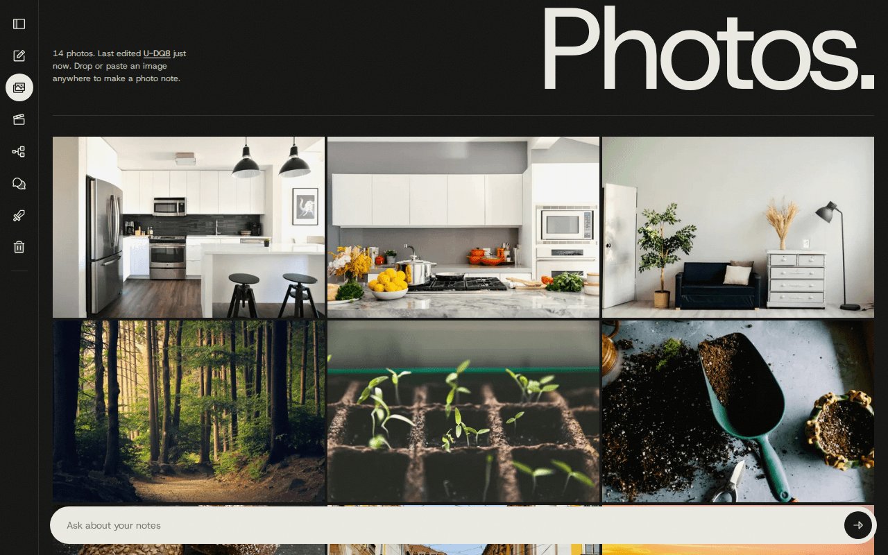
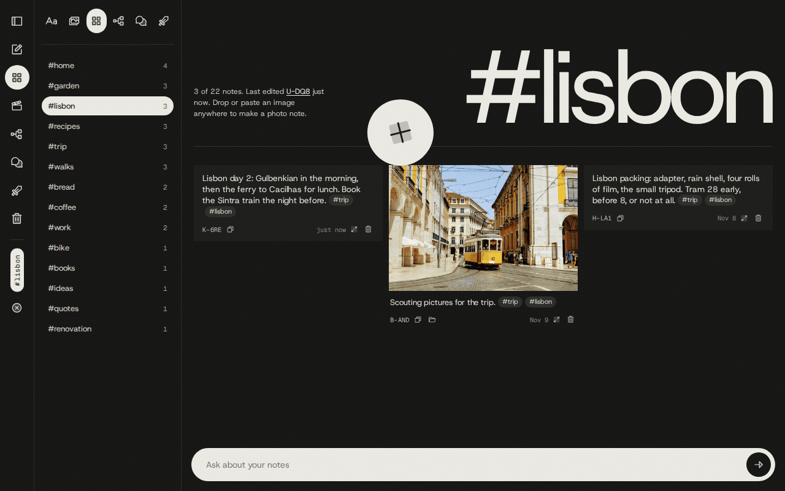
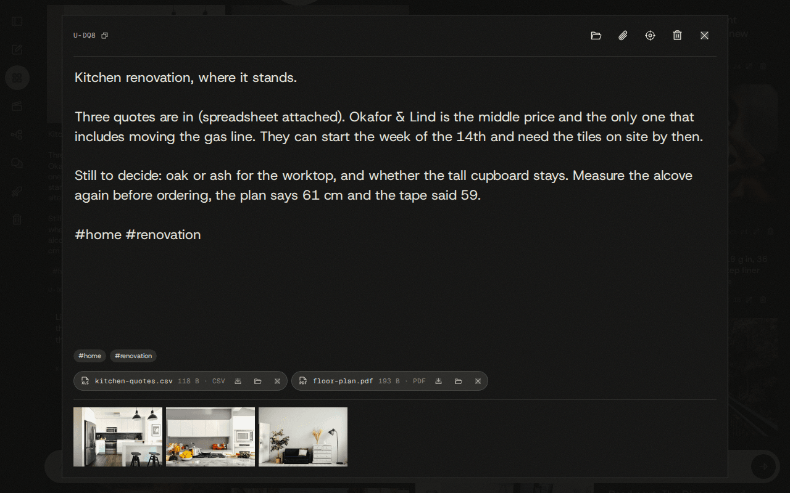
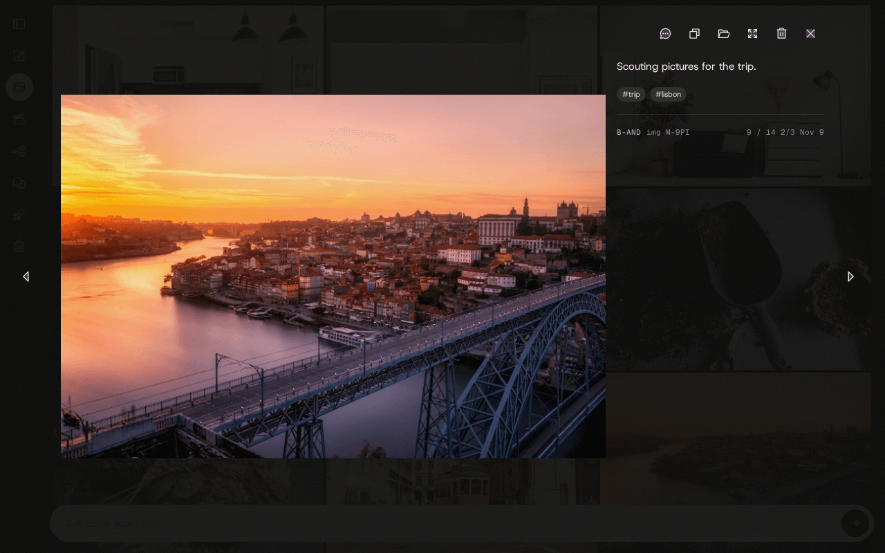
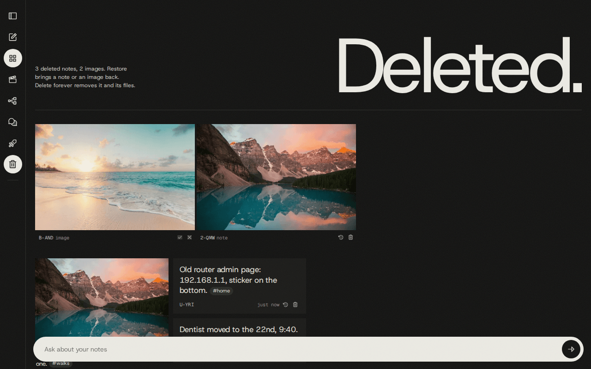
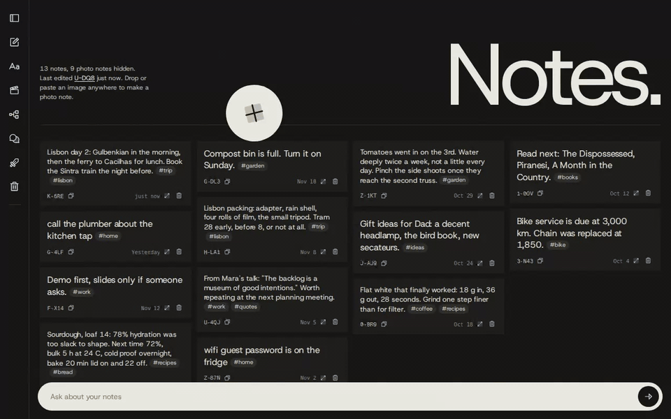

# The wall

The wall is the web app `notesd` serves at `http://localhost:7317/` (the port is `NOTESD_PORT`).
It shows every note as a card, lets you write and edit notes, takes photos and files by drop or
paste, and holds the recycle bin. It is for browsing, quick writing and dropping things in.
Finding things is Claude's job: see [claude-code.md](claude-code.md) and [chat.md](chat.md).


Other pages share the same shell (the rail on the left, the sidebar) and have their own guides:
[chat.md](chat.md) for the chat bar and chat history, [sessions.md](sessions.md) for `/projects`,
[movies.md](movies.md) for `/movies`, [adversary.md](adversary.md) for `/adversary`.

## Contents

- [The page](#the-page)
- [Three views: notes, photos, everything](#three-views-notes-photos-everything)
- [Tags](#tags)
- [Writing a note](#writing-a-note)
- [The big editor](#the-big-editor)
- [Adding photos](#adding-photos)
- [Looking at photos](#looking-at-photos)
- [Files on a note](#files-on-a-note)
- [Deleting and the recycle bin](#deleting-and-the-recycle-bin)
- [Open file location](#open-file-location)
- [Links to a note](#links-to-a-note)
- [Live updates](#live-updates)
- [Revisions](#revisions)
- [Two machines](#two-machines)
- [Keyboard and mouse shortcuts](#keyboard-and-mouse-shortcuts)
- [Quirks and limits](#quirks-and-limits)
- [Where the code is](#where-the-code-is)
- [Proving a change](#proving-a-change)

## The page

Every control is an icon button with a tooltip. There are no text buttons.

| Part | What it holds |
|---|---|
| Rail (left edge, always there) | Toggle sidebar, New note, the view button (cycles the three views), Movies, Projects, Chat history, Seer Adversarial, Recycle bin. Below a separator: one vertical chip per active tag filter and a Clear filters button. |
| Sidebar (opens beside the rail) | One button per view, Projects, Chat history, Seer Adversarial, then every tag with its note count. On the Projects and Seer Adversarial pages the tag list is replaced by that page's own list. |
| Header | A count line ("12 notes, 7 photo notes hidden."), "Last edited `A-B32` today" (the id is a link that scrolls to that card), a one-line hint, the giant heading, and the round "+" sticker. |
| Cards | The notes, last edited first. |
| Chat bar (bottom) | See [chat.md](chat.md). While an answer is open, the cards it used are outlined and the rest are dimmed. |

A press on a rail button that is already on returns to the wall. The bin button's tooltip reads
"Back to the wall" while the bin is open.

A card shows the note's text, then one line of small controls: the id, Copy ID, Show in Explorer
(only when it can work, see [Open file location](#open-file-location)), a paperclip with the number
of files when the note has any, the date the note was created, Expand note and Delete note.

## Three views: notes, photos, everything

The wall opens on text notes only. The rail's view button cycles the three views in this order,
and the sidebar has a button for each:

| View | Heading | Shows | Count line |
|---|---|---|---|
| Text notes only | `Notes.` | Notes without photos. A text note with files counts as a text note. | `12 notes, 7 photo notes hidden.` |
| Image notes only | `Photos.` | A contact-sheet gallery with one tile per photo, so a note with three photos gives three tiles. | `11 photos.` |
| All notes | `Everything.` | Text and photo notes mixed. | `19 notes, 7 with photos.` |

On the wall a photo note shows its first photo as the cover, with a small count in the corner
when it holds more than one. Its text is set small under the cover.



The view changes by itself when it would otherwise hide what you just did:

- New note from the Photos view switches to Notes.
- Dropping or pasting a photo while on Notes switches to Everything.
- Attaching a photo to a text note in the big editor while on Notes switches to Everything when
  the editor closes.
- Sending a chat question from Photos switches to Everything.
- A link to a note switches to Everything when the current view hides that note.

## Tags

Tags are parsed from the text on every save: `#seer`, `#v250`, `#from_phone`. A tag is `#` followed
by letters, digits, `_` or `-`, not directly after a word character (so `a#b` is not a tag), and it
is stored lower-case. To tag a note, write the hashtag into its text. To untag it, remove it.

- The sidebar lists every tag on a live note with its count, most used first.
- Clicking a tag in the sidebar, or a tag chip inside a card, turns that filter on or off.
- Several tags combine with AND: a note must carry all of them.
- With a filter on, the heading becomes the filter (`#trip #lisbon`) and the count line reads
  `4 of 19 notes.` The Photos view keeps its `Photos.` heading and counts the photos that match.
- Active tags stay on the collapsed rail as vertical chips. Click a chip to remove that tag, or
  Clear filters to remove all.
- Filters apply in all three views and in the recycle bin.



## Writing a note

The round "+" sticker in the header, or New note on the rail, creates a note with a server-made id
and opens it for typing at the top of the wall. The sticker is hidden in the Photos view.

- Click a card's text to edit it in place. The text is saved when the field loses focus.
- A note that is left with no text, no photos and no files is deleted when you leave it. The delete
  is soft: the note goes to the recycle bin.
- Text size follows length: under 36 characters reads like a sticky note, under 80 is medium, and
  anything longer is set as a paragraph.
- An edit moves the note to the top of the wall.
- Notes are plain text. There is no title and no markdown rendering.

## The big editor

Expand note on a card (the icon beside the trash), or Ctrl+click (Cmd+click on a Mac) on a card's
text, opens the same note in a large editor over the page. Its code name is "bigger-view-on-note"
(`NoteEditor.tsx`). Note links in chat answers and in a session's "Notes made" list open it too.



From top to bottom:

- **Top bar.** The note id with Copy ID, a quiet status line, then icons: Show in Explorer, Attach
  files (paperclip), Show on wall (crosshair), Delete note and Close. When some of the note's photos
  or files live on another machine, a badge says how many and where (`2 on GPD`).
- **Text.** A wide, tall text area in the wall's type.
- **Tag suggestions.** Typing `#` and a few letters offers up to six existing tags that start with
  them, most used first. Up and Down move, Enter or Tab accepts, Esc closes the list only.
- **Tag chips.** The tags currently in the text.
- **File chips.** See [Files on a note](#files-on-a-note).
- **Photo strip.** The note's photos that are on this machine, in the order they were added, each
  with Show in Explorer and Remove image. Click one to open the
  [image viewer](#the-image-viewer).

How it behaves:

- Text is saved when the text area loses focus and when the editor closes, and only if it changed.
  The card on the wall shows the change at once.
- Close with the X, Esc, or a click beside the panel.
- Emptying the text does not delete the note while the editor is open. On close, a note with no
  text, no photos and no files goes to the recycle bin, the same rule as on the wall.
- While the editor is open, anything you drop or paste is attached to this note instead of becoming
  a new note. Photos go to the strip and any other file becomes a chip. The drop overlay shows a
  paperclip instead of the picture icon to say so.
- A photo or file that already lives in a note is not attached twice. The status line says
  `already in K-F07`. A failed attach says `could not attach <name>`, with `(too large)` when
  the file is over the limit.
- Show on wall closes the editor, puts `/?note=<id>` in the address bar and scrolls the wall to the
  note's card, changing the view and dropping tag filters as needed. It is how you get from a note
  opened out of a chat answer to its place on the wall.
- Delete note saves the current text first, then deletes. When the note has photos or files on
  another machine it asks first (`A-B32 has 2 files on GPD. Delete it anyway?`), and so does the
  trash icon on that note's card.

For a long note, press "+", type the first line, then expand it and keep writing.

## Adding photos

Drop image files anywhere on the page, or paste a picture from the clipboard. The page shows a
dashed overlay while you drag.

- With no editor open, each dropped image becomes a new photo note. Files that are not images are
  ignored. A paste makes one note from the first image on the clipboard.
- With the big editor open, every dropped or pasted file is attached to the open note.
- A paste while the cursor is in the chat bar belongs to the chat: the picture goes with your next
  question and does not become a note.
- Each photo is stored once, matched by the sha256 of its bytes. Dropping a file that is already in
  a note returns that note (its card is outlined briefly) instead of making a copy, and brings the
  note back from the recycle bin if it was deleted.
- A note can hold several photos. They keep the order in which they were added. There is no drag to
  reorder.

Originals are never re-encoded or resized. The file under `~/mcp-notes-data/images/YYYY/MM/` is
exactly the file you dropped. The wall shows a 480 px thumbnail, and the modal and viewer show the
display file, which is the original itself for JPEG, PNG, GIF, WebP and AVIF. HEIC, HEIF and TIFF
are kept as they are, and a full-resolution JPEG is made beside them only for viewing. The accepted
image types are JPEG, PNG, GIF, WebP, AVIF, HEIC/HEIF and TIFF, up to 200 MB each.

Other ways in:

- **The inbox folder.** An image saved into `~/mcp-notes-data/inbox` becomes a photo note once its
  size has held still for two seconds, and the file is moved into the store. Only the top level of
  the folder is watched. Files that are not images stay where they are, dotfiles and unfinished
  downloads (`.crdownload`, `.part`, `.tmp` and the like) are left alone, and an image that fails
  to ingest is moved to `inbox/failed/`.
- **From Claude Code.** The [`create_image`](reference/mcp-tools.md#create_image) tool makes a
  photo note from a local path or a pasted picture, and
  [`attach_image`](reference/mcp-tools.md#attach_image) adds one to an existing note. See
  [claude-code.md](claude-code.md).

```
/n save this screenshot as a note about the login bug
/n attach ~/Pictures/Screenshots/login-bug-2.png to note A-B32
```

## Looking at photos

There are three places a photo opens large. Which one you get depends on where you clicked.

| Opened from | What opens | Steps through |
|---|---|---|
| A tile in the Photos view | The photo modal | Every photo in the current filter, wrapping around at the ends |
| A card's cover on the wall, a thumbnail in the editor's strip, an image id in a chat answer | The image viewer | That note's photos only, stopping at the first and last |
| Show full screen in the photo modal | The full-screen tab | One photo |

### The photo modal



The photo sits on the left. The column on the right has:

- Icons: Chat about this image, Copy ID, Show in Explorer, Show full screen, Delete image, Close.
- The note's text, shown without its hashtags. Click it (or press Enter on it) to edit the full
  text, hashtags included. It saves when the field loses focus. A note with no text shows
  "Add a description…".
- The tags as chips.
- The note id, `img <id>` when this photo's id differs from the note's, and the position:
  `4 / 12` in the whole filtered list, then `2/3` when the note holds several photos, then the
  date.

Previous and Next, or the Left and Right arrow keys, step one photo at a time through every photo
of a note and then on to the next note. Esc, the X or a click on the backdrop closes it.

Delete image removes that one photo from its note, not the note. The note stays, even when that
was its only photo, and the photo goes to the recycle bin with a six-second undo.

Chat about this image opens the chat history page with the photo attached to the message box. See
[chat.md](chat.md).

### The image viewer

A plain viewer over a dark backdrop: the photo, Previous and Next buttons that are disabled at the
ends, the position (`2 / 3`) and the original file name. Left and Right step, Esc or a click
beside the photo closes it. Opened from the editor's strip it also has Chat about this image and
Delete image, and closing it leaves the editor open.

### The full-screen tab

Show full screen opens `/full/<image id>` in a new tab, titled with the id. A note's first photo
shares the note's id, so `/full/<note id>` opens that note's first photo.

- The photo fits the window by default.
- Click to switch between fit and 1:1 device pixels. Drag to pan at 1:1.
- There is no film-tone filter here. The wall, the gallery, the modal and the viewer apply a light
  one, and this tab shows the pixels as they are. It is the place to check focus and grain.

## Files on a note

Any file can live on a note: a PDF, a spreadsheet, a zip. Files are added in the big editor only,
by drop, by paste, or with the paperclip, which opens a file picker that takes several files.
Image types the photo path does not accept (SVG, BMP) become files too.

Each file is a chip under the text:

- a type icon, the file name, its size and type (`4.2 MB · PDF`)
- Download
- Show in Explorer, when it can work
- Remove file

Files are stored byte for byte under `~/mcp-notes-data/files/<note id>/`, up to 200 MB each, and
the same bytes are stored once: attaching a file that already lives in a note is refused quietly
with `already in <id>`. Removing a chip is soft, with the usual six-second undo (`removed file`).
The bytes are deleted only when the note is deleted forever from the bin.

On the wall, a card shows a paperclip and the number of files. Claude sees the files on the note
too.

## Deleting and the recycle bin

Every card and the big editor have a trash icon. Deleting a note needs no confirmation (except for
[files on another machine](#two-machines)) and is soft. For six seconds a quiet line above the
right end of the chat bar says `deleted A-B32` with an undo icon beside it. Removing one photo
(`removed image`) or one file (`removed file`) works the same way. A newer undo replaces the one
showing.

The trash icon on the rail opens the recycle bin, headed `Deleted.`:

- at the top, a grid of deleted photos: the photos of deleted notes (marked `note`) and single
  photos removed from a note that is still on the wall (marked `image`);
- below, the deleted notes in the wall's style, most recently deleted first, with the date they
  were deleted.



Tag filters work in the bin. The sidebar's tags and counts keep counting live notes only.

Each entry has two icons:

- **Restore** puts a note back on the wall, or puts a removed photo back into its note at its old
  position. Restoring a photo of a deleted note brings the note back with it. In the grid, the
  tile of a deleted note acts on the whole note.
- **Delete forever** is the only destructive action in mcp-notes. It asks first, in place: the two
  icons turn into a check (delete forever) and a cross (cancel). Once confirmed it removes the
  database rows (the note with its photos, files, revisions and embedding, or the one photo), the
  original files and their derived copies in `cache/`.

If the same photo has since been added to another note, restoring it is refused and the tile says
`already in <id>`.

Nothing is purged on a timer. Delete forever exists only on the wall: its routes accept requests
from the wall's own page only (see [Quirks and limits](#quirks-and-limits)), and no MCP tool can
delete anything for good, so Claude can restore from the bin but never empty it.

## Open file location

The folder icon ("Show in Explorer") opens Windows Explorer on the stored file.

| Where | What it opens |
|---|---|
| A card, the editor's top bar | For a note with files, the note's files folder. For a note with only photos, its first photo, selected. |
| The photo modal, each photo in the editor's strip | That photo, selected. |
| A file chip | That file, selected. |

Gallery tiles have no folder icon. Open the photo and use the modal's.

The icon appears only when it can work: the file must be on this machine, and `notesd` must run
under WSL with Windows interop available (`GET /api/capabilities` answers `"reveal": true`).
`notesd` turns the stored path into a Windows path with `wslpath -w` and starts `explorer.exe`
without waiting for it. The routes take an id, never a path.

## Links to a note

`http://localhost:7317/?note=F-ZH5` opens the wall with that note scrolled into view and briefly
outlined. `#F-ZH5` works too, and the id may be lower-case or lack its dash (`?note=fzh5`).

The wall first makes the note visible:

- it leaves the recycle bin or any other page;
- it switches Notes or Photos to Everything when the view hides the note;
- it drops only the active tags the note does not carry;
- a big editor open on another note closes the usual way, saving its text. One open on the linked
  note stays open.

Other cases:

| Target | What happens |
|---|---|
| A note older than the 2,000 the wall loads | It is fetched on its own and shown. |
| A deleted note | The bin opens on its card, with the line `F-ZH5 is deleted. Restore it from the bin.` |
| An unknown id | `no note F-ZH5` in the top right corner. |
| A movie id (`?note=M-23T4`) | Opens that title on the Movies page. A movie id is never a note. |

The address is left as it is, so a reload selects the note again. Changing the hash, or moving
back and forward, selects the new target.

Claude writes every note id it mentions as a link of this form, and the `note-links` mod makes
ids clickable in the terminal: see [claude-code.md](claude-code.md). In the wall's own chat
answers a note id is a link that opens the big editor in place, without moving the wall, and an
image id opens the image viewer: see [chat.md](chat.md).

## Live updates

When anything writes a note (Claude over MCP, `/n`, the HTTP API, the inbox folder, another
browser tab), the wall shows it within about a second, with no reload.



The daemon sends a `note` event on `/api/events` (server-sent events) for every create, update,
delete, restore and purge. The page answers by fetching the notes and tags again, at most once
per 250 ms. The recycle bin does the same while it is open.

- A hidden tab does not refetch. It catches up once when it becomes visible.
- After a daemon restart the browser reconnects by itself and refetches what it missed.
- Events are per daemon. An edit made through the daemon on another machine does not raise an
  event here: see [Two machines](#two-machines).

## Revisions

Every update, append, revert and delete keeps the note's previous text as a revision. The wall has no revisions view. Ask Claude:

```
/n show me the revisions of A-B32
/n revert A-B32 to how it was yesterday
```

The tools are [`revisions`](reference/mcp-tools.md#revisions) and
[`revert`](reference/mcp-tools.md#revert). A revert keeps the text it replaces as a new revision,
so it can itself be undone.

## Two machines

Two machines can share the database. Text, tags and the record of every photo and file are
shared. The bytes of photos and files are not: they stay on the disk of the machine that took
them in, and every photo and file records that machine's host name.

On the machine that does not hold the bytes:

| Place | What you see |
|---|---|
| Wall card | The cover is the first photo that is on this machine. A note whose photos are all elsewhere looks like a text card. The paperclip count still includes files held elsewhere. |
| Photos view, the bin's photo grid, the editor's strip | Photos held elsewhere are left out. The `Photos.` count is this machine's own. |
| Big editor top bar | A badge: `2 on GPD` (photos and files together). |
| File chip | Dimmed, `on GPD` after the size and type, no Download and no Show in Explorer. |
| Full-screen tab | A placeholder: `not on this machine` and the host name. |
| Image viewer, when a photo fails to load | A placeholder: `uploaded on GPD`. |
| Image id clicked in a chat answer | `image 5-RI4 is not on this machine`. |
| Deleting the note | Asks first: `A-B32 has 2 files on GPD. Delete it anyway?` |

The API says the same thing: a photo or file made elsewhere has `available: false` in the note's
JSON, and its bytes answer `404` with `{"error":"not_on_this_machine","host":"…"}`.

Edits made on the other machine arrive by polling, not by events. While the tab is visible the
wall refetches every 5 minutes, and when you switch back to the tab it refetches at once if its
last load is more than 60 seconds old.

## Keyboard and mouse shortcuts

| Keys | Where | What it does |
|---|---|---|
| Alt+B | Everywhere except focus mode | Open or close the sidebar, like the rail's top icon |
| Ctrl+click, Cmd+click | A card's text | Open the big editor instead of editing in place |
| Esc | Big editor | Close the tag suggestions if they are open, else save and close the editor |
| Up, Down, Enter, Tab | Big editor, tag suggestions open | Move in the list, accept the tag |
| Left, Right | Photo modal | Previous and next photo, wrapping around |
| Enter | Photo modal, on the note text | Start editing the text |
| Esc | Photo modal | Leave the text field (saving it) if you are editing, else close the modal |
| Left, Right | Image viewer | Previous and next photo of the note, stopping at the ends |
| Esc | Image viewer | Close the viewer only. The editor under it stays open |
| Enter, Esc | A delete question | Confirm, cancel |
| Esc | Wall, with a chat answer open and not pinned | Close the answer |
| Click, drag | Full-screen tab | Switch between fit and 1:1, pan |

Esc always closes the topmost thing only: the viewer before the editor, the editor before the chat
answer.

Alt chords are Alt plus one letter, chosen so that none is a browser's own (Chrome and Firefox
keep Alt+F, E, D, H and S, and Alt+1 to 9 switch tabs on Linux). The wall cancels its chord before
the browser sees it, so it works with the cursor in a text field. Ctrl, Shift or Meta with the
same letter is not the chord, and neither is a held-down key repeating. Alt+Z (focus mode) and
Alt+C belong to the Projects and Seer Adversarial pages: see [sessions.md](sessions.md) and
[adversary.md](adversary.md).

## Quirks and limits

- **Photos and files are local to one machine.** They are never synced. Back up
  `~/mcp-notes-data/images` and `~/mcp-notes-data/files` yourself.
- **Full size costs disk.** A phone's 4 MB HEIC stays 4 MB, plus a full-resolution JPEG made for
  viewing.
- **HEIC colour.** The JPEG made from a HEIC has no Display-P3 conversion, so wide-gamut photos can
  look a little flat in the browser. The original is untouched.
- **Delete forever is final.** It removes rows and files with no undo. Everything else waits in
  the bin until you restore it or delete it forever.
- **The bin and Explorer routes are same-origin only.** `DELETE /api/bin/notes/:id`,
  `DELETE /api/bin/images/:imageId` and the three `…/reveal` routes need a loopback host and an
  `Origin` header equal to the daemon's own origin. Anything else gets `403`
  `{"error":"forbidden_origin"}`, so another site open in the browser cannot purge or open files,
  and a bare `curl` cannot either.
- **Open file location is for Windows under WSL.** Anywhere else the folder icon is not shown.
- **The wall loads 2,000 notes.** Older ones are reachable by link, by Claude and by the chat bar,
  and are fetched one at a time when opened.
- **Dropping a non-image on the wall does nothing.** Files are attached in the big editor only.
- **A paste outside the editor takes one image.** Open the editor to paste several.
- **Removing a note's last photo leaves the note.** A photo note with no text then shows as an
  empty text card until you write in it or delete it.
- **Tag syntax is loose.** Any `#word` becomes a tag, including `#123`.
- **No photo editing.** No reorder, crop or rotate. Finding photos is covered in
  [search.md](search.md).
- **Desktop first.** There is no phone layout. Bring phone photos in through the inbox folder.
- **Text needs the database.** Notes live in Postgres (Neon). With no connection, the wall is
  empty.
- **Single user, no login.** The daemon binds to `127.0.0.1`.

## Where the code is

| Path | What it holds |
|---|---|
| `web/src/App.tsx` | All wall state: view, tag filters, inline edit, the big editor, undo, links to a note, the empty-note rule |
| `web/src/components/Rail.tsx`, `Sidebar.tsx`, `Header.tsx` | The shell: rail buttons, view buttons and tag list, count line and heading |
| `web/src/components/Wall.tsx`, `NoteCard.tsx` | The cards and the inline editor |
| `web/src/components/NoteEditor.tsx` | The big editor ("bigger-view-on-note"): tag suggestions, strip, top bar |
| `web/src/components/FileChips.tsx`, `web/src/lib/files.ts` | File chips; which dropped file takes the image path or the file path; size and type labels |
| `web/src/components/DropOverlay.tsx` | Drop and paste, new note or attach to the open note |
| `web/src/components/Gallery.tsx`, `PhotoModal.tsx` | The Photos view and its modal |
| `web/src/components/Lightbox.tsx` | The image viewer (cards, editor strip, chat) |
| `web/src/components/NoteImage.tsx` | One image with the film tone, and the "not on this machine" placeholder |
| `web/src/fullscreen/`, `web/fullscreen.html` | The full-screen tab (`/full/:imageId`), a separate small page |
| `web/src/components/Bin.tsx`, `web/src/hooks/useBin.ts` | The recycle bin |
| `web/src/components/RevealButton.tsx`, `NoteRevealButton.tsx` | The Show in Explorer icons |
| `web/src/hooks/useNotes.ts`, `web/src/lib/events.ts` | The notes store: SSE subscription, debounced refetch, the poll |
| `web/src/hooks/useDeepLink.ts`, `web/src/lib/deepLink.ts`, `reveal.ts`, `flash.ts` | `?note=` and `#id` links, making a note visible, the outline flash |
| `web/src/lib/filter.ts`, `text.ts` | Views, tag matching, headings and count lines; tag parsing and text size |
| `web/src/hooks/useUndo.ts`, `useAltShortcut.ts` | The six-second undo; Alt chords |
| `src/notes/service.ts` | The only writer of notes: revisions, soft delete, restore, purge, events |
| `src/notes/tags.ts`, `ids.ts`, `binRepo.ts`, `events.ts` | Tag parsing, ids, bin queries, the event bus |
| `src/images/` | Ingest and dedupe (`ingest.ts`), derived copies (`derive.ts`), type sniffing (`probe.ts`), the inbox watcher (`inbox.ts`), paths (`store.ts`) |
| `src/files/` | File ingest, safe names, paths |
| `src/http/api.ts` | Notes, bin, tags and `/api/events` routes |
| `src/http/images.ts`, `files.ts`, `reveal.ts`, `sameOrigin.ts` | Photo, file and Explorer routes; the same-origin guard |

Routes are listed in [reference/http-api.md](reference/http-api.md), tools in
[reference/mcp-tools.md](reference/mcp-tools.md) and settings (`NOTESD_PORT`, `NOTES_DATA_DIR`,
`NOTESD_EXPLORER_BIN`) in [reference/configuration.md](reference/configuration.md). Where the
bytes and rows live is in [architecture.md](architecture.md).

## Proving a change

Use the `verify-notesd` skill (`.claude/skills/verify-notesd`). Start with `verify.sh up --web`
for any change under `web/`, or the instance serves the last built bundle.

| Feature map file | Proves |
|---|---|
| `features/wall.md` | The grid, `?note=` links, live updates, the big editor, the sidebar |
| `features/notes.md` | Create, update, append, revisions, revert, soft delete and restore |
| `features/images-files.md` | Upload, byte-for-byte originals, dedupe, HEIC, the inbox, `/full/:imageId`, files |
| `features/recycle-bin.md` | The bin list, restore, delete forever, the same-origin rule |

Things the harness cannot do: it never drives the `…/reveal` routes (they open the real Windows
Explorer), and it cannot produce a photo "from another machine". For `available: false`, insert a
row with a different host in a test. The unit tests beside each component
(`web/src/**/*.test.tsx`) cover those cases.

The pictures in this guide are retaken with `npm run docs:shots -- wall`
(`scripts/docs/shots/wall.mjs`).
